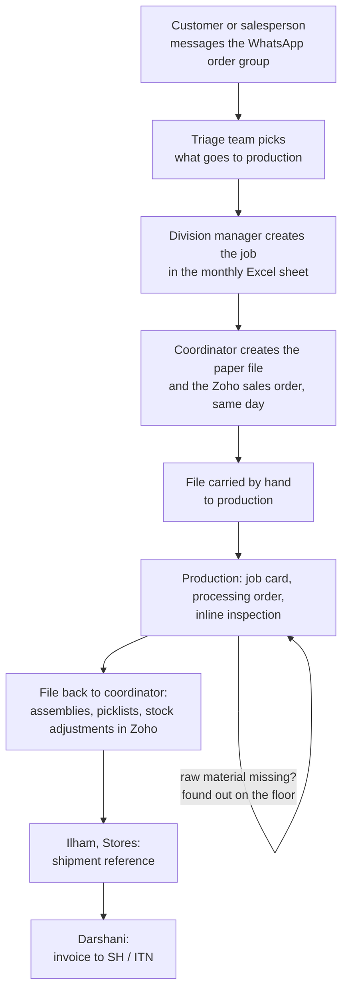
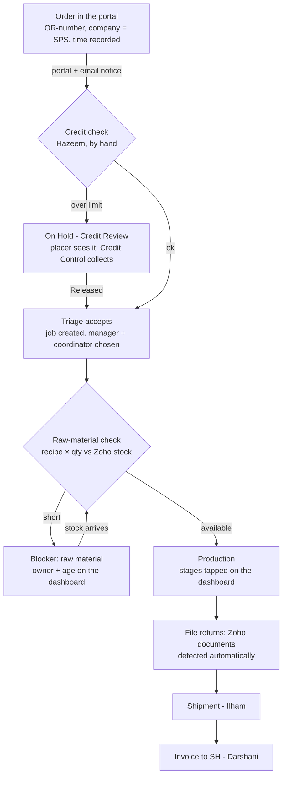
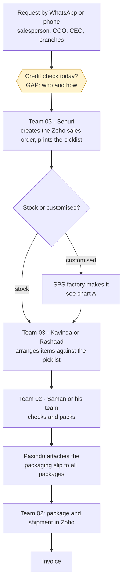
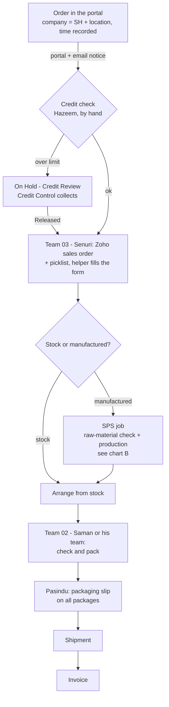
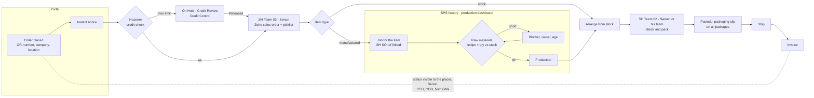

# CLAUDE.md — Production tracking dashboard

Smart Packaging Solutions (Pvt) Ltd, a manufacturing entity under Standard Holdings (Pvt) Ltd, Sri Lanka.

**Single developer.** Every design decision must survive one person building and maintaining it.

> **Read §17 first if you are new here.** It is the full order-to-shipment concept as of 19 Sep 2026: both companies, the order portal, the credit check, the raw-material check from recipes (BOMs), and five flowcharts. It stands on its own. §1–16 are the verified background it builds on. The approved build spec is `/root/Project Management/wiki/specs/2026-09-17-production-dashboard-design.md` (Rev 7.3).

---

## 1. What this replaces

Two things, both failing:

- **Zoho's centralised dashboard** — shows everything to everyone, so nobody uses it.
- **A monthly Excel job sheet** — six division registers plus one tab per working day, maintained by hand, re-keyed from data that already exists in Zoho.

And a paper file that physically travels between desks, where "where is the file" is currently the only way to answer "what stage is this job at".

The project sponsor is the order managing / analyst desk — the people who today reconstruct reports by hand from six sheets. They requested the change. That matters: they are the consumer of the output, so there is no acceptance battle to win.

---

## 2. Hard rules

1. **Zoho is never written to.** Read-only. Write-back is a later project, approved per process by managers.
2. **Read-only does not mean don't store.** Zoho data is mirrored locally — the API budget makes live calls impossible.
3. Mirror tables (`zoho_*`) and owned tables are **separate**. Never mix a Zoho field and an owned field in the same row.
4. Sync overwrites mirror tables freely, never touches core tables.
5. No field entered twice. If Zoho has it, read it.
6. **Every stage change records who and when, derived from the action, never typed.**
7. **Stages are configuration, not code.** One codebase, N divisions.
8. **Job numbers are opaque strings.** Never parse them.
9. **No individual staff productivity in GM or COO reports.** Aggregate to process and division. Once floor staff believe numbers judge them, the numbers stop being reliable and everything built on them fails.
10. **Job/SO selection is mandatory and first.** No unlinked output rows, ever.

---

## 3. Stack

- Node.js + Express + SQLite
- Contabo VPS, alongside the existing SH-IT Hub / IT-Conduit platform
- Server-rendered. Tabler (Bootstrap, MIT) to stay vanilla; React + Vite + shadcn/ui only if a separate frontend build is accepted
- Live updates via SSE, not WebSockets

---

## 4. Zoho constraints

**Two organisations, both accessible:** SmartPack (SPS) and Standard Holdings (SH). Quotas are per organisation, so ~2,000 calls/day total. Mirror tables need an `org` column from day one — do not retrofit.

Per org: **1,000 API calls/day**, **10,000 webhooks/month**, **100 requests/minute hard cap** that no plan removes. Books / Inventory / CRM have separate quotas, no shared pool.

Budget per org (~415 calls/day):

| Use | Calls/day |
|---|---|
| OAuth token refresh | 24 |
| Delta poll, 8 modules × 4/hr × 10hr | ~320 |
| Nightly stock reconcile | ~20 |
| Manual refresh (rate-limited) | ~50 |

- Webhooks must carry a **full custom payload** so an event costs 0 API calls.
- **Never webhook on item or stock-adjustment events.** Every invoice and packing action touches stock; this alone exhausts the webhook quota in days. Stock comes from the nightly reconcile.
- **Backfill via CSV export from the Zoho UI, never the API.** 3.5 years of history exports at zero API cost.

**Build SmartPack first and complete. Add SH as a second mirror afterwards.** Dual-org roughly doubles phase 1 sync work; one developer ships months earlier by sequencing it.

What the SH org unlocks: visibility of `SH Sales Order Ref` (a blocker on the critical path that SmartPack staff currently cannot see), delivery status (removing Mubeena's daily walk to the delivery department), and checklist stages 10–11 which are inherently cross-org.

---

## 5. The workflow, as verified

### 5.1 Customised orders

```
WhatsApp group (one group, all productions)
  -> triage team selects what goes to production
  -> division manager creates the job in the sheet
  -> coordinator creates the project file + Zoho sales order (same day)
  -> file physically handed to production
  -> production: job card / processing order / inline inspection
  -> file returns to coordinator, who fills assemblies, picklists, inventory adjustments
  -> Ilham (Stores) fills the shipment reference
  -> Darshani fills the invoice in ITN
```

The job is born **in the sheet, before the sales order exists**. The SO is the spine for analysis, not for intake. `jobs` must be creatable with a null SO plus a linking step and an unlinked flag.

### 5.2 Ex-stock orders

Paper Straw and Rewinding originate **inside Ishan's own area**, not from Mubeena's desk. They are often **produced before or as the file is created** — processed date equals or precedes the order date, processed qty equals SO qty exactly. `Order Type: Ex Stock`, `Order Received from: Standard Holdings`, artwork and plate "Not Applicable".

**Ex-stock needs a different stage sequence and different lead-time expectations.** Never average the two types together. The field already exists in Zoho, so this costs nothing.

### 5.3 People

| Creator | Division | Manager | Receiving coordinator |
|---|---|---|---|
| Nimesha | Offset (OPD) | Ranga **or** Ishan | Nirmani **or** Umanda |
| Nimesha | MOBA | Ranga | Nirmani |
| Nimesha | MOBA Punching | Ranga | Nirmani |
| Nimesha | Packpro | Ishan | Umanda |
| Nirmani | FPP | Ranga | Nirmani |
| Madushi | Screen Printing (SHPS) | Mubeena | Madushi |
| Umanda | Rewinding (RWU) | Ishan | Umanda |
| Umanda | Paper Straw (PSU) | Ishan | Umanda |

Nimesha and Madushi are Mubeena's coordinators. Then universally: coordinator → **Ilham** (Stores, shipment) → **Darshani** (invoice, ITN).

Key consequences:

- **Offset routing is a runtime decision**, chosen per job. Manager and coordinator belong on the **job**, not on the division. `divisions` holds eligible managers, not one owner.
- **Manager and coordinator travel as a pair** (Ranga+Nirmani, Ishan+Umanda). One choice in the UI, not two dropdowns.
- **Three of four coordinators both create and receive.** `can_create_files` and `can_receive_files` are independent per-user flags.
- **Ishan covers four divisions.** The model is **one dashboard per manager showing jobs assigned to them across divisions**, not one dashboard per division. This is what scales to twelve divisions.
- Divisions where the creator is also the receiver (SHPS, RWU, PSU) produce **no handover event** and therefore weaker timestamps. SHPS was the planned pilot — note this weakens its timestamp data.
- **Ilham and Darshani are not production staff** but own checklist stages 8–11. They need their own "waiting on me" views. Their input is one reference number each.

### 5.4 Fixed policy

**14 days** from order to delivery. Zoho corroborates: expected-ship minus order-date across 6,111 lines shows 25th percentile exactly 14, median 16. Mubeena states it is never met at high volume. Volume is ~6 orders/day each for Offset and Screen Printing, ~250–260 orders/month, which matches the export.

**Unresolved:** 14 days from WhatsApp message, SO creation, or project link? If the customer counts from their message and the company counts from the SO, jobs are late before production starts.

---

## 6. The stage model

The **File Checklist** already exists on paper, in use, agreed by the business. Shared catalog, per-division subset and order.

| # | Stage | Source |
|---|---|---|
| 1 | Artwork image | manual |
| 2 | Item photo (in system) | manual |
| 3 | Job card | manual |
| 4 | Sales order | Zoho |
| 5 | Bundle | Zoho |
| 6 | Pick list | Zoho |
| 7 | Package | Zoho |
| 8 | Shipment | Zoho |
| 9 | Inventory adjustment | Zoho |
| 10 | Sales invoice to SH | Zoho (cross-org) |
| 11 | Purchase bill from SPS | Zoho (cross-org) |

Verified variants:

| Division | Items | Omits |
|---|---|---|
| OPD | 11 | — |
| SHPS | 11 | — (Bundle / Pick list order swapped vs OPD) |
| PSU | 10 | Pick list |
| RWU | 9 | Artwork image, Pick list |

**Seven stages are Zoho documents the sync can detect automatically.** Only four need a human tap. Plus internal stages the checklist does not cover: processing order to division, inline inspection, QC approval, ITN. Net manual burden is roughly four taps per job.

```
stage_catalog:    11 shared rows
division_stages:  division_code, stage_id, sort_order
```

---

## 7. Documents in the file

| Document | Division | Holds |
|---|---|---|
| Sales order (Zoho printout) | all | SO no, dates, Ref#, customer, base material, SH SO ref, job no, order type, division, ClickUp link, job nature, three readiness gates |
| File Checklist | all | the 11-stage tracker |
| Job Document Reference Sheet | all | assemblies, picklists, shipments, inventory adjustments, ITN — each with reference no, date, generated by, line manager approval |
| Division cover sheet | all | job no, item, SKU, order qty, delivery date, job work order no, dispatch references |
| Job Card – Process Planning | OPD | pre-press arrangements, machine + labour process rows with **Standard Minutes, Taken Date, Operator, Start/End Time, Actual Hours** |
| Job Card (materials) | OPD | material consumption, conversion, ink usage, impressions |
| Processing Order | SHPS | required components + quantities, item produced, **duration (hours)**, impressions, processed by, printer |
| Time Claiming Bill (green carbon book) | PSU | date, finished product, **no of minutes**, division, employee name, no of staff, impressions |
| **Internal Job Card** | RWU | **interval-level shift timeline**: time ranges, minutes per interval, process description, qty per interval, breaks separated, total work vs personal minutes, team leader signature |
| Inline Inspection Checklist | all | QMS controlled. Batch order no, processed date, processed by, processed qty, QC details, total qty, dispatch date, production line manager approval, QC approval |
| QC Visual Verification Checklist | customised only | QMS controlled, doc no, revision, 10 checkpoints, designer + QC approver signatures |
| Artwork proof | customised only | customer, item, date, print colour |
| **QR code page** | SHPS (at least) | "SCAN FOR JOB DETAILS", job number printed beneath |

**The reference sheet carries a printed note that all listed documents exist in the electronic system and printouts are for audit only.** The dashboard enforces existing policy rather than introducing new policy. Useful line for the GM.

**The reference sheet is filled by three people at three times:** the coordinator fills assemblies, picklists and inventory adjustments on file return; Ilham fills shipments; Darshani fills ITN. It is a baton, not one person's task. It is also filled **retrospectively, from the production report**, which is why no real event timestamps exist today.

**RWU's Internal Job Card is the best labour record found** — interval level, breaks separated, signed. If one paper form is ever digitised, copy this one. Sample: Nilaka, 16 Sep, 540 min total (480 work, 60 personal), 102 rolls ≈ 4.7 min/roll, with a **declining rate across the day** (50 rolls / 240 min, then 29 / 120, then 23 / 120).

---

## 8. Verified data facts

### 8.1 Sales order export (10,442 lines, 8,305 orders, Mar 2023 – Sep 2026)

- **Join on `SalesOrder Number`** (86% match to the job sheet), **not `CF.Job No`** (65%). Screen Printing writes `JN-xxxx` on its sheet while Zoho holds `SHP…` — zero overlap.
- **Grain is order line, not order.** 1.26 lines per SO.
- **`Customer Name` is unusable** — 10,440 of 10,442 rows read "Standard Holdings (Pvt) Ltd", because SmartPack sells into the parent. Real customer is **`CF.Order Received from`** (631 distinct).
- **12 manufacturing divisions**, not 6: OPD 5,284 lines, SHPS 2,471, Paper Cup 859, Paper Straw 758, Rewinding 559, MOBA 168, Customized Packing 163, plus five smaller units. **Packpro does not appear in the export under that name** — get its Zoho value.
- Custom fields at 95–100% fill: `CF.Job No`, `CF.Manufacturing Division`, `CF.Order Received from`, `CF.Order Type`, `CF.Job Nature`, `CF.Base Material to be Used`, `CF.SH Sales Order Ref`.
- **Readiness gates exist twice** — an abandoned checkbox version (~6% true) and a live text version with typos in the field names (`Availablility`, `Not Avaialble`). **Read the text versions.**
- **`Order Type` values:** Customized Order, Ex Stock.
- **`Job Nature`:** Reorder / new. **Reorders skip artwork and platemaking**, so their real lead time is shorter. Never average with new orders.
- **Zoho cannot give production stage.** `Status` has only invoiced / partially_invoiced / confirmed. `Custom Status` is 0% filled. Own stage tables are required.
- `QuantityOrdered / Invoiced / Packed / Cancelled` populated at line level; partial completion partly derivable.
- **2023 data is junk** (5 rows, order numbers disagree with dates). Backfill from **2024**; trend analysis from **2025**.
- Volume by year: 2024 → 2,584 lines, 2025 → 4,547, 2026 to Sep → 3,306.
- **Offset Printing was the only division on Zoho at the start.** Any cross-division trend needs a start date after all divisions were live.
- `PurchaseOrder` standard field is misused to hold the job number.
- `CF.Clickup Link` on 13% of lines. ClickUp is a third system — status unknown.
- Job number formats vary wildly: `CPU-155`, `OPD6700`, `PSU/BTN/989`, `RWU/IMP2357/QPP/00025/BIO`.
- Order value 2024+: LKR 810M intake (order intake, not delivered revenue — finance figures will not match).

### 8.2 September 2026 job sheet

- 470 job orders across 6 registers; 2,006 daily task rows over 17 days; 42 staff; 35 processes.
- **67 jobs past delivery date and not marked done.**
- **31% of Screen Printing jobs blocked on "R/M Not available"** (18 of 59).
- **65 jobs (14%) with no Zoho SO link.**
- "Achieved for the Day" filled on 16% of rows; "Reason for not achieving target" on **under 1%**.
- Job Order # on only 62% of floor rows; Department on 22%.
- **Overproduction, all three cases in FPP**: FPP-011 ordered 9,500, produced 17,200 (81% over); FPP-037 30% over; FPP-012 5% over. FPP files are created by Nirmani.
- Status vocabulary uncontrolled: DONE, PENDING, HOLD, blank, "Cancle item", "SH has stock - Hold Packing", "100 Cancel (done)". 47 blanks in one register.
- Customer names unnormalised: "SH Stock" vs "SH STOCK".
- Daily checkpoints: 10:00, 12:20, 15:00, 16:30, 18:30.

### 8.3 Corrections to make before publishing anything

- **Recompute the 29% dye-cutter figure filtered to `Order Type = Customized Order`.** Ex-stock jobs are marked "Not Available" where "Not Applicable" is meant, so the current number measures two different things. This is the kind of error that gets a report dismissed.
- Request "Not Applicable" as a real option on the gate fields, plus guidance on when to use it.
- Confirm whether the near-identical straw item codes ("packed", "imported", "SPS") are one product or three. If one, the volume ranking is wrong.
- Verify the 67-overdue figure with managers. Some may be delivered and never updated. Frame as "either a delivery problem or a record-keeping problem, and we need to know which".

---

## 9. Data model

Mirror: `zoho_sales_orders`, `zoho_items`, `zoho_stock`, `zoho_customers` — each with `org` (SPS / SH), `zoho_id`, `sync_state`, `last_synced_at`.

Core:

- `divisions` — code, name, eligible managers, active
- `users` — name, role, `can_create_files`, `can_receive_files`
- `stage_catalog` — 11 shared stages, each flagged Zoho-detected or manual
- `division_stages` — division_code, stage_id, sort_order
- `jobs` — job_no (opaque string), division, `zoho_so_number` (nullable, flagged when null), `sh_so_ref` (nullable), order_type, job_nature, customer (from `CF.Order Received from`), product, ordered_qty, delivery_date, assigned_manager_id, assigned_coordinator_id, current_stage
- `job_stage_events` — **append only**. job_no, from_stage, to_stage, user_id, timestamp, note. All dwell-time and bottleneck analysis comes from here. Never update or delete.
- `handovers` — job_no, from_user, to_user, division, sent_at, received_at. Gives file location for free: whoever last received it has it.
- `output_entries` — job_no, date, checkpoint, process, staff_id, quantity, entered_by, entered_at. **A job can be produced in multiple runs across several days by different operators** (PSU job: 7,724 on 11 Sep + 7,816 on 16 Sep = 15,540), so processed date is a range, not a date.
- `blockers` — job_no, reason_code, opened_at/by, closed_at/by. Days blocked is derived.
- `reason_codes` — fixed list: raw material not available, dye cutter not available, artwork not available, waiting on SH sales order, machine down, staff absent, rework, customer hold, other. Only "other" takes free text.
- `staff`, `outbox` (write-back queue, built now, state `held`, never dispatched)

---

## 10. Manager dashboard

One dashboard per manager, showing jobs assigned to them across whichever divisions.

| Section | Contents |
|---|---|
| Blocked | Reason, days waiting, who owns the unblock |
| At risk | Delivery date vs remaining quantity |
| In production | Produced against ordered, operator, minutes |
| Incoming | Assigned but not yet physically received — with a Receive button |
| Ready to hand off | Complete, awaiting return to coordinator |

Card fields: job no, SO no, customer, item, ordered vs produced, division, current stage, days in stage, delivery date, blocker reason and age.

**Manager inputs, total:** advance a stage, record output, open/close a blocker, confirm a handover. Everything else derived or read from Zoho.

### What the dashboard adds that exists nowhere today

Where the file physically is; days blocked; incoming work before it arrives; ordered vs produced live; a cross-division view for managers running several; the SH-side blocker; short-delivery and overproduction flags.

### UX rules

- Two-click update: tap stage or preset quantity, then confirm
- **Carry forward** yesterday's open jobs and staff assignments — confirm, never re-type
- Quantity as **preset chips** (last three values used on that job), keypad as fallback
- Reason codes shown **only on a miss**, as buttons
- Entry must happen on a device the manager carries. If they must walk to an office PC for a 12:20 checkpoint, they will batch to end of day and nothing improves.

---

## 11. Reports

| Report | Audience | Cadence | Shape |
|---|---|---|---|
| Daily work list | Production GM | 7am | A work list, not a summary. Blocked jobs, at-risk deliveries, yesterday's output. |
| Weekly trend | COO | Monday | On-time %, avg days blocked, throughput, overproduction cost. **Do not ship before 4 weeks of data.** |
| Full export | Order managing / analyst | On demand | Per-job, per-staff, per-process, timestamped. |

Design backwards from decisions: ask the GM and COO separately what they would do differently with each metric. If it changes no decision, it stays off the report.

---

## 12. The question this system exists to answer

**Mubeena states the bottleneck is inability to produce for demand.** The evidence so far contradicts that:

- SHPS pizza box job: order 3 Aug, to production 11 Aug, **produced in 7 hours** (850 impressions, one operator), expected ship 17 Aug, ITN 13 Sep, shipment ~9 Dec.
- Production was hours inside a roughly four-month cycle.
- OPD job: 8 days from order to production start.
- 29% of lines report dye cutter unavailable; 31% of SHPS jobs blocked on raw material.

**So the constraint may be readiness and post-production handling, not machine capacity.** One file proves nothing, but this is the explicit purpose of phase 1: determine whether the constraint is capacity or readiness before anyone spends money on the wrong one.

| Issue | What must be captured |
|---|---|
| Post-production delay | Timestamps on every handover; whether Ilham/Darshani record on the event or weeks later |
| Readiness vs capacity | Blocker open/close with reason codes; corrected gate figures |
| Front-end latency | WhatsApp receipt, file creation, handover to production |
| Short delivery | Ordered vs produced vs dispatched; who accepted the shortfall (SHPS job: 1,000 ordered, 850 delivered, recorded in red pen only, invisible in Zoho) |
| Overproduction | Same three quantities; ask Nirmani whether FPP overruns are machine behaviour or deliberate stock building |
| Labour time | Minutes and output per job, enough cards to build real standard minutes |
| Cross-org blocking | Count and age of jobs at "SH Sales Order Ref: To be Received" |
| Overdue | Derivable once jobs are in the system |

---

## 13. Delivery phases

1. **Read-only Zoho views** (SmartPack only). No data entry asked of anyone. Builds the habit before asking for anything. Add SH delivery status once the second mirror lands — it removes Mubeena's daily walk.
2. **Digitise the File Checklist** — eleven checkboxes per job, identical across divisions, already ticked by hand today. Replaces a form rather than adding a screen, and produces timestamps from first use.
3. **Pilot one division** — Screen Printing (highest pain, only 59 jobs). IT keys in the data for two weeks so no manager carries dual entry and every edge case surfaces.
4. **Replace the handoff report** the analyst desk currently rebuilds by hand.
5. **Hand entry to the manager** for that division.
6. **Roll out remaining managers**, one at a time.
7. **Write-back**, per process, if approved, using the outbox record as evidence of what would have been written.

**The Excel sheet dies when the analyst desk stops asking for it, not when managers stop liking it.** Phase 1 must remove work, not only add a screen.

---

## 14. Divergence

During read-only, Zoho status is updated manually while our stage tracking runs independently. They will drift. Maintain a divergence list — jobs where Zoho and our stage disagree. It is both an operational check and the evidence base for approving write-back.

---

## 15. Still open

1. **Who built the QR code page, and what does it link to?** If a job-number QR scheme already exists, two-tap entry becomes a scan. Highest-value unknown.
2. **Does Ilham write the shipment reference when goods leave, or when he does the paperwork?** If the latter, every historical date is a recording date, all backfilled dwell-time analysis is unreliable, and only live capture from now on is trustworthy. This decides whether backfill is worth doing at all.
3. 14 days measured from what point?
4. What decides Ranga vs Ishan on an Offset job — rule or judgement?
5. Are ex-stock jobs always produced before the file is created?
6. Who fills the Time Claiming Bill, and is it PSU-only?
7. Does OPD produce a processing order, or is that SHPS-only?
8. Packpro's Zoho division value.
9. Coverage for Paper Cup, Paper Cup Lid, Paper Plate, Cake Wrapper and the remaining small units — few hundred lines each, can be added as configuration later.
10. What do the parts of `RWU/IMP2357/QPP/00025/BIO` encode? If operationally meaningful, give them a column.
11. Agreed fixed status vocabulary across all divisions.
12. Which of the five daily checkpoints are still real.
13. Who is in the WhatsApp group — customers directly or sales relaying — and what happens to orders the triage team does not select.
14. Is MOBA / MOBA Punching genuinely two divisions, or one recorded two ways? Zoho lists them separately; same manager and coordinator.

---

## 16. Notes on approach

- The QC Visual Verification and Inline Inspection checklists are **controlled QMS documents** with doc numbers, revisions and signatures. If digitised, they inherit audit requirements: retained approver identity, timestamp, no silent edits. Do not fold them into a generic stage tick.
- Four different labour-record formats exist across four divisions. **Do not try to unify them in phase 1.**
- Report Section 8.2 findings as a **system failure, not a people failure**. The unfilled "reason for not achieving target" column is not laziness — it is a column nobody has time for at 6:30pm. The four managers have to cooperate with this project.
- WhatsApp Business API integration is a separate project with its own cost and approval. **Do not scope it into phase 1.** A simple intake form logged when the message arrives gives the true start timestamp without touching WhatsApp at all.
- The dashboard does not fix the post-production delay; it makes it visible. Expect jobs to sit visibly in "packed" for months and be ready for that conversation.

---

## 17. The order-to-shipment concept (19 Sep 2026)

This section is self-contained, so you can hand it to someone new, including another AI. Where it says *(assumed)*, the sources don't say it. Where it says **gap**, the user has to answer.

### 17.1 The business in one paragraph

- **Standard Holdings (Pvt) Ltd (SH)**, Sri Lanka, sells packaging to restaurants, hotels and retailers. Its Food Packaging division takes the orders, picks, packs and ships.
- **Smart Packaging Solutions (Pvt) Ltd (SPS, "SmartPack")** is SH's factory. It makes the customised items: printed cups, boxes, straws, rolls and so on.
- **SPS sells almost everything to SH.** 99.9% of SPS invoice value in the last 12 months is billed to "Standard Holdings (Pvt) Ltd". The real end customer is on the SPS sales order in the custom field **`cf_order_received_from`** ("Order Received from").
- Both companies run **Zoho Inventory**, as two organisations on the US data centre. **Credit limits and customer balances live in Zoho Books** (answer, 20 Sep). Hazeem is requesting a login; we administer Zoho, so the preferred route is a read-only service account or API, with the browser as fallback. Until that access exists, don't build on Books data.
- **We administer Zoho, ClickUp and the systems we build** (20 Sep). When something needs access or a setting changed, ask the user for the admin action instead of treating it as a limit.
- Orders arrive today through a WhatsApp group and phone calls. Status lives in paper files and a monthly Excel sheet.

### 17.1b Scope (user, 23 Sep 2026)

- **The mandate is SmartPack only.** The production dashboard and managers' dashboard were asked for SPS.
- **The SH side (Food Packaging operations, Rizwan) is by Rizwan's own request**, to make warehouse and sales handling easier than Zoho alone. It is built only with Rizwan's agreement; he is the one asking, so that agreement is the basis. The order portal is what connects the two: it lets SH orders be tracked on the dashboard.
- **SH and SPS are separate companies.** Their records stay in separate reports and are never summed: SPS sells about 99.9% to SH, so adding them counts the same goods twice. SH's own sales also include sales to SPS (about LKR 144M materials + 72M SPS retail a year).
- **The two companies raise separate sales orders for one customised order.** An SH SO (real customer) plus an SPS SO (`JOBORDER-…`, customer = Standard Holdings). They are linked only by the hand-typed SPS field "SH Sales Order Ref", which holds a real SH order number in just 18% of orders (1,472 of 8,325 checked). The rest hold SPS job numbers, "For SH Stock" or "to be received". The portal order is designed to be the parent of both.

### 17.2 What we are building

One flow from order to shipment, visible to everyone who needs it:

1. **Order portal.** Every order is placed here and gets a number at once (`OR-000123`). It is tagged by company (SPS or SH) and, for SH, by location. This is "our system": the order starts here, not in WhatsApp. It is already in the approved spec (§7.2, D16).
2. **The next step is notified instantly** when an order is created or moves on: **in the portal plus email**, which are the record. WhatsApp is an optional urgent alert only, never the record. One outbox table, one sender.
3. **Credit check: AUTOMATIC at order placement (user, 21 Sep 2026; replaces Hazeem's manual check of 20 Sep).** When an order is placed, the portal takes the customer's credit limit, adds the customer's pending dues and the value of this order, and if the limit is exceeded shows an error popup: *"Credit limit exceeded by LKR X"*, where X = (pending dues + this order's value) − credit limit. The data is read from Zoho Inventory (invoice `balance` gives the dues; where the credit limit is stored in Inventory is **still to verify** once signed in). Open: is the order then blocked outright, or held for someone to release (Hazeem / Finance)? And do "pending dues" mean all unpaid invoices, or only overdue ones?
   *Earlier rule (20 Sep), kept for reference until the open points are answered:* Hazeem is notified first and checks the limit.
   - **Over the limit:** he sets **"On Hold – Credit Review"**. The order goes to the **Credit Control** team for collection and stays paused until they finish.
   - **Under the limit:** he approves, and Senuri creates the sales order in Zoho.
   - Hazeem is **Assistant Manager – Billing**, reports to Finance, and holds the role **Credit & Billing Reviewer**. Finance will name a backup; until then, approvals fall back to Finance.
   - Hazeem's detailed limit rules are still to come. Build the hold/release step now and plug the rules in later.
4. **Sales order and picklist in Zoho (Senuri, Team 03).** We never write to Zoho. A helper in the employee's own browser (a userscript, or a portal page with copy buttons) fills the Zoho form, and the employee clicks Save. Its spec, `zoho-helper-userscript-spec.md`, needs approval before any code. **Linking the portal order to the Zoho SO (decided 20 Sep):** until SH admin access arrives, Senuri pastes the SO number on the portal order. After that, a "Portal Order No" custom field in Zoho is read by the sync and links automatically; never guess by customer, date or lines.
5. **Arranging the products.**
   - Stock items (bought in and resold) are picked from stock.
   - **Manufactured items** go through the **production dashboard's raw-material check**: the item's recipe (BOM, "associated items" in Zoho) times the order quantity, compared with the current stock of each component.
6. **Saman's step (confirmed 20 Sep).** Saman or his team (Team 02) checks and packs the items.
7. **Packaging slip.** Pasindu attaches the packaging slip to all the packages in the order.
8. **Shipment**, then the invoice.

**The production dashboard** gives each production manager a view of their jobs. For every job it shows whether the raw materials are available now; a shortage becomes a visible blocker with its owner and age.

**Who sees what:**
- "On Hold – Credit Review" is visible only to Senuri, the person who placed the order, the CEO, the COO and both GMs. The CEO, COO and GMs see all orders anyway.
- **No customer access in this phase.** A hidden `customer_portal` flag, default `false`, lets a customer view be switched on later without a redesign.

**Order of work: SPS first, complete; then SH** (hard rule, §4).

### 17.3 Data found on 19 Sep 2026

- **Top 20 SPS end customers by sales-order value**, 19 Sep 2025 to 17 Sep 2026, in LKR. SH's own stock orders (182.4M across 921 orders) are left out.

  | # | Customer | Value |
  |---|---|---|
  | 1 | Keells Super | 22.6M |
  | 2 | TACO BELL | 12.1M |
  | 3 | Street Burger | 8.4M |
  | 4 | Tasty Caterers | 4.5M |
  | 5 | Spar SL | 4.4M |
  | 6 | Finagle Lanka | 2.2M |
  | 7 | Vanni inn | 2.2M |
  | 8 | BYD | 2.0M |
  | 9 | Flamingo | 1.9M |
  | 10 | Wok to Walk | 1.8M |
  | 11 | Kahabath Gedara | 1.7M |
  | 12 | CRESCENT | 1.7M |
  | 13 | Thai Shack | 1.5M |
  | 14 | Double Tree Hilton | 1.5M |
  | 15 | Chanas Restaurant | 1.4M |
  | 16 | Marriott | 1.3M |
  | 17 | Artisan Diletto | 1.3M |
  | 18 | Titos | 1.2M |
  | 19 | NGB | 1.1M |
  | 20 | Crepe Runner | 1.0M |

  Customer names are typed by hand, so check for variants, for example "Hilton Colombo" vs "Double Tree Hilton".
- **Items.** Those 20 customers placed 585 order lines covering **147 distinct items**. **All 147 are composite items**, so they have recipes.
- **SPS as a whole** has 2,447 composite items; SH has 542. **No recipe has been downloaded yet.** Each needs one detail call (`/api/v1/compositeitems/{id}`, field `mapped_items`).
- **Where the files are:** `/root/exports/zoho/native/`. The page `zoho-export-coverage.html` there shows what is complete.
  - SPS sales-order lines run to 15 Sep, in the native Excel export.
  - SH items: 12,006, confirmed.
  - SH sales orders, adjustments and transfers cover **Head Office only**, and its picklists are 8 of about 43,000. The `ithelp@` login sees 1 of SH's 10 locations; an SH admin must give it access to all of them.
- **Useful SPS sales-order fields:**
  - `cf_order_type`: Customized Order / Ex Stock / Internal SH Order / MTO;
  - `cf_manufacturing_division`;
  - `cf_job_no`;
  - `cf_sh_sales_order_ref`, which links to the SH order;
  - `cf_material_to_be_used`;
  - three readiness fields: artwork, die cutter, screen or plate.

### 17.4 Flowcharts

#### A. SPS today



The pain: there is no start time, the file's location is the only status, raw-material shortages surface only on the floor (31% of Screen Printing jobs blocked on "R/M not available" in Sep 2026), and nobody can see status without calling.

#### B. SPS planned



#### C. SH today (Food Packaging division)



**Gaps in "today":**
- How exactly do requests reach Team 03?
- Who checks credit today?
- How are shortages handled?
- Which SH locations ship?

#### D. SH planned



#### E. The whole thing, both companies



### 17.5 Technical shape (fits the approved spec)

- **Zoho Inventory, read-only, mirrored locally** (§2, §4). Recipes come from `compositeitems/{id}` → `mapped_items` (component id, quantity per unit). Stock comes from the items list (`stock_on_hand`, `available_stock`) in the nightly stock reconcile. **No webhooks on item or stock events** (§4).
- **Raw-material check:**

      need(component) = Σ over the job's composite lines of order qty × recipe qty
      short = need − available_stock

  It is computed when the job is created and again after each stock reconcile. A shortage opens a `blockers` row with reason "raw material not available" (the existing reason code). The blocker closes itself when stock covers the need.
- **Credit check:** a reviewer step between "submitted" and "accepted" in the portal. It records who and when, taken from the click. The enum values are **exact** (answers of 20 Sep):
  - order status (normal users): `Released` · `Rejected` · `Held until customer pays` · `Cancel` · `Change order`;
  - credit reviewer status (Credit & Billing Reviewer role only): `Credit Hold` · `Released` · `Rejected` · `On Hold / Sent for review`.

  "Over limit" is decided by Hazeem by hand for now. The limit and balance come from Zoho Books once read-only access exists.
- **Notifications:** one outbox table and one sender. The record is **in the portal plus email**; WhatsApp is only an optional urgent alert. The Hub's WhatsApp sender is paused.
- **Zoho form helper (Q7):** it runs only in the employee's browser, as a userscript or a copy-button page, and the employee clicks Save in Zoho. **No server-side Zoho writes.** Its spec is `zoho-helper-userscript-spec.md` and needs approval before any code.
- **Hosting and access:** the company VPS, one account per person, role-based. Recommended by the user (20 Sep), to be confirmed:
  - MFA, and SSO if a directory exists;
  - least-privilege roles: requester, order creator, warehouse, credit reviewer, manager, exec, admin;
  - an audit log of every sign-in and state change;
  - session timeout and a device list;
  - daily encrypted backups off the VPS (also LATER L17);
  - a separate secrets store for Zoho credentials;
  - staging vs production;
  - a read-only Zoho service account for sync.
- **Feature flag:** `customer_portal`, hidden, default `false`, so there's no customer access in this phase.
- **Changes the approved spec (Rev 7.3) doesn't cover yet:**
  - the credit step;
  - the recipe and stock tables and the raw-material check;
  - instant notices;
  - SH-side stages: picklist creator, Saman's check, packaging.

  **Each needs a spec delta and a plan-critic pass before any code.**

### 17.6 Open questions: answered 20 Sep 2026

The full answers are in `/root/Open Questions 2026-09-19/README.md` (Q1–11) and folded into §17.1, 17.2, 17.4 and 17.5 above.

**Still open (the user answers Monday 21 Sep):**
- Q8: how shortages are handled today, and who buys the missing raw materials.
- Q9: which SH locations ship (the user will send the list).
- Hazeem's detailed limit rules.
- Finance to name Hazeem's backup.
- Zoho Books read-only access.
- `ithelp@` / the sync account to see all 10 SH locations.

### 17.7 Status on 19 Sep 2026

- The spec (Rev 7.3) and the Release 0 plan have passed the plan-critic. **Nothing is built yet**; the dev clone `/root/dev/production-dashboard` doesn't exist.
- The recipes and stock for the 147 top-customer items are being downloaded from SPS Zoho, into `/root/exports/zoho/native/2026-09-19/sps/`.
- Today's handover notes: `HANDOFF-2026-09-19.md` in this folder.
- **20 Sep 2026:** the user answered Q1–7, 10 and 11 (see 17.6). Q8 and Q9 are pending until Monday. The stock procedure (questions 12–16) is **paused**; the rulebook's "Recommended" text stays as-is and no stock-system work starts until the user lifts the pause. Each change above still needs a spec delta and a plan-critic pass before any code.
