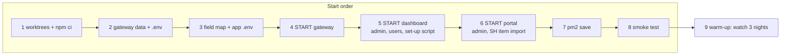

# Joint demo v0.1 - warm-up run package

Start date: Fri 30 Oct 2026. Demo target: Mon 9 Nov (latest Thu 12 Nov). The warm-up must run at least 3 days (3 nights, see section 6) before the demo.

Prepared by Abdul Hadhee | IT Executive

Spec: `/root/Project Management/.claude/worktrees/pd-demo-plan/wiki/specs/2026-10-24-joint-demo-v0-1-rev4-demo-first.md` (Rev 4.10). You run every command. Claude wrote this and did not run any of it, so the "expect" lines come from reading the code (appendix A), not from watching it run. If a real output differs, stop and tell the lead.

All paths below use `RP` for this folder:

```bash
export RP="/root/Project Management/reports/2026-10-24-joint-demo-status/run-package"
```

---

## 1. The picture first

Three small programs, all on this server, all listening on 127.0.0.1 only. You look at them through an SSH tunnel from your PC.

```
                                  YOUR PC  (ssh tunnel: 4300, 4800, 4850)
                                      |
        +-----------------------------+-----------------------------+
        |                             |                             |
  Order Portal :4800        Production Dashboard :4300     Gateway /demo page :4850
  (demo-portal)              (demo-dashboard)               (demo-gateway)
        |  POST salesorders          |  GET every 2 min          ^
        |  (writes)                  |  (reads only)             | buttons: Bundled > Packed >
        |  GET every 5 min           |                           | Checked > Invoiced
        v                            v                           |
   +----------------------------------------------------------------+
   |                 DEMO GATEWAY  (demo-gateway) :4850             |
   |  sandbox: DEMO job orders live here and nowhere else           |
   |  GET pass-through, one call at a time, >= 667 ms apart         |
   +------------------------+---------------------------------------+
                            | GET only, READ-scoped key (SPS)
                            v
                    LIVE SPS Zoho API  (7,500 calls/day for the whole org)

   Portal also reads SH stock directly:
   Portal --(CDP, GET, >= 1.2 s apart, <= 6,000/day)--> rizwan@ Chrome :9333 --> SH Zoho (read-only)
```



The key point: **nothing here ever writes to live Zoho.** Every write the portal makes goes to the gateway's sandbox file. The only real Zoho traffic is GET reads.

| process (PM2 name) | folder | port | database |
|---|---|---|---|
| demo-gateway | `/root/demo/order-portal-gateway` | 4850 | `tools/demo-gateway/data/sandbox.json` + `counter.json` (files) |
| demo-dashboard | `/root/demo/production-dashboard` | 4300 | `data/production.db` |
| demo-portal | `/root/demo/order-portal` | 4800 | `data/order-portal.db` |

Each folder is a **pinned checkout**: a copy of one exact commit. New work in `/root/dev/...` cannot change the running demo.

| app | dev clone | pinned commit |
|---|---|---|
| gateway | `/root/dev/order-portal-gateway` (feature/demo-gateway) | `65c72b6` |
| portal | `/root/dev/order-portal-s1` (feature/s1-demo) | `ca7f9fa` |
| dashboard | `/root/dev/production-dashboard-v01` (feature/joint-demo-v0.1) | `5e8bbb6` |

---

## 2. Never

```
+--------------------------------------------------------------------------------+
| NEVER  run any of this in a live dir (/root/SH-IT_Hub, /root/IT_Utilities_Backend,|
|        /root/employee-master-service, /root/invoice-automation, /root/sticker-engine,|
|        /root/ops). The demo lives in /root/demo only.                           |
| NEVER  use shdeploy for these three apps. There is no shdeploy row for them.     |
| NEVER  sign out of, close or restart the rizwan@ Chrome on :9333. Never log in   |
|        to Zoho in it. Never use :9333 for anything heavy while the demo runs.    |
| NEVER  paste a key, token, password or the contents of any .env into chat,       |
|        email or a ticket. Lengths and names are fine; values are not.            |
| NEVER  copy the real ZOHO_* values into the portal or dashboard .env.            |
| NEVER  run `pm2 restart all`, `pm2 delete all` or `pm2 save` before checking     |
|        `pm2 list`: those commands also touch the five production services.       |
+--------------------------------------------------------------------------------+
```

---

## 3. Load limits the demo must respect

| what | limit | where it is enforced |
|---|---|---|
| Zoho SPS API, whole org | 7,500 calls/day | not by us; the caps below keep us under it |
| Portal share | 2,000/day (`ZOHO_DAILY_CALL_CAP=2000`, the config maximum) | portal `server/config.js:103` |
| Dashboard share | 4,500/day (`ZOHO_DAILY_CALL_CAP=4500`) | dashboard `server/config.js:109` |
| Total | 6,500 of 7,500, leaving 1,000 for manual checks | spec 2.6 |
| Gateway to Zoho | one call at a time, at least 667 ms apart (about 90/min) | gateway `create-gateway.js:14` |
| SH reader (rizwan@ browser) | at least 1.2 s apart, 40 per cycle, 6,000/day | portal `server/services/sh-reader.js:15-18` |
| SEC-9333 | nothing else heavy on :9333 while the demo runs; stay under about 200 requests/min overall (the SH reader is at most 50/min, one other tool at a time, no full SH pulls) | portal `LATER.md` row SEC-9333; spec 3 |

Practical meaning: do **not** run abdullah-report, `zget.mjs`, or any full export against :9333 during the warm-up. If you must, run one, and stop the SH reader first (step 12.2).

---

## 4. Run steps

Every step has: the command, what to expect, what to do if it fails. Open a terminal on the server (SSH). Keep it open for the whole session.

### Step 0 - Pre-flight checks (changes nothing)

```bash
export RP="/root/Project Management/reports/2026-10-24-joint-demo-status/run-package"
bash "$RP/scripts/00-preflight.sh"
```

Expect: a column of `OK` lines and last line `PREFLIGHT PASSED`. `WARN` lines are information (for example a dev tree has newer commits than the pin, which is fine).

If a line says `FAIL`:
- `gateway .env missing` or a missing name: run `/root/tools/demo-key/set-read-key.sh` again (you need a Zoho Self Client code made less than 10 minutes ago).
- `no ... robots.txt tab`: in the rizwan@ Chrome, open a new tab at `https://inventory.zoho.com/robots.txt` by hand. Do not touch any other tab and do not sign in or out.
- `cannot reach the browser on 127.0.0.1:9333`: stop. Do not start Chrome yourself. Tell the lead.
- a port already listening: something else owns 4300, 4800 or 4850. Run `ss -ltnp | grep -E ':(4300|4800|4850)\b'` and tell the lead before going on.

Then run the tests in each dev clone on the exact pinned commit (they use fake upstreams and random ports; no network, no :9333):

```bash
for d in /root/dev/order-portal-gateway /root/dev/order-portal-s1 /root/dev/production-dashboard-v01; do echo "== $d"; (cd "$d" && git status --short --untracked-files=no | head -3; npm test 2>&1 | tail -8); done
```

Expect, for each folder, a TAP summary ending `# fail 0`. Note the `# pass` numbers and keep them for the lead. The dashboard's tests include the cross-app e2e (`test/helpers/joint-demo-world.js`) and read the gateway and portal from their dev clones by default (`test/helpers/gateway-kit.js:8-9`).
If any `# fail` is not 0: stop. Do not start the demo. Tell the lead which folder and the failing test name.

### Step 1 - Make the pinned checkouts

```bash
bash "$RP/scripts/01-make-worktrees.sh"
```

Expect, three times, a `Preparing worktree (detached HEAD <sha>)` line from git, an `npm ci` summary (`added NNN packages`), then `ok     better-sqlite3 loads in ...`, then `ok     dashboard web/dist is in the checkout` and `DONE worktrees`.

Check it:

```bash
for d in order-portal-gateway order-portal production-dashboard; do printf '%-26s ' $d; git -C /root/demo/$d rev-parse --short=7 HEAD; done
```

Expect: `order-portal-gateway 65c72b6`, `order-portal ca7f9fa`, `production-dashboard 5e8bbb6`.

If it fails:
- `STOP: ... is at X, expected Y`: a folder already exists at another commit. Do not delete it. Tell the lead.
- `better-sqlite3 does not load`: `cd <that folder> && npm rebuild better-sqlite3`, then re-run step 1 (it is safe to re-run; it only verifies what exists).
- `fatal: ... is already checked out` cannot happen (the script uses `--detach`). If you see `already exists`, the folder is half-made: tell the lead, do not `rm -rf`.

### Step 2 - Gateway data and its .env

```bash
bash "$RP/scripts/02-gateway-setup.sh"
```

Expect: `maps.json: identical to the dev copy (<16 hex chars>)`, `copied gateway .env (mode 600)`, `added  PORTAL_DB_PATH=/root/demo/order-portal/data/order-portal.db`, then a list of 9 names with lengths (never values) and `DONE gateway setup`. Names and lengths are safe to read out to the lead; nothing else from that file is.

Why a copy: `set-read-key.sh` wrote the key into the dev folder, and `.env` is gitignored, so the new checkout does not have it. After this step the key exists in two places (dev and demo), both mode 600. See open question Q5.

If it fails:
- `maps.json: differs`: the recording changed since 25 Oct. Not an error, but tell the lead.
- `STOP: ... .env missing`: step 0 should have caught it; run `set-read-key.sh`.

### Step 3 - Portal field map and the two app env files

```bash
node "$RP/scripts/make-portal-field-map.mjs"
bash "$RP/scripts/03-make-app-env.sh"
```

Expect, first: `wrote /root/demo/order-portal/data/field-map.json: 13 custom fields, divisions MACPRO, PACKPRO, PSU, tag Division`.
Then: `copying (names and lengths only):` with four lines (DEMO_CLIENT_ID, DEMO_CLIENT_SECRET, DEMO_READ_REFRESH, DEMO_WRITE_REFRESH) and their lengths, then `wrote .../order-portal/.env (mode 600) and .../production-dashboard/.env (mode 600)` and `DONE app env`.

This is how the secrets move without printing: the script reads the four `DEMO_*` stand-in values by name from the gateway `.env` and writes them into the two app files under the apps' own names (`ZOHO_CLIENT_ID`, `ZOHO_CLIENT_SECRET`, portal `ZOHO_READ_REFRESH_TOKEN` / `ZOHO_WRITE_REFRESH_TOKEN`, dashboard `ZOHO_REFRESH_TOKEN`). The real `ZOHO_*` values are not read at all by this script.

If it fails:
- `an app .env exists`: expected on a re-run. Use `bash "$RP/scripts/03-make-app-env.sh" --replace` (databases are not touched).
- `maps.json has no ...`: tell the lead; the map and the script disagree.

Note: the divisions in the field map (MACPRO, PACKPRO, PSU) are my best reading of the evidence. See open question Q3.

### Step 4 - Start the gateway FIRST

```bash
pm2 list                                   # look first: the five production services should be 'online'
export ECO="$RP/ecosystem.demo.config.cjs"
bash "$RP/scripts/check-demo-env.sh" gateway
pm2 start "$ECO" --only demo-gateway
sleep 4
curl -s http://127.0.0.1:4850/health
```

Expect: the check ends `CHECK PASSED: gateway`. The curl prints `{"ok":true,"mode":"DEMO MODE (gateway)","filter_refused":0}`.

Also look at the start log (it must not show any token):

```bash
pm2 logs demo-gateway --lines 20 --nostream
```

Expect a line with `start`, `DEMO MODE (gateway)`, `127.0.0.1` and port `4850`.

If it fails:
- `curl: (7) Failed to connect`: the process stopped. `pm2 logs demo-gateway --lines 50 --nostream`. The gateway prints `demo-gateway: did not start (...)` followed by the problem **by name, never by value** (`gateway/tools/demo-gateway/server/main.js:24`, `startup-checks.js:12-28`):
  - `set these in .env: NAME, ...` - a name is missing from the copy. Run `/root/tools/demo-key/set-read-key.sh` (it rewrites the dev file), then refresh the demo copy and re-add the path line: `install -m 600 /root/dev/order-portal-gateway/tools/demo-gateway/.env /root/demo/order-portal-gateway/tools/demo-gateway/.env && bash "$RP/scripts/02-gateway-setup.sh"`. The key script makes new `DEMO_*` values, so also run `bash "$RP/scripts/03-make-app-env.sh" --replace` and restart any app already running.
  - `.env is readable by group or others` - `chmod 600 /root/demo/order-portal-gateway/tools/demo-gateway/.env`, then `pm2 restart demo-gateway`.
  - `... must be at least 24 characters`, `... must differ`, `... must not equal ZOHO_...` - the key file was written by hand or cut off. Run `set-read-key.sh` again, then do the refresh in the first bullet above.
- The check prints `FAIL ... is set in the shell`: run the `unset NAME` it shows.
- `pm2 start` prints `pre-start check failed ... nothing was started`: read the FAIL lines above it; fix those.

Do not continue until `/health` says `DEMO MODE (gateway)`.

### Step 5 - Dashboard

5.1 Start it.

```bash
bash "$RP/scripts/check-demo-env.sh" dashboard
pm2 start "$ECO" --only demo-dashboard
sleep 4
curl -s http://127.0.0.1:4300/api/health
```

Expect: `CHECK PASSED: dashboard`, then JSON containing `"ok":true`, `"db":"ok"` and `"mode":"DEMO MODE (gateway)"` (dashboard `server/routes/health.js:15`). `lastSync` is `null` for the first minutes.

If it fails: `pm2 logs demo-dashboard --lines 50 --nostream`. A line starting `ZOHO_API_BASE must be http://127.0.0.1:<port>` or `BRIDGE_HOST must be empty ...` means the `.env` was edited: repeat step 3 with `--replace`. A `better-sqlite3` binding error: `cd /root/demo/production-dashboard && npm rebuild better-sqlite3`, then `pm2 restart demo-dashboard`.

5.2 Create the dashboard admin (once; the service must already be running so it makes the database, see runbook-release-0 A2).

```bash
cd /root/demo/production-dashboard && node cli/create-admin.js
```

Expect prompts `Username:`, `Display name:`, `Password (min 10):`, `Again:` (the password is not echoed), then a confirmation line. Choose the user name yourself; the lead refers to it below as `<admin>`.

5.3 Open the dashboard from your PC and create the demo people.

On your PC:

```bash
ssh -N -L 4300:127.0.0.1:4300 -L 4800:127.0.0.1:4800 -L 4850:127.0.0.1:4850 root@45.151.122.105
```

Leave that window open. Browse to `http://localhost:4300` in Chrome or Edge (older Safari refuses the login cookie on localhost). Sign in as the admin. In the admin screens, create the managers and coordinators for the demo units (spec 9 P4). Managers (owner, 28 Oct): **MACPRO = Shihar**, **PACKPRO = Ishan**. Coordinators: **MACPRO = Nimesha**, **PACKPRO = Umanda**. **Ranga** (PCU, PCLU, PPU, CWU, MOBA, FPP, CPU, DPU), coordinator **Nirmani**. **Ishan** also has **RWU** (coordinator Umanda). **Mubeena** (SHPS), coordinator **Madushi**. PSU is in the demo: **PSU = Ishan**, coordinator **Umanda** (a manager's coordinator covers all their units). Then on the server list their ids:

```bash
sqlite3 -readonly -header -column /root/demo/production-dashboard/data/production.db "SELECT id, username, roles FROM users ORDER BY id;"
```

Expect: one row per user you created.

5.4 Write the pairs file and run the set-up script. The pairs file lists, per division code, the manager and coordinator ids (format from `test/helpers/joint-demo-world.js:168-171`):

```bash
cat > "$RP/dashboard-pairs.json" <<'EOF'
[
  { "division_code": "MACPRO",  "manager_user_id": SHIHAR-ID, "coordinator_user_id": NIMESHA-ID },
  { "division_code": "PACKPRO", "manager_user_id": ISHAN-ID,  "coordinator_user_id": UMANDA-ID },
  { "division_code": "PSU",     "manager_user_id": ISHAN-ID,  "coordinator_user_id": UMANDA-ID },
  { "division_code": "PCU",     "manager_user_id": RANGA-ID,  "coordinator_user_id": NIRMANI-ID },
  { "division_code": "PCLU",    "manager_user_id": RANGA-ID,  "coordinator_user_id": NIRMANI-ID },
  { "division_code": "PPU",     "manager_user_id": RANGA-ID,  "coordinator_user_id": NIRMANI-ID },
  { "division_code": "CWU",     "manager_user_id": RANGA-ID,  "coordinator_user_id": NIRMANI-ID },
  { "division_code": "MOBA",    "manager_user_id": RANGA-ID,  "coordinator_user_id": NIRMANI-ID },
  { "division_code": "FPP",     "manager_user_id": RANGA-ID,  "coordinator_user_id": NIRMANI-ID },
  { "division_code": "CPU",     "manager_user_id": RANGA-ID,  "coordinator_user_id": NIRMANI-ID },
  { "division_code": "DPU",     "manager_user_id": RANGA-ID,  "coordinator_user_id": NIRMANI-ID },
  { "division_code": "RWU",     "manager_user_id": ISHAN-ID,  "coordinator_user_id": UMANDA-ID },
  { "division_code": "SHPS",    "manager_user_id": MUBEENA-ID, "coordinator_user_id": MADUSHI-ID }
]
EOF
```

Rule (owner, 28 Oct): a manager's coordinator covers every unit of that manager, so Umanda coordinates PackPro, PSU and RWU for Ishan, Nirmani all eight of Ranga's units, and Madushi SHPS for Mubeena.

Replace each `*-ID` with that person's number from the query above (numbers, no quotes), then:

```bash
bash "$RP/scripts/run-dashboard-setup.sh" <admin> "$RP/dashboard-pairs.json"
```

It asks for the admin password (hidden). Expect the last line `Demo set-up done. Undo list: /root/demo/production-dashboard/data/demo-setup/undo.json`. It makes MACPRO and the other division codes, the pairs, and imports the item routes from `/root/Project Management/reports/2026-10-08-pd-zoho-study/routes.csv`. It changes the demo database only.

If it fails:
- `Sign-in failed (401)`: wrong user or password.
- `Sign-in failed (...). Is the service running on port 4300?`: step 5.1 is not healthy.
- Any other message: the script stops at the first problem and leaves an undo list. Run the undo (section 8), tell the lead the message, and stop. Do not edit the database by hand.
- The routes and the unit map used are the study's draft (`test/fixtures/routes/unit-map.json`), which the owner confirms in "Q-U". See Q4.

### Step 6 - Portal

6.1 Start it (this applies migrations 001 and 002 on first start).

```bash
bash "$RP/scripts/check-demo-env.sh" portal
pm2 start "$ECO" --only demo-portal
sleep 4
curl -s http://127.0.0.1:4800/api/health | jq -c .
```

Expect: `CHECK PASSED: portal`, then JSON with `"ok":true`, `"mode":"DEMO MODE (gateway)"`, `"db":"ok"`, `"writesEnabled":true`, `"sh":{"state":...}`, `"budget":{...}`. (portal `server/routes/health.js:21-37`). `sps.stale` is `true` until the first sync finishes (about a minute).

If it fails: `pm2 logs demo-portal --lines 50 --nostream`. The portal refuses to start with a clear message naming the setting (all in `server/config.js`): for example `DEMO_GATEWAY=1 needs BRIDGE_HOST= ...`, `PORTAL_INSTANCE is required in production`, `ZOHO_WRITES_ENABLED=true needs DEMO_GATEWAY=1 ...`. Repeat step 3 with `--replace`; do not edit by hand.

6.2 Create the portal admin (password goes in on stdin, never on the command line):

```bash
cd /root/demo/order-portal
read -rsp "Portal admin password: " PW; echo
printf '%s\n' "$PW" | npm run create-admin -- <portal-admin-name>
unset PW
```

Expect: `admin <portal-admin-name> created; the password must be changed at the first login`. Sign in at `http://localhost:4800` through the tunnel and change it.
If it says `an active admin already exists`, that is correct on a re-run. If `database not found` or `database is not migrated`, step 6.1 did not start cleanly.

6.3 Create the portal people on its Admin screen (users, divisions, who belongs to which division, the dispatch team member). Roles in use: sales, fulfilment (one shared login, for Rizwan's team), coordinator, manager, admin. Managers (owner, 28 Oct): MACPRO = Shihar, PACKPRO = Ishan. Coordinators: MACPRO = Nimesha, PACKPRO = Umanda. Ranga (PCU, PCLU, PPU, CWU, MOBA, FPP, CPU, DPU), coordinator Nirmani. Ishan also has RWU (coordinator Umanda). Mubeena (SHPS), coordinator Madushi. PSU is in the demo: manager Ishan, coordinator Umanda (a manager's coordinator covers all their units). Still needed: sales accounts (spec 9 P4). The division **codes** must match the field map made in step 3 (MACPRO, PACKPRO, PSU, PCU, PCLU, PPU, CWU, MOBA, FPP, SHPS, CPU, DPU). **RWU is not in the portal field map yet:** no recorded SPS order carries a Rewinding Division tag option, so do not create an RWU division in the portal until that option name is known; RWU jobs still show on the dashboard. A code that is not in the field map makes an approval fail with `division <code> is not in the field map` (`zoho-payload.js:55-57`).

6.4 Import the SH item list. The file already exists (`sh-items.json`, 1,656 rows, made with `python3 -I $RP/scripts/sh-items-from-export.py <export.xlsx> $RP/sh-items.json`). Do not remake it unless the lead says so.

```bash
cd /root/demo/order-portal
npm run import-sh-items -- --file "$RP/sh-items.json"
```

Expect (counts only):

```
read: 1656
inserted: 1656
updated: 0
unchanged: 0
refused: 0
links made: N (name: A, sku: B)
```

`links made: 0 (name: 0, sku: 0)` is **normal** if the SPS items have not synced yet (spec 22 N2). Wait for the first full item sync (check with `bash "$RP/scripts/status.sh"`: the portal `sps.backfill.items` becomes `null`), then run the same command again. Expect `inserted: 0`, `updated: 0`, `unchanged: 1656`, and `links made` above 0. Run it a third time later: all zeros means it is idempotent.

If it fails: `import-sh-items failed: file not found or unreadable`, `... not valid JSON`, `... not a JSON array`, `... over 5 MB`: tell the lead; do not edit the JSON. `database is not migrated`: step 6.1 first.

6.5 Check the SKU links (the owner looks at these before the rehearsal):

```bash
bash "$RP/scripts/sku-links.sh"
```

Expect: a small table `matched_by | links` with rows `name`, `sku` and `TOTAL`, then `sh_items=1656  sps_items=<n>`, then up to 15 SKU links with the SPS item name next to the SH item name. Read them: the two names should be the same product. Wrong link? Section 8 (undo SH import) shows how to remove one.

The one-line version of the same check, if you only want the counts:

```bash
sqlite3 -readonly /root/demo/order-portal/data/order-portal.db "SELECT matched_by, count(*) FROM item_links GROUP BY matched_by;"
```

6.6 Pick the Kohalwila stock locations. In the portal's Admin screen, find the SH locations list (it fills after the SH reader's first daily `locations` read) and tick the Kohalwila stock locations. Until you do, stock shows "unknown". A name rule would also catch "SPS Kohalwila Factory", so choose by hand (spec 3, OQ5). The owner must do this before the rehearsal.

If the list stays empty after 5 minutes: `curl -s localhost:4800/api/health | jq .sh`. `"state":"login_required"` means the reader found a sign-in page and stopped. **Do not sign in from the server.** Open the rizwan@ Chrome window, check by eye that Zoho is still signed in, then press Resume in the portal Admin screen. `"state":"rate_paused"` waits 10 minutes by itself.

### Step 7 - Save the PM2 list

First look at everything PM2 runs, because `pm2 save` writes the list exactly as it is now:

```bash
pm2 list
```

Expect: the five production services (sticker-engine, employee-master, it-utils, gatepass, gazette-invoice) `online`, plus `demo-gateway`, `demo-dashboard`, `demo-portal` `online`. If a production service is stopped or errored for a reason you know about, stop here and ask the lead first: `pm2 save` would remember it as stopped.

```bash
pm2 save
```

Expect: `Successfully saved in /root/.pm2/dump.pm2`. If `pm2 startup` was never set up on this server, a reboot will not bring the demo back; see Q6.

### Step 8 - Smoke test (this proves the feature, not just that processes are up)

On your PC the tunnel must be open (step 5.3). Get the gateway demo-page address on the server terminal only (it contains the page token, so it must never go to chat):

```bash
bash "$RP/scripts/print-demo-url.sh"
```

It prints `http://127.0.0.1:4850/demo?token=...` on your screen. Paste it into the browser on your PC. Run `clear` afterwards.

The token is in the address bar and your browser history. Don't share your screen while the address bar shows it, and after the demo delete that history entry. Anyone with the token can tick the demo steps on sandbox orders (sandbox data only).

Walk one order through:

1. Portal `http://localhost:4800`: sign in as a sales user. New order: pick a customized item (one of the 234 the gateway knows), an end customer, a quantity, a division (for example MACPRO), save, submit.
2. Sign in as the fulfilment login. Decide: production.
3. Sign in as the division coordinator. Queue: accept the line.
4. Sign in as the division manager. Approve: pick an existing Job No (project) from the list.
5. Check the write really went to the sandbox and not anywhere else:

```bash
sqlite3 -readonly -header -column /root/demo/order-portal/data/order-portal.db "SELECT kind, state, http_status, zoho_id FROM zoho_writes ORDER BY id DESC LIMIT 4;"
```

Expect: two rows, `so_confirm` and `so_create`, both `done`, `http_status` 200 or 201, and a `zoho_id` starting `99` (the gateway's sandbox ids; real SPS ids start `4892105`).
6. Gateway demo page: the order appears as `DEMO-<yymmdd><nnnn>`. Dashboard `http://localhost:4300`, My jobs for that unit's manager: within 2 to 4 minutes the job appears with a DEMO chip.
7. On the demo page press **Bundled**, then **Packed (SmarTAG)**, then **Checked (Standardization)**, then **Invoiced (to SH)**. After each press the dashboard strip ticks the matching step within one 2-minute cycle. After Invoiced the job leaves the open list; switch My jobs to **All** to see it (spec 2.5).
8. Portal Decide screen: for an item with a SKU link, the SH Kohalwila stock shows a number with an "as of" time, not "unknown" (needs step 6.6).

Fail signs:
- Approve says `precheck_failed` / `item_inactive` / `unknown_project`: the portal mirror has not synced yet (wait one 5-minute cycle) or the item is not one of the 234 mapped items (spec 2.3).
- `zoho_writes` row `failed` with `zoho_code` set: `pm2 logs demo-gateway --lines 50 --nostream` (it logs path and status only).
- A row stuck `unknown`: a restart happened mid-write; use the portal Admin ledger view (spec 4, L15/L16).
- The dashboard never shows the job: `bash "$RP/scripts/status.sh"` and `bash "$RP/scripts/dashboard-sync-status.sh" <admin>`; look at `calls_today` against `cap`.

---

## 5. Checks you can run any time

| what | command | healthy looks like |
|---|---|---|
| everything at a glance | `bash "$RP/scripts/status.sh"` | three `online`, three health lines with `DEMO MODE (gateway)` |
| gateway health | `curl -s http://127.0.0.1:4850/health` | `{"ok":true,"mode":"DEMO MODE (gateway)","filter_refused":0}`; `filter_refused` above 0 is an error (an app sent a list filter the gateway refuses) |
| dashboard health | `curl -s http://127.0.0.1:4300/api/health` | `"ok":true`, `"db":"ok"`, `lastSync` updating every 2 min |
| portal health | `curl -s http://127.0.0.1:4800/api/health \| jq .` | `"ok":true`, `sps.stale:false`, `sh.state:"ok"` |
| logs | `pm2 logs demo-gateway --lines 50 --nostream` (also `demo-dashboard`, `demo-portal`) | no `error`/`failed` lines repeating |
| SKU links | `bash "$RP/scripts/sku-links.sh"` | name and sku counts above 0 after the first sync |
| portal budget today | `curl -s http://127.0.0.1:4800/api/health \| jq .budget` | calls used well under 2,000 |

---

## 6. Warm-up: watching the dashboard history load

Why it matters: the dashboard loads old orders ("history") slowly, and **only at night, between 21:00 and 06:00 Colombo time** (`server/services/zoho-sync.js:336-339`). So "3 days of warm-up" means **3 nights**. Started on Fri 30 Oct, the first history night is 30 to 31 Oct; Mon 9 Nov has plenty of margin, but only if the process stays up.

Daily check (morning and evening):

```bash
bash "$RP/scripts/dashboard-history.sh"
bash "$RP/scripts/dashboard-sync-status.sh" <admin>
```

The first needs no password: rows in `zoho_so_headers`, how many have their detail loaded, how many are failing, and the last 6 sync runs. The second asks for the dashboard admin password and prints the exact figures from the admin status route (`server/routes/zoho-sync.js:59`): `in_scope_sos`, `loaded_sos` (this is the progress: it is done when they are equal or close), `history_calls_today`, `calls_today` against `cap` (4500), `backlog`, `sync_problems`.

Healthy: `loaded_sos` rises every night and `calls_today` stays under 4,500. Bad: `loaded_sos` flat for a whole night; `limit_reached_today: true`; `sync_problems` above a handful; `lastSync` older than 10 minutes (the 2-minute sync is stuck).

Portal side of the warm-up: the 30-day backfill should take about 1 day (spec 2.6). Watch `curl -s localhost:4800/api/health | jq .sps`: `backfill.salesorders` and `backfill.items` go to `null` when finished.

---

## 7. Monitoring for the next 24 hours, then daily

| watch | bad looks like | do |
|---|---|---|
| `pm2 list` | any `demo-*` `errored`, or `restarts` climbing | `pm2 logs <name> --lines 50 --nostream`, then section 8 stop if it keeps failing |
| gateway `/health` | `filter_refused` above 0 | tell the lead; do not change anything |
| portal `/api/health` `sh.state` | `login_required` | look at the rizwan@ Chrome by eye (step 6.6 note). Never sign in from here |
| portal `sh.state` | `rate_paused` more than twice a day | stop the SH reader (step 12.2) and tell the lead |
| Zoho API usage page (SmartPack admin) | above about 6,500 calls in a day | stop the portal first, then the dashboard (section 8) |
| `df -h /` | under 5 GB free | tell the lead |
| dashboard `lastSync` | older than 10 minutes | `pm2 logs demo-dashboard --lines 50 --nostream` |

---

## 8. Stop, undo and rollback (assume it is 2 am)

Stop is the **reverse** of start: portal, then dashboard, then gateway. Nothing in live Zoho needs undoing, because every write went to the gateway sandbox.

**Stop everything, keep the data (about 1 minute):**

```bash
pm2 stop demo-portal
pm2 stop demo-dashboard
pm2 stop demo-gateway
pm2 list
```

Expect: the three `demo-*` show `stopped`; production services unchanged. Start again with `pm2 start "$RP/ecosystem.demo.config.cjs" --only <name>` in the order gateway, dashboard, portal (after `check-demo-env.sh`). Do not run `pm2 save` after a stop unless you want the stopped state remembered.

**Remove the demo from PM2 (about 1 minute):**

```bash
pm2 delete demo-portal
pm2 delete demo-dashboard
pm2 delete demo-gateway
pm2 list      # check the five production services are still online
pm2 save
```

Expect: `[PM2] [demo-portal](...) ✓` etc., and `Successfully saved`.

**Remove the checkouts (the spec rollback; about 1 minute). This deletes the demo databases and the sandbox. Disposable by design, but move them first if you want to keep them:**

```bash
mv /root/demo /root/demo.removed-$(date +%Y%m%d-%H%M)       # a move, not a delete
git -C /root/dev/order-portal-gateway worktree prune
git -C /root/dev/order-portal-s1 worktree prune
git -C /root/dev/production-dashboard-v01 worktree prune
```

The moved folder still holds a copy of the real Zoho read key. Delete that one file (the dev copy stays, see Appendix B Q5):

```bash
rm -f /root/demo.removed-*/order-portal-gateway/tools/demo-gateway/.env
```

Expect: no output. `git -C /root/dev/order-portal-s1 worktree list` no longer lists `/root/demo/...`.

**Undo the dashboard set-up only** (dashboard must be running; about 1 minute):

```bash
bash "$RP/scripts/run-dashboard-setup.sh" <admin> --undo
```

Expect `Demo set-up undone.` (or `Nothing to undo: no snapshot at ...`).

**Undo the SH item import** (stop the portal first, so nothing writes while you edit; this changes the demo database only):

```bash
pm2 stop demo-portal
# one wrong link (the next reader cycle re-matches it):
sqlite3 /root/demo/order-portal/data/order-portal.db "DELETE FROM item_links WHERE sps_item_id = 'PUT-THE-SPS-ITEM-ID-HERE';"
# or the full revert of the import:
sqlite3 /root/demo/order-portal/data/order-portal.db "DELETE FROM item_links; DELETE FROM sh_stock; DELETE FROM sh_items;"
pm2 start "$RP/ecosystem.demo.config.cjs" --only demo-portal
```

(`PUT-THE-SPS-ITEM-ID-HERE` is the one thing you type: the id from your SKU check. Spec 22 C2.)

**Emergency brake for Zoho load or the SH browser:** `pm2 stop demo-portal` stops all SH reads and half the SPS reads at once; `pm2 stop demo-dashboard` stops the other half.

---

## 9. Updating the pin (later; deliberate)

Moving the demo to a newer commit is a human decision, one app at a time, databases kept (the `data/` folders are gitignored).

```bash
pm2 stop demo-<app>
sqlite3 /root/demo/<folder>/data/<db file> ".backup '/root/demo/<db file>.bak-$(date +%Y%m%d-%H%M)'"   # portal and dashboard only
git -C /root/demo/<folder> checkout --detach <new commit>
(cd /root/demo/<folder> && npm ci --omit=dev --no-audit --no-fund)
# edit the pinned SHA in scripts/lib.sh (GW_SHA / PT_SHA / DB_SHA) so the pre-start check accepts it
bash "$RP/scripts/check-demo-env.sh" <gateway|dashboard|portal>
pm2 start "$RP/ecosystem.demo.config.cjs" --only demo-<app>
```

The apps apply their own new migrations at start. Restart order is always gateway, dashboard, portal.

---

## 10. Comms

| when | who | what |
|---|---|---|
| Before step 4 | the lead | pre-flight output (`PREFLIGHT PASSED`) and the `# pass` numbers from the tests |
| Before step 4 | the SmartPack Zoho API owner (you) | the demo will read live SPS orders through the API from now, at most 6,500 calls a day |
| Before step 6.6 | whoever else uses the rizwan@ Chrome (Abdullah's tools) | the SH reader will use :9333 at up to 50 requests a minute; no full pulls until the demo is over |
| After step 8 | the lead | which of the 8 smoke-test points passed, and the `zoho_writes` rows |
| Daily until 9 Nov | the lead | one line: three `online`, `loaded_sos` of `in_scope_sos`, `calls_today`, `sh.state` |

---

## 11. Pre-flight checklist (tick before Fri 30 Oct)

- [ ] `bash scripts/00-preflight.sh` ends `PREFLIGHT PASSED`
- [ ] `npm test` is `# fail 0` in all three dev clones, on the pinned commits `65c72b6`, `ca7f9fa`, `5e8bbb6`
- [ ] The SPS read key is in the gateway `.env` (mode 600) and the Self Client has read scopes only
- [ ] The three code reviews and security fixes S1/S2 are in `65c72b6` (`redirect: 'error'` and the 20 s timeout are at `create-gateway.js:225,286`; the spec says they must be done before the real key goes into `.env`)
- [ ] The rizwan@ Chrome on :9333 is signed in, with the `https://inventory.zoho.com/robots.txt` tab open, and nobody is running a heavy pull on it
- [ ] `pm2 list` shows the five production services online (so `pm2 save` is safe)
- [ ] 5 GB free on `/`; ports 4300, 4800, 4850 free
- [ ] Unit owners and coordinators: done (28 Oct, step 5.3). Still NEEDS-VALUE: sales accounts, the Rizwan team login name, key customers (P3), and the Zoho Division tag option name for Rewinding (portal only)
- [ ] The admin usernames you will use for the dashboard and the portal: NEEDS-VALUE
- [ ] The owner knows he must pick the Kohalwila locations (step 6.6) before the rehearsal

---

## 12. Reference

### 12.1 Environment each app gets (written by `03-make-app-env.sh`)

Portal `/root/demo/order-portal/.env`: `NODE_ENV=production`, `PORT=4800`, `APP_ORIGIN=http://localhost:4800`, `BRIDGE_HOST=` (empty), `TRUSTED_PROXY_IPS=192.0.2.1`, `PORTAL_INSTANCE=demo`, `DEMO_GATEWAY=1`, `ZOHO_API_BASE=http://127.0.0.1:4850/inventory/v1`, `ZOHO_TOKEN_URL=http://127.0.0.1:4850/oauth/v2/token`, `ZOHO_CLIENT_ID`, `ZOHO_CLIENT_SECRET`, `ZOHO_READ_REFRESH_TOKEN`, `ZOHO_WRITE_REFRESH_TOKEN` (these four are the DEMO_* stand-ins), `ZOHO_SYNC_ENABLED=true`, `ZOHO_WRITES_ENABLED=true`, `ZOHO_FIELD_MAP=/root/demo/order-portal/data/field-map.json`, `ZOHO_DAILY_CALL_CAP=2000`, `SPS_HISTORY_DAYS=30`, `PROJECT_MODE=pick`, `SH_READER=cdp`, `SH_CDP_URL=http://127.0.0.1:9333`.

Dashboard `/root/demo/production-dashboard/.env`: `NODE_ENV=production`, `PORT=4300`, `APP_ORIGIN=http://localhost:4300`, `BRIDGE_HOST=` (empty), `TRUSTED_PROXY_IPS=192.0.2.1`, `DEMO_GATEWAY=1`, `ZOHO_API_BASE`, `ZOHO_TOKEN_URL` (as above), `ZOHO_CLIENT_ID`, `ZOHO_CLIENT_SECRET`, `ZOHO_REFRESH_TOKEN` (DEMO_* stand-ins), `ZOHO_SYNC_ENABLED=true`, `ZOHO_SYNC_INTERVAL_MIN=2`, `ZOHO_DAILY_CALL_CAP=4500`.

Gateway `/root/demo/order-portal-gateway/tools/demo-gateway/.env`: the 8 required names plus `PORTAL_DB_PATH` (appended by step 2). `GATEWAY_PORT` is not set, so the default 4850 applies.

A shell variable of the same name beats the `.env` (dotenv does not override), which is why every check script fails if one is set.

### 12.2 Stopping only the SH reader (to free :9333 for one other job)

The reader runs while `SH_READER=cdp`. To pause it without stopping the portal: edit `SH_READER=cdp` to `SH_READER=off` in `/root/demo/order-portal/.env` (that line is not a secret; use `sed -i 's/^SH_READER=.*/SH_READER=off/' /root/demo/order-portal/.env`), then `pm2 restart demo-portal`. Stock shows "unknown" meanwhile. Set it back to `cdp` and restart when the other job is done. `check-demo-env.sh portal` expects `cdp`, so re-run step 3 with `--replace`, or accept its one FAIL line while paused.

### 12.3 Files in this package

| file | what |
|---|---|
| `RUNBOOK.md` | this file |
| `ecosystem.demo.config.cjs` | proposed PM2 file (the spec's `tools/demo-gateway/ecosystem.demo.config.cjs` does not exist) |
| `scripts/lib.sh` | shared paths and pinned commits |
| `scripts/00-preflight.sh` | read-only checks |
| `scripts/01-make-worktrees.sh` | worktrees + `npm ci --omit=dev` (runs package install scripts as root; accepted for the demo because each lockfile pins integrity hashes; security audit S6) |
| `scripts/02-gateway-setup.sh` | maps.json, gateway `.env` copy, `PORTAL_DB_PATH` |
| `scripts/make-portal-field-map.mjs` | portal `ZOHO_FIELD_MAP` from the gateway's maps |
| `scripts/03-make-app-env.sh` | app `.env` files from named `DEMO_*` values (names and lengths printed) |
| `scripts/check-demo-env.sh` | the spec 2.7 pre-start checks, per app |
| `scripts/status.sh`, `sku-links.sh`, `dashboard-history.sh`, `dashboard-sync-status.sh` | read-only checks |
| `scripts/run-dashboard-setup.sh` | dashboard set-up and undo (asks the admin password, hidden) |
| `scripts/print-demo-url.sh` | prints the gateway `/demo` address with its token, on your terminal only |
| `scripts/sh-items-from-export.py`, `sh-items.json` | already made; left as they were |

---

## Appendix A - what each claim rests on (file:line)

Gateway (`/root/dev/order-portal-gateway`, 65c72b6):
- Start command and `.env` path from the file's own location: `tools/demo-gateway/server/main.js:9-15`; required names `main.js:17-21`; checks `main.js:22-26`, `startup-checks.js:4-30` (names missing; group/other readable; secrets under 24 characters; equal values; DEMO equal to ZOHO).
- Port default 4850, host 127.0.0.1: `main.js:29-30`; `README.md` (Run, Configuration).
- `PORTAL_DB_PATH`, `GATEWAY_DATA_DIR`, `GATEWAY_MAPS_PATH`, `PLACEHOLDER_CONTACT_ID`: `main.js:31-34`.
- Portal DB opened read-only and skipped when absent: `create-gateway.js:311-314`.
- `/health` body: `create-gateway.js:645-647`. `/demo` and `/demo/advance`: `create-gateway.js:638,664,669`; token header or query: `create-gateway.js:614`.
- 667 ms spacing: `create-gateway.js:14`. `redirect: 'error'` and timeout: `create-gateway.js:211,225,286`.
- The ecosystem file does not exist: `ls tools/demo-gateway` shows only `README.md data scripts server test`. The gateway is its own branch and does not sit under the portal checkout (the s1-demo commit has no `tools/` folder).
- `build-maps.mjs` usage: `tools/demo-gateway/scripts/build-maps.mjs:1-3,16-21`. Portal-ref stand-in id: `build-maps.mjs:8`.
- `/root/tools/demo-key/set-read-key.sh:8-9,43-57` writes the gateway `.env` into the dev folder, with the eight names.

Portal (`/root/dev/order-portal-s1`, ca7f9fa):
- Env names and rules: `server/config.js:60-62` (DEMO_GATEWAY), `:64` (NODE_ENV), `:76` (PORTAL_INSTANCE), `:79-95` (sync/writes/loopback bases), `:96` (SPS_HISTORY_DAYS), `:97` (SH_CDP_URL), `:103` (cap max 2000), `:108-113` (tunnel-only demo rules), `:124` (PORT 4800), `:130` (DB_PATH default `data/order-portal.db`), `:143` (ZOHO_FIELD_MAP), `:149-150` (PROJECT_MODE, SH_READER).
- `.env` read from the repo folder: `server/env.js:7-8`. Single instance only: `server/app.js:11-15`. Start log: `app.js:20`. Health body: `server/routes/health.js:21-37`.
- Scripts: `package.json` scripts `create-admin`, `import-sh-items`. `cli/create-admin.js:15-23` (stdin only), `:40` (message). `cli/import-sh-items.js:14-17,38-43` (usage, counts). Database must exist and be migrated: `server/db/open.js:23-34`.
- SH reader limits: `server/services/sh-reader.js:15-18`; robots.txt tab: `:20`; stop states: header comment `:9-10`. Intervals: `server/startup.js:8-10`.
- Field map format and use: `server/services/zoho-payload.js:9-20,54-62`; fixture `test/fixtures/zoho-field-map.json`.
- Tables used in checks: `item_links` `002-s1-demo.sql:26`; `zoho_writes` `001-schema.sql:92-98`.
- SEC-9333: `LATER.md` last row.

Dashboard (`/root/dev/production-dashboard-v01`, 5e8bbb6):
- Env names: `server/config.js:56-57,58-67` (gateway URLs, `gatewayUrl` `:39-45`), `:71-76`, `:77-78` (interval must be one of 1,2,3,4,5,6,10,12,15), `:109` (cap), `:82` (PORT 4300), `:68` (DB_PATH `data/production.db`).
- `.env` read from the working directory: `server/app.js:1` (`dotenv/config`), so PM2 `cwd` matters (ecosystem sets it).
- Health: `server/routes/health.js:15`. Start log: `server/startup.js:7`.
- Set-up script and undo: `cli/demo-setup.js:11-26` (flags `--routes --map --pairs --lid-items --work-dir --undo-file --undo`, env `DEMO_ADMIN_USER` / `DEMO_ADMIN_PASSWORD`), `:50-61`; `docs/demo-setup.md`; undo file default `cli/lib/demo-setup.js:22`.
- History only at night: `server/services/zoho-sync.js:336-339`. Status route and fields: `server/routes/zoho-sync.js:12,37-39,59`. History counts: `server/services/job-queries.js:13-23`.
- `web/dist` is committed (`git ls-files web/dist`), so no build is needed.
- `create-admin.js` prompts: `cli/create-admin.js` (`ask('Username: ')`, display name, password twice).

Evidence for the whole env set: `test/helpers/joint-demo-world.js:121-126` (portal), `:141-146` (dashboard), `:168-177` (pairs file and set-up call).
SSH tunnel address: `docs/runbook-release-0.md` A6 (`root@45.151.122.105`).
Spec: 2.7 (runtime, pre-start checks, warm-up), 2 (gateway), 2.6 (budget), 3 (SH reader), 9 (preconditions), 11 (rollback), 20 (S1/S2), 22 (SH import, N2).

---

## Appendix B - open questions for the lead

1. **Gateway location differs from the spec.** Spec 2.7 says the gateway is `/root/demo/order-portal/tools/demo-gateway`. In fact it is a separate branch (`feature/demo-gateway`, `65c72b6`) with no common tree with the portal's `feature/s1-demo` (`ca7f9fa`), so it gets its own checkout `/root/demo/order-portal-gateway`. Is that accepted? (The spec text should be corrected.)
2. **The ecosystem file named in the spec does not exist** in the gateway repo. I wrote a proposal beside this runbook. It runs `check-demo-env.sh` when pm2 loads it for a start. I could not test it under PM2 (not allowed to run it). Where should the final file live (gateway repo or this package)?
3. **Portal field map and divisions.** No script existed to make the portal's `ZOHO_FIELD_MAP` for the real demo, so I wrote `make-portal-field-map.mjs` from the gateway's `maps.json`. Three guesses need the owner or lead: the division codes (MACPRO, PACKPRO, PSU only; the others need adding with their tag option names), the text of `cf_manufacturing_division` for each (taken from the harness `HDR_OPD` and the portal fixture), and `warehouse_id` (a stand-in; the gateway does not read it, but the live write at v0.5 needs the real one).
4. **Dashboard set-up inputs.** The set-up script needs a routes CSV, a unit map, a pairs file and a lid-items list. I used the study's `routes.csv`, the test fixture `unit-map.json` (a draft the owner confirms as "Q-U"), and an empty lid list (as the harness does). The pairs need the demo accounts (P4, still open).
5. **The real Zoho key now exists in two folders** (dev and demo copy, both 0600). Should `set-read-key.sh` (in `/root/tools`, not mine to change) write to the demo folder from now on, and the dev copy be removed after the demo?
6. **Reboot.** Is `pm2 startup` already configured for root? If not, `pm2 save` alone will not bring the demo back after a reboot. I did not check (it needs a `systemctl` look that the human should do): `systemctl is-enabled pm2-root`.
7. **Dashboard login for viewers.** The managers log in with accounts the human creates through the dashboard admin screen. Please confirm that is the intended demo route (spec 9 P4 lists names as still open).
8. **Test counts.** I did not run `npm test` (rule: I run nothing). The spec says 49 committed dashboard tests define done; I could not confirm the current numbers, so step 0 asks you to note them.
9. **Unverified by reading only:** the portal screen names (Admin ledger view, SH locations tick list, Resume button) are from the spec, not checked against `web/admin.html`. If the labels differ, tell the lead.
