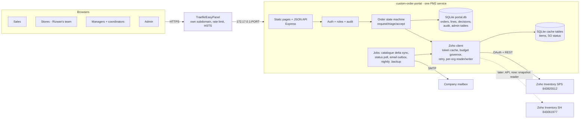

# D-B. Thin standalone app: Zoho is the record, the app owns only requests, decisions and audit

Prepared 17 Oct 2026. Design proposal only: no live Zoho call, no credentials, nothing built. Inputs: `R1-zoho-api.md`, `R2-zoho-native.md`, `R3-flow.md`, `R4-auth-hosting.md` (same folder) and the data files in `../` (`03-patterns-and-lead-times.md`, `05-p0-stock-by-location.md`). SH (org 843061977) and SPS (org 843825512) figures are never summed. Zoho facts carry the URL R1/R2 read them from; anything I could not confirm is marked UNVERIFIED and is not built on until a sandbox check.

## 0. Answer first

1. One small Node service (Express + SQLite, the house style), one new PM2 service behind Traefik. It holds **only** order requests, queue decisions, the audit log and a few admin tables. Items, stock, sales orders, packages and shipments live in Zoho and are read live through the API behind a small cache.
2. Zoho connection: one Self Client per org, one dedicated integration user per org. SPS first (the user is the admin); SH reads start as the existing snapshot behind a swappable reader and switch to API when the CEO grants access.
3. Only Zoho write in v1: **create the SPS sales order** when a coordinator clicks. SH Zoho stays read-only until the CEO consents. Writing reverses the standing "Zoho read-only" rule, so it is a decision for the user (section 12).
4. API load is small: about 600 calls/day typical on SPS and about 25-150 on SH, against SPS 7,500/day (observed 7 Oct) and an assumed SH floor of 1,000/day. The real risk is not volume but the **shared budget** with the Production Dashboard and inventory services on the same SPS org (section 3.4).
5. Incremental cash cost is close to zero (existing VPS, existing Zoho plans); the cost is developer time: about **15 developer-weeks** for the full v1, a click-through demo in about **2 weeks**, a demo on live SPS data with a real draft SPS SO in about **5 weeks** (section 8).

## 1. Where this overrides earlier decisions

| Earlier decision | Under this design |
|---|---|
| "Zoho stays read-only" (8 Oct PD release spec; old portal plan) | **Overridden for the SPS org, narrowly** (create SPS SO; optional confirm and void). SH stays read-only until the CEO agrees. Production Dashboard code is untouched. |
| 7 Oct: SH data via signed-in browser session, SH API later | **Direction overridden** (user, 17 Oct: API, no scripts). **Practice kept** until the CEO grants access: SH stock comes from a snapshot behind the same reader interface. |
| Old OP-01..16 plan, add-on, extension, userscripts, tunnel-only password login | Not used. Read as data only. |

## 2. Components

| Component | Job | Notes |
|---|---|---|
| Web + API | Express, plain HTML/JS pages like the Hub, one JSON API | no framework change; matches ARCHITECTURE.md house style |
| Auth | own accounts, scrypt, HttpOnly cookie sessions, roles sales / stores / manager / coordinator / admin | reuses IT Utilities scrypt and Hub `loginLimiter.js` pattern per R4 |
| Order state machine | line states in R3 s3 (DRAFT to SUBMITTED to TRIAGE to SENT_TO_PROD to ACCEPTED to SPS_SO_PENDING to IN_PRODUCTION...) | the line is the unit; derived states (PACKED, DISPATCHED) come from Zoho, not clicks |
| Zoho client | one module, two org instances; token cache; budget governor; single-flight de-duplication; 429 handling by code | the only file that talks to Zoho, so it is the only file to review for call volume |
| Cache tables | SPS item catalogue (customized flag), last-seen SO status per linked SO, stock reading with timestamp | cache is disposable: it can be deleted and rebuilt from Zoho |
| Jobs | in-process timers (no new queue service) | idempotent on restart |
| Email outbox | rows in SQLite, sent by a job | no WhatsApp sending or automation anywhere |

What the app owns (all of it): requests and lines, Stores/manager/coordinator decisions with actor and time, append-only audit log, managed end-customer list and aliases, SPS-to-SH item map, division and manager/coordinator pairs, holidays, notification rows, hand-ticked steps. Everything else is Zoho's.

## 3. Zoho connection

### 3.1 Orgs, identity, OAuth

- Base URL `https://www.zohoapis.com/inventory/v1`, `organization_id` on every call, token header `Authorization: Zoho-oauthtoken <token>` (https://www.zoho.com/inventory/api/v1/introduction/ and https://www.zoho.com/inventory/api/v1/oauth/).
- **One Self Client per org** (https://www.zoho.com/accounts/protocol/oauth/self-client/overview.html): no end-user consent screen, the admin authorises once. SPS: the user creates it. SH: the SH admin (CEO) creates it. One client across both orgs is not possible today because the user is not an SH admin (R1 s3).
- **Dedicated integration user** per org (for example `portal-svc`), not a person's login, so a staff change does not kill the integration and Zoho shows "portal-svc" as creator. Real names live in the portal audit log. Extra seat price for this user is UNKNOWN (R2 did not retrieve it).
- Access token lasts about an hour; refresh token is permanent but only 20 per user are kept and the oldest is silently deleted (https://www.zoho.com/inventory/api/v1/oauth/), so the app must never mint a new refresh token on each deploy. Store the refresh token encrypted at rest with the key outside the DB (R4 s5). Cache the access token; refresh at most 10 per 10 minutes (R4).
- Worth testing: the client-credentials Self Client flow (no refresh token to protect). UNVERIFIED for Inventory scopes.

### 3.2 Scopes (least privilege; names from the endpoint pages, linked in R1 s4)

| Phase | Org | Scopes |
|---|---|---|
| 1 read | SPS | `ZohoInventory.items.READ`, `contacts.READ`, `salesorders.READ`, `settings.READ`, `packages.READ`, `shipmentorders.READ` (add `transferorders.READ`, `picklists.READ` only if the dashboard shows them) |
| 2 write | SPS | add `ZohoInventory.salesorders.CREATE` (confirmed on the create endpoint, https://www.zoho.com/inventory/api/v1/salesorders/). Scopes for confirm and void are **UNVERIFIED** (R1 s3); do not call those until checked. |
| 1 read | SH | `items.READ`, `settings.READ` (stock per location, locations); nothing else needed for the hint |
| 3 write | SH | only after CEO consent: `salesorders.CREATE`; transfer orders stay manual |

Not requested: `ZohoInventory.FullAccess.all`.

### 3.3 Calls the app makes

| Purpose | Call | Source |
|---|---|---|
| Catalogue delta | `GET /items?last_modified_time=...&per_page=200` | https://www.zoho.com/inventory/api/v1/items/ |
| Stock for one line | `GET /items/{item_id}` (per-location figures in the `locations` array) | same |
| Create SPS SO | `POST /salesorders` with `custom_fields` | https://www.zoho.com/inventory/api/v1/salesorders/ |
| Track linked SOs | `GET /salesorders?salesorder_ids=a,b,...` (up to 200 ids) and `GET /salesorders/{id}` | same |
| Packed/shipped | `GET /packages`, `GET /shipmentorders/{id}` (no list-all shipments endpoint was seen) | https://www.zoho.com/inventory/api/v1/packages/ , .../shipmentorders/ |

Pagination is `page` / `per_page` (default 200). The "more pages" flag name is UNVERIFIED. SO list filters by status or date were not seen in the part of the page R1 read, so tracking is by the portal's own list of SO ids, which also keeps polling cheap.

### 3.4 Daily budget arithmetic

Load, from `../03-patterns-and-lead-times.md`: mean 7.7 SOs and 11.0 lines per working day, p95 20 SOs / 31 lines, worst day 35 SOs; 217 open customized SOs today (about 120 in flight at steady state is my estimate: 201 SOs a month x about 18 days median lead time / 30). Assume 10 working hours, Monday to Saturday.

Limits (https://www.zoho.com/inventory/api/v1/introduction/): 100 requests/minute per org; daily 1,000 / 2,000 / 5,000 / 10,000 / 10,000 by plan; concurrency 5 free, 10 paid. SPS observed 7,500/day with 0 used in 30 days (7 Oct), which matches no documented tier, so its plan is unknown. SH: unknown, budget the 1,000 floor.

**SPS org, per working day**

| Item | Typical | Worst day (35 SOs, about 49 lines) | Arithmetic |
|---|---|---|---|
| Catalogue delta | 20 | 20 | 2 calls/hour x 10 h; plus 13 pages for a nightly full resync (2,537 items / 200) = 33 |
| SPS stock hint | 22 | 98 | 2 reads per line (submit + triage open) x 11 lines; 2 x 49 on the worst day |
| Create SPS SO | 21 | 105 | about 7 accepted SOs x 3 calls (create, read-back, optional confirm); 35 x 3 |
| Dashboard status | 480 | 480 | best case: 2 calls (SO list-by-ids + packages) per refresh, one refresh per 5 min x 120 refreshes |
| Token refresh | 24 | 24 | 1 per hour (may not count against the API quota; UNVERIFIED) |
| Retries/other | 50 | 100 | allowance |
| **Total** | **about 650** | **about 830** | |

Case B (list-by-ids does not carry packed/shipped per line, so each in-flight SO needs a detail call): 120 SOs x 40 refreshes at 15-minute spacing = 4,800/day, too many. The governor therefore falls back to: list view from one call, per-SO detail only on drill-down or hourly (120 x 10 = 1,200/day) and spread under 60 calls/minute. Which case applies is decided by one sandbox read (open point 1 in section 11).

Budget policy: the app is capped at **2,000/day on SPS** (27% of 7,500) and at 60/minute; at the cap it stops polling, shows "status as of hh:mm" and keeps the human screens working. It never retries on Zoho error code 45 (daily limit) or 44 (per-minute) except after back-off (R1 s5).

**The shared-budget problem.** The same SPS org is also read by the Production Dashboard (about 415/day, per the earlier inventory design in `/root/CLAUDE.md`) and the inventory service (capped at 500/day). Together with this app's cap: 2,000 + 415 + 500 = 2,915/day, 39% of 7,500. But if SPS's real tier were 1,000 or 2,000, the total would not fit, so the first action is to confirm the real SPS figure in the admin console.

**SH org, per working day (read only, phase 1-2):** SH stock hint 2 reads per line = 22 typical, 62 at p95 (31 lines), about 100 worst day; catalogue match refresh 10; token 24. Total about 60 typical, about 150 worst, against the 1,000 floor (6-15%). With SH writes (phase 3): about 1 in-stock order a day x 3 calls = 3. Nobody else is known to use SH API today.

Per-minute: bursts come from a dashboard refresh. 120 detail calls at once would break 100/minute, so the governor paces them (about 1/second).

### 3.5 Live reads, small cache

- Stock: cache at most 5 minutes, stale after 15 (R3 s6.3); a stale or failed read hides the numbers and says "stock not checked". Buttons still work, because Stores decide and the hint is advice, not routing.
- Dashboard: one shared refresh per 5 minutes regardless of how many people look (single-flight), refreshed only while someone has the page open. This is what makes 480/day a ceiling, not a per-user cost.
- Catalogue: delta by `last_modified_time` (documented filter); cache is disposable.

### 3.6 Writing the SPS SO safely

1. Portal ref (for example `OP-2026-000123-1`) goes into a **new custom field** the user creates in SPS Zoho and into `reference_number`. `CF.SH Sales Order Ref` cannot be reused: it holds the job number (R3).
2. Persist an outbox row *before* the POST (state SO_CREATING with the exact payload). On success store SO id and number. On timeout or 5xx, state "needs check": the coordinator is shown "Link existing SO" rather than a blind retry, because searching Zoho by portal ref is UNVERIFIED (list filters unseen).
3. Draft only if drafts are supported for this org: UNVERIFIED (stock commitment on confirm, approval workflow). No auto-confirm in v1.
4. `custom_fields` needs `customfield_id`, not the label `CF.Order Received from`; where to get ids is UNVERIFIED (R1 s4). One sandbox read of an existing SO gives them.
5. Line location: `location_id` vs `warehouse_id` is UNVERIFIED for these multi-warehouse orgs; test in a sandbox.
6. A per-org feature flag and a kill switch (config, no deploy needed to turn writes off). A daily reconciliation read compares portal links with Zoho and lists orphans.

## 4. Login

(From R4; own accounts, Zoho identity kept separate.)

- Own accounts: scrypt hash, 12+ character minimum, HttpOnly SameSite cookies, login rate limit. TOTP for managers, coordinators, admin (needs one new dependency: a hard-stop approval, section 10).
- Roles are rows in our DB. "Sign in with Zoho" is an optional later add-on; not all staff are Zoho users and Zoho docs do not say sign-in is limited to one org (R4).
- **Stores shared login until launch:** a real role-limited account `stock_team`, hard expiry date, office IP only (if public IPs are supplied; Traefik 3.6.7 `ipAllowList` needs `ipStrategy` behind a proxy), generated password, and a "who is acting" pick-list on every action recorded in the audit log. Honest limit: it logs who *says* they acted, not proof. My suggestion is individual accounts for the 3-5 people in Rizwan's team as soon as the demo is accepted; it costs minutes per account and removes the weakness.
- Zoho calls act as the integration user, never as the logged-in person.

## 5. Screens

| Role | Screens |
|---|---|
| Sales | **New order** (managed customer picker, catalogue search with live items first, qty + unit, required-by, job nature, artwork/dye-cutter/screen flags, notes, attachments, "new item not in catalogue"); **My orders** (state timeline, "accepted by", SPS SO number, packed/shipped from cache); cancel/cancel-request |
| Stores (Rizwan's team) | **Triage queue** (card per line, stock panel with SH per-location figures and SPS stock shown separately and labelled, snapshot/read time, unit warning, age); buttons Fulfil from stock, Send to production, Split, Return to sales (reason). Bulk "send unknown/none lines to production" with a per-line log. **Stock path**: pick location, "transfer raised" with the TO number typed in (SH Zoho stays manual), then the app watches it |
| Managers | **Production queue** per division: Accept / Return (reason) / Wrong division; Production Dashboard blocks |
| Coordinators | Same queue (act for their manager, as decided 8 Oct), **Create SPS SO** form prefilled from the line (edit, create, or link existing), hand-ticked steps |
| Dashboard | Block A: accepted, no SPS SO yet (portal data, oldest first, working-day age). Block B: live SPS SO status, ordered/packed/shipped, days vs expected date, late flags (Zoho cache). Freshness line "status as of hh:mm" always shown |
| Admin | Users and roles, division/manager/coordinator pairs, Unassigned list (PCU, DPU, unresolved), customer list merge + aliases, item map SPS to SH, unit alias table (nos = pcs), holidays, feature flags (writes on/off), Zoho health (calls today vs cap, last error), audit log |

## 6. Notifications

In-app (bell and queue counters) and email only, per R3 s7. Per-event email to Stores and the sales person; a **digest** for managers (about 11 lines/day otherwise). Email goes through an SMTP outbox using an existing company mailbox (which mailbox and its credentials are open; not checked). Zoho-unreachable shows a banner and mails the admin. **No WhatsApp sending, scraping or automation in any phase.** The "SH MANUFACTURING ORDER REQUEST" group simply stops being the transport.

## 7. Cost (per year)

| Item | Cost | Basis |
|---|---|---|
| Hosting | no new line item | same Contabo VPS; extra load is a few hundred requests a day. I have no price for the VPS in these files, so none is quoted |
| Domain/TLS | none expected | subdomain via Traefik/EasyPanel on an existing domain (assumed; confirm the domain) |
| Zoho Inventory plans | already paid, no change | per org per month, annual billing: Standard USD 29, Professional 79, Premium 129, Enterprise 249 (R2, from https://www.zoho.com/inventory/pricing/, fetcher summary; re-check live). API access is not a separate charge in what R1/R2 read |
| Integration user seats | 0 to 2 extra seats, **price unknown** | R2 could not retrieve the extra-seat price. If the integration user takes a paid seat in each org it is the only recurring Zoho cost |
| Zoho webhooks | not used | restricted to "selective pricing plans" (R1 s6); polling instead |
| Off-server backup | small, not priced | R4 proposes nightly sqlite `.backup` plus an encrypted off-server copy; options already costed in the mail-storage reports |
| Email | none expected | existing mailbox |
| TOTP library | free (npm) | needs approval as a new dependency |
| Developer time | 15 dev-weeks | section 8 |

For comparison only: the Zoho Creator route in R2 is about USD 1,920-3,840 per year (Standard) to 4,800-9,600 (Professional) at 20-40 users, plus seats, from preview-host prices that R2 flags as shaky. Convert to LKR at the current rate; I have not converted.

## 8. Effort and time to demo (one developer, includes test-first and the review gates)

| Block | Dev-weeks |
|---|---|
| Foundation: Express, SQLite migrations, config, logging, deploy registration, nightly backup | 1.0 |
| Auth: accounts, sessions, roles, TOTP, shared `stock_team` + acting-as, rate limit, audit | 1.5 |
| Zoho client: tokens, budget governor, retry, cache, SPS reader/writer, SH snapshot reader behind the same interface, sandbox spike | 1.5 |
| Catalogue sync, customer list, item map | 1.0 |
| Sales screens | 1.0 |
| Stores triage + stock panel + split/return | 1.5 |
| Production queue, accept/return/reassign | 1.0 |
| Coordinator Create SPS SO (outbox, idempotency, reconcile) | 1.5 |
| Dashboard blocks A and B | 1.5 |
| Admin screens | 1.0 |
| Notifications (in-app + email) | 0.5 |
| Hardening: code review, security audit, UAT, runbook | 1.5 |
| **Total** | **15.0** |

Demo milestones: **about 2 weeks** for a click-through on seed data (foundation, lite auth, sales, triage, production queue; no Zoho). **About 5 weeks** for a demo on live SPS data (read-only reads of items and SOs, real stock hint for SPS, SH snapshot, one draft SPS SO written from the coordinator screen under the flag), which needs section 9 items 1-3 done in week 1. These are my estimates, not measured.

Capacity caution: 15 dev-weeks is about 600 hours. `/root/CLAUDE.md` records Year 1 development time for the user at about 300 hours in normal working hours, and the user already carries the goods gatepass demo (end of October), the Production Dashboard release and IT Utilities. If Claude does the building with the user reviewing, calendar time is set by review capacity, not typing. A realistic cut is the **MVP: no dashboard Block B, no admin beyond pairs/unassigned, no Split** (about 10 dev-weeks).

## 9. What this needs from the user and the CEO

| # | Needed | From | Why |
|---|---|---|---|
| 1 | Create the SPS Self Client + `portal-svc` user + the read scopes (write scope later) | the user | phase 1; about 30-60 minutes |
| 2 | Create the new portal-ref custom field on the SPS SO; give one test customer, one test item, permission to delete test drafts | the user | safe write testing |
| 3 | Read the real SPS daily limit and plan in the admin console; check Settings > Automation (workflow rules, webhooks) | the user | the 7,500 figure matches no documented tier |
| 4 | Decision: the SPS write exception (create, optionally confirm/void) | the user | reverses read-only |
| 5 | SH API access: Self Client + integration user + read scopes, and the SH daily limit | CEO / SH admin | needed to retire the snapshot; the polished proposal is what the 7 Oct note says unlocks it |
| 6 | Consent for SH writes (phase 3) and a new actor in SH books | CEO | optional |
| 7 | Q-U answers: PCU manager, pairs after 9 Oct; Stores may act on SPS stock?; which SH locations Stores dispatch from; are SH Kohalwila and SPS WIP the same goods | managers / user | R3 s10 |
| 8 | Office public IPs, Stores email list, launch date for the shared login expiry, subdomain, backup target | user | R4 |
| 9 | Approval for the new service, new table set and TOTP dependency | user (hard stops) | engineering doctrine s4 |
| 10 | Whether the SH sales person already keys an SH sales order in SH Zoho today. I do not know. If yes, the stock path should link to that SO instead of the portal creating one | user | decides if SH writes are ever needed |

## 10. Risks

| Risk | Effect | Mitigation |
|---|---|---|
| Duplicate or wrong SPS SO from a bug or timeout | bad data in the book of record | outbox before POST, "needs check" state, link-existing, draft only, kill switch, daily reconciliation |
| Shared SPS API budget (dashboard + inventory + this app) | one service starves the others; real SPS tier unknown | per-service cap, governor, confirm the real limit first |
| SO list filters, pagination flag, `customfield_id` source, scopes for confirm/void are UNVERIFIED | design changes after the sandbox | 3-day sandbox spike in week 1, before any build on them |
| Zoho outage or expired token | cannot create SO, status stale | portal keeps working for decisions; Create button disabled with a message, never queued silently |
| Stores shared login | cannot prove who acted | acting-as pick-list, expiry, IP limit, early individual accounts |
| Refresh token theft (never expires) | persistent Zoho write access | encrypt at rest, key stored and backed up separately, least scopes |
| Service binds 0.0.0.0 with no firewall (R4: ufw inactive, port 4200 shown on 0.0.0.0) | bypasses Traefik TLS and limits | bind to the docker bridge or localhost; verify before launch (unverified whether Traefik can reach it that way) |
| No scheduled DB backups exist on the VPS (ARCHITECTURE.md:154 per R4) | order history loss | nightly `.backup`, off-server copy, restore test |
| 90% of lines go to production (SH stock covers 1-8% of lines) | the stock hint adds cost for little decision value | keep the stock hint light in v1 (one read per line); see growth |
| Stock figures in my data are 19 and 28 Sep snapshots | thresholds untested | no thresholds in v1; hint only |
| Capacity: 15 dev-weeks vs the user's load | slip | MVP cut in section 8 |
| New service + dependency are hard stops | delay | ask in the spec stage |

## 11. Open points to verify before building (sandbox or admin console)

1. Does `GET /salesorders` carry per-line packed/shipped, and what list filters exist (full page is 162k chars, R1 read 100k). Decides case A vs case B in section 3.4.
2. `location_id` vs `warehouse_id` on SO lines; how `cf_*` fields appear on reads; where `customfield_id` comes from.
3. Draft SO behaviour (stock commitment, approval workflow) per org.
4. Scopes for confirm, void, approve.
5. Real daily limit, SPS and SH; webhook availability.
6. Whether the token endpoint counts against the daily quota or has its own limit.
7. Client-credentials Self Client with Inventory scopes.

## 12. Growth path

- **Stock hint to smarter hint:** after 3 months of logged decisions (the portal stores hint, decision and outcome), compute how often Stores overrode the hint; only then propose thresholds. Reuses the INV-05 reorder engine idea but not its code.
- **Other item classes:** the order type values (Ex Stock, MTO, Internal SH) already exist in the data; add an item-class filter on the catalogue and a different route (Ex Stock skips production) without schema change.
- **SH writes:** flip the SH feature flag after CEO consent; SH SO draft for the stock path; transfer orders last (`transferorders.CREATE` exists, https://www.zoho.com/inventory/api/v1/transferorders/).
- **Webhooks:** one SO-modified workflow rule per org as a "re-read now" nudge if the plan includes them; polling remains the record.
- **Sign in with Zoho** as an add-on; individual accounts for Stores at launch.
- **Goods gatepass:** the portal ref and SO number are the natural join key for the gatepass system, replacing the ClickUp link field.
- **Scale:** SQLite is enough for about 300 lines/month; moving the cache to another store is not needed within this design.

## 13. What this design deliberately is not

No browser extension, userscript, Zoho add-on or Deluge code; no Creator; no WhatsApp; no auto-routing; no stock reservation; no import of the 229 old open lines (90 are over 180 days old); no change to the Production Dashboard code.

Prepared by Abdul Hadhee | IT Executive
