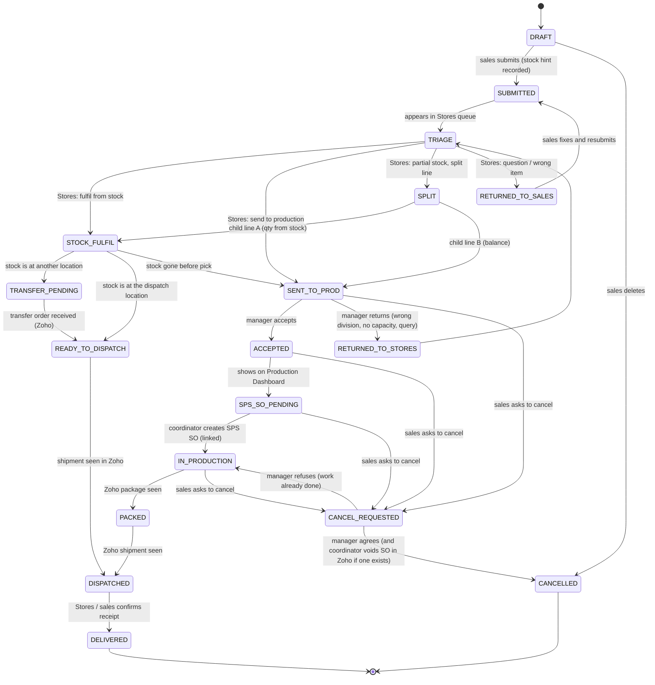
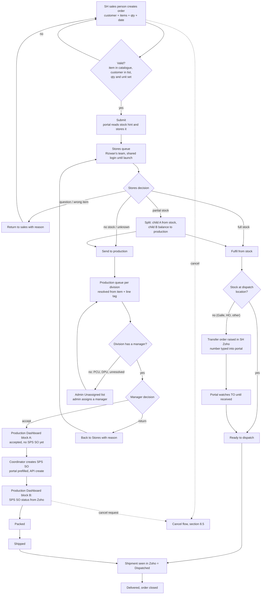

# R3 - Business flow of the custom order portal (fresh design)

Prepared by Abdul Hadhee | IT Executive. 17 Oct 2026. Design only: no live Zoho call, no credentials, nothing built. Data basis: `../01-catalogue.md`, `../02-stock-and-routing.md`, `../03-patterns-and-lead-times.md`, `../05-p0-stock-by-location.md`, `../fact-check.md`. SH and SPS figures are never summed; every SPS number is SPS Zoho (org 843825512), every stock number from SH is SH Zoho (org 843061977).

This is a fresh design. The old OP-01..16 plan, the Zoho add-on, the browser extension, userscripts and the tunnel-only password login are not used.

## 0. Answer in six lines

1. One order **line** is the unit that moves; an order is just a basket of 1-5 lines (70.2% of customized SOs are single-line, max 5: `03` s4).
2. Flow: SH sales creates -> **Stores (Rizwan's team) triage every line** -> either fulfil from stock, or "Send to production" -> manager of the line's division **accepts** -> coordinator **creates the SPS SO** (portal-assisted) -> status then follows Zoho (SO, package, shipment) on the dashboard.
3. The portal **owns the request, the decisions and who did what**; Zoho **owns stock, the SO, packages, shipments, invoices**. The portal keeps only a link (SPS SO id) and a cached copy of Zoho status.
4. The portal does not auto-route. The user said Stores decide. The stock panel is a hint (SH covers a typical order fully for only 1.1-7.7% of lines depending on location set and unit rule: `05` table), so the expected daily reality is "Stores clicks Send to production" about 9 times in 10.
5. Notifications are in-app (a bell and queue counters) and email only. WhatsApp is never sent or automated; the existing group "SH MANUFACTURING ORDER REQUEST" simply stops being needed.
6. Seven edge cases are designed in section 8. Three need an owner answer before build (section 10): PCU has no manager, whether Stores may also ask SPS to release SPS-side stock, and how SH stock is read until the CEO grants SH API access.

## 1. Where this overrides earlier decisions (said explicitly)

| Earlier decision | New position | Why / condition |
|---|---|---|
| "Zoho stays read-only" (old order-portal plan, PD managers' release spec 8 Oct) | **Overridden for the SPS org only, narrowly**: the portal may create the SPS sales order (and only that) through the API on the coordinator's click. SH Zoho stays read-only. | The user said "portals and dashboards which directly connect to Zoho through API". He is SPS Zoho admin, so he can grant the scope himself. Which exact OAuth scopes are needed is for R1/R2 to confirm from Zoho docs; I do not guess scope strings here. Creating a sales order is a documented call: `POST /salesorders`, with `custom_fields` accepted on create (https://www.zoho.com/inventory/api/v1/salesorders/). |
| 7 Oct: SH data via the signed-in browser session; SH API only after the dashboard is stable or once the goods-gatepass proposal is shown | **Kept for SH reads** (stock). Build the SH stock reader behind one interface so "snapshot now, API later" is a config switch. | SH API needs the CEO. Until then SH stock is a snapshot and the freshness rule (section 6.3) makes the stock panel say so. |
| `02` section (d): auto-route by stock (cases 1-7) | **Replaced** by Stores triage. Cases 1-7 survive as the *hint text* shown to Stores. | The user's flow: Rizwan's team decides. |
| Dashboard "read-only Zoho" jobs list from the preview spec | The dashboard gets a new first block: accepted portal requests (portal data), then Zoho status once the SPS SO exists. | Section 5. |

## 2. People and logins

| Role | Who | Login | Sees / does |
|---|---|---|---|
| Sales | SH sales persons | individual login | create, edit draft, submit, cancel own order before production, see status of own orders |
| Stores | Rizwan's team: SO picklist / packing / dispatch-prep | **one shared login until the final demo/launch, then individual** | triage queue, fulfil from stock, send to production, return to sales |
| Manager | Mubeena (SHPS), Ranga (MOBA, CPU, FPP, cups per F2.4 draft), Ishan (PackPro), Shihar (MacPro) per `division-routing.csv` | individual | accept / return, see own divisions |
| Coordinator | Madushi, Nimesha, Nirmani, Umanda per draft pairs | individual | create SPS SO, update hand-ticked steps, see their manager's divisions |
| Admin | the user (IT) | individual | assign units, manage customer list and item map, resolve Unassigned |

Shared Stores login consequence: the audit trail cannot say *which person* triaged. So every Stores action asks for a free-text "initials" field until individual logins exist (small, honest substitute; not a security control). At launch the field disappears. People and pairs are the 8 Oct **draft** (`division-routing.csv`, question Q-U still open); they are admin data, not code.

## 3. Order and line states

### 3.1 Line state machine

Notes on the diagram:
- `PACKED`, `DISPATCHED` for the production path are **derived from Zoho**, not clicked. Everything left of `IN_PRODUCTION` is a human decision recorded by the portal.
- `DELIVERED` is a portal-owned confirmation. Zoho shipment has a delivery date field (`03` lists it as not analysed), so whether it is filled reliably is unknown; I do not rely on it.
- Order (header) status is computed: DRAFT if any line draft; otherwise the *least advanced* line, shown as "3 of 4 lines dispatched".

### 3.2 Who acts, what the screen shows

| State | Who acts | Screen and what it shows | Next actions |
|---|---|---|---|
| DRAFT | Sales | **New order**: customer picker (managed list), item search over the catalogue (live items first), qty + unit, required-by date, job nature (New / Reorder / Reorder with new design / Rework: values exist today, `03` s3), base material and artwork / dye-cutter / screen availability flags (replace the free-text fields, `03` s7), notes, attachments (artwork) | Save, Submit, Delete |
| SUBMITTED to TRIAGE | system | stock hint is computed and **stored with its timestamp and source** | enters Stores queue |
| TRIAGE | Stores | **Triage queue**, one card per line: item, qty, customer, required-by, sales person, age. Stock panel: SH free-to-promise per location (never summed with SPS), SPS free stock shown separately and labelled, unit-mismatch warning, "stock read at hh:mm / snapshot of date". Hint line using the `02` case wording ("SH has 200, ordered 500") | **Fulfil from stock**, **Send to production**, **Split**, **Return to sales** (reason required) |
| STOCK_FULFIL / TRANSFER_PENDING / READY_TO_DISPATCH | Stores | Pick list: location, qty, whether a transfer order is needed (Galle and HO get it by transfer from Kohalwila, user's flow). Portal shows the Zoho transfer order number once Stores has made it **in Zoho** (SH Zoho is read-only for the portal) | Mark "transfer raised" with its TO number typed in; portal then watches it |
| SENT_TO_PROD | Manager (and coordinator can see) | **Production queue** per division: item, qty, end customer, job nature, artwork flags, required-by, Stores' note, stock hint. Resolved division shown with a one-click "wrong division" | **Accept**, **Return** (reason: wrong division / cannot make by date / need info) |
| ACCEPTED / SPS_SO_PENDING | Coordinator | Appears on the Production Dashboard block A (section 5). A "Create SPS SO" form is **prefilled** from the line (item, qty, customer name in `CF.Order Received from`, division, order type = Customized Order, job nature, expected date) | Edit, **Create SPS SO** (API), or "Link existing SO" if they already keyed it |
| IN_PRODUCTION | nobody clicks | Dashboard block B: Zoho SO status, packed qty, shipped qty, days open vs expected date | hand-ticked steps (artwork, photo, job card: 8 Oct spec) stay as in the dashboard |
| PACKED / DISPATCHED | Stores | Notified in-app and by email that goods are packed in the SPS side; Stores arranges SH-side handling | confirm delivery |

Ownership of "Send to production": Stores clicks it; it does not touch Zoho. Ownership of "accept": the manager of the resolved division, or the coordinator on the manager's behalf if the 8 Oct rule (coordinators act for their manager) is kept; that is already decided for Send next and I reuse it.

## 4. Flowchart (end to end)

## 5. Production dashboard (managers and coordinators)

Two blocks on one page, per manager (coordinators see their manager's divisions via `division_pairs`, as already decided 8 Oct).

**Block A - Accepted requests (portal data, no SPS SO yet).** Columns: portal ref, item, qty, end customer (normalised name), required-by, accepted by / when, age since accept, artwork flags, "Create SPS SO" button. Sorted by oldest accept first. Counter on the page header: number waiting more than 1 working day (my suggestion; threshold for the owner). A row leaves block A the moment the SPS SO is linked.

**Block B - Live production (Zoho data, SPS SO exists).** Columns: SPS SO number, portal ref, item, ordered / packed / shipped qty, SO status, expected date vs today, days late, hand-ticked steps (existing design). Filters: division, late, this week.
- Order-level status vocabulary comes from Zoho: confirmed, partially / fully packed, shipped, invoiced. What the SPS Zoho sales-order `status` field returns exactly is not fully listed on the API page (it shows only an example "fulfilled"), so the mapping table must be built from a real read in R1/R2, not from this document (https://www.zoho.com/inventory/api/v1/salesorders/).
- Package and shipment status come from the packages and shipment-orders modules (https://www.zoho.com/inventory/api/v1/packages/, https://www.zoho.com/inventory/api/v1/shipmentorders/). Those endpoints exist per the API index page (https://www.zoho.com/inventory/api/v1/); field details to be confirmed by R1/R2.
- Joins: package and shipment join to the SO by SO number (verified in exports: `03` s8, 100% match). They are SO-level not line-level, so per-line packed qty is by item name within the SO (a known limit, `03` s8).

**Freshness and cost.** Poll Block B rows only (open linked SPS SOs, not all history). Today there are 229 open customized lines / 217 SOs (`03` s6), so even a poll of every open SO every 15 minutes is a few hundred calls a day against SPS's 7,500/day limit (checked 7 Oct; docs: per-day limits by plan and 100 calls/min per org, https://www.zoho.com/inventory/api/v1/ section "API Call Limit"). Whether Zoho Inventory can push changes to us by webhook, and how it is configured, I could not confirm: my fetch of the help page returned 404. I design for **polling** and treat webhooks as an optional upgrade for R1/R2 to verify. The list endpoint page I read exposes `salesorder_ids` (max 200) and paging, and I did not see a `last_modified_time` filter on it (page partly read, so it may exist), which is why polling is by explicit id list.

**Late and stuck signals:** order past expected date (45.3% of customized SOs shipped on time, median 2 days late: `03` s5), accepted but no SPS SO after N days, SPS SO exists with 0 packed after the division's median lead time (OPD 21, SHPS 14, PCU 21 days for 2026).

## 6. Data: Zoho vs portal

### 6.1 Ownership table

| Data | Owner | Portal keeps | Notes |
|---|---|---|---|
| Item master (name, unit, division tag `cf_bu`, customized flag, rate) | Zoho SPS | cached read, refreshed daily | 862 customized items on SH-as-customer lines; catalogue 2,537 (`01`) |
| SH item match (SPS item -> SH item) | portal | mapping table, reviewed by hand | name matching misses 19% of ordered items; SKU rejected (`02`) |
| Stock (SH per location, SPS per warehouse) | Zoho (each org) | stock hint snapshot per line with timestamp | never summed; SPS finished goods sit in "SPS Work In Progress" |
| End customer (managed list, aliases) | portal | list + alias table | Zoho's customer is SH on 10,594 of 10,596 lines; the real name goes to `CF.Order Received from` on the SPS SO |
| Sales request (order, lines, notes, attachments) | portal | everything | |
| Triage, accept, return, cancel decisions + actor + time | portal | everything | audit log, append-only |
| Division resolution and manager/coordinator pairs | portal (admin data) | tables | draft until Q-U answered |
| SPS sales order, packages, shipments, invoices | Zoho SPS | SO id, number, cached status/qty/dates | portal never edits an SO after creation except void on an agreed cancel |
| SH transfer orders, SH shipments | Zoho SH | TO number typed by Stores, then cached status | SH write is not allowed; so Stores keys the TO in Zoho themselves |
| Hand-ticked steps (artwork, photo, job card) | portal | as in the dashboard design | |
| Notifications | portal | in-app rows + email log | |

### 6.2 What the portal writes to Zoho (the whole list)

1. **Create SPS sales order** at coordinator click (`POST /salesorders`, `custom_fields` and `item_custom_fields` accepted: https://www.zoho.com/inventory/api/v1/salesorders/). Sets customer = SH (as today), `CF.Order Received from` = end customer, order type, division, job nature, expected date, and a custom field holding the **portal ref** so the join is reliable. A new custom field for the portal ref must be created by the user in SPS Zoho (he is admin). Today `CF.SH Sales Order Ref` is really the job number (51% equals `CF.Job No`: `03` s7), so it must not be reused.
2. **Confirm** the SO if the house practice is to confirm on entry: endpoint exists (`POST /salesorders/{id}/status/confirmed`), whether the coordinator or the portal does it is an owner question.
3. **Void** the SO on an agreed cancellation (`POST /salesorders/{id}/status/void`). A void does not undo packed or shipped quantities; handled in section 8.5.
Nothing is written to SH Zoho. Nothing is written to Zoho for stores-fulfilled lines.

### 6.3 Freshness of stock hints

Read at submit and again when Stores opens the line (cache at most 5 minutes; stale after 15; both are my suggestions from `02`). If the read is stale or failed the panel shows "stock not checked", values hidden, and the Stores buttons still work: the human decides. Unlike the old auto-route design, a stale read here cannot misroute an order, it only removes a hint. Until SH API access exists, SH stock comes from a snapshot and the panel prints its date; the 28 Sep snapshot is three weeks old today, so any threshold tuning waits for a fresh read.

## 7. Notifications (in-app and email only)

| Event | In-app | Email to |
|---|---|---|
| Order submitted | Stores queue counter + bell | Stores shared mailbox / list (address is an owner answer) |
| Returned to sales | bell on order | the sales person |
| Sent to production | manager and coordinator queue counters | managers of the resolved division (one digest, not one email per line, to avoid ~11 lines/day noise) |
| Division has no manager | admin Unassigned counter | admin |
| Accepted | sales sees "accepted by <manager>" | sales person |
| SPS SO created | sales sees SO number | sales person (optional) |
| Packed / shipped (from Zoho poll) | order timeline | sales person and Stores |
| Cancel requested / agreed / refused | both sides | both sides |
| Accepted but no SPS SO after N days | coordinator + manager | coordinator |
| Poll failing (Zoho unreachable) | banner on dashboard | admin |

Rules: load is small (mean 7.7 SOs / 11.0 lines per working day, p95 20 SOs / 31 lines, worst day 35 SOs: `03` s1), so a per-event email is acceptable for Stores and sales; managers get a digest. No WhatsApp sending, no WhatsApp automation, no webhook to WhatsApp, in any phase. The existing group stays a human channel if people still want it; the portal does not write to it.

## 8. Edge cases

### 8.1 Partial stock
Observed: partly covered somewhere for 30.6% of lines (SH or SPS, `02`); using stricter SH-only sets, PARTIAL is 1.2-11.2% (`05`). Design: Stores can **Split**: child A (qty from stock) goes to the stock path; child B (balance) goes to production. Both children keep the parent ref (`ORD-123-A/B`), and the manager sees "balance of 500 after 200 from stock" so lead time is not misread. The portal never splits by itself. Risk: stock between split and pick can be taken by another order; mitigation is the same as for every stock path (section 8.6 on stock changes): the pick step re-reads and can fall back to production.

### 8.2 Wrong division
Division is resolved from the item's unit tag, with the "MOBA Unit" tag refined by cup/lid/cake/plate header (rule from the 8 Oct spec, `02` (c)). 40 production lines in the last year had a tag disagreeing with the header (tag wins); 0.6% (21 lines) cannot be resolved. Design: the queue shows the resolved division; the manager has **Wrong division -> reassign** (pick another unit, reason). That is one action, logged, and moves the line to the other manager's queue with a note, without going back to Stores. Repeated corrections on the same item raise a "fix the item's division in the portal map" prompt for the admin, so the same mistake is not made twice.

### 8.3 PCU with no manager (12.2% of lines; plus 0.6% unresolved)
Paper Cup Unit has no manager in the draft; F2.4 says MOBA-tagged cups are Ranga's but that conflicts until Q-U is answered (`02` (c)). Design: lines resolving to PCU, DPU or unresolved go to an **Unassigned** list visible to admin and to a named fallback approver. Recommended default (needs owner confirmation): route PCU to Ranga's queue by an admin-editable rule, because it is a one-row change in the pairs table rather than a code change; if the owner says no, Unassigned stays and the admin must triage manually. Alert if any line sits in Unassigned more than one working day. This is an input to the owner, not a decision I make.

### 8.4 End-customer name variants
640 distinct spellings of the end customer across lines; 8 groups differ only in case/punctuation; "Standard Holdings (Pvt) Ltd" is itself the end customer on 4,098 SOs (`01`, fact-check). Design: the order form uses a **managed customer list**, not free text. Typing searches the list including aliases; "not found" opens a short "request new customer" mini-form that Stores or admin approves, so a typo cannot create a new customer silently. Seed the list from `data/end-customers.csv`, with an admin merge screen for variants (normalise: case, punctuation, spaces). At SPS SO creation the portal writes the **canonical** name to `CF.Order Received from`. Old orders keep their old spelling (no rewriting of history in Zoho). The 42 "near variants" in the earlier report could not be rechecked (fact-check row 7), so merging near variants is always by a human.

### 8.5 Cancellation
Rules by state:
- DRAFT, SUBMITTED, TRIAGE, RETURNED: sales cancels freely.
- STOCK_FULFIL before pick: Stores cancels, stock path closes.
- SENT_TO_PROD / ACCEPTED / SPS_SO_PENDING (no SO yet): sales **requests**, manager approves (reason logged). No Zoho effect.
- IN_PRODUCTION: request goes to manager and coordinator. If agreed and nothing packed, coordinator voids the SPS SO (portal button calls the void endpoint, https://www.zoho.com/inventory/api/v1/salesorders/). If something is packed or made, the cancellation becomes a **partial cancel** (cancel the unmade balance) which is a manual SO edit by the coordinator; the portal records the outcome. History shows cancelled quantity is 1.1% of ordered quantity and only 2.7% of lines are fully cancelled; 18.4% of lines have some cancelled quantity (`03` s6), i.e. short-shipment cancels are normal, so "cancel balance" must be a first-class outcome, not a rare exception.
- After DISPATCHED: no cancel; that is a return/credit matter outside this portal.

### 8.6 Stock changes between triage and pick
Stores' "Fulfil from stock" re-reads stock at the pick step. If it is no longer enough, the line is offered **Send to production** or **Split** with a banner "stock changed since triage". This is why reserving stock is not attempted: SH Zoho is read-only for the portal, so the portal cannot hold a reservation. Two sales orders competing for the same free stock is possible; Stores sees the other open portal lines against the same item ("2 other lines want this item") to reduce it.

### 8.7 New items not yet in Zoho
243 of 1,269 recently ordered items (19%) have no SH match, and 26 SO lines in one month used items missing from the item master (`01`/`02`, fact-check row 8), so this is common. Design: sales may choose **"New item (not in catalogue)"**: free-text name, spec, artwork upload, qty, flagged job nature = New Order. It cannot be triaged to stock (no stock exists). Stores sends it to production; the manager accepts; the **coordinator creates the item in SPS Zoho** (as today) and then selects it in the portal ("Link item"), which unlocks "Create SPS SO". The SH-side item (needed for SH stock and SH sales) is created by whoever owns SH item creation today, outside the portal; until then the SH match is empty and stock hint = "unknown". Whether the portal itself should call an items-create endpoint is left out on purpose: I did not verify that endpoint or its custom-field behaviour, and doing it by hand matches today's control (item creation stays with the people who set the naming style: 94% of live item names end in a bracket, e.g. "SP-Burger Pouch (Street Burger)").

### 8.8 Other cases worth a line
- **Unit mismatch** (SPS "pcs" vs SH "nos", box vs pcs): 47.0% of lines have a strict unit mismatch, 17.7% after treating nos/pcs/piece as equal (`05`). The stock panel shows both units and refuses to compare box with pcs; an admin-maintained alias table (nos = pcs) is a pre-condition for stock hints to mean anything.
- **SH as end customer** (106 of 3,527 lines = 3.0% are SH's own stock orders, rule 2 in `05`): flagged "internal SH" and hinted toward production, but Stores may still decide.
- **Duplicate submit**: same customer + item + qty within 10 minutes warns before submit.
- **Zoho down / token expired**: the portal keeps working for everything except stock hint, SO creation and status refresh; "Create SPS SO" is disabled with a clear message, never queued silently.
- **Back-dated history**: do not import the 229 open lines; 90 are older than 180 days and may never have been closed (`03` s6). The portal starts clean; Stores or managers confirm those SOs separately.
- **Saturday / holidays**: Saturday is a half day; the age counters use working days with an admin-editable holiday list (no calendar exists in the data).

## 9. What each side sees (one-glance)

| Screen | Sales | Stores | Manager | Coordinator | Admin |
|---|---|---|---|---|---|
| New order / my orders | yes | read | - | - | read |
| Triage queue + stock panel | - | yes | read | read | read |
| Production queue (accept / return) | - | read | yes | yes (acts for manager) | read |
| Dashboard A + B | - | read B | yes | yes | read |
| Create SPS SO | - | - | - | yes | - |
| Unassigned, customer merge, item map, pairs, aliases, holidays | - | - | - | - | yes |
| Audit log | own orders | - | own queue | own queue | all |

## 10. Decisions and open questions for the owner

1. **Confirm the narrow write exception**: portal may create/confirm/void SPS sales orders via API (SH remains read-only). Needs the user to create the OAuth client and the extra custom field for the portal ref.
2. **PCU manager**: route PCU to Ranga by an editable rule, or leave Unassigned? (Q-U also decides the other pairs.)
3. **Does Stores ever act on SPS-side stock** ("SH below qty, SPS free stock >= qty", 1.3% of lines in `02`)? Default in this design: shown as a hint; Stores may "Ask SPS to release" which is just a note to the coordinator, no Zoho action.
4. **Double counting**: SH "SPS Kohalwila Factory" (1.6M units) and SPS WIP (1.5M units) may be the same goods. The panel shows them as separate readings until someone confirms.
5. **Which SH locations Stores may dispatch from**: not known; the panel lists all, and the location set is a setting.
6. **Fast lane**: since Stores will send roughly 90%+ of lines to production, do they want a "send all unknown/none lines to production" bulk button? Suggested yes, per-line decision still logged.
7. **Email addresses** for Stores, and whether managers want per-line email or a digest.
8. **Cancel authority** after production starts (manager only, or manager + coordinator).
9. **Webhook support** in Zoho Inventory and exact status values: for R1/R2; this document assumes polling.

## 11. What I could not determine

- The exact OAuth scopes and the full list of sales-order status values (API page shows only an example), the package/shipment field lists, and whether Zoho Inventory webhooks exist for these modules: the help page I tried returned 404 and I did not guess.
- SH Zoho's daily API limit (unknown; docs list limits by plan only: https://www.zoho.com/inventory/api/v1/ "API Call Limit") and whether the CEO will grant API access.
- Whether SH Kohalwila stock and SPS WIP are the same goods.
- Today's stock: all snapshots are 19 and 28 Sep.
- Real behaviour of Stores in the WhatsApp group (volumes, how they decide). The group's content was not read and must not be scraped.
- Whether the draft manager/coordinator pairs are still correct after 9 Oct.
