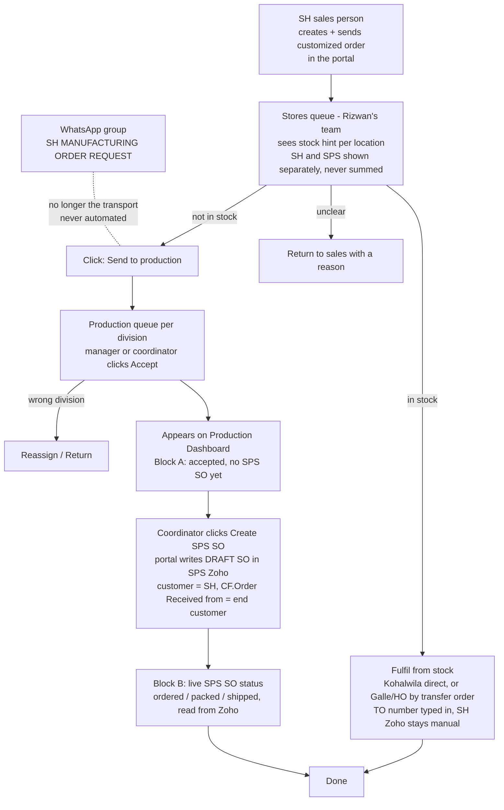

# Custom-order portal: the better way

Prepared 17 Oct 2026. Design judgement only: no live Zoho call, no credentials, nothing built. I judged D-A (build inside Zoho Creator), D-B (thin app on the VPS) and D-C (full app with its own Zoho mirror), using R1-R4 and the fact-checked data files. Every Zoho claim below keeps the URL and the confidence tag from the design it came from. SH (org 843061977) and SPS (org 843825512) figures are never summed.

## 1. Recommendation in 3 lines

1. **I suggest D-B, the thin app**: one small Node service (Express + SQLite, like our other services) that stores only the orders, the Stores/production decisions and the audit log, and reads items, stock and sales-order status from Zoho through the API. No scripts, no extensions, no WhatsApp.
2. **Zoho writes stay minimal**: the only write is "create a draft SPS sales order" when a coordinator clicks, in the SPS org only (you are its admin). SH Zoho stays read-only, and SH stock comes from a labelled snapshot until the CEO grants API access.
3. **First step is a 2 to 3 day sandbox spike in SPS Zoho**, before any build, because several API details are still unverified (see section 6). A clickable demo on real item and customer data can follow in about 2 weeks of effort.

## 2. The end-to-end flow

Where the portal sits: browsers go through Traefik to one PM2 service. That service talks outward to Zoho SPS now and Zoho SH later (a swappable "reader": snapshot today, API later). Zoho keeps items, stock, SOs, packages and shipments. The portal keeps requests, decisions, the customer list with aliases, the SPS-to-SH item map and the audit log.

## 3. Comparison (1 = worst, 5 = best)

| Criterion | D-A Zoho Creator | D-B Thin app | D-C Full app + mirror |
|---|---|---|---|
| Meets your flow | 4 | 5 | 5 |
| Time to a working demo | 4 | 4 | 3 |
| Cost | 1 | 5 | 4 |
| Reliability within Zoho API limits | 2 | 4 | 4 |
| Security | 4 | 3 | 3 |
| Maintainable by a 3-person IT team | 3 | 4 | 2 |
| Lock-in | 1 | 4 | 4 |
| **Total (of 35)** | **19** | **29** | **25** |

Why I scored it this way (my judgement, from the design documents):

- **D-A.** Fewest build weeks (about 9.5, range 7-12) and no server to look after, but it costs about USD 3,000-7,400 a year for 31 named users and up to USD 12,000 at 40 (D-A section 8; the pricing came from pages R2 flags as shaky). It is also not "no scripts": the SPS write, stock hint and status sync are Deluge scripts inside Zoho. The plumbing is unproven: a Creator connection to Inventory with sales-order scope, and a possible per-user cap on external calls of 100 / 250 / 500 a day (https://www.zoho.com/creator/pricing-comparison.html, DOC), which D-A itself says could stop the schedules (spike S3). Logic written in Deluge is the hardest to move out later.
- **D-B.** About 15 dev-weeks (about 10 for a cut-down MVP), near-zero cash cost, house-style stack, and every Zoho call goes through one module, so volume is easy to review. Typical load is about 380 calls/day on SPS (D-B's own table says about 650, but its dashboard line multiplies 2 calls x 120 refreshes as 480 instead of 240; worst day about 590) (corrected by fact-check) (cap it at 2,000 of 7,500, observed 7 Oct) and about 60 to 150 on SH against an assumed 1,000/day floor (limits: https://www.zoho.com/inventory/api/v1/introduction/). Its weak spots are the ones every own-hosted design has: we own login, backups and the open-port finding in R4.
- **D-C.** The most capable (a local mirror makes screens fast and the call budget predictable: about 523 calls/day on SPS; this assumes the items list returns per-location stock, but the items docs show per-location fields only on retrieve / bulk-fetch, so the 24 x 13-page sweep may need extra calls: UNVERIFIED, spike it) (note added by fact-check), but about 17 dev-weeks, two more moving parts to maintain (sync jobs, a second copy of the data that can drift) and a bigger SH footprint (677 to 951 of an assumed 1,000/day once the inventory service is counted). D-C's own section 12 says a smaller design would save 4 to 5 weeks if the real need is the hand-off alone. That is your need today.

Plain reading: D-B wins because it meets the whole flow, costs almost no cash, and is the smallest thing a 3-person team can keep running. D-C is the sensible upgrade path if you later want one shared Zoho mirror for the dashboard and inventory services.

## 4. Ideas I would take from the runners-up

| From | Idea | Why |
|---|---|---|
| D-C | One `api_ledger` per Zoho org shared across services, and a reader interface (API reader / snapshot reader) | The SPS and SH budgets are shared with the Production Dashboard (about 415/day) and the inventory service (cap 500/day). Counting calls in one place is the only way to see this coming. |
| D-C | Read-only first release: coordinator creates the SPS SO in Zoho by hand and pastes the number back | Delivers the hand-off while the write path is still unproven. |
| D-C | Daily count reconciliation between portal and Zoho | Bounds drift without a full mirror. |
| D-A | The spike plan (S1 write a draft SO with a custom field, S2 read plan features, S5 real plan/limit) | Cheap, and settles the facts all three designs depend on. Run it first in SPS, which you administer. |
| D-A | Named seats for Rizwan's team from day one, with an audit log of who acted | R3 and R4 both flag the audit gap of a shared login. |
| D-A | Weekly CSV export of portal data off the server | Cheap insurance, and an exit path. |
| D-B | Dashboard refresh: one shared refresh every 5 minutes, only while someone has the page open | Turns the 240 calls/day (2 calls x 120 refreshes; D-B wrote 480) into a ceiling instead of a per-user cost (corrected by fact-check). |
| D-B | Outbox row before the POST, a "needs check" state, "link existing SO" instead of blind retry, per-org kill switch | Protects the SPS books from duplicate sales orders. |

## 5. What to build first (demo scope)

**Stage 0, sandbox spike (2 to 3 days, you in SPS Zoho, no CEO needed).** Create the SPS read-only Self Client and a dedicated integration user (steps in `/root/dev/production-dashboard/docs/zoho-self-client-setup.md`). Read the real SPS plan and daily limit in the admin console. With a test customer and test item, write one draft SO with `custom_fields` and read it back. Record findings. This settles: the `customfield_id` source, `location_id` vs `warehouse_id`, SO list filters, pagination flag, whether drafts commit stock, and whether the SPS list-by-ids call carries packed/shipped state (https://www.zoho.com/inventory/api/v1/salesorders/ ; these were UNVERIFIED in D-B and D-C).

**Stage 1, clickable demo (about 2 weeks of effort, no Zoho calls).** Sales form, Stores triage with the stock panel, production queue with Accept/Return, all on seed data: the 862 customized items and the end-customer spellings (640 across the whole SO file, 638 on customized lines per fact-check.md) (corrected by fact-check), loaded as a managed customer list with aliases (`../data/*.csv`). Stores buttons: Fulfil, Send to production, Return. Show it to Rizwan's team and the three managers. The floor feedback matters more than the code.

**Stage 2, live SPS demo (about 5 weeks of effort in total).** Real SPS item and stock reads, an SH snapshot labelled with its date (the last ones are 19 and 28 Sep, so pull a fresh one first), the coordinator's Create SPS SO writing one draft behind a feature flag, and Dashboard Block A. Block B and Split can wait.

**Not in the demo:** SH writes, transfer orders from the portal, webhooks, email digests, "Sign in with Zoho".

The 31 Oct demo date belongs to the goods gatepass, not to this portal. These are effort-weeks, not calendar promises; you also carry the Production Dashboard, E-Gate Pass and IT Conduit, so I would not promise both on one date.

## 6. Decisions only you or the CEO can make (with my suggested answer)

| # | Decision | Who | I suggest |
|---|---|---|---|
| 1 | **Zoho write or read-only?** This overrides the standing "Zoho read-only everywhere" rule (8 Oct and the old plan). | You | Yes, narrowly: create an unconfirmed SPS sales order only (the create docs do not state what status a new SO gets, so "draft" is UNVERIFIED until the spike) (note added by fact-check), no auto-confirm, no void. Production Dashboard and inventory services stay read-only. SH stays read-only. The kill switch is a config flag. |
| 2 | **SH API access** (the 7 Oct rule says the polished proposal unlocks it). | CEO / SH admin | Ask for a dedicated integration user with read scopes only: `ZohoInventory.items.READ`, `settings.READ`, and `contacts.READ` / `transferorders.READ` only if needed (scope names: https://www.zoho.com/inventory/api/v1/oauth/). Ask for the SH daily API limit at the same time. Until then, the snapshot reader. I would ask right after Stage 1 is shown. |
| 3 | **Login method.** | You | Own accounts (scrypt password, session cookie), plus an authenticator-app code (TOTP) for managers, coordinators and admin. "Sign in with Zoho" can come later (https://www.zoho.com/accounts/protocol/oauth/sign-in-using-zoho.html). Zoho tokens never reach the browser. |
| 4 | **Rizwan's shared login until launch.** | You | Prefer individual accounts for his 3 to 5 people now (no TOTP needed for them). If you keep the shared one: one expiring `stock_team` account, office-IP only, and a mandatory "who is acting" pick-list written to the audit log. That logs who says they acted; it does not prove it. |
| 5 | **New things the doctrine makes a hard stop:** a new service, new tables, a TOTP library, an SMTP library (nodemailer is not in our other services' dependencies). | You | Approve the service and tables for the demo. Decide the two libraries when Stage 2 starts. |
| 6 | **Is the "no scripts" rule also "no Deluge"?** Only matters if you keep D-A alive. | You | I treat Deluge as scripts, so D-A is out. |
| 7 | Paper Cup Unit has no manager. | You | Route to Ranga by an editable rule (the MOBA tag points that way); leave the rest on an admin "Unassigned" list. |
| 8 | May Stores act on SPS-side stock, or only see it as a hint? | You | Hint only, plus an "ask SPS to release" note. |
| 9 | Does the SH sales person already key an SH sales order in SH Zoho today? | You | Find out before Stage 2. If yes, the in-stock path should link to that SO instead of creating anything. |
| 10 | Office public IPs, backup target, subdomain, SMTP mailbox. | You | Needed before the shared login can be IP-limited and before launch. |

## 7. Risks

| Risk | Effect | What I would do |
|---|---|---|
| Zoho details are unverified: SO list filters, pagination flag, `customfield_id` source, `location_id` vs `warehouse_id`, scopes for confirm/void, whether drafts commit stock | Design changes after the build starts | Stage 0 spike first; write the findings down. Do not call confirm or void until their scopes are checked. |
| Wrong or duplicate SPS SO after a timeout | Bad data in the book of record | Outbox row before the POST, draft only, "needs check" state, link-existing, kill switch, daily reconciliation. |
| Shared SPS call budget (this app, the dashboard about 415/day, inventory 500/day). The 7,500/day I saw on 7 Oct matches no published tier | One service starves another | Per-service cap (this app 2,000/day), per-minute pacing at 60, shared ledger. Re-read the real limit in the console. Zoho error 44 is per minute, 45 is per day; stop, don't loop. |
| SH limit unknown, SH access not granted | SH side stays a snapshot | Budget at the 1,000 floor; swappable reader; the portal still works without it. |
| Stale or wrong stock hints (snapshots are 3 weeks old; SH Kohalwila stock and SPS WIP may be the same goods) | Stores decide on bad advice | Show source and age on every number; never sum SH and SPS; the hint is advice, Stores decide. Fresh pull before any demo. |
| Refresh token theft (it does not expire; Zoho keeps only 20 per user) | Persistent write access to SPS | Encrypt at rest with the key outside the database, least scope (never FullAccess), never mint a new token per deploy. |
| Our own hosting gaps from R4: services bind 0.0.0.0 with ufw inactive, and no scheduled DB backups exist | Bypass of Traefik; order history loss | Bind to the docker bridge, nightly `.backup` plus an off-server copy and a restore test. You execute the firewall and Traefik changes. |
| Capacity: about 15 dev-weeks against your other builds | Late | Cut to the MVP (no Block B, no Split, minimal admin). Claude builds, you review; review time sets the calendar. |
| Integration user owned by a person | Breaks when staff change (14 Oct lesson) | A dedicated `portal-svc` user per org owned by a company mailbox. Its extra-seat price is unknown. |
| Notifications drift into WhatsApp | Against your rule | In-app and email only. No WhatsApp sending, scraping or automation, ever. |

Prepared by Abdul Hadhee | IT Executive
