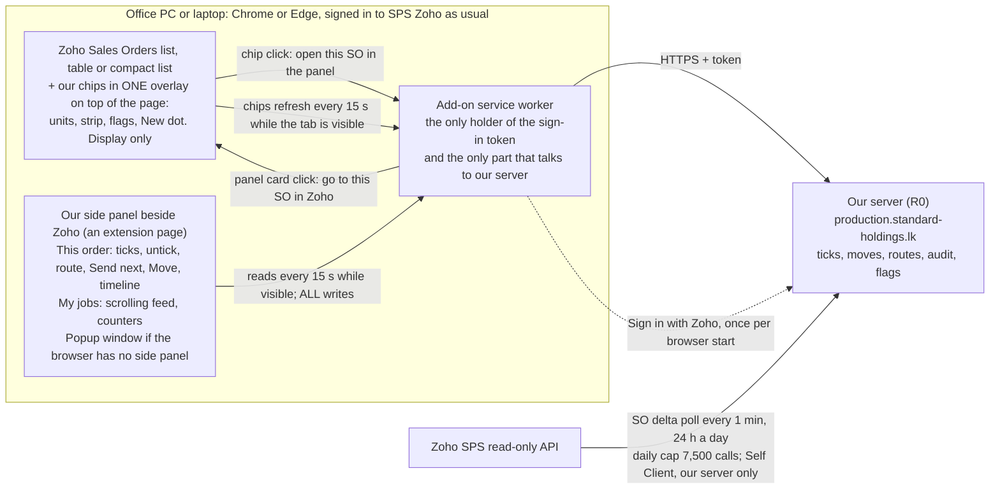
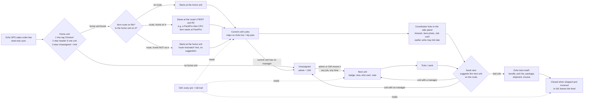

# PD managers' release (full): Zoho's own screens plus an add-on with display-only job chips and a side panel for ticks, Send next and "My jobs"

Spec delta on top of the **PD manager preview** spec, `/root/Project Management/wiki/specs/2026-09-28-pd-manager-preview.md` (Rev 11; plan-critic approved Rev 8; Revs 10 and 11 are corrections found by test-author). This file **does not edit** the preview spec. Every section of the preview applies unless this spec names it and says what changes. Parent design: `/root/Project Management/wiki/specs/2026-09-17-production-dashboard-design.md` (Rev 7.3). Code: `/root/dev/production-dashboard`. Release 0 (R0) is built at `b0cd339` and **not deployed**: `/root/production-dashboard` does not exist (checked 8 Oct). The preview code is not written yet. About 14 failing preview test files exist (`test/jobs-*.test.js`, `test/zoho-*.test.js`). Migration 005 is not written.

**Rev 3.2, 9 Oct 2026, by spec-writer.** It applies plan-critic round 3 (`2026-10-08-pd-managers-full-release-critic-round-3.md`, verdict **APPROVE-WITH-CHANGES**, nothing blocks): the required C1–C3, the notes N1–N6 and the minor `active` wording fix. No AC is renumbered; new checks are appended as bullets inside existing ACs (AC71, AC74, AC93, AC104, AC106). Each finding, where it is answered and whether the change is mechanical are listed in §2d. Rev 3.1 answered plan-critic round 2 (`2026-10-08-pd-managers-full-release-critic-round-2.md`); its response table is §2c.

**Change log**
- **Rev 1** (8 Oct): `/jobs` web page design.
- **Rev 2** (8 Oct): the add-on on Zoho's screens (D-L); history in §2b.
- **Rev 3** (8 Oct): answers plan-critic round 1 (BLOCK on C1, C2); owner decisions D-P1, D-P2, D-P3; V8 results (`reports/2026-10-08-pd-zoho-study/v8/V8.md`); real route rows from `routes.csv` and `ROUTES-BY-UNIT.md`. Response table: §2.
- **Rev 3.1** (9 Oct): answers plan-critic round 2 (APPROVE-WITH-CHANGES). Strip steps = the union over the job's units (N1); chip occlusion (N2); migration numbering split between startup and `npm test` (N3); new SOs in lane 1 and the bulk-day line-edit lag (N4); overlap re-read budget (N5); `home_at_first_move` fallback and `raw_tag` (N6); background refreshes do not keep a session alive (N7); AC8 scope (N8); synchronous `sidePanel.open` (N9); real row 645 (N10); the remaining label ACs (N11); the estimate (N12). New ACs: AC103–AC106. **Owner correction (9 Oct): Q-P is answered yes. Shihar and the GM both have their own SPS Zoho logins (D-O); Q-P is removed from the open lists.** Response table: §2c.
- **Rev 3.2** (9 Oct): applies plan-critic round 3 (APPROVE-WITH-CHANGES). The occlusion check's chip-group sample point comes from the `Range` and the layout math, never from a hidden chip's rectangle (C1); observer-driven chip refreshes are background requests (C2); the org-path guard re-runs on every route-watch tick and the worker's sender check uses the same exact path (C3); reads before writes in the occlusion pass (N1); a fake dropdown below the host's z-index (N2); the partial-overlap residual and a `click` trigger (N3); `other_lines` without trail or seen calls (N4); the R0 renumbering note covers `test/migrations.test.js:206` and computes the numbers at runtime (N5, N6); the `doc_steps.active` filter wording (minor); `req.viaExtension` set before the GET early return (critic's unverified item, checked in code). Response table: §2d.

Status: **READY** (§21). Every Rev 3.2 change applies a fix the round-3 critic stated; one reading inside C3 is recorded as R24 (§4, §2d).

---

## 0. The flow on one screen

**0a. Where things run (Rev 3: every write is in the side panel; the chips on Zoho's list are display-only).**



There is **no live push** to the add-on (critic C2). The panel and the chips poll our server every 15 s while visible. A Zoho change reaches an open panel in **≤ 90 s** (1-minute poll + ≤ 15 s run + ≤ 15 s refresh), except a line-only edit on a bulk-edit day, which can lag up to the backlog drain time of about 2 h 13 min (§9.5, owner note N-1). A colleague's tick or send reaches it in **≤ 35 s** (AC24).

**0b. What happens to a job (Rev 3: a multi-unit job starts at its route's first unit, D-P1).**



One job = one SPS sales-order line (preview §2). It sits at **one unit at a time**. A unit is a division code (`divisions.code`). People are attached to units through `division_pairs` (manager + coordinator), which is **admin data**. The job's step strip is the union of the steps of **every unit it has been at or ticked from** (Rev 3.1, §8.4), so a step an earlier unit can still tick late stays visible.

---

## 1. Owner decisions (8 Oct 2026; do not re-ask)

> **D-A One release.** "The managers get the view, coordinator logins, document ticks and Send next together (not staged)."
>
> **D-B Send next** can be pressed by the manager or the coordinator of the job's current unit. The receiving manager sees who sent it and the note.
>
> **D-C Coordinator scope** = their manager's divisions through `division_pairs` (e.g. Nirmani sees Ranga's MOBA/FPP jobs).
>
> **D-D Manual (hand-ticked) steps** = Artwork, Item photo, Job card. "The owner may add more later": adding a manual step is admin data, not code.
>
> **D-E Zoho stays strictly read-only** (SPS Self Client). Zoho-detected steps (SO, bundle, pick list, package, shipment, invoice) tick themselves.
>
> **D-F Q2 (which Zoho field decides the division)** is **decided by the data study (pending)**. The study reads the SPS Zoho data (field names, record history, what the company actually records) and writes to `/root/Project Management/reports/2026-10-08-pd-zoho-study/`. Working default until then: line tag first, header fallback, conflict marker (preview §2). The rule is pluggable (§4.2).
>
> **D-G Sync cadence: "always in sync".** This means a short, **configurable** polling interval for changed records, with no long staleness window. The default interval comes from the same study, which counts API calls per day from past order history against the **SPS limit of 7,500 calls a day** (`/root/CLAUDE.md` §2, checked 7 Oct). The full-header re-read cadence (the preview's "Pending lead decision", preview lines 7-22) is **pending on the same study**.
>
> **D-H "Each item goes through different processes, we need to know that too."** Each item gets an **expected route**: a sequence of units and steps, pre-filled from the study's `routes.csv` and editable by the admin. Each step maps to a unit and so to its manager. Send next **suggests** the next unit on the route, and the user can still pick another.
>
> **D-I (8 Oct, answers to F5.2/F5.4)** Send back: **yes**, same button, note required, receiver sees "Returned from X". **No accept step**: jobs arrive at once with a "New" badge.
>
> **D-J (F4.2)** Coordinators and managers tick; **only the manager can untick**. An untick needs a note; tick and untick stay on the timeline forever.
>
> **D-K (F8.1)** **Zoho alone closes a job**: shipped and invoiced in full, or cancelled. There is no close button.
>
> **D-L (F10.1, changes the architecture: spec Rev 2 needed)** The owner said "it should be used as a script after logging into Zoho". He confirmed the meaning is a **panel inside Zoho, as a browser add-on**: managers and coordinators log into Zoho as usual, and a browser extension or userscript draws our dashboard on top of Zoho pages. Open design points for Rev 2:
> - (a) The add-on reads Zoho data through the user's own session or through our server's Self Client.
> - (b) Ticks, Send next and routes still need our shared server and its own trust (a Zoho identity read in the page cannot be trusted server-side).
> - (c) Who has Zoho logins (managers?).
> - (d) Phones: Chrome on Android has no extensions.
> - (e) Store or self-hosted install, and updates.
> - (f) Zoho's terms for add-ons.
>
> **D-M (8 Oct)** Every manager (Ranga, Ishan, Mubeena) and coordinator (Nirmani, Umanda, Madushi) **has their own SPS Zoho login**. Main use is **office PCs and laptops** (Chrome/Edge desktop). A phone page is not required for this release.
>
> **D-N (8 Oct)**
> - **F1.3:** a job appears only once its Zoho SO exists.
> - **F1.4:** B-grade "NA" lines are shown, labelled "no job no".
> - **F2.3:** **MacPro Unit (`OPD - MacPro Unit`) is owned by Shihar**. He is a new manager, so he needs a login, a Zoho login check and a `division_pairs` row. **His coordinator is Nimesha.** Nimesha is today the OPD/MOBA/PackPro SO creator, so she now also gets the coordinator role.
> - **F2.2:** the person's move wins. The card shows "Zoho now says: X".
> - **F2.4:** cups, lids, plates and cake wrappers with the MOBA tag are Ranga's.
> - **F2.5:** Digital Printing Unit is kept, with no manager; its jobs go to Unassigned.
> - **F3.1:** all four OPD people see OPD jobs, and the first to send decides.
> - **F3.2:** orders older than 180 days sit behind the "Legacy" filter.
> - **F3.3:** jobs that left the unit stay visible read-only under "Passed through my units", **but only until delivered** (shipped in Zoho). After that they drop off.
> - **F4.3:** a step can be ticked late by the current unit **and also by any previous unit the job passed through** (the unit that did the work). Ticks after close are allowed. Unticks stay manager-only (D-J).
> - **F4.1 (who unticks):** the **manager of the unit that ticked it**, even after the job has moved on.
> - **F4.4:** Inventory adjustment and Purchase bill are shown on the strip as **"in progress — coming in a future update"**. They will be released later, read from the Zoho page. They are neither hand-ticked nor flagged in this release.
> - **F4.5:** a missing hand-tick is flagged once Zoho shows the job packed.
> - **F5.1:** routes are pre-filled from the data study, and the manager can change the suggestion.
> - **F5.5:** the note on a normal Send next is optional.
> - **F5.6 (changed from the default):** a job **can** be sent to a unit with no manager. It lands on the admin's Unassigned list, and **the admin can assign any job to any unit at any time**: "with 0 issues", meaning it must never fail or get stuck.
> - **F6.1:** wait limits are set **per unit**, with numbers from the owner. Until he gives them, no wait flag is shown. Each limit is an admin setting.
> - **F6.3:** after an explanation that these are warnings, not blocks, the owner chose to keep the 2/3/2 working-day "missing document" flags.
> - **F1.1:** **1-minute freshness.** A Zoho change shows within 1 minute. Feasibility is to be confirmed by the call-count study; if 1 minute cannot fit, report back to the owner with numbers.
> - **F1.2:** **no headroom reserved.** The dashboard may use the whole 7,500/day. Conflict to flag: the inventory service plan assumes its own 500/day (`SCHEMA-CONTRACT`/INV notes). The owner must be told when that service is built.
> - **F9.1/F9.2:** notifications are an in-app badge only, and the GM sees the names of who ticked and who sent.
> - **F9.3 (changed):** **the admin and the GM can both move any job**, at any time, to any unit. This extends F5.6.
> - **F6.2:** **Saturday (a half day) counts as a working day.** The calendar is Mon–Sat, set in the admin calendar screen (seed or default change, not code).
>
> **D-L confirmed (8 Oct, via the lead):** a **panel inside Zoho as a browser extension**; everyone listed has their own SPS Zoho login (D-M); desktop Chrome and Edge; no phone page in this release.
>
> **D-O (8 Oct, Rev 2 answers)**
> - **Q-H:** yes. The API is public over HTTPS, at e.g. `production.standard-holdings.lk` through Traefik, for the add-on. Sign in with Zoho only. Password login stays tunnel-only. A security audit is required before go-live.
> - **Q-S:** an **unlisted Chrome Web Store** listing, used by both Chrome and Edge, with automatic updates. There is a one-time US$5 developer fee; the owner pays it.
> - **Q-A2:** all SPS Zoho users sign in with two-step verification (OTP). "Sign in with Zoho" inherits it.
> - **Q-P (answered 9 Oct):** **yes. Shihar and the GM both have their own SPS Zoho logins.** The owner's earlier "not sure" was a wrong click, corrected on 9 Oct. Both sign in with Zoho like everyone else; no other way in is needed.
> - **DPU:** the owner's F2.5 answer stands: DPU is kept with **no manager**. The §1d draft that pairs DPU with Mubeena + Madushi is superseded unless the 9 Oct unit answer says otherwise.
>
> **D-P (8 Oct, Rev 3 answers to plan-critic round 1)**
> - **D-P1 (critic C1): a job on a multi-unit route starts in the first unit on the route (R[0])**, even though Zoho's line tag names the last unit. Example: a PackPro > CPU item starts in PackPro's list; when PackPro is done, they press Send next → CPU. The single rule, the "route mismatch" case (the home unit is not on the route) and the interaction with "Zoho now says" are in §9.3.
> - **D-P2 (critic "simpler alternative", N6, N9): every write (tick, untick, Send next, Move) lives in an extension-owned side panel beside Zoho.** The in-page write iframe/block is removed. The list chips stay, **display-only**, drawn in one overlay attached to `document.body` and positioned from each row's rectangle, so **nothing is inserted into Ember's tree**. Clicking a chip or an SO opens or focuses that SO in the panel. Use `chrome.sidePanel` where supported. Edge support is a V-check (V14), with a popup-window fallback.
> - **D-P3 (critic N11): the owner reaffirms 1-minute polling 24 hours a day, with a daily cap of the full 7,500** (his F1.1, F1.2). No hourly nights, no 7,000/6,000 caps. The bulk-edit guards stay: per-cycle detail caps, the backlog ordered by list-row signature first (N3), a "catching up" line, and a final stop at 7,500. Numbers and the plain consequence for other systems: §9.5.
>
> The owner's own words: "it should be easy to manage orders all by scrolling through", "coordinators login for each manager they do the documentation parts", "by send next button if it needs to go through another manager it goes to him", "better UI UX", "tracking features".

### 1b. Data study results (8 Oct 2026)

Source: `reports/2026-10-08-pd-zoho-study/README.md`, plus `routes.csv`, `daily_counts.csv` and `fact-check.md`. The study is read-only and GET-only, with about 1,050 calls (README line 2). The fact-check is a **self-check; no independent reviewer ran** (`fact-check.md:1`).

- **Q2, the division rule: ANSWERED** (README lines 31-36); the exact rule is in §8.0b.
  - Line tag `tags[].tag_name="Division"`: 92.7% filled (line 14).
  - The header resolves 310 of 333 untagged lines (line 24).
  - 23 OPD-header lines with no tag (about 2 a month) → Unassigned with a `cf_bu` hint (line 34).
  - 2.4% header-vs-line disagreements → follow the line, "check" chip (lines 23, 35).
- **Who changed the division cannot be shown**: the comments feed has no field-level audit (line 27). Rev 3 records what our sync saw and when (`job_division_observations`, §8.2).
- **Sync at 1 minute, 24 h, fits**: SO list + bundles delta + per-document details, median 3,304, p95 3,619, max 6,181 calls a day (README line 45, variant "A"). The study advised 5 min by day (line 48); the owner chose 1 min, 24 h and the full budget (F1.1, F1.2, D-P3), so a bulk-edit guard is specified (§9.5). Rev 3.1 adds the overlap re-reads the study did not model (about 150–300 extra calls on a bulk day, §9.5).
- **Bulk-edit days** are the real risk: 2,645 SOs on 5 May; up to 337 changes in 5 minutes (line 39). The modified series is a lower bound (line 39).
- **Packages:** a median of 162 a day, 54,989 a year.
- **V8 (8 Oct, `v8/V8.md`, 136 GETs):**
  - Package changes (46 of 46), shipment changes (45 of 45) and invoice **creation** (14 of 14) move the SO's `last_modified_time`. Invoice **edits** do not (only 1 of 14; V8.md lines 12-13).
  - The SO list accepts `sort_column=last_modified_time` and a `last_modified_time=<ISO+0530>` filter, which works as **≥** (lines 18-19).
  - List rows carry `last_modified_time`, `shipped_status`, `quantity_packed`, `quantity_shipped` (line 20).
  - **Pick lists were not tested**, nor deletes, voids or package edits long after creation (line 15). Pick lists are open check V8b (§20).
- **Routes:** 99.4% assemblies; route = BOM sub-assembly units, **then the item's own unit** (README line 53); 27 routes; 87 items (6%) cross units; PackPro vs MacPro is per order (lines 29, 50-56).
- **People surprise:** Nirmani mostly creates CPU orders (28 of 34); Nimesha creates OPD 87, PCU 25, Punching 11, CPU 8, Cake 4, Plate 4; Madushi SHPS 64, DPU 3; Umanda PSU 43, RWU 18 (line 27).

### 1c. Why the owner wants an add-on (8 Oct, his words)

> "i made it a script which changes zoho ui to the PD because you dont need to code much and you have a base to code onto; with itexe you can view all what you need to see"

What this spec takes from it:
- Build on Zoho's own screens: display-only chips on the SO list, and one side panel beside Zoho for everything else (D-P2).
- Reuse Zoho's navigation, search, filters and SO pages.
- Keep the add-on small.
- Our server stays the store for ticks, moves, routes and audit, and runs the background sync for flags (§5).
- "With itexe you can view all" = one read-only identity sees all SPS data, which is what the server's Self Client gives (§5). The itexe@ browser is used only for the read-only UI map.

### 1d. Unit → people: working draft (lead's guesses, 8 Oct; owner confirms 9 Oct)

| Unit (code) | Manager + coordinator (draft) | Note |
|---|---|---|
| CPU | Ranga + Nirmani | Nirmani creates CPU orders (§1b) |
| PCLU (Lid), CWU (Cake), PPU (Plate) | Ranga + Nirmani | |
| MOBA (Punching; alias `MOBA Punching Unit`, `002-seed.sql:50`) | Ranga + Nimesha | |
| FPP | Ranga + Nirmani | |
| ~~DPU~~ | **none** | Rev 3 (critic N5): D-N F2.5 and D-O stand. DPU jobs land on Unassigned `no_manager` (AC88) |
| PCU (cups) | **unknown** | Until answered, cup jobs land on Unassigned (`no_manager`). This is the **largest cross-unit family** (523 order lines, §1e) and conflicts with F2.4 for the time being |
| MACPRO | Shihar + Nimesha | D-N F2.3 |
| OPD | Ranga + Nirmani, Ishan + Umanda | `design.md:398`, F3.1 |
| PACKPRO, PSU, RWU | Ishan + Umanda | |
| SHPS | Mubeena + Madushi | |

**All admin data** (`division_pairs`, `admin-config.js:240-277`; aliases; §8.0b settings). The 9 Oct confirmation changes no code and no migration.

### 1e. Routes by unit (study, 8 Oct): the units list and the route pre-fill

Source: `reports/2026-10-08-pd-zoho-study/ROUTES-BY-UNIT.md` (built from `routes.csv`; per-item detail in `routes-by-unit.csv`, header `unit,item,item_id,route,step_no,steps_total,role_in_route,so_count,order_lines,line_tags`). It shows what the BOMs say, not who did the floor work (ROUTES-BY-UNIT line 29).

**How to read a route (Rev 3 correction, critic C1).** A route lists the BOM sub-assembly units first and **the item's own unit last** (ROUTES-BY-UNIT line 5; README line 53). Zoho's line tag names the item's own unit, so **the line tag is normally the last step**. Example: every `PackPro > CPU` item is tagged "Customized Packing Unit" (`routes.csv:19, 21, 38, 39, 54-56`). Under D-P1 such a job **starts at the first step** (PackPro) and Send next takes it to the last (CPU). Rev 2's §9.3 started it at the home unit and so could never suggest these hand-offs.

| Study unit (route token) | Items | Order lines | Only here | Comes from | Goes to | → Division code (draft, Q-U) | Why this code |
|---|---|---|---|---|---|---|---|
| PackPro | 577 | 1,855 | 530 | SHPS 9 | CPU 32, RWU 3, SHPS 3 | **PACKPRO** (family with MACPRO, OPD) | "PackPro here includes MacPro work" (line 28) |
| SHPS | 471 | 1,118 | 453 | PackPro 3, OPD-Offset 3, MOBA-Cup 2 | PackPro 9, OPD-Offset 3 | **SHPS** | — |
| MOBA-Cup | 168 | 523 | 148 | OPD-Offset 1 | MOBA 12, PCU(cup) 5, SHPS 2 | **PCU** | 523 order lines = exactly the 523 PCU-header lines (README line 13) |
| PSU | 7 | 305 | 7 | — | — | **PSU** | — |
| RWU | 11 | 224 | 8 | PackPro 3 | — | **RWU** | — |
| MOBA-Punch | 59 | 218 | 59 | — | — | **MOBA** | Seeded alias `MOBA Punching Unit` → MOBA (`002-seed.sql:50`) |
| OPD-Offset | 135 | 209 | 112 | SHPS 3 | CPU 16, SHPS 3, MOBA-Cup 1 | **OPD** (family with PACKPRO, MACPRO) | "OPD offset unit" (line 27); no line ever carries an OPD tag (README line 14) |
| CPU | 69 | 163 | 21 | PackPro 32, OPD-Offset 16 | — | **CPU** | — |
| PCU(cup) | 10 | 88 | 5 | MOBA-Cup 5 | — | **PCU** | "the paper cup unit" (line 27) |
| FPP | 11 | 32 | 11 | — | — | **FPP** | — |
| MOBA | 15 | 28 | 3 | MOBA-Cup 12 | — | **MOBA** | Draft: same Punching unit; **confirm** (Q-U) |
| MOBA-Plate | 2 | 10 | 2 | — | — | **PPU** | Plate unit |
| MOBA-Cake | 4 | 6 | 4 | — | — | **CWU** | Cake-wrapper unit |

Consequences:
- **Units used by this release** = these 10 codes plus MACPRO (line tags), PCLU (Lid, header only), DPU (header only; F2.5, no manager), and the unused seeded MOBA_P (kept, no pair).
- **Pre-fill:** each item's route is its token list mapped through this table. `MOBA-Cup > PCU(cup)` becomes PCU, PCU, and **consecutive duplicate units are collapsed into one step** (§9.6).
- **Where a job starts (D-P1):** at the first step of its resolved route when its home unit is on the route (§9.3). So "Comes from" is where the job starts and "Goes to" is where Send next takes it.
- **Main hand-offs Send next will suggest** (now reachable under §9.3): PackPro→CPU (32 items), OPD-Offset→CPU (16), MOBA-Cup→MOBA (12), SHPS→PackPro (9).
- **Known mismatch family:** lids. The route is `PCU(cup)` but the home unit is PCLU (`routes.csv:8`: tag "MOBA Unit", header "Paper Cup Lid Unit"). PCLU is not on [PCU], so the job starts at PCLU with a "route mismatch" hint and no suggestion (AC97). The admin fixes the item's route if the floor confirms.
- **Real `MOBA-Cup > MOBA` case (Rev 3.1, critic N10):** `routes.csv:645` (SP-12Oz D/Wall White Paper Cup, tag "MOBA Unit", header "Paper Cup Unit (PCU)") resolves home PCU through rule 1b, which is also R[0]. It starts at PCU and, while PCU has no pair, sits on Unassigned `no_manager` (AC102).

---

## 2. Rev 3 review response (plan-critic round 1)

| Finding | Response | Where |
|---|---|---|
| **C1** route model backwards; §9.3 vs AC28 | D-P1. One start rule: start = first step of the resolved route when the home unit is on it (family-aware), else the home unit with `route_status='mismatch'` and no suggestion. ACs are built from the real rows `routes.csv:19` (PackPro > CPU), `:64` (SHPS > PackPro, PackPro- and MacPro-tagged) and `:8` (lid, mismatch). §1e corrected. "Zoho now says" compares **home with home**, never the R[0] start with the home | §1e, §8.4, §9.3, AC1, AC27, AC28, AC31, AC97, AC98 |
| **C2** no live nudge in an MV3 worker | **(b) chosen**: the stream is dropped for the add-on. The panel and the chips refetch every **15 s while visible**. Each refetch is a `chrome.runtime` message, which wakes the worker, so its 30 s idle stop does not matter. No new dependency (no `ws`). The server's nudge event is **not added** (the preview's "sync writes emit no events" stands). AC24 ≤ 35 s with an idle-worker E-test. Why 15 s rather than the critic's 30 s: it keeps a Zoho change within 90 s of an open panel (F1.1). The cost is ≤ 8 small requests a minute per visible panel | §0a, §9.2, §10.3, §10.5, AC23, AC24, AC67 |
| **N1** no storage for the division trail | `job_division_observations` (append-only) in 006, written by the sync line handler on first sight and on change. Rev 12 list item 8 | §8.2, §8.0b, §9.5 (Rev 12 list), AC21, AC89 |
| **N2** V8 math, invoices and pick lists | V8 measured: one SO delta poll covers packages, shipments and invoice creation. Invoice edits are covered by the nightly full read's signature compare (V12 fallback stated). Pick lists: V8b, with a 5-minute pick-list delta fallback (+288/day; worst day 6,469 ≤ 7,500) | §9.5, §20 V8/V8b/V12 |
| **N3** bulk days delay real changes | Backlog lane 1 = SOs whose list-row signature changed; lane 2 = `last_modified_time` only; lane 3 = the preview's history lanes | §9.5, AC54, AC55 |
| **N4** 23 label ACs | All 23 rewritten with input, action and observable result. New: AC86 (B-grade "NA"), AC87 (no chips on `/edit`, `/new`), AC88 (DPU → Unassigned `no_manager`) | §13 |
| **N5** fixture pairs DPU | Fixture DPU has no pair; §1d row struck | §1d, §13 fixture, AC88 |
| **N6** hosts inside Ember's DOM | D-P2: one overlay host on `document.body`; chips are positioned from row rectangles, and **zero** insertions happen inside Zoho's tree (static AC70, E AC81). Re-rendering harness (AC73). Manual AC84 extended (sort, filter, page, layout switch, 5 SOs, console-error diff) | §10, AC70, AC72, AC73, AC81, AC84 |
| **N7** `externally_connectable` absent | `"externally_connectable": {"ids": []}`; static AC: no `onMessageExternal` / `onConnectExternal` | §11.1, AC91 |
| **N8** `storage.session` readable by extension pages | Claim restated: only `sw.js` touches `chrome.storage.session` (static check over the built panel bundle and the content scripts); content scripts are excluded by the default access level, which is never widened | §6.3, §11.2, AC92 |
| **N9** clickjacking `block.html` | `block.html` is gone, and **nothing is web-accessible** (no `web_accessible_resources`), so no Zoho page can frame the panel. The worker accepts writes only from its own `panel.html`; content-script messages are a fixed read allow-list. E-tests | §10.1, §11.1, AC93 |
| **N10** identity by email only | V11: if a read-only Zoho scope lists SPS org users, the exchange checks the email is an active SPS user (cached 10 min). Otherwise, and in both cases, the written offboarding rule applies, with a monthly audited review. V5 records whether user-info carries an email-verified field; unverified → refuse | §6.3, §6.7, §9.6, §20 V5/V11, AC96 |
| **N11** caps and nights without sign-off | D-P3: 1 min, 24 h, cap 7,500, no soft cap. Numbers and the plain statement for other systems | §9.5 |
| **N12** migration numbering collisions | A new numbering lint (unique, contiguous, from 001) in `lint-migrations.js`, run by `npm test` and at startup before any migration. **Rev 3.1 (round-2 N3): startup checks uniqueness only; contiguity is `npm test` only (§8.1)** | §8.1, AC90 |
| **N13** kill switch vs empty-env rule | `EXT_DISABLED=1` → 503 `{error:'ext_disabled'}` for every extension request; `EXTENSION_ORIGINS` stays set and joins the non-empty list (`config.js:29`). Exact rollback command in AC95 | §6.6, §17, AC95 |
| **N14a** `is_return` | `is_return = 1` iff `to_unit` held the job before this event (the job's start unit or any earlier `to_unit`). Computed by the server, never sent | §8.4, AC99 |
| **N14b** tick units in `pathUnits` | `pathUnits` adds the unit of every tick event | §8.4, AC100 |
| **N14c** proxy IP check | Runbook check: `TRUSTED_PROXY_IPS` = Traefik's container IP; `/api/me` shows the real client IP; `untrustedForwarded` stays 0 | §7, AC101 |
| **N14d** company-owned store account | The publisher account is a company-controlled Google account with 2-step verification; the owner pays the fee (D-O) | §11.3 |
| **N14e** estimate | Re-costed: this spec ≈ 213 h; combined path to go-live ≈ 320 h, with the order of work. **Rev 3.1: ≈ 240 h and ≈ 350 h (round-2 N12)** | §19 |
| Simpler alternative | Adopted as D-P2 | §10 |
| Could not verify | Edge `launchWebAuthFlow` (V3), overlay styles under Zoho's CSP (V1, re-scoped), watermark lag (handled by the preview's 10-minute overlap, preview line 341), `line_item_id` stability on SO edit (V15), `chrome.sidePanel` in Edge (V14), V7 | §20 |
| Coordinator note (V8 measured) | Applied: single SO delta with the `last_modified_time` filter; nightly full read kept for deletions and invoice edits | §9.5 |

### 2b. Changes from Rev 1 (Rev 2 history; superseded rows marked)

| # | Area | Rev 1 | Rev 2 | Why |
|---|---|---|---|---|
| C1 | Screens | `/jobs` page | Add-on on Zoho's own screens. **Rev 3: display-only chips + side panel (D-P2); the SO-page block is removed** | D-L, §1c |
| C2 | Data path | Server sync | **Unchanged.** The add-on reads only the page address, the SO numbers shown and the profile; it never calls or intercepts Zoho | §5 |
| C3 | Sign-in | Password + cookie | **"Sign in with Zoho"**; the token is held only by the service worker; password login is tunnel-only | §6 |
| C4 | F5.6 | Refused | Allowed → Unassigned | D-N |
| C5 | F9.3 | Non-goal | Admin/GM move anything; `/move` never 409 | D-N |
| C6 | F4.3 | Current unit | Current and previous units; after close too | D-N |
| C7 | Untick | Current unit's people | Ticking unit's manager | D-J, D-N |
| C8 | F3.3 | For ever | Until shipped in full | D-N |
| C9 | F4.4 | `not_tracked` | `planned` | D-N |
| C10 | F6.1 | Constant | Per-unit setting; none until set | D-N |
| C11 | F6.2 | Mon–Fri | Mon–Sat | D-N |
| C12 | MacPro | None | MACPRO, Shihar + Nimesha (data) | D-N |
| C13 | Access, MFA | Public after PD-03D | MFA blocker removed; public HTTPS still needed | §7 |
| C14 | Freshness | 5 min, pending | ~~1 min by day, hourly at night~~ **Rev 3: 1 min, 24 h (D-P3)**; 02:00 full read kept | §9.5 |
| C15 | Cap | 6,000 | ~~7,000 hard, 6,000 soft~~ **Rev 3: 7,500, no soft cap (D-P3)** | F1.2 |
| C16 | Widths | Phone to desktop | Desktop | D-M |
| C17 | Importer | Guessed columns | Exact header; token map from §1e; collapse duplicates; `--list-tokens` | study |
| C18 | Q2 | Default | Decided (§8.0b); a conflict → chip, not Unassigned | study |
| C19 | Bulk days | — | Caps, backlog and guards (Rev 3: signature-first backlog, final stop at 7,500) | study |
| C20 | Route families | — | **OPD, PACKPRO, MACPRO** form one family in route matching | §1e |
| C21 | People | Fixture pairs | §1d working draft, all admin data; one question (Q-U) | lead |
| C22 | Anchors | — | From `ui-map/`: Ember SPA, **no `data-test-id`**, text anchors, health check. Rev 3: list anchors only | ui-map |
| C23 | Units list | Seeded codes only | §1e study units mapped to codes | ROUTES-BY-UNIT |
| C24 | Rev 1 F5.1, F10.1, Q-Z2, Q-C | Blocking | Answered | — |

### 2c. Rev 3.1 response (plan-critic round 2, APPROVE-WITH-CHANGES)

"Mechanical" = the change applies the critic's stated fix with no new design choice. "No" = a design choice was made inside the critic's fix, or something was added; those rows are what a further critic look would examine (§21).

| Finding | Response | Where | Mechanical? |
|---|---|---|---|
| **N1** (required) which unit's step list a job uses | **Union chosen:** strip steps = the union of `division_doc_steps` over `pathUnits` (which already contains `current_unit`). **Why (one line):** tick validation already accepts a step from any previous unit's list (F4.3; `step_not_in_unit` checks the *tick unit's* list), so only the union shows every step someone can still tick; "current unit's list" would hide tickable steps, and both cost the same to compute. Order: the current unit's steps in its `sort_order`, then the rest by `doc_steps.id`. Each strip step gains `tickable` (for the caller). `manual_missing` and `manual_step_missing` use the union. The preview DTO's `division_code` holds the **home unit** (= `home_unit`). Row-19 AC added | §0b, §8.4, §9.1, §9.4, §15, AC103 | **No** (ordering rule and the nested `tickable` key are new) |
| **N2** (required) chips over Zoho's dropdowns, modals, sticky header | Host `pointer-events:none`, `z-index:10`; only chip groups `pointer-events:auto`. Each chip group is shown only if `document.elementsFromPoint` (host skipped) at the centre of the row's number rectangle **and** at the centre of the chip group's own rectangle both land inside that row. Re-checked on every position update, after `pointerdown`/`keydown`/`focusin`/`transitionend`/`animationend` (capture), and every 500 ms while visible. New E-AC | §10.1, §10.3, §11.2, §15, §18, §20 V10, AC104 | **No** (the second sample point and the triggers are mine) |
| **N3** (required) startup contiguity breaks AC0.15 | **Option (a).** `runMigrations` calls `duplicateNumberProblems` (uniqueness only). `numberingProblems` (unique + contiguous from 001) runs only in the `npm test` lint, over the literal `server/db/migrations` directory (not `MIGRATIONS`, which `PD_MIGRATIONS_DIR` can redirect, `test/helpers/db.js:8-9`). AC0.15 (`test/migrations.test.js:87-97, 112-133`, `900-extra.sql`) stays frozen and passes. Also found: the C1 test at `test/migrations.test.js:193-209` hard-codes `005-ok.sql`/`006-bad.sql` and breaks once the real 005 lands, whatever this spec does (§8.1) | §8.1, §8.5, §15, AC90 | Yes (option a as stated); the `:193-209` note is a finding, not a design change |
| **N4** (required) bulk-day lanes | An SO in the delta with no mirror row → lane 1. Owner note N-1 states the line-only-edit lag (up to about 2 h 13 min on a bulk day). AC55 case for a new SO | §0a, §9.5, §15, §21 N-1, AC55 | Yes |
| **N5** overlap re-reads | The "+60" sentence corrected (a fixed margin, not a forecast of bulk pages). `listReserve` adds the V8b pick-list slots and the org-check slots. Load table gains a "+ overlap" column (worst ≈ 6,770; ≈ 6,910 with the org check). Plain statement: about 600–700 left on the worst modelled day. AC54: every cycle completes its delta (all pages) and the bundles delta | §1b, §9.5, §21 N-2, AC54 | Yes |
| **N6** `home_at_first_move` with no observation; two tags | No observation at or before the first route event → the job's **earliest** observation; no observation at all → NULL and no chip. `raw_tag` = the preview's `division_tag` (values sorted, joined with ` \| `, preview line 335), cut to 200 characters | §8.2, §8.4, AC89 | Yes |
| **N7** 15 s polling defeats the 12 h idle timeout | Background refreshes carry `X-PD-Background: 1`; on GET requests and `POST /api/jobs/so-summaries` from an allow-listed extension Origin, the server then does **not** refresh `last_seen_at` (`server/auth/sessions.js:28-30`); the idle check (`:23`) still runs. Writes ignore the header. CORS allow-list gains the header. ETag/304 not adopted (non-goal) | §6.5, §6.6, §10.1, §10.3, §10.5, §14, AC63, AC106 | **No** (the read-only scope of the header is mine) |
| **N8** AC8 vs R0's Origin rule | AC8 rescoped: a non-GET with a foreign or missing Origin → 403 (`server/auth/middleware.js:21-22`; GET/HEAD pass); a bearer without an allow-listed extension Origin → 401 | AC8 | Yes |
| **N9** `sidePanel.open()` loses the gesture after `await` | The worker's `open_so` handler calls `chrome.sidePanel.open({windowId})` as its first statement, synchronously, before any `await` or storage call. New S/unit check beside V14 | §10.1, §20 V14, AC105 | Yes |
| **N10** AC102 synthetic home | Real row `routes.csv:645` added (home PCU via rule 1b = R[0]); fixture routes include it; synthetic case kept as a second case | §1e, §13 fixture, AC102 | Yes |
| **N11** remaining label ACs | AC44, AC45, AC48, AC52 rewritten with inputs and results; AC85 is a sign-off gate; AC71 lists the non-SPS URLs. For AC71 the content script now also exits unless `location.pathname` is exactly the SPS org path, because the manifest pattern `843825512*` also matches a longer org id | AC44, AC45, AC48, AC52, AC71, AC85, §10.3 | Mostly. **No** for two additions: the AC71 pathname guard, and AC45's `other_lines` = read-only DTOs of the SO's other job lines (preview line 111) |
| **N12** estimate | Accepted: add-on 20 → 33 h, test-author 32 → 44 h; this spec ≈ 240 h; combined ≈ 350 h (range 340–380) | §19 | Yes |
| Unverified: Zoho per-minute limit | Recorded as part of V13 (peak minute ≈ 78 calls at 02:00) | §20 V13 | Yes |
| **Owner correction (9 Oct), Q-P** | Answered **yes**: Shihar and the GM both have their own SPS Zoho logins (the earlier "not sure" was a wrong click). D-O updated; R13 no longer says "unconfirmed"; Q-P removed from the go-live list (§21), from §19 step 8 and from AC85 | §1 D-O, §4 R13, §13 AC85, §19, §21 | Yes |

### 2d. Rev 3.2 response (plan-critic round 3, APPROVE-WITH-CHANGES)

Source: `2026-10-08-pd-managers-full-release-critic-round-3.md`. Round 3 found the four non-mechanical Rev 3.1 items (§2c: N1, N2, N7, N11) sound (critic file lines 7-11). "Mechanical" has the §2c meaning. No AC is renumbered; every new check is a bullet appended inside an existing AC and marked "Rev 3.2".

| Finding | Response | Where | Mechanical? |
|---|---|---|---|
| **C1** (required) hidden chip's sample point | Sample point (ii) is the centre of the rectangle `overlay.js` **computes** for the chip group from the number's `Range` rectangle and its own layout numbers (the same left/top it uses to place the group, and the group's width and height from its layout calculation). It is never read with `getBoundingClientRect()` of the chip group: a `display:none` element returns a 0×0 rectangle, so a chip hidden once would be sampled at the wrong point and might never come back. AC104's existing bullet "closing the dropdown → those chips are visible again within 600 ms" fails under that wrong implementation | §10.3 step 5b | Yes |
| **C2** (required) observer re-collects keep the session alive | A `summaries` message caused by the list `MutationObserver` (Zoho re-rendering the list, including after a sort, filter or page change that does not change the address) carries `background:true`, like the 15 s timer. Only a route change (from the content script) and panel actions count as activity. When the 2 s throttle merges several triggers into one message, the message is background only if every merged trigger was; this rule is the direct consequence of the existing throttle (§10.3 step 2), not a new mechanism. New AC106 E-bullet: a list re-render with no user input sends `X-PD-Background: 1` | §6.5, §10.1, §10.3 steps 2 and 4, AC106, §15, §21 N-4 | Yes |
| **C3** (required) org path checked only at load | The exact-org-path guard re-runs on every route-watch tick (each `hashchange`, `popstate` and 1 s href check). On a failing tick the content script empties the overlay's shadow root, sets the host to `display:none`, disconnects every observer, removes its listeners, clears every timer (15 s refresh, 500 ms occlusion, 1 s href check) and sends no further message; it stays inert until the page is reloaded (reading R24). The worker's content-script sender check (§10.1 table) uses the same exact rule on `new URL(sender.url)`: origin and pathname, not the manifest pattern. New bullets: AC71 (E, `pushState` to another org) and AC93 (d) (unit, sender URL with a longer org id) | §4 R24, §10.1, §10.3, §11.1, §15, §20 V2, AC71, AC93 | Yes, with one reading recorded (R24: the route watch stops too) |
| **N1** reads before writes | Each occlusion pass is two-phase: every `elementsFromPoint` read for every row in the pass first, then every `display` write. New AC104 bullet | §10.3 step 5b, AC104 | Yes |
| **N2** vacuous click assertion | The fake filter dropdown has computed `z-index: 5`, below the host's 10, so a chip left shown over it would paint on top and take the click. The modal stays above 10. Harness text and new AC104 bullet | §13 (E) harness, AC104 | Yes |
| **N3** partial overlap | Residual added to §18. `click` (capture) added to the re-check triggers | §10.3 step 5b, §18 | Yes |
| **N4** `other_lines` and 404s | `other_lines` are rendered read-only, with no timeline (trail) and no `seen` call, because `GET /api/jobs/:id/trail` and `POST /api/jobs/:id/seen` are reader-only and return 404 for them (§9.2). New AC74 bullet | §10.5, AC74 | Yes |
| **N5** `schema_migrations` assertion | The R0 renumbering note also covers `test/migrations.test.js:206`, which asserts `[1, 2, 3, 4, 5, 6]` | §8.1, §13 "R0 tests affected", §19 step 5 | Yes |
| **N6** hard-coded renumbering | The new file numbers (highest+1, highest+2), the `user_version` expectations (`:202`, `:205`) and the `schema_migrations` list (`:206`) are computed at runtime from the copied directory | §8.1, §19 step 5 | Yes |
| **Minor** `active` wording | `division_doc_steps` has no `active` column (§8.2). The strip set, `tickable` and `manual_missing` now say "rows whose `doc_steps.active=1`" | §8.4 | Yes |
| Unverified 1: does Zoho re-render the list by itself? | V10 records it. After C2 the answer no longer affects correctness, only how many background requests are sent | §20 V10 | Yes |
| Unverified 2: does Zoho switch org with `pushState`? | V2 records it. C3 covers both a full load (start guard) and an in-page switch (tick guard) | §20 V2 | Yes |
| Unverified 3: Zoho's real z-index values | Already V10 (Rev 3.1) | §20 V10 | — |
| Unverified 4: is `req.viaExtension` set before `requireOrigin`'s GET early return? | **Checked in code:** `server/auth/middleware.js:21` returns for GET and HEAD before any other line of `requireOrigin` runs. So the new code must set `req.viaExtension` **before** that return; otherwise a bearer GET is never recognised and AC8 (bullets 3-4) and AC106 cannot pass. Stated in §6.6 | §6.6 | Yes (the only order under which the existing ACs can pass) |

---

## 3. Problem

**Today.**
- R0 shows non-admin users a stub (`web/src/App.tsx:19-26`), reachable only by the admin through an SSH tunnel (`docs/runbook-release-0.md:3, 59-63`).
- Coordinators get a 403 in the preview (preview AC24).
- Artwork, Item photo and Job card cannot be recorded; jobs cannot be passed between units; routes are unknown.
- People work in Zoho's Sales Orders screen, which shows date, SO number, reference, customer (almost always "Standard Holdings"), status, invoiced and payment, and nothing about production (`ui-map/so-list.png`; `/root/Production Dashboard/CLAUDE.md` §8.1).

**Wanted.** Beside and on top of those same Zoho screens:
- each SO row shows where its jobs are and what is missing (display-only chips);
- a side panel beside Zoho lets coordinators tick documents and press **Send next** for the order open in Zoho, and gives the scrolling "My jobs" feed;
- every job has a timeline.

**Who is harmed today.**
- Managers (Ishan, Mubeena, Ranga, now Shihar) and coordinators (Nirmani, Umanda, Madushi, now Nimesha) chase jobs through WhatsApp and paper.
- Steps are missed.
- 218 cross-unit order lines a year (§1b) have no owner in between.
- The GM cannot see where a job is or how long it has waited.

---

## 4. Readings of the request (rule 1: ambiguity)

| # | Phrase | Readings | Assumed | Why |
|---|---|---|---|---|
| R1 | "unit" | division code / pair / process | division code | `001-schema.sql:115-119` |
| R2 | coordinator scope | own pair rows / all of the manager's units | own pair rows | The explicit grant |
| R3 | "goes to him" | unit / person | unit | F3.1 |
| R4 | "within 1 minute" (F1.1) | poll interval / end-to-end on screen | **poll every 1 minute; end-to-end ≤ 90 s to an open panel, any hour (AC67)**; a line-only edit on a bulk-edit day can lag up to the drain time (Rev 3.1) | 1-min poll + ≤ 15 s run + ≤ 15 s refresh (C2). Owner told (§21, note N-1) |
| R5 | 1 minute at night | 24 h / day only | **24 h (D-P3)** | Owner reaffirmed |
| R6 | "tracking" | timeline / physical file | timeline | — |
| R7 | admin steps | manual / also Zoho | manual | A detector needs code |
| R8 | route key | `item_id` / name / group | `item_id` | `routes.csv:1` |
| R9 | "a job" | SO line / 001 job | SO line | §8.0 |
| R10 | "script after logging into Zoho" | extension / userscript / Zoho widget | extension, confirmed | Tampermonkey is a dependency; a widget cannot reach our ticks |
| R11 | "changes zoho ui to the PD" | extend Zoho's pages / cover them with our app | **extend**: display-only chips on Zoho's list, everything else beside it (D-P2) | "A base to code onto"; D-P2 |
| R12 | "with itexe you can view all" | one read-only identity sees all / read through each person's session | one read-only identity (server Self Client) | §5 |
| R13 | "All 7 people" | 8 named + GM + admin | 8 + GM + admin | Every one of them, Shihar and the GM included, has their own SPS Zoho login (D-M; Q-P answered yes 9 Oct, D-O) |
| R14 | Inventory/Books URLs | Inventory / both | both, Books only if V2 shows use | `zget.mjs:7,21`; `NOTES.md:9` |
| R15 | F9.3 "0 issues" | every state / open only | every state | "Never fail or get stuck" |
| R16 | Study rule 2 "maps to one unit" | any alias / not a bucket | not a bucket | The OPD header is a bucket (README line 23) aliased to OPD (`002-seed.sql:44`) |
| R17 | "MOBA Unit" tag on cups, lids, cakes, plates | its own unit / Ranga's MOBA family with the header naming the unit | family + header | PCU / Lid / Cake / Plate headers allow the one MOBA tag (README line 23); configurable (§8.0b); confirmed in Q-U |
| R18 | Study unit names (§1e) | (a) new division codes per study unit; (b) map onto the seeded codes | (b) | The study units are BOM item-master units, not people's units. Mapping keeps one unit list. Only MACPRO is new. Evidence per row in §1e |
| R19 | F1.4 B-grade "NA" lines | (a) job no is literally "NA", treated as no job no but a normal job; (b) also put on Unassigned `no_job_no` like a blank job no (preview AC21) | **(a)** | "NA" is a deliberate entry for B-grade work, not a data error; putting about every B-grade line on the admin's list would bury real problems. A blank job no keeps preview AC21 |
| R20 | "side panel beside Zoho" (D-P2) | (a) the browser's own side panel (`chrome.sidePanel`), an extension page; (b) a drawer we inject into Zoho's page | **(a)**, popup window if unsupported | (b) puts writes back inside Zoho's page, which D-P2 removes |
| R21 | D-P1 "the Zoho home unit appears on the route" | exact code only / family-aware (OPD, PACKPRO, MACPRO) | **family-aware** | PackPro vs MacPro is chosen per order (ROUTES-BY-UNIT line 28); without it every MacPro-tagged PackPro item (e.g. `routes.csv:16`) would be a false mismatch |
| R22 (Rev 3.1) | Critic N1 "which unit's step list" | (a) union over `pathUnits`; (b) the current unit's list | **(a)** | Consistent with tick validation, which checks the tick unit's list and allows previous units (F4.3); (b) would hide steps that are still tickable (§2c) |
| R23 (Rev 3.1) | Critic N7 "background refresh" | (a) mark timer-driven requests and skip the `last_seen_at` refresh; (b) accept the idle-timeout loss as a residual risk for the security-auditor | **(a)** | Keeps the R0 12 h idle rule meaningful for the add-on; one header, no new table |
| R24 (Rev 3.2) | Critic round-3 C3 "stop the observers and timers" when the org-path guard fails on a route-watch tick | (a) stop everything, the route watch included; the content script is inert until the page reloads; (b) keep the 1 s route watch running and restart the content script when the path is the SPS org again | **(a)** | The critic's literal wording (the route watch is one of the timers); one fewer state to test. Cost: after an in-page switch away and back, chips and "This order" stay off until a reload. All managers and coordinators sign in to SPS only (D-M), so an org switch in the same tab is rare, and whether Zoho even does it in-page is unverified (V2) |

---

## 5. Data path

| | (a) Server Self Client polls Zoho; the add-on reads our server | (b) The add-on reads Zoho through the person's session |
|---|---|---|
| Records seen | One read-only identity, our scope rules | Each person's Zoho role |
| History when nobody is signed in | Yes | No |
| Overnight flags | Yes | No |
| Zoho's terms | Documented API | Automates the web app's endpoints with the person's cookies; not checked |
| Counts against the limit | Yes, budgeted (§9.5) | **Unverified.** The Zoho page itself calls `/api/v1/salesorders?page=1&usestate=true`, `/salesorders/<id>?include=html`, `/packages`, `/shipmentorders`, `/items`, `/customviews`, `/customfields` on the same origin (`ui-map/README.md` lines 7-9), and whether those count is not verified (line 9). The study scripts used the same technique (`zget.mjs:14-16`) |
| Breakage | API versioning | Any web-app change |

**Decision: (a) for data, and the add-on for the UI only.** The content script reads from the page only:
- the address (org, route, SO id);
- the **SO numbers shown** in list rows (`JOBORDER-NNNNN`, `ui-map/so-list.png`);
- the profile email if visible (§6.4).

It **never calls Zoho endpoints and never reads or intercepts the page's own JSON calls.**

**Freshness:** the server polls Zoho every minute, 24 h (§9.5). The add-on refetches from our server every 15 s while visible (§10.5). **No server-sent event is added** (the preview's "sync writes emit no events" stands).

---

## 6. Identity and trust

### 6.1 The problem

Our server cannot trust anything the Zoho page says.

### 6.2 Options

| | Option 1: own login | Option 2: "Sign in with Zoho" |
|---|---|---|
| Person does | Types a password once per browser start | One click (consent once) |
| Passwords on the internet | Yes, so MFA (PD-03D) first (runbook lines 3-4, 69) | None (password login is tunnel-only) |
| MFA | To build | Zoho's (D-O Q-A2: all SPS users use OTP) |
| Shared PC | Whoever typed | The browser's Zoho account; a mismatch is shown |
| Setup | — | One Zoho API-console client (Q-A1); Node's built-in `fetch` |

**Decision: Option 2.** Rejected: Option 1 (public passwords without MFA, or waiting for PD-03D).

### 6.3 Sign-in flow (exact)

1. The service worker makes `state` (32 random bytes) and calls `chrome.identity.launchWebAuthFlow({interactive:true, url})`, where `url` = `https://accounts.zoho.com/oauth/v2/auth?response_type=code&client_id=<ZOHO_LOGIN_CLIENT_ID>&scope=<LOGIN_SCOPE>&redirect_uri=<chrome.identity.getRedirectURL()>&access_type=online&state=<state>`. Profile-only scope (V5).
2. It refuses a `state` mismatch, `location ≠ us`, or `accounts-server ≠ https://accounts.zoho.com` (preview line 268).
3. `POST /api/auth/zoho/exchange {code, redirect_uri}`, `credentials:'omit'`.
4. Server (`server/auth/zoho-login.js`, own transport):
   1. exact `redirect_uri` check;
   2. token POST with the `.env` secret (10 s);
   3. user-info GET (V5, 10 s) → ZUID + email (+ the email-verified field if V5 finds one);
   4. **discard the Zoho token**;
   5. **if V5 found an email-verified field and it is false → 403 `zoho_email_unverified`**, audited, no session;
   6. **SPS org check (only if V11 = yes):** the email (lower-case) must be an **active** user in the SPS org user list. The list is read by `server/auth/zoho-org-check.js` through the **sync's** Self Client transport (GET only, a `.READ` scope, counted in `api_calls`), cached for 10 minutes. If the read fails (Zoho error, or our daily cap reached), the last good list up to 24 h old is used; if there is none, → 503 + `Retry-After: 30`. Not in the list → 403 `not_in_sps_org`, audited, no session;
   7. map by ZUID, else by email with no ZUID yet (binds it; audit `auth.zoho_linked`);
   8. 403 `not_linked` / `zoho_identity_conflict` / `inactive`, audited, no session;
   9. success → `createSession(…, via:'zoho')` (`server/auth/sessions.js:7-14`), audit, 200 `{token, expires_at, user, zoho_email}`.
   - Zoho 4xx → 401 `zoho_code_invalid`; 5xx or timeout → 503 + `Retry-After: 30`.
   - 30 per IP per 15 min → 429.
   - `EXT_DISABLED=1` → 503 `ext_disabled` before any step (§6.6).
5. **Token isolation (restated, critic N8).** The token lives in `chrome.storage.session`, written and read **only by `sw.js`**. Content scripts cannot read it: they are excluded by the default access level, and `chrome.storage.session.setAccessLevel` is never called. Extension pages (the panel) *could* read session storage, so the rule is enforced by a static check: no file other than `sw.js`, and nothing in the built panel bundle, contains `storage.session` (AC92). The panel never holds the token; it asks the worker by message.

**Linking:** `zoho_email` on the Users screen (`admin-users.js:94-120`), unique among active users; a change clears the ZUID, revokes sessions and is audited. A PATCH (or a re-activation) that would give two active users the same `zoho_email` (case-insensitive) → 409 `zoho_email_taken`, nothing written (the 409 pattern of `admin-users.js:117`; AC52).

### 6.4 Zoho user ≠ our user

- The content script looks for the signed-in email at **Z-PROFILE**. The UI map shows only an **avatar** in the header (`ui-map/so-list.png`), so the email may not be in the DOM without opening the profile menu. **The add-on never clicks to open it.**
- If the email is readable without interaction (V10): a mismatch with `zoho_email` → banner in the panel, and the service worker refuses write messages until "Switch to A" re-runs §6.3.
- If not readable: no banner, writes enabled, panel footer "Identity check unavailable".
- A convenience guard, not security.

### 6.5 Lifetime and revoke

- 12 h idle / 7 days maximum (`server/auth/sessions.js:3-4, 23`).
- **Background refreshes are not activity (Rev 3.1, critic N7; Rev 3.2, critic C2).** Today every authenticated request refreshes `last_seen_at` at most every 5 minutes (`server/auth/sessions.js:28-30`), so a panel polling every 15 s would keep a session alive for the full 7 days. Timer-driven requests from the add-on, and (Rev 3.2) chip refreshes caused by Zoho re-rendering its list, therefore carry `X-PD-Background: 1`, and the server does not refresh `last_seen_at` for them (§6.6). The 12 h idle check (`sessions.js:23`) still runs on every request. So the idle timeout measures time since the person last did something: a route change in Zoho (a change of the page address), opening the panel, a click or search in the panel, Load more, or any write. Zoho re-rendering its list, including after a sort, filter or page change that does not change the address, does not count (Rev 3.2, C2).
- Sign out (`server/routes/auth.js:52-57`); deactivation (`admin-users.js:104-105, 113, 120`); email change.
- Kill switch `EXT_DISABLED` (§6.6, §17).

### 6.6 R0 code this changes

| File | Today | Change |
|---|---|---|
| `server/create-app.js:34-35` | json → `requireOrigin` | Insert `extensionCors`: exact allow-listed Origin → ACAO = that origin, `Vary: Origin`, headers `Authorization, Content-Type, X-PD-Ext-Version, X-PD-Background`, methods `GET, POST`, max-age 600; **never `Allow-Credentials`, never `*`**; `OPTIONS` allowed → 204, else 403 with no CORS headers. Then `extDisabled`: when `EXT_DISABLED=1`, every request from an allow-listed extension Origin (OPTIONS excepted) → 503 `{error:'ext_disabled'}` **with** the CORS headers, so the add-on can show "Turned off by IT" |
| `server/create-app.js:27` | CSP | **Unchanged** (our SPA only; the extension pages use the manifest CSP; our site is never framed) |
| `server/auth/middleware.js:20-24` | Origin = appOrigin; GET and HEAD pass without a check (`:21`) | appOrigin or an allow-listed extension origin; `req.viaExtension`. **GET/HEAD still pass** (AC8 is scoped to non-GET, Rev 3.1 N8). **Rev 3.2 (checked in code):** `:21` returns for GET and HEAD before any other line runs, so `req.viaExtension` (= the request's `Origin` is in `EXTENSION_ORIGINS`) is set as the **first** statement, before that return. Otherwise a bearer GET is never recognised (AC8, AC106) |
| `server/auth/middleware.js:26-31` | Cookie | Extension → bearer only (`via='zoho'`); otherwise cookie only (`via` NULL or `'password'`). **Rev 3.1 (N7):** passes `touch:false` to `loadSession` when `req.viaExtension`, the header `X-PD-Background` equals exactly `1`, and the request is a GET or `POST /api/jobs/so-summaries`; otherwise `touch:true` |
| `server/auth/sessions.js:16, 28-30` | `loadSession(db, token, now)` refreshes `last_seen_at` when it is > 5 min old | **Rev 3.1 (N7):** `loadSession(db, token, now, {touch = true} = {})`; `touch:false` skips only the `:28-30` refresh. The expiry and idle checks at `:23` are unchanged. Existing callers keep today's behaviour by default |
| `server/auth/middleware.js:33-40` | `must_reset` | Password sessions only |
| `server/auth/middleware.js:3-7` | `SameSite=strict` cookie | **Unchanged**; `credentials:'omit'`, and cookies are ignored on extension requests, so nothing depends on how browsers class extension requests for SameSite |
| `server/routes/auth.js:20` | Any address | **403 `password_login_local_only`** unless a loopback socket and no XFF; no limiter count |
| `server/routes/auth.js` | — | `POST /auth/zoho/exchange` (extension Origin only) |
| `server/auth/sessions.js:7` | — | `via` |
| `server/config.js:29` | Non-empty list | Add `EXTENSION_ORIGINS`, `EXT_DISABLED`, `EXT_MIN_VERSION`, `ZOHO_DAILY_CALL_CAP`, `ZOHO_SYNC_INTERVAL_MIN` to the `requireNonEmpty` list. So `EXTENSION_ORIGINS=` **refuses to start**, which is why the kill switch is `EXT_DISABLED` (critic N13) |
| `server/config.js` | — | `EXTENSION_ORIGINS` (`^chrome-extension://[a-p]{32}$` each; refuses `*`), `EXT_DISABLED` (`0`/`1`, default `0`), `ZOHO_LOGIN_*`, `EXT_MIN_VERSION`; sync keys in §9.5 |
| Version gate | — | `X-PD-Ext-Version` below the minimum → 426 |

Preview AC1 stands for the sync; the login module has AC64.

### 6.7 Offboarding rule (critic N10; applies whether or not V11 allows the org check)

Written into the runbook (Part B) and the admin Users screen help text:
1. When a person leaves, or loses SPS Zoho access, the admin sets them **inactive** in our Users screen **the same working day**. That revokes every session at once (`admin-users.js:104-105, 113`).
2. **Monthly review** (first working day): the admin runs check 9 in §16 and compares the list with Zoho's Users page for SPS. Any active `zoho_email` with no active SPS Zoho user → set inactive. The admin then records the review with `POST /api/admin/offboarding-review {note}` (§9.6) → one `audit_log` row `user.offboarding_review` with the note.
3. Without the org check (V11 = no), a person removed from Zoho but still active here keeps access until their session ends (≤ 12 h idle since their last action, ≤ 7 days in all; Rev 3.1 N7) or step 1 runs. This residual risk is accepted by the security-auditor at go-live, or the auditor's finding blocks.

---

## 7. Reaching the server (F10.1 resolved)

- **Today:** loopback only, through the admin's SSH tunnel (runbook lines 3, 59-63).
- **The add-on needs HTTPS from 8+ PCs.** SSH for staff is unacceptable and no VPN is known, so public HTTPS is required at `https://production.standard-holdings.lk` (runbook line 87): Traefik (99-107), X2 (89-97), S1 (121). D-O Q-H: yes.
- **MFA (PD-03D) is not required** (no public password login). **The security-auditor must agree before go-live**, or F10.1 reopens.
- **Proxy trust check (critic N14c; runbook Part B, AC101):**
  1. Read Traefik's container IP on the network it uses to reach the host: `docker inspect <traefik container> --format '{{range .NetworkSettings.Networks}}{{.IPAddress}} {{end}}'`.
  2. `TRUSTED_PROXY_IPS` in the live `.env` must equal that IP (the default is `172.18.0.3`, `server/config.js:38`).
  3. From an office PC through the public URL, `GET /api/me` returns `ip` = the office's public IP, not the Traefik IP (`server/routes/auth.js:61` returns `req.ip`).
  4. `app.locals.stats.untrustedForwarded` (`server/create-app.js:22-24`), shown on the admin sync screen, stays 0 after 1 hour of use.
- **Optional IP allow-list (Q-H2):** default off.

---

## 8. Data model changes

### 8.0 Identity and preview Q9

- Job = `(org, line_item_id)`, org SPS. The 001 `jobs` tables are not used (`001-schema.sql:146-189, 173`). OP-05's assumption stays wrong (`03-resequence-after-manager-first.md:47-61`).
- No FK to the mirror (preview AC10); events keep the SO number snapshot.
- SO lookups by `salesorder_id` (preview line 999) **or** `salesorder_number` (the number is what the Zoho list shows).
- **`line_item_id` stability** when an SO is edited in Zoho is not verified (V15). If an edit re-issues line ids, events stay on the old id and the new id starts fresh; V15 decides whether a carry-over rule is needed before go-live.

### 8.0b The division rule (Q2, answered): the **home unit**

`resolveHomeUnit(line, header, item, aliases, settings)`:

1. **Line tag** `Division` → alias.
   - Two distinct tags → NULL, `unmapped_division`.
   - No alias → NULL, `unmapped_division` (preview AC20).
   - **1b refinement:** if the raw tag is a key of `tag_refined_by_header` and the header maps into its list → the **header's unit** (`division_source='tag+header'`). Draft: `{"MOBA Unit":["PCU","PCLU","CWU","PPU"]}`.
2. **Else the header** → alias, unless the raw value is in `header_bucket_values` (default `["Offset Printing Division (OPD)"]`).
3. **Else** → NULL, **`needs_unit_confirmation`**, `suggested_home_unit = bu_unit_hints[item.cf_bu]` (default `{"OPD":"MACPRO","PACPRO":"PACKPRO"}`, README lines 29, 34). The job is on Unassigned; an admin or GM Move confirms it.
4. **Conflict:** an unrefined tag and a non-bucket header map to different codes not allowed by `header_tag_compatible` (draft `{"OPD":["PACKPRO","MACPRO"]}`) → follow the line, `division_conflict=true`, "check: header says X" chip. **Not Unassigned (changes preview AC18).**

The home unit is **not** necessarily where the job starts: §9.3 (D-P1). The preview DTO's `division_code` (preview line 544) holds the home unit (§8.4).

**Who changed the division is not shown** (no Zoho audit). The trail shows "Zoho now says X (first seen <our sync time>)", read from `job_division_observations` (§8.2).

**`cf_bu`:** not in R0's item mirror (`001-schema.sql:67-70`). 006 adds a nullable column, filled by the import and the sync (V9).

### 8.1 Migration number, and the numbering checks (critic round-1 N12, round-2 N3)

`006-line-job-workflow.sql`, the next free number at merge (`server/db/migrate.js:33-34, 49-51`). PD-03D moves to 007, the portal half (OP-02) to 008 onward. Not folded into 005 (preview AC36). 005 and 006 ship together.

**Why a check is needed (evidence).** Two files with the same number (e.g. `006-a.sql`, `006-b.sql`) both pass `migrationFiles` (`server/db/lint-migrations.js:86-87`). The runner applies the first, then records hashes for every file with `m ≤ n` (`server/db/migrate.js:62-66`). The second file then hits the existing row with a different hash and throws "edited after it was applied" (`migrate.js:27-28`). So the collision fails **only at startup, with a misleading message**.

**The checks (Rev 3.1: split, critic round-2 N3 option a).** Add two exported functions to `server/db/lint-migrations.js`. Both take the list returned by `migrationFiles`:
- `duplicateNumberProblems(files)`: every numeric prefix is **unique**. It returns one message per duplicated number, e.g. `duplicate migration number 006: 006-a.sql, 006-b.sql`.
- `numberingProblems(files)` = `duplicateNumberProblems(files)` plus **contiguity from 001** (sorted prefixes = 1..N). A gap gives one message per missing number, e.g. `gap in migration numbers: 003 missing`.

They are called:
1. **At startup:** `runMigrations` calls **`duplicateNumberProblems` only**, right after `migrationFiles(dir)` (`migrate.js:33`) and before the newer-schema check (`:36`) and any write. Any message → throws `migration numbering: <messages joined with '; '>`. **No contiguity check at startup.** So R0's AC0.15 tests (`test/migrations.test.js:87-97` and `:112-133`), which add `900-extra.sql` to a copy of the real directory, still pass unchanged: 900 is unique. Those tests stay frozen. The note at `test/helpers/db.js:8` (the Release 1+ compatibility run points `PD_MIGRATIONS_DIR` at newer migrations) stays true.
2. **In `npm test`:** a new test beside `test/migrations.test.js:39-41` asserts `numberingProblems(migrationFiles(path.resolve('server/db/migrations')))` is `[]`. It uses that **literal path**, not `MIGRATIONS` from `test/helpers/db.js:9`, because `PD_MIGRATIONS_DIR` can redirect `MIGRATIONS` to a test directory that is deliberately non-contiguous. So a duplicate or a gap in the real directory fails at merge.

**Finding for test-author and the preview build (not caused by this spec).** The R0 test at `test/migrations.test.js:193-209` copies every `^\d{3}-.*\.sql$` file of `MIGRATIONS` into a temporary directory (`:195`), then writes `005-ok.sql` (`:199`) and `006-bad.sql` (`:200`, and again at `:203`), and expects `/no_such_table/` (`:201`), `user_version` 5 (`:202`) then 6 (`:205`), and `schema_migrations` numbers exactly `[1, 2, 3, 4, 5, 6]` (`:206`, Rev 3.2, critic round-3 N5). As soon as the preview's real 005 exists, `005-ok.sql` collides with it. Under today's code the second `runMigrations` then throws "edited after it was applied" from the hash check (`migrate.js:43-47` → `:27-28`), not `no_such_table`. With this spec it throws `migration numbering: duplicate …`. Either way that test must be changed when 005 lands. **Every number is computed at runtime from the copied directory, never hard-coded (Rev 3.2, critic round-3 N6):**
- after the copy loop at `:195`, `copied` = the numeric prefixes of the copied files in ascending order, and `highest` = the last of them;
- the two file names become `String(highest + 1).padStart(3, '0') + '-ok.sql'` and `String(highest + 2).padStart(3, '0') + '-bad.sql'` (the bad file is written under the same name at `:200` and `:203`);
- `:202` expects `user_version` = `highest + 1`; `:205` expects `highest + 2`;
- `:206` expects `[...copied, highest + 1, highest + 2]` (today, with 001-004, that is `[1, 2, 3, 4, 5, 6]`; with 005 and 006 present it is `[1, …, 8]`).
So the test passes unchanged whenever 005, 006 or any later migration lands. This is a test-data edit, not a behaviour change, and it is outside AC0.15.

**Doc edits for the coordinator (not made by this spec):**
| File | Line | Change |
|---|---|---|
| `/root/CLAUDE.md` | 105 | "(proposed preview=005, MFA=006, portal=007+)" → "(preview=005, PD managers' release=006, PD-03D MFA=007, portal=008+; decided in the full-release spec Rev 3 §8.1)" |
| `/root/Project Management/reports/2026-09-25-sps-business-plan/dev/order-portal/03-resequence-after-manager-first.md` | 42-45 | Replace the proposal with: preview `005`, full release `006`, `PD-03D` `007`, `OP-02` `008` onward; the numbering checks (§8.1) now catch collisions in `npm test` and duplicates at startup |
| `…/dev/01b-dated-schedule.md` | 146 | PD-03D row: "split from migration 005" → "migration 007" |
| `…/dev/dated-schedule.json` | the `PD-03D` entry (line 45 onward) and the OP-02 entry (title at line 313) | Same numbers: PD-03D `007`; OP-02 "migration 008 onward, portal half only" |
| `…/dev/order-portal/prompts/OP-02-schema-migration-mfa.md` | 37 | `005-...sql` → `008-...sql` (`009` if needed) |

There is **no separate PD-03D prompt file** (searched `dev/` on 8 Oct; PD-03D lives only in `01b-dated-schedule.md:146` and `dated-schedule.json`).

### 8.2 Schema (additive; `lint-migrations.js:71-73`; scoped UPDATEs, `:30-41`)

```sql
CREATE TABLE doc_steps (
  id INTEGER PRIMARY KEY CHECK (id BETWEEN 1 AND 11 OR id >= 100),
  label TEXT NOT NULL CHECK (length(label) BETWEEN 1 AND 60),
  kind TEXT NOT NULL CHECK (kind IN ('zoho','manual','not_tracked','planned')),
  detector_key TEXT CHECK (detector_key IS NULL OR detector_key IN ('so','bundle','picklist','package','shipment','invoice')),
  active INTEGER NOT NULL DEFAULT 1,
  created_at TEXT NOT NULL,
  CHECK ((kind = 'zoho') = (detector_key IS NOT NULL))
);
INSERT OR IGNORE INTO doc_steps(id, label, kind, detector_key, created_at)
  SELECT id, name,
         CASE WHEN detected = 1 THEN 'zoho' WHEN id IN (1,2,3) THEN 'manual' WHEN id IN (9,11) THEN 'planned' ELSE 'not_tracked' END,
         CASE WHEN detected = 1 THEN detector_key END,
         strftime('%Y-%m-%dT%H:%M:%fZ','now')
  FROM stage_catalog;
CREATE TABLE division_doc_steps (
  division_code TEXT NOT NULL REFERENCES divisions(code),
  step_id INTEGER NOT NULL REFERENCES doc_steps(id),
  sort_order INTEGER NOT NULL,
  PRIMARY KEY (division_code, step_id), UNIQUE (division_code, sort_order)
);
INSERT OR IGNORE INTO division_doc_steps(division_code, step_id, sort_order)
  SELECT division_code, stage_id, sort_order FROM division_stages;

CREATE TABLE job_step_events (
  id INTEGER PRIMARY KEY, org TEXT NOT NULL, line_item_id TEXT NOT NULL, salesorder_number TEXT NOT NULL,
  step_id INTEGER NOT NULL REFERENCES doc_steps(id),
  action TEXT NOT NULL CHECK (action IN ('tick','untick')),
  unit_code TEXT NOT NULL REFERENCES divisions(code),
  actor_id INTEGER NOT NULL REFERENCES users(id), at TEXT NOT NULL,
  note TEXT CHECK (note IS NULL OR length(note) <= 500),
  CHECK (action = 'tick' OR (note IS NOT NULL AND length(trim(note)) >= 3))
);
CREATE INDEX ix_step_events_job ON job_step_events(org, line_item_id, step_id, id);

CREATE TABLE job_route_events (
  id INTEGER PRIMARY KEY, org TEXT NOT NULL, line_item_id TEXT NOT NULL, salesorder_number TEXT NOT NULL,
  from_unit TEXT REFERENCES divisions(code),
  to_unit TEXT NOT NULL REFERENCES divisions(code),
  suggested_unit TEXT REFERENCES divisions(code),
  move_kind TEXT NOT NULL CHECK (move_kind IN ('send','admin_move')),
  is_return INTEGER NOT NULL CHECK (is_return IN (0,1)),
  actor_id INTEGER NOT NULL REFERENCES users(id), at TEXT NOT NULL,
  note TEXT CHECK (note IS NULL OR length(note) <= 500),
  client_token TEXT NOT NULL UNIQUE CHECK (length(client_token) = 36),
  CHECK (from_unit IS NULL OR from_unit <> to_unit),
  CHECK (from_unit IS NOT NULL OR move_kind = 'admin_move'),
  CHECK (is_return = 0 OR move_kind = 'admin_move' OR (note IS NOT NULL AND length(trim(note)) >= 3))
);
CREATE INDEX ix_route_events_job ON job_route_events(org, line_item_id, id);
CREATE INDEX ix_route_events_to ON job_route_events(to_unit, id);
CREATE INDEX ix_route_events_from ON job_route_events(from_unit, id);
CREATE VIEW v_job_current_route AS
  SELECT e.* FROM job_route_events e
  WHERE e.id = (SELECT max(id) FROM job_route_events x WHERE x.org = e.org AND x.line_item_id = e.line_item_id);

CREATE TABLE route_reads (
  user_id INTEGER NOT NULL REFERENCES users(id),
  route_event_id INTEGER NOT NULL REFERENCES job_route_events(id),
  read_at TEXT NOT NULL,
  PRIMARY KEY (user_id, route_event_id)
);

-- Rev 3 (critic N1): what the sync saw of the division fields, and when. Append-only.
CREATE TABLE job_division_observations (
  id INTEGER PRIMARY KEY,
  org TEXT NOT NULL, line_item_id TEXT NOT NULL, salesorder_number TEXT NOT NULL,
  raw_tag TEXT CHECK (raw_tag IS NULL OR length(raw_tag) <= 200),
  raw_header TEXT CHECK (raw_header IS NULL OR length(raw_header) <= 200),
  seen_at TEXT NOT NULL
);
CREATE INDEX ix_div_obs_job ON job_division_observations(org, line_item_id, id);

CREATE TABLE item_routes (
  org TEXT NOT NULL, item_id TEXT NOT NULL, seq INTEGER NOT NULL CHECK (seq BETWEEN 1 AND 12),
  unit_code TEXT NOT NULL REFERENCES divisions(code),
  step_label TEXT CHECK (step_label IS NULL OR length(step_label) <= 60),
  source TEXT NOT NULL CHECK (source IN ('study','admin')),
  updated_by INTEGER REFERENCES users(id), updated_at TEXT NOT NULL,
  PRIMARY KEY (org, item_id, seq)
);

ALTER TABLE users ADD COLUMN zoho_email TEXT CHECK (zoho_email IS NULL OR (length(zoho_email) BETWEEN 3 AND 254 AND instr(zoho_email,'@') > 1));
ALTER TABLE users ADD COLUMN zoho_zuid TEXT CHECK (zoho_zuid IS NULL OR length(zoho_zuid) BETWEEN 1 AND 40);
CREATE UNIQUE INDEX ux_users_zoho_zuid ON users(zoho_zuid) WHERE zoho_zuid IS NOT NULL;
CREATE UNIQUE INDEX ux_users_zoho_email ON users(lower(zoho_email)) WHERE zoho_email IS NOT NULL AND active = 1;
ALTER TABLE sessions ADD COLUMN via TEXT CHECK (via IS NULL OR via IN ('password','zoho'));
ALTER TABLE zoho_items ADD COLUMN cf_bu TEXT;

UPDATE settings SET value = '[1,2,3,4,5,6]' WHERE key = 'working_weekdays' AND value = '[1,2,3,4,5]';
INSERT OR IGNORE INTO settings(key, value) VALUES ('header_bucket_values', '["Offset Printing Division (OPD)"]');
INSERT OR IGNORE INTO settings(key, value) VALUES ('bu_unit_hints', '{"OPD":"MACPRO","PACPRO":"PACKPRO"}');
INSERT OR IGNORE INTO settings(key, value) VALUES ('route_unit_families', '[["OPD","PACKPRO","MACPRO"]]');
INSERT OR IGNORE INTO settings(key, value) VALUES ('header_tag_compatible', '{"OPD":["PACKPRO","MACPRO"]}');
INSERT OR IGNORE INTO settings(key, value) VALUES ('tag_refined_by_header', '{"MOBA Unit":["PCU","PCLU","CWU","PPU"]}');
```

Plus the append-only trigger pairs (001 style, `001-schema.sql:301-340`) on **`job_step_events`, `job_route_events`, `route_reads`, `job_division_observations`**. Setting codes not in `divisions` are ignored until they exist.

**Observation write rule (sync line handler, Rev 12 list item 8).** In the same transaction as the line upsert: read the latest observation for `(org, line_item_id)`. Insert a row `(raw_tag, raw_header, seen_at = now)` when **no row exists**, or when `raw_tag IS NOT` the latest `raw_tag`, or `raw_header IS NOT` the latest `raw_header`. Otherwise write nothing. A re-run of the same data writes nothing (idempotent by comparison). The history load writes observations the same way (`seen_at` = our sync time, never Zoho's).
- **`raw_tag` (Rev 3.1, critic N6)** = the line's stored `division_tag` exactly as the preview builds it (preview line 335): no tag → NULL; one tag → its cleaned text; **two or more → the distinct values sorted and joined with ` | `** (e.g. `MOBA Unit | Paper Cup Unit`). Because the values are sorted, Zoho returning the same tags in another order writes no new row.
- **`raw_header`** = the header's raw manufacturing-division value.
- Both are **cut to their first 200 characters** before the comparison and the insert, so an over-long value can never fail the CHECK and roll back the line upsert.

**Admin data at go-live (no code, no migration):**
- the MACPRO division (`admin-config.js:126-143`);
- the aliases `OPD - MacPro Unit`, `OPD - PackPro Unit`, `MOBA Unit`, `Digital Printing Unit (DPU)` (exact strings copied from the Unassigned raw text, preview AC20);
- users, roles and pairs (§1d, then Q-U);
- Zoho emails (every manager and coordinator, Shihar and the GM included; D-M, Q-P);
- the route-token map file (§1e, Q-U).

### 8.3 Justifications (rule 5)

| New | Why | Rejected |
|---|---|---|
| `doc_steps` | Admin steps; `planned` | `stage_catalog` CHECK (`001-schema.sql:120`) |
| `division_doc_steps` | Ids ≥ 100 | `division_stages` FK (`:122`) |
| `job_step_events` | Line-job ticks | `manual_stage_events` (`:172-176`) |
| `job_route_events` | Sends + admin moves in one log | `jobs(id)` tables; two logs |
| *(no pointer)* | — | A pointer can disagree with the log |
| `route_reads` | Badge | Accept step; browser storage; one cursor |
| `job_division_observations` | "Zoho now says X (first seen …)" and the home unit at the first move need the history of raw values; the mirror keeps only the latest (critic N1) | A column on the line mirror (keeps one value, loses history); `audit_log` (holds admin actions; sync rows would swamp it) |
| `item_routes` | D-H | A mirror column; per-division routes |
| `users.zoho_*` | Identity link | A link table |
| `sessions.via` | Cookie vs bearer | A second sessions table |
| `zoho_items.cf_bu` | Rule 3, pre-fill | An attributes table |
| `settings` rows | Admin-tunable rules (`002-seed.sql:77` pattern) | Tables; code constants |
| `X-PD-Background` header (Rev 3.1, not a schema item) | Keeps the 12 h idle timeout working under 15 s polling (N7) | A `sessions.last_user_action_at` column (a migration for the same effect); accepting the residual risk |

`division_stages` and `stage_catalog` become inert; the admin stage routes switch over (`admin-config.js:36-38, 81, 87, 138-139, 145-160`). **No new dependency, no new service.**

### 8.4 Derived values (Rev 3: start unit, held units, `is_return`, tick units; Rev 3.1: strip steps)

- **home:** `resolveHomeUnit` on the current mirror (§8.0b); may be NULL.
- **`division_code` (preview DTO, preview line 544; Rev 3.1, critic N1):** always equals `home_unit`. `division_source` ∈ {`tag`, `header`, `tag+header`, null} per §8.0b; null exactly when `division_code` is null. `division_code` never holds the start or the current unit. Scope, the strip and tick rights use `current_unit` and `pathUnits`, never `division_code`.
- **R (resolved route):** the item's `item_routes` units in `seq` order. Each step that **matches** home (equal, or in one `route_unit_families` family) is replaced by home, then consecutive duplicates are collapsed. Empty if the item has no route. With home NULL, R is the stored units unchanged.
- **route_status:**
  - `'none'` if R is empty;
  - `'mismatch'` if home is not NULL and no step of R matches home, or if R[0] is not an active division;
  - else `'ok'` (this includes home NULL with a non-empty R).
- **start_unit (D-P1):** `R[0]` when `route_status='ok'` and home is not NULL; else home (may be NULL).
- **current_unit:** start_unit with no route events; otherwise the latest `to_unit`.
- **heldUnits(before event e):** `{from_unit of the job's first route event, if not NULL}` ∪ `{to_unit of every route event with id < e.id}`.
- **is_return (critic N14a):** computed by the server when it writes event e: `1` iff `e.to_unit ∈ heldUnits(before e)`; else `0`. Never accepted from the client. For a `send`, `is_return=1` requires a note of ≥ 3 characters (400 `note_required_for_return`). For an `admin_move` no note is required.
- **pathUnits (critic N14b):** `heldUnits(after the last event)` ∪ `{current_unit}` ∪ `{unit_code of every tick or untick event of the job}`; NULLs removed.
- **myUnits:** active pairs naming the user.
- **Tick unit:** current if mine; else the most recently held unit in `pathUnits ∩ myUnits`, where tick-only units count as held at the time of their latest tick; else 403.
- **Untick right:** the latest event of that step is a tick, and the user is the manager of an active pair of **that tick's** `unit_code`.
- **Strip steps (Rev 3.1, critic N1; replaces preview line 169 "the stages of the job's division"):**
  - **Set:** the union of the `division_doc_steps` rows of every unit in `pathUnits` (which already contains `current_unit`), **keeping only rows whose `doc_steps.active=1`** (Rev 3.2: `division_doc_steps` has no `active` column of its own, §8.2). If `pathUnits` is empty (current NULL and no ticks), OPD's rows with the same filter, as the preview does for a job with no division (preview line 169).
  - **Order:** the current unit's steps in its `sort_order`; then every other step of the set in ascending `doc_steps.id`. With current NULL, OPD's `sort_order` takes the current unit's place.
  - **Why the union:** tick validation (`step_not_in_unit`, §9.2) checks the **tick unit's** list, and the tick unit may be a previous unit (F4.3). So the union is exactly the set of steps that someone on the job's path may still tick, and every tickable step is shown. "The current unit's list" would hide steps that are still tickable late.
  - **`tickable` (per strip step, for the caller):** `true` iff the step's kind is `manual`, the caller has a tick unit (above), and the step is in that tick unit's `division_doc_steps` rows whose `doc_steps.active=1` (the same filter as the set). Otherwise `false`. gm and admin: always `false` (§12).
- **manual_missing:** the `manual` steps of the strip set (so only steps whose `doc_steps.active=1`, the same filter) whose latest event is not a tick, in ascending id. Only computed when `qty_packed > 0` (§9.4); else `[]`.
- **Shipped in full:** `qty_shipped ≥ effective quantity`, or cancelled.
- **Waiting:** `at_unit_since` (the latest route event's `at`, or the line's first-seen time with no events), `wd()`, `wait_limits_wd[current]`.
- **home_at_first_move (Rev 3.1, critic N6):** with no route events → NULL. Otherwise `resolveHomeUnit` (with today's aliases and settings) applied to **the latest observation with `seen_at ≤` the first route event's `at`**; if no observation is that old, to **the job's earliest observation**; if the job has no observation at all → NULL.
- **home_changed_after_route:** there is ≥ 1 route event, `home_at_first_move` is not NULL, and `home ≠ home_at_first_move`. Only then is the "Zoho now says: <home>" chip shown (§9.3c). So a job with no observation never shows the chip.

### 8.5 Migration: forward, idempotency, rollback

- **Forward:** one transaction, `user_version=6`, hash (`server/db/migrate.js:59-68`), manifest (`test/migrations.test.js:43-51`).
- **Idempotent:** the runner's version guard (`migrate.js:49-51`), `INSERT OR IGNORE`, the default-only calendar update. The duplicate-number check runs before it at startup; the full numbering lint runs in `npm test` (§8.1).
- **No startup job.** The observation rows are written by the sync, not by the migration.
- **Rollback is the code** (`migrate.js:36-38`: a database newer than the code starts with a warning). Old code ignores the new tables and nullable columns (`server/auth/sessions.js:10, 19`), and ignores bearers (the add-on shows "Sign-in not available"). All data survives (AC49). A backup restore loses only this release's data.

---

## 9. API

### 9.1 `GET /api/jobs` (the panel feed and the web `/jobs`)

- **Keys:**
  - `at=mine|passed|all|unassigned`;
  - `q`;
  - `counter=due_3d|past_due|in_production|produced_not_shipped|docs_missing|new_for_me|waiting_too_long|division_check|route_mismatch`;
  - `unit`, `sort=due|waiting|moved`, `limit` (1-100), `cursor`.
- **Scopes:**
  - `mine` = current_unit ∈ myUnits, open;
  - `passed` = pathUnits ∩ myUnits, not current, **not shipped in full**;
  - `unassigned` = current_unit NULL, or current_unit with no active pair; reasons: the preview reasons, plus `unit_has_no_pair` (the job was sent or moved there) and `needs_unit_confirmation`; a current unit with no pair and no events keeps the preview's `no_manager`;
  - conflicts → `division_check`, not Unassigned;
  - `route_mismatch` (gm/admin only) = `route_status='mismatch'`, open.
- **Without `limit`:** the preview response. With it: a keyset cursor.
- **Counters:** over the full `mine`/all set, open, non-legacy; null when level 1 is false. Plus `unread_arrivals`.
- **JobDTO adds:**
  - `home_unit`, `suggested_home_unit`, `start_unit`, `current_unit`, `at_unit_since`, `waiting_working_days`, `wait_limit_wd`;
  - `last_move` (with `move_kind`, `is_return`), `unread`, `home_changed_after_route`, `zoho_home_now`, `zoho_division_first_seen_at`;
  - `route` (R, with `step_label`s), `route_status`, `position`, `suggested_next`, `manual_missing`, `waiting_too_long`;
  - `can_tick`, `can_send`, `can_move`, `untickable_steps`, `salesorder_id`, `job_no_label`.
- **`division_code` (preview key, kept):** = `home_unit` (§8.4, Rev 3.1).
- **`job_no_label` (F1.4, R19):** `job_no` when it is non-NULL and does not match `^\s*N\s*/?\s*A\s*$` (case-insensitive); otherwise the text `no job no`. A job whose `job_no` matches the "NA" pattern is a normal job: listed in its unit's `mine`, counted, and **not** put on Unassigned for `no_job_no`. A NULL job no keeps preview AC21 (Unassigned `no_job_no`).
- **Strip (Rev 3.1, critic N1):** the step set and order of §8.4 "Strip steps". Each entry is the preview's `{stage_id, name, state, at, at_label, ref}` plus `kind` (`zoho|manual|not_tracked|planned`) and `tickable` (§8.4); manual steps also carry `ticked_by_name`, `ticked_at`, `ticked_unit`; states add `ticked`, `unticked`, `planned`.
- **`can_tick`** = at least one strip step has `tickable=true`.
- `missing` is unchanged (preview AC59). Its three codes are line-quantity rules (preview §4), so the strip union does not change it.

### 9.2 New routes

| Route | Who | Behaviour |
|---|---|---|
| `POST /api/jobs/so-summaries` `{salesorder_numbers?, salesorder_ids?}` | manager, coordinator, gm, admin | List-row chips. 1-200 keys (else 400); numbers `^[A-Z0-9][A-Z0-9/_-]{2,39}$`, ids 10-25 digits. Returns `{summaries:{<key>:{lines, units:[{code,n}], worst_strip, flags, unread, check}}, as_of}` **only for SOs with ≥ 1 readable line**. Read limiter: 120 per user per minute. Counts as a read for `X-PD-Background` (§6.6) |
| `GET /api/jobs/:id` | readers | JobDTO or 404 |
| `GET /api/jobs/by-so/:key` | manager, coordinator, gm, admin | By id or number → `{salesorder_number, salesorder_id, lines, other_lines, as_of}`; otherwise an indistinguishable 404. `lines` = JobDTOs of the SO's job lines the caller can read (gm/admin: all); `other_lines` = JobDTOs of the SO's remaining job lines, read-only (`can_tick`, `can_send`, `can_move` false, every `tickable` false, `untickable_steps` `[]`), as the preview shows other divisions' lines read-only (preview line 111). 404 when the SO is unknown, `missing_in_zoho`, a draft, or has no line the caller can read. The panel's "This order" view |
| `GET /api/jobs/:id/trail` | readers | Ticks, unticks, routes, `zoho_seen`, `zoho_division` (from observations; no actor) |
| `POST /api/jobs/:id/steps/:stepId` | manager, coordinator | §8.4; `planned` → 400 `step_planned`; a step not in the tick unit's `division_doc_steps` → 400 `step_not_in_unit`; repeats → `changed:false` |
| `POST /api/jobs/:id/send` | current unit's people | Body `{to_unit, expected_unit, client_token, note?}`. 409 `stale` if `expected_unit ≠ current`; 409 `job_not_open`; `to_unit` = current → 400; inactive → `unknown_unit`; **no-pair units allowed**; `is_return` computed (§8.4), and a return needs a note; 201 |
| `POST /api/jobs/:id/move` | **gm, admin** | Token; inactive → 400; current → 200 `changed:false`; 201 `admin_move` (`from_unit` may be NULL); any state; **never 409** |
| `POST /api/jobs/:id/seen`, `/seen-all` | as Rev 1 | — |
| `GET /api/units` | manager, coordinator, gm, admin | Active divisions with `has_manager`, managers, coordinators |
| `POST /api/ext/anchor-report` `{page, anchor, ok:false, ext_version}` | extension users | Enum fields only; one warn per user, anchor and day; 10 per hour |
| `GET /api/admin/ext-health` | admin | Failing anchors since restart |

**No nudge event is added** (Rev 3, C2). The R0 SSE hub (`server/services/sse.js`) and its 25 s ping (`server/app.js:22`) are unchanged and serve only the web SPA's existing uses.

### 9.3 Start unit and route suggestion (Rev 3, D-P1; replaces Rev 2 §9.3)

**9.3a The single rule.**
1. Compute `home` (§8.0b) and `R` (§8.4: family-aware replacement by home, then collapse).
2. **Start:**
   - If `home` is not NULL, some step of R matches home, and R[0] is an active division → the job **starts at R[0]** (`route_status='ok'`).
   - If R is empty → it starts at home (`'none'`).
   - If R is non-empty and no step matches home, or R[0] is inactive → it starts at home (`'mismatch'`). There is **no suggestion ever** (until the route or the home changes), and a "Route doesn't include <home>; check the item route" hint is shown to the unit's people and in the admin's `route_mismatch` counter.
3. **Position:** `idx` starts at 0. For each route event in id order, with `u = to_unit`:
   - if `u` equals `R[j]` for some `j > idx` → `idx` = the smallest such j (forward);
   - else if `u` equals `R[j]` for some `j ≤ idx` → `idx` = the largest such j (a return goes back);
   - else (off-route) `idx` is unchanged and `off_route=true` until a later event lands on a route unit.
   `position = idx + 1` (1-based); null when `route_status ≠ 'ok'`.
4. **Suggestion:** `suggested_next = R[idx+1]`, or null at the end of R or when `route_status ≠ 'ok'`. In the Send dialog it is **pre-selected** only if it differs from the current unit and is active; the user may pick any active unit (D-H).
5. Admin moves move `idx` by the same rule.
6. A job whose **current unit has no active pair** is on Unassigned: `unit_has_no_pair` after a move, `no_manager` with no events. This includes a start at a no-pair R[0], e.g. the real `MOBA-Cup > MOBA` item at `routes.csv:645`, which starts at PCU while PCU has no pair.

**9.3b Real rows (the ACs use these).**
| `routes.csv` row | Item | Route → R | Line tag + header → home | Start | Next |
|---|---|---|---|---|---|
| 19 | 4892105000110658771 PACKSERV 450ml foil container | `PackPro > CPU` → [PACKPRO, CPU] | "Customized Packing Unit" + CPU header → CPU | **PACKPRO** (Ishan + Umanda) | CPU |
| 64 | 4892105000011133001 Kraft Paper Bag (Pappa Rich) | `SHPS > PackPro` → [SHPS, PACKPRO] | "OPD - PackPro Unit" + OPD header → PACKPRO | **SHPS** (Mubeena + Madushi) | PACKPRO |
| 64 | same item, a MacPro-tagged line | [SHPS, PACKPRO] → family replace → [SHPS, MACPRO] | "OPD - MacPro Unit" + OPD header → MACPRO | **SHPS** | MACPRO |
| 16 | 4892105000000297923 Kraft Food Wrap (Taco Bell), MacPro-tagged line | `PackPro` → [PACKPRO] → [MACPRO] | → MACPRO | **MACPRO** (`route_status='ok'`, position 1 of 1) | null |
| 8 | 4892105000003142231 PS6 lid for 8oz cup | `PCU(cup)` → [PCU] | "MOBA Unit" + "Paper Cup Lid Unit" → PCLU (1b refinement) | **PCLU**, `route_status='mismatch'` | null |
| 645 (Rev 3.1) | 4892105000064623440 SP-12Oz D/Wall White Paper Cup (Bacuzzi Restaurant) | `MOBA-Cup > MOBA` → [PCU, MOBA] | "MOBA Unit" + "Paper Cup Unit (PCU)" → PCU (1b refinement) | **PCU** = home = R[0]; Unassigned `no_manager` while PCU has no pair | MOBA |

**9.3c "Zoho now says" and the start unit.** The R[0] start is **by design**, so the chip never compares the current unit with the home unit. It compares **home with home**:
- With **no route events**, the job follows Zoho: a change in the tag or header recomputes home, R and start on the next read. The trail gets a `zoho_division` entry "Zoho now says <home> (first seen <seen_at>)". No chip is shown. Ticks keep their `unit_code`, and that unit stays in `pathUnits` (§8.4), so it keeps late-tick rights, its steps stay on the strip, and "Passed through" visibility stays.
- With **≥ 1 route event**, the person's move wins (F2.2): the current unit is pinned to the latest `to_unit`. If `home ≠ home_at_first_move` (both not NULL, §8.4), the chip "Zoho now says: <home>" is shown on the card and in "This order". Position and suggestion keep using the R and home **at the first move** (`home_at_first_move`), so the route the people were following does not shift under them.
- Example: row 19 sits at PACKPRO (its start) with home CPU → **no chip**. If Zoho's tag later changes to "OPD - PackPro Unit" after PackPro sent it to CPU → chip "Zoho now says: PACKPRO", and the job stays at CPU.

### 9.4 Flags

- `manual_step_missing`: `qty_packed > 0` and `manual_missing` is non-empty (the strip union, §8.4); `since = packed_seen_at`.
- `waiting_too_long`: a unit limit is set and `wd ≥` it.
- `planned` never flags. `docs_missing` = `missing` or `manual_missing`.
- **Lead decision 9 Oct:** `manual_step_missing` is raised only when the job is packed (`qty_packed > 0`), a manual step of its strip union is unticked, AND at least one unit on the job's path has an active pair (nobody else can tick, so with no pair there is no flag). There is no "nothing shipped yet" condition: a shipped job with an unticked manual step and a pair is still flagged. This supersedes the earlier bullet that flagged a manual step owned only by an unpaired unit.

### 9.5 Sync cadence and the bulk-edit guard (D-P3; numbers for the preview Rev 12 pass)

| Setting | Value |
|---|---|
| `ZOHO_SYNC_INTERVAL_MIN` | **1**, all 24 hours (allowed 1, 2, 3, 4, 5, 6, 10, 12, 15) |
| Night mode | **none** |
| Full header read | daily at 02:00 Colombo, about 43 pages (README line 40); kept for deletions and invoice edits |
| `ZOHO_DAILY_CALL_CAP` | **7,500** (allowed 250..7,500; default 7,500). The owner's full limit; nothing reserved for other systems (F1.2) |
| Soft cap | **none** (removed, D-P3) |
| `DETAIL_PER_CYCLE` | **20** (1..200) SO detail calls per 1-minute cycle |
| `ZOHO_CAP_DAY_TZ` | `Asia/Colombo` (the day on which our counter resets; V13 sets it to Zoho's own reset day if that differs) |

**The SO delta (V8).** Each cycle reads `GET /salesorders?organization_id=…&last_modified_time=<W − 10 min, ISO +0530>&sort_column=last_modified_time&sort_order=D&per_page=200&page=n` until `has_more_page=false`. W is the preview's watermark (preview lines 340-346). The filter is ≥ (V8.md lines 18-19), so a normal minute is one page. **Because of the 10-minute overlap, each cycle re-reads every SO changed in roughly the last 11 minutes** (Rev 3.1, critic N5); after a bulk edit that is several pages a cycle for about 11 cycles (guard 2). The bundles delta stays as in the preview (bundles do not belong to an SO). There are **no package, shipment or invoice list polls**: their creation and change move the SO's `last_modified_time` (V8). The SO detail is fetched only for changed SOs and carries the packages, shipments and invoices.

**Reconciliation.** The 02:00 full header read (about 43 calls) finds deleted SOs (preview §5.4 `missing_in_zoho`). It also compares each list row's **signature** with the mirror and queues a detail fetch where they differ. That catches **invoice edits**, which do not move `last_modified_time` (V8.md line 13), as long as the list row carries an invoice field (V12). If V12 shows no invoice field in the list row, the fallback is a weekly detail re-read (Sunday 03:00) of open SOs that have at least one invoice. Its cost is recorded by V12 before Rev 12.

**List-row signature (critic N3).** `sig = (status, shipped_status, invoiced_status, quantity_packed, quantity_shipped, quantity_invoiced)`, using only the fields V12 confirms the list row carries. `quantity_packed`, `quantity_shipped`, `shipped_status` and `last_modified_time` are confirmed (V8.md line 20).

**Backlog order (each cycle, up to `DETAIL_PER_CYCLE`):**
1. **Lane 1:** SOs whose list-row `sig` changed since the mirror, **and SOs that appear in the delta with no mirror row yet (new SOs; Rev 3.1, critic N4)** (open jobs first, then oldest change first);
2. **Lane 2:** SOs where only `last_modified_time` moved (open first, then oldest);
3. **Lane 3:** the preview's remaining lanes (confirmations, history load) in the preview's order.
A real change that alters the list row, and a new SO, are fetched in the first cycle after the list row is read, even during a bulk-edit day (AC55).

**What lane 2 delays (Rev 3.1, critic N4).** A line-only edit (a Division tag, an ordered quantity, a line added) moves `last_modified_time` but not `sig`, so it waits in lane 2. On a normal day lane 2 is empty within the cycle. On a bulk-edit day it waits behind the bulk backlog: up to the drain time, about **2 h 13 min** for a 2,645-SO edit (2,645 ÷ 20 per cycle = 133 cycles). Owner note N-1 says this in plain words.

**Guards.**
1. **Per-cycle cap:** at most 20 detail calls a cycle (1,200 an hour). A 2,645-SO bulk edit drains in about 2 h 13 min; lane 1 is never behind lane 2.
2. **List reserve:** before each **detail** call, if `used + listReserve + 60 > 7,500`, the detail call is skipped this cycle.
   - `listReserve` = the list calls still scheduled today:
     - the remaining cycles × 2 (the SO delta's first page and the bundles delta);
     - plus 43 if the 02:00 read has not run;
     - plus the remaining 5-minute pick-list slots, if the V8b pick-list delta is on (Rev 3.1, N5);
     - plus the remaining 10-minute org-check slots, if V11 = yes (at most one users-list call per 10 minutes, §6.3 step 6; Rev 3.1, N5).
   - **The 60 is a fixed safety margin, not a forecast (Rev 3.1, critic N5).** It does **not** cover a bulk day's extra delta pages. Through the 10-minute overlap, a 2,645-SO edit is re-read for about 11 cycles at about 14 pages each, so such a day costs **about 150–300 extra list calls**. These are counted in `used` as they are made, lists are never skipped by this guard, and the final stop (guard 3) is the backstop.
   - Lists are never skipped by this guard.
3. **Final stop:** at `used ≥ 7,500`, **no Zoho call of any kind** until 00:00 in `ZOHO_CAP_DAY_TZ`.
   - The status shows "Zoho limit reached for today", and one `error` log `zoho_daily_cap_reached` is written.
   - Data goes stale, so flags hide (preview fail-closed).
   - If Zoho itself rejects a call for the limit (its error response; V13 records the exact code), the same stop applies and `zoho_limit_rejected` is logged.
4. **"Catching up with Zoho: N orders"** is shown in the panel while lanes 1+2 hold more than 50 SOs.

**Load (README line 45; 1-minute polling all day, SO list + bundles delta):**
| Variant | Median | p95 | Worst modelled day | Worst + overlap re-reads (Rev 3.1, N5; +≈ 300) |
|---|---|---|---|---|
| A, one call per document too (the owner's wording; the planning figure) | **≈ 3,304** | 3,619 | **≈ 6,181** | ≈ 6,480 |
| B, SO detail only (what this design does after V8) | 3,099 | 3,246 | 5,840 | ≈ 6,140 |
| A + the V8b pick-list fallback (+288) | 3,592 | 3,907 | 6,469 | **≈ 6,770** |

All include the 43-page nightly read. The overlap adds almost nothing on a normal day (a normal minute is one page either way). If V11 = yes, the org check adds at most 144 a day (worst ≈ 6,910). Peak minute: the 02:00 cycle (43 + delta + bundles + 20 details) is about 78 calls; V13 records Zoho's per-minute limit.

**Plain statement for the owner (F1.2):**
- On a median day about 4,200 calls are left for other systems.
- On a bulk-edit day **little is left**: about 700 on the worst modelled day, or about 600 if the org check runs every 10 minutes (Rev 3.1: was 1,300 before the overlap re-reads were counted).
- Bulk days are a lower bound (README line 39), and the guards let the dashboard spend up to the full 7,500. So on such a day **nothing is guaranteed** for any other system using the SPS API.
- The INV services' planned 500/day each (`SCHEMA-CONTRACT`/INV notes) are **not** reserved. Decide before INV-02.

**V8b (pick lists).** If pick-list creation does not move the SO's `last_modified_time`:
- add a pick-list delta, `GET /picklists?…&sort_column=last_modified_time&sort_order=D`, every **5 minutes** (288 calls a day; worst day ≈ 6,770 with the overlap, ≤ 7,500);
- put every SO it names into lane 1.
If the pick-list list cannot be sorted, filtered or linked to its SO, the pick-list step is detected at the next SO change (packing always follows picking). Its tick may then lag until packing; this is stated on the strip tooltip and in the release notes.

**Rev 12 list (the preview pass this spec needs):**
1. 1-minute cadence, 24 h; preview AC3 bounds 250..500 → 250..7,500, default 7,500.
2. Delta with the `last_modified_time` filter (V8).
3. No package, shipment or invoice polls; pick lists per V8b.
4. Backlog lanes by signature (N3); new SOs in lane 1 (Rev 3.1).
5. `DETAIL_PER_CYCLE` = 20; preview `DETAIL_PER_DAY_SLOT`/`NIGHT` (preview lines 466, 468) retired.
6. The list-reserve guard (with the V8b and org-check slots) and the final stop above; preview `DAY_DETAIL_RESERVE` arithmetic (preview line 458) redone for 7,500, including the overlap re-reads.
7. **The daily 02:00 full header read stays** (this settles the preview's "Pending lead decision", preview lines 7-22: the budget allows it, and it reconciles deletions and invoice edits).
8. The observation write in the line handler (§8.2), with the Rev 3.1 `raw_tag` rule.
9. `cf_bu` in the item mirror (V9).
10. The preview ACs listed in §13 "Preview ACs changed".
11. (Rev 3.1) The preview strip's "stages of the job's division" (preview line 169) becomes §8.4 "Strip steps".

### 9.6 Admin

- **Steps:**
  - `POST /api/admin/doc-steps {label}` → 201 a `manual` step with id = max(99, max id) + 1.
  - `PATCH /api/admin/doc-steps/:id {kind}` for `manual` ↔ `not_tracked`; zoho and planned steps are locked (400 `step_locked`).
  - Both are audited (`doc_step.create`, `doc_step.update`).
  - Attaching steps to units uses the existing `PUT /api/admin/divisions/:code/stages {stage_ids}` (`admin-config.js:145-160`), switched to `division_doc_steps`.
- **Item routes:** `PUT /api/admin/item-routes/:item_id {steps:[{unit_code, step_label?}]}`, 0-12 steps, `admin` source, audited (`item_route.update`); `[]` deletes the route.
- **Wait limits:** `GET/PUT /api/admin/wait-limits`.
- **Division rules:** `GET/PUT /api/admin/division-rules` (the five settings; unknown units and units in two families → 400; audited).
- **Zoho link:** `PATCH /api/admin/users/:id {zoho_email}`; a duplicate among active users → 409 `zoho_email_taken` (§6.3).
- **Offboarding review (§6.7):** `POST /api/admin/offboarding-review {note}` (note 3-500 characters) → 201; one `audit_log` row `user.offboarding_review` with the note; admin only.
- **Pairs and aliases:** the existing routes (`admin-config.js:205-277`). The 9 Oct answer goes here.
- **Importer** `node cli/import-routes.js --file <routes.csv> --map <unit-map.json> [--dry-run] [--list-tokens]`:
  - The header must equal `routes.csv:1` exactly; `item_id` and `route` are used (`exceljs`, `package.json:28`).
  - `route` is split on ` > `. `direct(X)` (8 plain items) → [X], labelled "direct (no assembly)".
  - **Tokens:** exactly the 13 study units of §1e (`PackPro, SHPS, MOBA-Cup, PSU, RWU, MOBA-Punch, OPD-Offset, CPU, PCU(cup), FPP, MOBA, MOBA-Plate, MOBA-Cake`; ROUTES-BY-UNIT lines 11-23). `--list-tokens` prints the tokens found, with counts, and the importer reports any token outside the map.
  - After mapping, **consecutive identical units are collapsed into one step** (its `step_label` keeps both tokens, e.g. "MOBA-Cup + PCU(cup)").
  - An item with an unmapped token is skipped and reported. Items with an `admin` row are never touched. Idempotent; `--dry-run`.
  - `unit-map.json` draft = the §1e code column, confirmed in Q-U.
  - `routes-by-unit.csv` is a grouped **view** for the owner's check, not an import source (same data, one row per unit per item).
  - The importer stores units in BOM order. **It never reorders by home unit**: the start rule (§9.3) is applied at read time.

---

## 10. The add-on: display-only chips on Zoho's list, everything else in a side panel (D-P2)

### 10.1 Pieces and messaging

```
extension/
  manifest.json      §11.1
  sw.js              service worker: the ONLY holder of the token and caller of our server;
                     message broker; checks every message; opens the side panel (or popup)
  anchors.js         ONE table of Zoho list anchors (selector, page, required, extract, probe), from ui-map
  overlay.js         the ONE overlay host on document.body (created lazily on the first draw); chip
                     drawing, positioning and the occlusion check; the only file allowed to create or
                     remove DOM nodes
  content.js         plain JS, no build: org-path guard, route watch, health check, row discovery,
                     profile email, 15 s refresh while visible; no DOM writes of its own
  panel.html         side panel: "This order" + "My jobs" (React, existing Vite, second entry)
web/src/feed/        shared components (also the admin's web /jobs)
```

| Piece | Where | What | Writes |
|---|---|---|---|
| **Row chips** | **One overlay**: a single `<div data-sps-pd>` appended once to `document.body`, with a closed shadow root. **The host is `position:fixed; top:0; left:0; width:0; height:0; overflow:visible; z-index:10; pointer-events:none`; only chip groups set `pointer-events:auto`** (Rev 3.1, critic N2). Each chip group is `position:fixed` at the right edge of the row's `JOBORDER-NNNNN` text, measured with a `Range` over that text node, and is drawn only when the row is not covered (§10.3 step 5b). Both list layouts (§10.2) | Up to 3 unit chips (+n), the worst mini strip, flag count, "New" dot, check mark; `aria-label`; `textContent` only. If the gap after the number is narrower than the full group (V10 measures it), a single 8 px status dot is drawn instead | **No.** A click opens or focuses that SO in the panel |
| **Side panel** (`panel.html`, `chrome.sidePanel` default path; popup-window fallback) | Beside Zoho, browser-owned | **This order** (the SO open in the active SPS tab): per readable line, unit chip, tick boxes, route with position, last move, Send next / Move, timeline, check / "needs a unit" / "route mismatch" / "Zoho now says" chips. **My jobs:** scopes, counters, search, cards | **Yes: the only write surface** |

**Opening the panel.**
- The toolbar icon opens it (`chrome.sidePanel.setPanelBehavior({openPanelOnActionClick:true})`).
- A **chip click** sends `open_so` from the content script. **The worker's `open_so` handler calls `chrome.sidePanel.open({windowId: sender.tab.windowId})` as its first statement, synchronously: no `await`, no `chrome.storage` call and no other asynchronous step comes before it** (Rev 3.1, critic N9; Chrome drops the user gesture after the first `await`). The handler keeps the returned promise; when it resolves, the worker sends `focus_so` to the panel. Storing the pending SO happens after the call.
- If `chrome.sidePanel` is missing (Edge, V14), or the `open()` promise rejects because no user gesture was carried: the worker opens or reuses **one popup window** with `chrome.windows.create({type:'popup', url:'panel.html', width:440, height:860})`. It stores the window id in `chrome.storage.session`.
- If the popup cannot open either, the worker sets the action badge to `1` and stores the pending SO. The panel focuses that SO the next time it opens.

**A card click in the panel** → the worker sends `go_to_so {so_id}` to the content script of the last active SPS tab, which sets `location.hash='#/salesorders/<digits>'`. The panel's "This order" then follows (route watch).

**Messages** (only `chrome.runtime` / `chrome.tabs.sendMessage`, never `window.postMessage`). The worker checks `sender.id === chrome.runtime.id` for every message, then:

| Sender | Recognised by | Allowed message types | Anything else |
|---|---|---|---|
| Content script | `sender.tab` set, and **(Rev 3.2, critic C3) `new URL(sender.url)` has origin `https://inventory.zoho.com` (or `https://books.zoho.com` while the Books pattern stays, V2) and `pathname` exactly `/app/843825512` or `/app/843825512/`**, the same exact rule as the content script's org-path guard (§10.3). Matching the manifest pattern (§11.1) is not enough, because `843825512*` also matches a longer org id | `route_changed {page, so_id\|null}`, `summaries {numbers[], background}`, `open_so {so_number\|so_id}`, `anchor_report {page, anchor}`, `identity {email\|null}` | `{error:'refused'}`; `console.warn('[SPS panel] refused', type)` |
| Panel | `sender.url` = `chrome-extension://<own id>/panel.html` (side panel or popup) | `api {name, params, body?, background?}` with `name` ∈ `feed, job, trail, by_so, units, seen, seen_all, tick, untick, send, move, sign_in, sign_out, go_to_so` | same |

- **Writes (`tick`, `untick`, `send`, `move`) are accepted only from the panel**, and are refused during an identity mismatch (§6.4).
- Each `api` name maps to one fixed server path; payloads are validated against the same zod shapes as the server.
- **Background flag (Rev 3.1, critic N7; Rev 3.2, critic C2):** when a message has `background:true`, the worker adds `X-PD-Background: 1` to the server request, but only for the read names `feed, job, trail, by_so, units` and for `summaries`. For any other name the flag is dropped. The content script sets `background:true` on its 15 s timer refresh **and on every `summaries` message caused by the list observer** (Zoho re-rendering its list with no change of address, §10.3 step 4; Rev 3.2). Its only non-background `summaries` is the one that follows a route change. The panel sets it only on its 15 s timer refresh and its 30 s server-down retry. Everything the person triggers in the panel (opening it, a click, Load more, search) and every route change is sent without it.
- **The panel is not web-accessible** (no `web_accessible_resources`), so no web page can frame it (critic N9).
- The worker tracks the active SPS tab with `chrome.tabs.onActivated`, `chrome.windows.onFocusChanged` and the `route_changed` messages, keyed by tab id. These need no `tabs` permission, because no URL or title is read from the tabs API. It sends `active_so {so_id|null, page}` to the panel.

### 10.2 Zoho anchors (from `ui-map/README.md`, 8 Oct; exact selectors and masked captures still to confirm, V10)

Facts from the map:
- Zoho Inventory is an **Ember single-page app** (README line 5; `landmarks.json` `"ember": true`).
- Routes: `#/salesorders` and `#/salesorders/<so_id>`. **The SO page opens beside a compact list** (README line 5; `so-detail.png`).
- **There are no `data-test-id` attributes** (README line 6; `landmarks.json` `"testIds": []`). So every anchor is class-, structure- or text-based, and fragile. Zoho shows a "we've fine-tuned Zoho Inventory, refresh" banner (README line 6; `so-detail.png`), which is direct evidence that the UI changes.
- Each list row shows customer, the JOBORDER number, date, `cf_job_no` (e.g. `OPD6815`), amount and status (README line 10).

| Anchor | Page | How it is found (robust-first) | Used for | If missing |
|---|---|---|---|---|
| **Z-ROUTE** | all | `location.href` regex. SO page = `#/salesorders/(\d{10,25})`, followed by `?` or nothing. **`#/salesorders/new`, `#/salesorders/<id>/edit` and any other sub-route = no SO context** (AC87) | everything | — |
| **Z-LIST-CONTAINER-TABLE** | `#/salesorders` (full table; 200 rows, `landmarks.json` line 59) | The table body containing ≥ 1 cell whose text matches `^JOBORDER-\d{4,6}$`; class selector from V10 as a second check | observer scope (observe only) | no chips; amber badge |
| **Z-LIST-CONTAINER-PANE** | `#/salesorders/<id>` (compact list beside the SO) | The scrolling list element containing ≥ 1 text node `^JOBORDER-\d{4,6}$` | observer scope (observe only) | no chips there; amber badge |
| **Z-LIST-ROW** | both layouts | The nearest row or card ancestor of each `JOBORDER-NNNNN` text node. **The SO number is found by text pattern, not by class** | chip position; occlusion check (§10.3) | as above |
| **Z-PROFILE** | header | Only if an email is present in the DOM **without opening any menu**; the map shows an avatar only | §6.4 | check off |

Rev 2's Z-DETAIL-TOOLBAR, Z-DETAIL-NEXT, Z-DETAIL-LINES and Z-SHELL are **removed** (no block, no in-page launcher). The SO id for "This order" comes from Z-ROUTE alone. `anchors.js` keeps one entry per anchor: `{id, page, find, required, probe}`. **Any change = a new add-on version.**

### 10.3 Behaviour

- **Org-path guard (Rev 3.1, critic N11 / AC71; Rev 3.2, critic C3):** `content.js` returns at once, before any message, observer or overlay call, unless `location.pathname` is exactly `/app/843825512` or `/app/843825512/`. The manifest pattern `…/app/843825512*` also matches a longer org id that starts with the same digits; this guard closes that gap. `overlay.js` creates its host lazily on the first draw, so a page that fails the guard never gets a host.
  - **Re-run on every route-watch tick (Rev 3.2, C3).** The same check runs first on each route-watch tick (every `hashchange`, `popstate` and 1 s href check), before anything else in that tick. If it fails (for example, Zoho switches org inside the same page with `pushState`), the content script, in this order: has `overlay.js` empty its shadow root and set the host's `style.display` to `none` (the host is not removed: AC70 allows only writes inside the shadow root and the host's own `style`); disconnects the list `MutationObserver` and the `ResizeObserver`; removes its `scroll`, `resize` and occlusion-trigger listeners and the route-watch listeners; clears the 15 s refresh, the 500 ms occlusion and the 1 s href-check timers; and sends no further message from that page. It then stays inert until the page is reloaded (R24); a reload re-runs the start guard.
  - The worker applies the same exact rule to every content-script sender (§10.1 table), so a message from a page that fails it is refused even if the content script misbehaves.
- **Route watch:** `hashchange`, `popstate`, a 1 s href check. On each change: run the org-path guard (above), clear our chips (inside our shadow root only), run the health check, report `route_changed`, redraw.
- **Lists (both layouts):**
  1. collect the visible `JOBORDER-` numbers;
  2. one `summaries` message (at most 1 per 2 s per tab; the worker caches the result for **10 s**). **When the 2 s limit merges several triggers into one message, the message has `background:true` only if every merged trigger was a background trigger** (Rev 3.2, C2): a route change inside the window makes it a non-background message;
  3. draw one chip group per row that has a summary, inside the overlay;
  4. a `MutationObserver` **only on the list container** (`childList`, `subtree`, `characterData`; observe only), debounced 250 ms → re-collect and redraw; disconnected on route change. **The `summaries` message a re-collect sends has `background:true` (Rev 3.2, critic C2):** Zoho re-rendering its list (by itself, or after a sort, filter or page change that does not change the address) is not activity by the person;
  5. **position updates:** a capture-phase passive `scroll` listener on `document` (it catches inner scroll panes), `resize`, and a `ResizeObserver` on the list container. Each is `requestAnimationFrame`-throttled. A chip whose row rectangle lies outside the list container's visible rectangle is hidden;
     - **5b. Occlusion check (Rev 3.1, critic N2).** On every position update, a chip group is shown (`display` not `none`) only if, for **both** sample points — (i) the centre of the row's `JOBORDER-` number rectangle and (ii) the centre of the rectangle the chip group occupies — the first element of `document.elementsFromPoint(x, y)` that is **not** our host lies inside that row (`row.contains(el)`). Otherwise the chip group is set to `display:none`, so it neither paints nor takes clicks. This hides chips under Zoho's dropdowns, modals, popovers, toasts and the sticky table header. Because the host has `pointer-events:none`, a hidden or covered spot passes every click to Zoho.
     - **Where the sample points come from (Rev 3.2, critic C1).** Point (i) is the centre of `range.getBoundingClientRect()` for a `Range` over the number's text node (the same rectangle positioning uses). Point (ii) is the centre of the rectangle `overlay.js` **computes** for the chip group: its left and top are the values positioning sets from rectangle (i), and its width and height come from the overlay's own layout calculation for that group (the same numbers it uses to draw it). Point (ii) is **never** read with `getBoundingClientRect()` of the chip group element: for a group at `display:none` that returns a 0×0 rectangle at (0, 0), so a chip hidden once would be sampled in the wrong place and might never be shown again.
     - **Reads before writes (Rev 3.2, critic N1).** Each check pass is two-phase: first every `elementsFromPoint` (and `Range` rectangle) read for every row in the pass, then every `display` write. No `display` write happens between two reads of the same pass.
     - The check also runs, `requestAnimationFrame`-throttled, after any capture-phase `pointerdown`, `click` (Rev 3.2, critic N3), `keydown`, `focusin`, `transitionend` or `animationend` on `document`, and every **500 ms** (`OCCLUSION_RECHECK_MS`) while `document.visibilityState==='visible'`. It only reads layout; it never writes to Zoho's tree. It is limited to rows inside the list container's visible rectangle (normally ≤ 30).
  6. **refresh:** every **15 s while `document.visibilityState==='visible'`**, the content script sends `summaries` again with `background:true` (critic C2 option b; Rev 3.1 N7). The message wakes the worker if it was stopped.
  The table route can render 200 rows (`landmarks.json` line 59), which fits one 200-key call.
- **SO page:** no injection. The content script reports `route_changed {page:'so', so_id}`; the panel shows "This order" from `by-so`. No readable lines → "No production jobs of yours on this order". Not synced yet → "Dashboard has not seen this order yet (last sync HH:MM)". `/new` and `/edit` → "Open a saved order to see its jobs".
- **Isolation:** try/catch everywhere, with `console.warn('[SPS panel]', code)` and no Zoho data. An error clears our overlay; nothing is thrown into Zoho.
- **Zoho's tree is never written to.** The only DOM writes are: one `document.body.appendChild(host)` per page load (by `overlay.js`), and writes inside our closed shadow root (plus the host's own `style` properties, set once, and its `display` set to `none` by a failing org-path guard). Zoho's own elements are never changed, removed, clicked, re-parented or wrapped.

### 10.4 Selector health check and fallback

- `probe()` for the page's list anchors runs **before** drawing, on every route change.
- **A required anchor fails →**
  - no chips on that page;
  - the action **badge** turns amber (`!`), and the panel shows "Zoho's layout changed. Row chips are off; everything else works.";
  - one `anchor-report` per anchor per browser session.
- Because every write is in the panel, **an anchor failure never blocks any work**. Only the chips are lost.
- `GET /api/admin/ext-health` shows the failures to IT the same day.
- **Fix:** re-run `ui-map/map.mjs` (read-only), update `anchors.js` and the masked fixtures, publish a new version.

### 10.5 Panel content

The demo's visual language (`reports/2026-10-02-pd-manager-demo/index.html` `:9-11, :18-23, :80-97, :9808-9817, :9841-9846, :10099-10117, :320-324, :15`), laid out for 320-600 px wide.

- **Header:** freshness line ("Zoho data as of HH:MM", "Catching up with Zoho: N orders", "Zoho limit reached for today"), "New" badge, Sign out, mismatch banner.
- **This order** (top, when the active SPS tab shows an SO):
  - what's missing;
  - tick boxes for the strip's manual steps: enabled where `tickable=true`; a disabled box shows which unit can tick it (an untick needs a 3+ character note; coordinators see "Only <manager> can untick");
  - route with position ("step 1 of 2: PackPro → CPU"), "route mismatch" hint;
  - Send next ("suggested by route"; "goes to Unassigned" for no-manager units; one `client_token` per dialog opening; a return needs a note);
  - Move (gm/admin; pre-selects `suggested_home_unit`);
  - "Zoho now says: X" chip (§9.3c);
  - timeline;
  - **`other_lines` (Rev 3.2, critic N4):** shown below the caller's lines, read-only, each with its unit chip, strip (every box disabled), route and last move from the `by-so` DTO. **No timeline and no `seen` call** for them: `GET /api/jobs/:id/trail` and `POST /api/jobs/:id/seen` are reader-only (§9.2) and return 404 for a job the caller cannot read, so the panel never requests them for an `other_lines` entry.
- **My jobs:**
  - scope tabs (At my units / Passed through / All; gm/admin: All / By unit / Unassigned / Check / Route mismatch), counters, search;
  - a feed of 30 per page with Load more;
  - cards show due, `job_no_label` / SO, unit ("from <home>" when the current unit ≠ home), check chip, strip, last move, "Waiting here N (/ limit L)", "New", flags;
  - a card click → that SO in Zoho and in "This order".
- **States:** signed out; server down (banner, writes off, data "as of", retry every 30 s); 401; 426; 503 `ext_disabled` → "Turned off by IT".
- **Refresh (C2):** while `document.visibilityState==='visible'`, the panel refetches the feed page in view and "This order" every **15 s**, with `background:true` (Rev 3.1, N7). After the user's own write it refetches at once, without the flag. Hidden panel → no polling. No stream.
- **Accessibility:** keyboard ticks and Send; a `role="status"` region (`web/src/lib/api.ts:21-36` extended); chips' `aria-label`; axe (`package.json:40`).
- **Desktop only.**

---

## 11. The add-on: manifest, security, distribution

### 11.1 Manifest

```json
{
  "manifest_version": 3,
  "name": "SmartPack Production Panel",
  "version": "<x.y.z>",
  "minimum_chrome_version": "116",
  "description": "Production job status for SmartPack staff, shown beside SPS Zoho Inventory pages.",
  "permissions": ["identity", "storage", "sidePanel"],
  "background": { "service_worker": "sw.js" },
  "action": { "default_title": "SmartPack Production Panel" },
  "side_panel": { "default_path": "panel.html" },
  "externally_connectable": { "ids": [] },
  "content_scripts": [{
    "matches": ["https://inventory.zoho.com/app/843825512*", "https://books.zoho.com/app/843825512*"],
    "js": ["anchors.js", "overlay.js", "content.js"], "run_at": "document_idle", "all_frames": false
  }],
  "content_security_policy": {
    "extension_pages": "script-src 'self'; object-src 'none'; base-uri 'none'; connect-src https://production.standard-holdings.lk"
  },
  "icons": { "16": "icon16.png", "48": "icon48.png", "128": "icon128.png" }
}
```

| Entry | Why | Does not allow |
|---|---|---|
| `identity` | `launchWebAuthFlow` | Google accounts |
| `storage` | Token (worker, session store); popup window id; pending SO | — |
| `sidePanel` | The write surface (D-P2); `chrome.sidePanel.open` needs Chrome 116 | — |
| `externally_connectable: {ids: []}` | No other extension and no web page may message or connect (critic N7) | — |
| `content_scripts.matches` | SPS org `843825512` only (`zget.mjs:5`; `ui-map/README.md` line 5); the exact path is enforced by the content script's org-path guard at load and on every route-watch tick (§10.3), and by the worker's content-script sender check (§10.1; Rev 3.2, critic C3) | SH `843061977`, `/app#/` without an org, a longer org id, other sites |
| CSP | Self scripts only; network only to our server | `eval`, other hosts |
| **Not requested** | `host_permissions`, `tabs`, `activeTab`, `scripting`, `cookies`, `webRequest`, `<all_urls>`, **`web_accessible_resources`** | — |

The Books pattern is dropped unless V2 shows use. Overlay styles use a constructed stylesheet in the shadow root plus CSSOM `element.style` properties; there is no `<style>` element and no inline `style=""` attribute string. V1 checks Zoho's CSP reports no violation.

### 11.2 Security rules (each tested)

1. **The content script reads only** the address, the `JOBORDER-NNNNN` text in list rows, the profile email if visible without interaction, and layout (`getBoundingClientRect`, `elementsFromPoint`) for positioning and the occlusion check. No cookies or storage, **no interception of Zoho's JSON calls**, no server calls (`fetch`/XHR are absent from content scripts).
2. **Only `sw.js` touches the token store** (`chrome.storage.session`); the panel asks the worker; content scripts are excluded by the default access level, never widened (AC92).
3. **Writes only from `panel.html`**; content-script messages are a fixed read allow-list; the panel is not web-accessible (AC93).
4. One overlay host marked `data-sps-pd` on `document.body`, with `pointer-events:none` and `z-index:10`; only visible, uncovered chip groups take pointer events (AC104); nothing else in Zoho's DOM is created, changed or removed (AC70, AC81).
5. No `eval`, `new Function`, string timers, data `innerHTML`, or remote script; chips use `textContent`.
6. Sender checks and payload validation on every message; no `onMessageExternal` / `onConnectExternal` listener (AC91).
7. Readable sources; "Zoho" is not used as the product name.
8. **Zoho's own elements are never changed, removed, clicked or submitted.** The only page action is setting `location.hash` to a Zoho SO route after the person clicks a panel card.

### 11.3 Distribution and updates

| Option | Verdict |
|---|---|
| **A. Chrome Web Store, unlisted**; Edge installs it after "Allow extensions from other stores" | **Chosen (D-O Q-S)**: one id, one CORS origin, one redirect URI. **Publisher account (critic N14d):** a company-controlled Google account (an IT-owned company mailbox), not a personal one, with 2-step verification on and a second IT admin as recovery; the owner pays the one-time fee (D-O). `privacy.html` required |
| B. Also Edge Add-ons | Rejected (second id) |
| C. Self-hosted `.crx` + force-install | Rejected (Windows needs domain-joined or MDM machines; Q-D1 default not) |
| D. Unpacked | Pilot only |

- **Versions:** `MAJOR.MINOR.PATCH` in `X-PD-Ext-Version`; 7-day compatibility before `EXT_MIN_VERSION` rises; no store rollback (re-upload with a higher version). **Anchor fixes are normal versions; until one is approved the chips are off and the panel works.**
- **Build:** `npm run build:ext` (the existing Vite, `package.json:10,51`, with the panel as a second HTML entry) plus copying; `scripts/pack-extension.sh` (`/usr/bin/python3.12 -m zipfile -c`). The test-only `manifest.test.json` pins a test id.
- **Install** (about 5 minutes per PC): link → add (Edge: allow other stores) → pin → open Sales Orders → click the icon → "Sign in with Zoho" → chips visible, panel open.
- **Dependencies needing approval: none.** Owner actions: Q-S account and Q-A1.

---

## 12. Roles and permissions

| Role | Reads | Writes |
|---|---|---|
| manager, coordinator | mine / passed (until shipped) / all; single, trail, `by-so`, `so-summaries` for pathUnits ∩ myUnits | Tick (path ∩ mine; the step must be in the tick unit's list); untick (ticking unit's manager); send (current ∈ mine, open); seen |
| gm | Everything, Unassigned, Check, Route mismatch | Move; no ticks or Send |
| admin | Everything, sync, ext-health | Move; steps, routes, wait limits, rules, pairs, aliases, links, offboarding review |
| others | 403 | 403 |

- Enforced in the writing transaction (`sweep.js:13`, `facts.js:67`); 404 when unreadable, 403 with a reason when not writable.
- CSRF: cookies keep `requireOrigin` + strict (`server/auth/middleware.js:5, 20-24`); bearers are not ambient.
- Limits: 60 writes / minute; 120 summaries / minute; 10 anchor reports / hour.
- zod at the boundary (`admin-config.js:20`).
- `must_reset` for passwords only.

---

## 13. Acceptance criteria

`node --test` + supertest, Playwright **(E)**, or manual **(M)**. **(S)** = static check over the source or the built package.

**Fixture pairs = the §1d working draft** (test data; the live pairs are admin data):
- Ishan+Umanda → {PSU, RWU, OPD, PACKPRO}
- Ranga+Nirmani → {OPD, CPU, FPP, PCLU, CWU, PPU}
- Ranga+Nimesha → {MOBA}
- Shihar+Nimesha → {MACPRO}
- Mubeena+Madushi → {SHPS}
- PCU: none. **DPU: none** (Rev 3, critic N5)

**Fixture routes:** `routes.csv` rows 8, 16, 19, 64 and **645** (Rev 3.1, critic N10) imported with the §1e draft map. A synthetic `[PCU, MOBA]` item with a MOBA home stays as a second case for AC102. Unless an AC names a route, fixture jobs have no route.

**Fixture steps:** `division_doc_steps` = the 006 copy of `division_stages` (`002-seed.sql:33-41`): SHPS all 11; PSU without step 6; RWU without steps 1 and 6; every other seeded unit `[1,2,3,4,6,5,7,8,9,10,11]`. MACPRO, created as admin data, gets the same list as PACKPRO.

**(E) harness:** the unpacked test build in Chromium against a **fake Zoho SPA** on `https://inventory.zoho.com/app/843825512` (Playwright interception). It reproduces the mapped layout:
- the full SO table on `#/salesorders` (rows with `JOBORDER-NNNNN`), with a **sticky table header** (Rev 3.1);
- the compact list beside the SO page;
- an avatar header;
- a hostile stylesheet;
- (Rev 3.1, critic N2) a **filter dropdown** that renders into a body-level container over rows 2-6, and a **modal dialog** with a full-page backdrop, each recording clicks on its own items. **(Rev 3.2, critic round-3 N2) The dropdown's container has computed `z-index: 5`, below the overlay host's 10; the modal and its backdrop have a z-index above 10;**
- a **re-rendering harness** (critic N6b). It has two modes:
  - (i) *in place*: the same row nodes, with text nodes rewritten, like Glimmer updates;
  - (ii) *replace*: the rows are removed and new nodes created.
  Both run on sort, filter, page change and a 3 s timer.

`panel.html` is driven in a normal tab of the test build (`chrome-extension://<test id>/panel.html`). The real browser side panel is checked by spying on `chrome.sidePanel.open` through the test build's `globalThis.__pdTest` hook, and by hand in AC84. Masked captures replace the fixture markup once V10 lands. There is also a fake Zoho Accounts.

**Scope**
- **AC1**: No events and no routes → Nirmani's `mine` = the jobs at {OPD, CPU, FPP, PCLU, CWU, PPU}; Nimesha's = {MOBA, MACPRO}; Umanda's = Ishan's; Ranga's = Nirmani's ∪ MOBA. With the row-19 route imported, the row-19 job is in Umanda's and Ishan's `mine` (start PACKPRO) and **not** in Nirmani's.
- **AC2**: Pair deactivated → empty, counters 0.
- **AC3**: PSU → MOBA: Ranga and Nimesha `mine`; Ishan `passed`; Ishan send → 403 `not_your_unit`; Mubeena → 404.
- **AC4**: Shipped in full → out of Ishan's `passed` and `all`; direct GET and `by-so` → 200.
- **AC5**: gm/admin tick, untick, send → 403; requester → 403; no session → 401.
- **AC6**: Validation 400s (extra key, 501-character note, `\u0007`, non-UUID token, bad `limit`, bad SO key, 201 summary keys), nothing written.
- **AC7**: The 61st write → 429; the 121st summary call → 429.
- **AC8 (rewritten for round-2 N8)**: With Ranga's valid password cookie session and his valid Zoho bearer session:
  - `POST /api/jobs/<id>/steps/1` with the cookie and `Origin: https://evil.example`, or with no `Origin` header → 403 `{error:'origin'}`, and no row is written;
  - `GET /api/jobs` with the cookie and `Origin: https://evil.example` → 200 (R0 lets GET and HEAD pass, `server/auth/middleware.js:21`);
  - `GET /api/jobs` with the bearer and no `Origin`, with `Origin: https://evil.example`, or with `Origin: chrome-extension://<32 a-p letters not in EXTENSION_ORIGINS>` → 401 (a bearer is honoured only from an allow-listed extension Origin, §6.6);
  - `GET /api/jobs` with the bearer and the allow-listed extension Origin → 200; `POST /api/jobs/<id>/steps/1` the same way, by Nirmani's bearer → 201.

**Ticks**
- **AC9**: Nirmani ticks Artwork (OPD) → one row; repeat → `changed:false`.
- **AC10**: Nirmani untick → `manager_only`; Ranga without a note → 400; with "wrong file" → ok, trail shows both.
- **AC11**: Nirmani ticks on CPU; the job moves CPU → SHPS; Mubeena untick → `not_ticking_unit`; Ranga → 200.
- **AC12**: PSU → MOBA; Umanda ticks → `unit_code='PSU'`; Madushi → 404; after close → 200.
- **AC13**: Steps 4, 9 (`step_planned`), inactive, or step 1 on RWU → 400.
- **AC14 (rewritten)**: Given one row in each of `job_step_events`, `job_route_events`, `route_reads` and `job_division_observations`, when the test runs, for each table, `UPDATE <t> SET <a text column> = 'x' WHERE rowid = 1` and then `DELETE FROM <t> WHERE rowid = 1`, then every statement throws an error whose message contains `append-only`, and the table's row count and that row's values are unchanged.
- **AC15 (rewritten)**: Given an admin, when they `POST /api/admin/doc-steps {label:"Plate proof"}` → 201 `{id:100, kind:'manual'}`, then `PUT /api/admin/divisions/SHPS/stages {stage_ids:[1,100,4]}` → 200, then:
  - an SHPS job (no route, no events, no ticks from other units) has `strip` step ids exactly `[1,100,4]` in that order;
  - an OPD job's strip has no step 100;
  - `POST /api/jobs/<SHPS job>/steps/100` by Madushi → 201;
  - `POST /api/jobs/<OPD job>/steps/100` by Nirmani → 400 `step_not_in_unit`;
  - a second `POST /api/admin/doc-steps` returns id 101;
  - `audit_log` holds one `doc_step.create` per step and one `division.stages` row.

**Send and move**
- **AC16**: Umanda PSU → MOBA "print done" → 201; Ranga and Nimesha unread.
- **AC17**: Token replay → same event; on another job → `token_reused`.
- **AC18**: Concurrent sends with the same `expected_unit` → exactly one 201 and one 409 `stale`.
- **AC19**: Ranga MOBA → PCU (no pair) → 201: Unassigned `unit_has_no_pair`, Ranga's `passed`; current → 400; inactive → `unknown_unit`; closed → 409 `job_not_open`.
- **AC20**: After PSU → MOBA, Nimesha sends MOBA → PSU: with no note → 400 `note_required_for_return`; with "misprint" → 201 with `is_return=1`, and Umanda's card shows "Returned from MOBA".
- **AC21 (rewritten for N1)**: Given an OPD-header line tagged "OPD - PackPro Unit", synced at T1 (observation 1), and Umanda sends it PACKPRO → CPU at T2, when the next sync at T3 sees the tag "OPD - MacPro Unit", then:
  - observation 2 is written with `seen_at=T3`;
  - `current_unit` stays CPU;
  - `home_changed_after_route=true` and `zoho_home_now='MACPRO'`;
  - the trail shows "Zoho now says MACPRO (first seen T3)" with no actor.
  Given an identical line with **no** route events, the same change moves the job to MACPRO's `mine` on the next read, with no chip.
- **AC22**: Admin and GM moves in every state, including from NULL; current → `changed:false`; manager on `/move` → 403. **Property:** 200 random moves → no 409 or 5xx.
- **AC23 (rewritten for C2)**: (S) No server file emits a new SSE event type (`grep -R "pd_jobs_changed" server/` finds nothing), and `server/services/sse.js` and `server/app.js:22` are unchanged against `b0cd339`. (S) `REFRESH_VISIBLE_MS === 15000` in both `content.js` and the panel's refresh hook.
- **AC24 (E, rewritten for C2)**: Given Ranga's panel tab open and visible and his fake Zoho list showing J's SO, when the test stops every service worker through CDP `ServiceWorker.stopAllWorkers` and waits 35 s, and then Umanda (second browser context) sends J PSU → MOBA from her panel, then within **35 s** Ranga's panel shows "New" on J **and** J's row chip shows the dot. Run 5 times; 5 of 5 pass.

**Reads**
- **AC25**: 3 unread for Ranga → open one → 2 for Ranga, 3 for Nimesha; `seen-all` → `marked=2`.
- **AC26**: A second `seen` → one row.

**Routes (Rev 3, D-P1; real rows)**
- **AC27 (row 19, item 4892105000110658771, `PackPro > CPU`, tag "Customized Packing Unit", CPU header)**:
  - Given no events: `home_unit='CPU'`, `route=[PACKPRO, CPU]`, `route_status='ok'`, `start_unit='PACKPRO'`, `current_unit='PACKPRO'`, `position=1`, `suggested_next='CPU'`, `home_changed_after_route=false`. The job is in Umanda's `mine`, not Nirmani's.
  - When Umanda sends it to CPU (no note) → 201 with `suggested_unit='CPU'`, `is_return=0`. Then `current_unit='CPU'`, `position=2`, `suggested_next=null`; the job is in Nirmani's `mine` and Umanda's `passed`.
  - When Nirmani returns it to PACKPRO with "lid missing" → `is_return=1`, `position=1`, `suggested_next='CPU'`.
- **AC28 (row 64, item 4892105000011133001, `SHPS > PackPro`)**: A line tagged "OPD - PackPro Unit" with the OPD header → `start_unit='SHPS'` (Madushi's `mine`), `suggested_next='PACKPRO'`. A line of the same item tagged "OPD - MacPro Unit" → `route=[SHPS, MACPRO]`, `start_unit='SHPS'`, `suggested_next='MACPRO'`. An item with no route → `start_unit=home`, `route_status='none'`, `position=null`, `suggested_next=null`.
- **AC29 (importer)**: Exact `routes.csv:1` header; the map = the §1e code column:
  - `PackPro > CPU` → [PACKPRO, CPU];
  - `MOBA-Cup > PCU(cup)` → **[PCU]** (collapsed, label "MOBA-Cup + PCU(cup)");
  - `MOBA-Cup > MOBA` → [PCU, MOBA];
  - `OPD-Offset > CPU` → [OPD, CPU];
  - `direct(PCU(cup))` → [PCU] "direct (no assembly)";
  - a token removed from the map → the item is skipped and reported;
  - a header change → exit 1;
  - idempotent; admin items untouched; `--dry-run` / `--list-tokens` write nothing; `--list-tokens` on the real file prints exactly the 13 tokens of §1e plus any `direct(...)` forms;
  - the stored order is the CSV order for every item (row 19 stored as seq 1 PACKPRO, seq 2 CPU).
- **AC30 (rewritten)**: Given an admin, `PUT /api/admin/item-routes/4892105000110658771 {steps:[{unit_code:'PACKPRO'},{unit_code:'CPU'}]}` → 200; the rows have `source='admin'` and `updated_by` = the admin; `audit_log` has `item_route.update`. Then:
  - 13 steps → 400;
  - an unknown or inactive unit → 400 `unknown_unit`;
  - `[CPU, CPU]` → 400 `consecutive_duplicate`;
  - `[]` → 200, and the row-19 job's `start_unit` becomes CPU (`route_status='none'`);
  - a manager → 403;
  - re-running the importer afterwards leaves the admin rows byte-identical.
- **AC31 (families; rewritten for D-P1)**:
  - row 16 (item 4892105000000297923, `PackPro`), MacPro-tagged line → `route=[MACPRO]`, `route_status='ok'`, `start_unit='MACPRO'`, `position=1`, `suggested_next=null`; its PackPro-tagged line → `start_unit='PACKPRO'`;
  - row 64, MacPro-tagged line, at SHPS → next **MACPRO** (AC28);
  - with `route_unit_families` set to `[]`: the row-64 MacPro-tagged line → `route_status='mismatch'`, `start_unit='MACPRO'`, `suggested_next=null`.

**Division rule**
- **AC32**: `OPD - MacPro Unit` + OPD header → MACPRO, no conflict.
- **AC33**: No tag + RWU header → RWU.
- **AC34**: No tag + OPD header → `needs_unit_confirmation` with a `cf_bu` hint, or none when `cf_bu` is null; an admin move → Shihar's and Nimesha's `mine`.
- **AC35**: `MOBA Unit` + OPD header → MOBA, check chip, `division_check`, not Unassigned (replaces preview AC18).
- **AC36**: `MOBA Unit` + `Paper Cup Lid Unit` → PCLU (`tag+header`), in Nirmani's `mine`; + `Paper Cup Unit (PCU)` → PCU, Unassigned `no_manager` while PCU has no pair.
- **AC37**: Two tags → `unmapped_division`; editing `header_bucket_values` changes AC34's result (settings only).
- **AC38**: Adding a PCU pair through the existing admin route moves AC36's PCU job into that pair's `mine` on the next read, **with no code or migration change**.

**Feed**
- **AC39 (rewritten)**: `Object.keys(GET /api/jobs/:id)`, sorted, equals exactly the preview AC28 key set plus `home_unit, suggested_home_unit, start_unit, current_unit, at_unit_since, waiting_working_days, wait_limit_wd, last_move, unread, home_changed_after_route, zoho_home_now, zoho_division_first_seen_at, route, route_status, position, suggested_next, manual_missing, waiting_too_long, can_tick, can_send, can_move, untickable_steps, salesorder_id, job_no_label`. One key more or fewer fails. (Rev 3.1) Every `strip` entry's key set equals the preview's `{stage_id, name, state, at, at_label, ref}` plus `kind` and `tickable`, plus `ticked_by_name, ticked_at, ticked_unit` on manual steps; and `division_code` equals `home_unit` on every job of the fixture.
- **AC40 (rewritten)**: Given 75 jobs in Ranga's `mine`, `sort=due&limit=30` returns 30 items and a `next_cursor`; following the cursors returns 30, then 15 with `next_cursor:null`. The union is exactly the 75 ids with no duplicates. A job inserted between page 1 and page 2, with an earlier due date than page 1's last item, causes no duplicate and no skipped id. `limit=0` and `limit=101` → 400.
- **AC41 (rewritten)**: `q=OPD6815` returns only jobs whose `job_no`, SO number or item name contains "opd6815" (case-insensitive). The `counters` object is identical with and without `q`, and on every cursor page of the same scope.
- **AC42 (rewritten)**: Given an OPD job with `qty_packed=0` and steps 1-3 unticked → `manual_missing=[]` and no `manual_step_missing` flag. When a sync at T sets `qty_packed=5` → `manual_missing=[1,2,3]` and the flag has `since=T`. Ticking step 1 → `[2,3]`; Ranga unticking step 1 with a note → `[1,2,3]`. A `planned` step (9) never appears in `manual_missing`.
- **AC43 (rewritten)**: Given `wait_limits_wd={"CPU":2}`, the calendar Mon–Sat, and a holiday on Monday 12 Oct 2026, a job arriving at CPU on Friday 9 Oct 10:00 has `waiting_working_days` (the preview's `wd()`):
  - 1 on Saturday 10 Oct 10:01 (Saturday counts);
  - 1 on Monday 12 Oct 23:00 (Sunday and the holiday do not count);
  - 2, with `waiting_too_long=true`, on Tuesday 13 Oct 10:01.
  A unit with no limit → `wait_limit_wd=null`, `waiting_too_long=false`. With level 1 false, both are null.
- **AC44 (rewritten for round-2 N11)**: Given a database built by 001-005:
  - with `settings.working_weekdays = '[1,2,3,4,5]'` (the seed value), after 006 it is `'[1,2,3,4,5,6]'`;
  - with `working_weekdays` set beforehand to `'[1,2,3,4]'` (an admin change), after 006 it is still `'[1,2,3,4]'`;
  - after 006 the rows `header_bucket_values`, `bu_unit_hints`, `route_unit_families`, `header_tag_compatible` and `tag_refined_by_header` hold exactly the strings in §8.2;
  - with a `bu_unit_hints` row inserted beforehand as `'{}'`, after 006 it is still `'{}'` (`INSERT OR IGNORE`).
- **AC45 (rewritten for round-2 N11)**: Given SO `JOBORDER-01234` (id `4892105000200000001`) with one OPD line and one SHPS line, and SO `JOBORDER-01235` with only an SHPS line:
  - Nirmani `GET /api/jobs/by-so/JOBORDER-01234` and `GET /api/jobs/by-so/4892105000200000001` → 200, and the two bodies are identical after removing `as_of`: `lines` = the OPD JobDTO, `other_lines` = the SHPS JobDTO with `can_tick=false`, `can_send=false`, `can_move=false`, every strip `tickable=false`, `untickable_steps=[]`;
  - the GM on `JOBORDER-01234` → `lines` = both, `other_lines=[]`;
  - Nirmani on `JOBORDER-01235`, on `JOBORDER-99999` (unknown) and on a draft SO → 404 each, with bodies equal after removing `requestId`;
  - a requester → 403.
- **AC46**: `so-summaries` returns only readable SOs; 200 keys < 150 ms, < 60 KB.
- **AC47 (rewritten)**: On a database seeded with 3,000 open jobs, 2,000 route events, 6,000 step events and 4,600 observations, on the dev VPS, over 50 runs each, the p95 times are:
  - `GET /api/jobs?at=all&limit=30` < 300 ms;
  - `GET /api/jobs/:id/trail` < 100 ms;
  - `POST /api/jobs/so-summaries` with 200 keys < 150 ms.

**Migration**
- **AC48 (rewritten for round-2 N11)**: Given a database at `user_version` 5 built by 001-005, when the service starts:
  - `user_version` = 6;
  - `sqlite_master` gains exactly: the tables `doc_steps`, `division_doc_steps`, `job_step_events`, `job_route_events`, `route_reads`, `job_division_observations`, `item_routes`; the view `v_job_current_route`; the indexes `ix_step_events_job`, `ix_route_events_job`, `ix_route_events_to`, `ix_route_events_from`, `ix_div_obs_job`, `ux_users_zoho_zuid`, `ux_users_zoho_email`; and two append-only triggers (UPDATE, DELETE) on each of the four event tables;
  - `users` has the columns `zoho_email` and `zoho_zuid`, `sessions` has `via`, `zoho_items` has `cf_bu`, all NULL on existing rows;
  - `schema_migrations` has a row `n=6` whose `sha256` equals the `MANIFEST.json` entry for `006-line-job-workflow.sql`.
  A second start then writes no `migration applied` log line, and a snapshot of every `sqlite_master.sql` text and every table's row count is identical before and after it.
- **AC49**: Code rollback keeps all data; loopback password works.
- **AC50 (rewritten)**: After 006 on a database built by 001-005:
  - `doc_steps` ids 1, 2, 3 have `kind='manual'`; 9 and 11 have `'planned'`;
  - every `stage_catalog` row with `detected=1` has `kind='zoho'` and its `detector_key`; all others are `'not_tracked'`;
  - `INSERT INTO doc_steps(id,label,kind,detector_key,created_at) VALUES (100,'x','zoho',NULL,'t')` fails the CHECK;
  - `division_doc_steps` for OPD equals `division_stages` for OPD, row for row.
- **AC51 (rewritten)**: `lintAll(MIGRATIONS)` returns `[]` with 006 present. After migrating a fresh database, `PRAGMA foreign_key_check` returns no rows and `PRAGMA integrity_check` returns `ok`.
- **AC52 (rewritten for round-2 N11)**: Given active users A (`zoho_email='ranga@x.lk'`) and B (no email), and inactive user C (`zoho_email='old@x.lk'`):
  - `PATCH /api/admin/users/<B> {zoho_email:'RANGA@x.lk'}` → 409 `{error:'zoho_email_taken'}`; B's row and `audit_log` are unchanged;
  - `PATCH /api/admin/users/<B> {zoho_email:'old@x.lk'}` → 200 (C is inactive);
  - then `PATCH /api/admin/users/<C> {active:true}` → 409 `zoho_email_taken`, C stays inactive;
  - a direct SQL `UPDATE users SET zoho_zuid='z1'` on two different rows → the second throws a UNIQUE constraint error;
  - a direct SQL insert of two active users whose emails differ only in case → the second throws a UNIQUE constraint error.

**Sync guard (to the preview Rev 12 tests)**
- **AC53 (rewritten)**: `loadConfig` behaves as follows:
  - `ZOHO_SYNC_INTERVAL_MIN`: accepts 1, 2, 3, 4, 5, 6, 10, 12 and 15; throws on 0, 7, 16 and `''`;
  - `ZOHO_DAILY_CALL_CAP`: accepts 250 and 7500; throws on 249, 7501 and `''`; defaults to 7,500;
  - `DETAIL_PER_CYCLE`: defaults to 20; throws outside 1..200;
  - `EXT_DISABLED`: accepts `0` and `1`; throws on anything else;
  - `EXTENSION_ORIGINS=''`: throws.
- **AC54 (bulk day; rewritten, Rev 3.1 N5)**: Given 2,645 SOs whose `last_modified_time` moves at 00:00 with no signature change, under the fake clock and a fake Zoho whose delta filter is ≥:
  - every cycle completes its SO delta (every page until `has_more_page=false`) and the bundles delta;
  - the cycles from 00:01 to 00:10 each read at least 14 SO delta pages (the overlap re-reads);
  - each cycle makes ≤ 20 detail calls;
  - the day's total stays ≤ 7,500;
  - lane 2 is empty by 02:20;
  - "Catching up with Zoho: N orders" shows while N > 50 and is gone after.
- **AC55 (signature priority and new SOs; replaces the soft-guard AC, critic N3; Rev 3.1 N4)**: Given AC54's backlog at 00:05:
  - when one SO's list row shows `quantity_packed` 0 → 40, its detail is fetched in the first cycle after that list row is read, before any remaining lane-2 SO, and `GET /api/jobs/:id` shows the packed quantity within 2 cycles;
  - when a **new** SO (no mirror row) appears in the delta at 00:06, its detail is fetched in the first cycle after its list row is read, before any remaining lane-2 SO, and its job lines appear in `GET /api/jobs?at=all` within 2 cycles;
  - when an SO's Division tag changes with no `sig` change at 00:07, it is **not** fetched before the lane-2 SOs queued ahead of it (it waits in lane 2, as owner note N-1 states).
- **AC56 (hard guard; rewritten)**:
  - Given `used = 7,500 − listReserve − 60` with a detail due → no detail request is sent, and the list calls continue.
  - Given `used = 7,500` → no request of any kind is sent until 00:00 in `ZOHO_CAP_DAY_TZ`; the status says "Zoho limit reached for today"; `zoho_daily_cap_reached` is logged exactly once.
  - Given a fake Zoho limit rejection → the same stop applies and `zoho_limit_rejected` is logged.
  - (Rev 3.1, N5) With the V8b pick-list delta switched on, `listReserve` at 00:00 equals 1,440 × 2 + 43 + 288; with the org check also on, it additionally includes 144.
- **AC57**: Cadence:
  - 1,440 one-minute cycles in a Colombo day (no night mode);
  - one 43-page full read at 02:00;
  - GET-only (preview AC1);
  - each delta carries `last_modified_time=` and `sort_column=last_modified_time`;
  - no package, shipment or invoice list request is made.

**Sign-in and server trust**
- **AC58 (rewritten)**: Given fake Accounts returning code → token `"tok-FAKE-123"` and user-info `{ZUID:'z1', email:'ranga@x.lk'}`, and user Ranga with `zoho_email='ranga@x.lk'` and no ZUID, when the extension posts the exchange, then:
  - 200 `{token, expires_at, user, zoho_email}`;
  - `users.zoho_zuid='z1'`;
  - one `sessions` row with `via='zoho'`;
  - audit rows `auth.zoho_linked` and `auth.login`;
  - the string `tok-FAKE-123` appears in no database table, no log line and no response body.
- **AC59 (rewritten)**: Each of these returns the stated result and creates **zero** `sessions` rows:
  - a wrong `redirect_uri` → 400 `redirect_uri`;
  - an unknown email → 403 `not_linked`;
  - an email whose user has another ZUID → 403 `zoho_identity_conflict`;
  - an inactive user → 403 `inactive`;
  - Accounts 4xx → 401 `zoho_code_invalid`;
  - Accounts 5xx, or no answer in 10 s → 503 with `Retry-After: 30`;
  - the 31st attempt from one IP in 15 minutes → 429.
  The 403s each write one audit row.
- **AC60 (rewritten)**:
  - a `via='zoho'` token sent as a cookie → 401;
  - a password-session token sent as a bearer from an extension Origin → 401;
  - a valid cookie on an extension-Origin request is ignored (the bearer decides);
  - logout with a bearer deletes that session row;
  - after the user is set inactive, the next bearer request → 401;
  - after 12 h + 1 s idle → 401;
  - 7 days + 1 s after creation → 401.
- **AC61 (rewritten)**: For a user with `must_reset=1`, a Zoho bearer session can call `GET /api/jobs` (200). A password cookie session gets 403 `must_reset` on `GET /api/jobs` and 200 on the three allowed paths (`server/auth/middleware.js:33`).
- **AC62 (rewritten)**: `POST /api/auth/login` from socket 127.0.0.1 with no `X-Forwarded-For` → normal handling (401/200). From the trusted proxy with XFF, or from any non-loopback socket → 403 `password_login_local_only`, and the per-user and per-IP limiter counts are unchanged.
- **AC63 (rewritten)**:
  - `OPTIONS` from an allow-listed extension Origin → 204 with `Access-Control-Allow-Origin` = that origin, `Vary: Origin`, methods `GET, POST`, headers `Authorization, Content-Type, X-PD-Ext-Version, X-PD-Background` (Rev 3.1), max-age 600, and no `Access-Control-Allow-Credentials`;
  - from any other `chrome-extension://` origin → 403 with no ACAO;
  - no response ever carries `ACAO: *`;
  - `EXTENSION_ORIGINS` containing `*`, or an entry not matching `^chrome-extension://[a-p]{32}$` → `loadConfig` throws.
- **AC64 (rewritten)**: During AC58-AC59, the login module's transport receives requests only for the fake `accounts.zoho.com` host. (S) `server/auth/zoho-login.js` contains no `zohoapis.com`. Preview AC1 and AC2 still pass, including over `server/auth/zoho-org-check.js` (GET only, `.READ` scopes).
- **AC65 (rewritten)**: With `EXT_MIN_VERSION=1.2.0`:
  - header `X-PD-Ext-Version: 1.1.9` → 426 `{error:'ext_outdated', min:'1.2.0'}`;
  - `1.2.0` and `1.10.0` → pass;
  - a missing header on an extension-Origin request → 426;
  - `1.2` or `abc` → 400.
- **AC66 (rewritten)**: The `Content-Security-Policy` header on `GET /` equals, byte for byte, the string at `server/create-app.js:27`.
- **AC67 (M, rewritten)**: Over one working day and one night hour, a real SO quantity edit and a real package creation (done in normal work) each appear in an open, visible panel within **90 s**, 5 of 5 times each, with a median ≤ 60 s. (Not run on a bulk-edit day; N-1.)
- **AC68 (rewritten)**: `PATCH /api/admin/users/:id {zoho_email:'new@x.lk'}` → 200, and then:
  - that user's `zoho_zuid` is NULL;
  - all of their `sessions` rows are deleted;
  - `audit_log` has one `user.zoho_email_changed` row with the old and new emails;
  - their next bearer request → 401.

**The add-on**
- **AC69 (S)**: Manifest exactly as §11.1: permissions, `side_panel`, `externally_connectable`, matches, CSP, no `web_accessible_resources`, no extra keys.
- **AC70 (S)**:
  - `content.js` and `anchors.js` contain none of: `fetch(`, `XMLHttpRequest`, `WebSocket`, `sendBeacon`, `document.cookie`, `localStorage`, `sessionStorage`, `storage.session`, `postMessage`, `eval(`, `new Function`, `innerHTML`, `.click(`, `.submit(`, `dispatchEvent`, `appendChild`, `insertBefore`, `replaceChild`, `insertAdjacent`, `.before(`, `.after(`, `.prepend(`, `.append(`, `.remove(`, `outerHTML`, `.style`;
  - `overlay.js` contains exactly one `document.body.appendChild(`, and its other DOM calls target nodes inside its own shadow root (or the host's own `style`);
  - no packaged eval; allowed URLs only;
  - every anchor entry has `id, page, find, required, probe`.
- **AC71 (E, patterns; rewritten for round-2 N11)**: The fake serves the same list markup at every URL below. At `https://inventory.zoho.com/app/843825512#/salesorders` the overlay host `[data-sps-pd]` exists and chips are drawn. At each of the following, after 3 s, `document.querySelector('[data-sps-pd]')` is `null` and the worker received no `summaries` and no `route_changed` message from that tab:
  - `https://inventory.zoho.com/app/843061977#/salesorders` (the SH org);
  - `https://inventory.zoho.com/app#/salesorders` (no org in the path);
  - `https://books.zoho.com/app/843061977#/salesorders` (SH in Books);
  - `https://inventory.zoho.com/app/8438255120#/salesorders` (a longer id with the SPS digits as its prefix; the content script is injected by the manifest pattern and stopped by the org-path guard, §10.3);
  - `https://inventory.zoho.in/app/843825512#/salesorders` (another Zoho data centre);
  - `https://example.com/app/843825512#/salesorders`.
  - **(Rev 3.2, critic round-3 C3) In-page org switch:** starting at `https://inventory.zoho.com/app/843825512#/salesorders` with chips drawn, the fake calls `history.pushState(null, '', '/app/843061977#/salesorders')` and keeps the same list markup. Within **1.5 s** the host's shadow root contains no chip group and the host's computed `display` is `none`; from then for **20 s** (covering one 15 s refresh) the worker receives no message of any type from that tab, and further re-renders of the list draw nothing. A `history.pushState` back to `/app/843825512#/salesorders` draws nothing either (R24); after `page.reload()` at that address, chips are drawn again within 2 s.
- **AC72 (E, chips, both layouts)**:
  - full table, 30 rows, 12 readable → 12 chip groups within 2 s from one `so-summaries` call, each within 4 px of the right edge of its row's `JOBORDER-` text;
  - on `#/salesorders/<id>` the **compact list** gets chips the same way;
  - a class renamed on rows in the fake → chips still appear;
  - the hostile CSS has no effect on the chips;
  - Zoho's row click still works: a click on the row outside a chip opens the fake SO, and a click on a chip does not;
  - scrolling the compact pane by 300 px moves every chip with its row within one animation frame, and rows scrolled out of the pane have no visible chip.
- **AC73 (E, re-render; critic N6b)**: In both harness modes (in place, replace), after paging, sorting and 5 timer re-renders:
  - each visible readable row has exactly one chip group, and it shows **its own** SO's summary;
  - in in-place mode, rewriting row 1's number from A to B changes its chip to B's within 1 s;
  - there is ≤ 1 `so-summaries` call per 2 s;
  - the list observer disconnects when the route leaves the list.
- **AC74 (E, panel "This order"; replaces the Rev 2 block AC)**:
  - with the fake on `#/salesorders/<id>`, the panel's "This order" shows that SO's readable lines within 2 s;
  - changing the route to another SO switches it within 2 s;
  - a tick and a send from the panel reach the server;
  - a chip click calls `chrome.sidePanel.open` with the tab's `windowId` (spy) and the panel focuses that SO;
  - with `chrome.sidePanel` removed in the test build, the chip click opens one popup window (a second click reuses it);
  - **(Rev 3.2, critic round-3 N4)** signed in as Nirmani on AC45's `JOBORDER-01234`: the SHPS line appears under the OPD line with its unit chip and strip, every tick box disabled, no Send or Move control and no timeline; over 20 s with the panel visible (one 15 s refresh included), the server receives no `GET /api/jobs/<SHPS job id>/trail` and no `POST /api/jobs/<SHPS job id>/seen`, and the panel shows no error.
- **AC75 (E, health and fallback)**:
  - with no `JOBORDER-` rows found → no chips, amber badge, the panel message "Row chips are off", one anchor-report, and ext-health lists it;
  - the feed and "This order" still work, including a tick;
  - with the fake's labels in another language, chips still work (the `JOBORDER-` pattern).
- **AC76 (E)**: A panel card click → the Zoho hash route goes to that SO with no full reload, and "This order" shows it.
- **AC77 (E, token)**: The token is only in the worker's session store; not in the panel's JS heap snapshot, the DOM, any URL or the console. A browser restart → signed out. Sign out deletes the session.
- **AC78 (E, server down)**: Banners, writes off, chips "as of"; Zoho fully usable; no page errors; recovery within 40 s.
- **AC79 (E, mismatch)**: A fake email in the DOM ≠ the session → the worker refuses writes until "Switch". Avatar-only header (the mapped real case) → footer "Identity check unavailable", writes on, **no menu ever opened** (no click events dispatched).
- **AC80 (E)**: Extension contexts contact only our server (plus the sign-in window); content scripts make zero requests; no request to `/api/v1/` comes from extension contexts.
- **AC81 (E, Zoho untouched; critic N6)**: At every step of a scripted session (list, sort, page, open SO, back), Zoho's DOM with our single `[data-sps-pd]` body child removed is byte-identical to the same step in a run without the add-on.
- **AC82 (E)**: axe and keyboard checks on the panel; chip `aria-label`s; live region.
- **AC83 (E)**: A double-click Send → one event.
- **AC84 (M, real pilot; extended for critic N6c)**: Chrome and Edge on one office PC, real SPS Zoho with the V10 anchors:
  - chips on the table and the compact list;
  - Zoho's sort, filter, search, paging and layout switch each work, and the chips follow;
  - (Rev 3.1) with a Zoho filter dropdown open over the list, and with a Zoho dialog open, no chip shows over them and their items can be clicked;
  - opening and closing 5 SOs in a row works;
  - **the browser console shows zero Zoho errors that are absent in the same steps with the add-on disabled**;
  - the panel opens as a side panel (Chrome; Edge per V14, else the popup) and its tick and send work;
  - nothing is created in Zoho;
  - screenshots go in the release notes.
- **AC85 (M, sign-off gate; rewritten for round-2 N11)**: Go-live (§19 step 10) does not proceed until a signed pilot record exists in the release notes. On the pilot PC, each of Ranga, Ishan, Mubeena, Shihar and at least one coordinator, signed in as themselves with "Sign in with Zoho":
  - finds one of their jobs in "My jobs" and on Zoho's list;
  - ticks one manual step;
  - presses Send next on one job (coordinator or manager of the current unit);
  - and, for the managers, unticks one step with a note.
  The GM also signs in with Zoho and opens one job's trail. The record lists, per person: the date, the SO numbers used, pass or fail per action, and their words. Any fail, including a failed sign-in, blocks go-live until it is fixed and that person's row is re-run. The owner signs the record.

**New in Rev 3**
- **AC86 (F1.4, critic N4)**: A line whose `job_no` is `"NA"` → `job_no_label='no job no'`, listed in its unit's `mine`, counted in counters, **not** on Unassigned. The same holds for `" n/a "`. `"NAP"` → `job_no_label='NAP'`. A NULL job no → `'no job no'` **and** Unassigned `no_job_no` (preview AC21 unchanged).
- **AC87 (E, critic N4)**: On `#/salesorders/new` and `#/salesorders/<id>/edit`:
  - the overlay draws no chips;
  - no `summaries` message is sent;
  - the panel's "This order" shows "Open a saved order to see its jobs".
  Returning to `#/salesorders/<id>` restores it within 2 s.
- **AC88 (critic N4, N5)**: A line with no tag and the header `Digital Printing Unit (DPU)` (aliased to DPU) → `home_unit='DPU'`, Unassigned with reason `no_manager`, in no manager's or coordinator's `mine`, and in the admin's and GM's `unassigned`.
- **AC89 (N1; extended for round-2 N6)**: Three syncs of the same line with unchanged tag and header → exactly 1 observation. A tag change → 2. A header change → 3. A change back to the first values → 4. A run with the same data again → still 4. Also:
  - a line whose Zoho tags are `["Paper Cup Unit", "MOBA Unit"]` → `raw_tag='MOBA Unit | Paper Cup Unit'`; the next sync returning them as `["MOBA Unit", "Paper Cup Unit"]` writes no new row;
  - a 250-character header value → `raw_header` holds its first 200 characters, the line upsert commits, and the next identical sync writes no row;
  - a job with one route event at T2 whose only observation has `seen_at` T3 > T2 → `home_at_first_move` is resolved from that observation; a job with a route event and **no** observation → `home_at_first_move=null`, `home_changed_after_route=false`, no chip.
- **AC90 (N12; rewritten for round-2 N3)**:
  - `numberingProblems` on `[001…005, 006-a, 006-b]` → `['duplicate migration number 006: 006-a.sql, 006-b.sql']`;
  - `numberingProblems` on `[001, 002, 004]` → exactly one message, the gap for 003;
  - the new `npm test` case asserts `numberingProblems(migrationFiles(path.resolve('server/db/migrations')))` is `[]` (the literal path, not `MIGRATIONS`);
  - `runMigrations` on a directory with a duplicate number throws `migration numbering: duplicate migration number …`, writes nothing, and leaves `user_version` unchanged;
  - `runMigrations` on a directory with a gap (the real files plus `900-extra.sql`) does **not** throw: R0's AC0.15 tests (`test/migrations.test.js:87-97`, `:112-133`) pass unchanged;
  - (S) `server/db/migrate.js` calls `duplicateNumberProblems` and does not call `numberingProblems`.
- **AC91 (S, N7)**: No extension file contains `onMessageExternal` or `onConnectExternal`; the manifest has `"externally_connectable": {"ids": []}`.
- **AC92 (S, N8)**: `storage.session` appears in `sw.js` and in no other file of the packed extension (including the built panel bundle); `setAccessLevel` appears nowhere.
- **AC93 (E, N9)**:
  - (a) a content-script message `{type:'api', name:'tick', …}` → `{error:'refused'}` and no server request;
  - (b) the fake Zoho page creating `<iframe src="chrome-extension://<id>/panel.html">` → the frame does not load (blocked, not web-accessible);
  - (c) a second test extension calling `chrome.runtime.sendMessage(<our id>, …)` gets no response and no handler runs;
  - **(d) (unit, Rev 3.2, critic round-3 C3)** under `node --test`, with `sw.js` loaded with the fake `chrome` global of AC105 and a fake `fetch`: a `{type:'summaries', numbers:['JOBORDER-01234'], background:false}` message from a content-script sender (`tab` set) whose `sender.url` is `https://inventory.zoho.com/app/8438255120#/salesorders`, `https://inventory.zoho.com/app/843061977#/salesorders` or `https://inventory.zoho.com/app#/salesorders` → the response is `{error:'refused'}` and `fetch` is not called; the same message with `sender.url` `https://inventory.zoho.com/app/843825512#/salesorders` → `fetch` is called once, to `/api/jobs/so-summaries`.
- **AC94 (E)**: With `chrome.sidePanel.open` stubbed to reject, a chip click opens the popup. With both stubbed to fail, the action badge shows `1`, and opening the panel later focuses the pending SO.
- **AC95 (N13)**: With `EXT_DISABLED=1`:
  - `POST /api/jobs/:id/send` with a valid bearer → 503 `{error:'ext_disabled'}` carrying CORS headers, and nothing is written;
  - the exchange → 503;
  - a cookie request from the web SPA → normal.
  The rollback command in §17 step 1 is exactly `EXT_DISABLED=1` in the live `.env` followed by `pm2 restart production-dashboard --update-env`, and `loadConfig` accepts that `.env`.
- **AC96 (N10)**:
  - If V11 = yes: a user-info email absent from the fake SPS org user list, or listed as inactive → 403 `not_in_sps_org`, no session. A list fetch failure with a cached list < 24 h old → the cached list decides. With no cache → 503.
  - If V5 shows a verified field and it is false → 403 `zoho_email_unverified`.
  - `POST /api/admin/offboarding-review {note:'October review: no changes'}` by the admin → 201 and one `user.offboarding_review` audit row; by a manager → 403; a 2-character note → 400.
  - (M) The runbook contains the §6.7 rule word for word.
- **AC97 (C1, row 8, item 4892105000003142231)**: Tag "MOBA Unit" + header "Paper Cup Lid Unit", route token `PCU(cup)` → `home_unit='PCLU'`, `route=[PCU]`, `route_status='mismatch'`, `start_unit='PCLU'` (Nirmani's `mine`), `position=null`, `suggested_next=null`. The Send dialog pre-selects nothing. The job is in the admin's `counter=route_mismatch` and not in PCU's Unassigned.
- **AC98 (C1, chip)**: The row-19 job at PACKPRO with home CPU and no events → `home_changed_after_route=false` and no "Zoho now says" chip. After Umanda sends it to CPU and Zoho's tag changes to "OPD - PackPro Unit" → `home_changed_after_route=true`, chip "Zoho now says: PACKPRO", `current_unit='CPU'`. Its `position` still uses the route at the first move (`position=2`).
- **AC99 (N14a)**: The server refuses an `is_return` key in a request body (extra key → 400). Path A → B → A → B, sent by the right units, with a note on every send: the events' `is_return` are 0, 1, 1. An admin move from NULL → X: 0. An admin move back to a held unit → 1, with no note required.
- **AC100 (N14b)**: A job with home SHPS, ticked (Artwork) by Madushi at SHPS before any move, whose Zoho header then changes to `Paper Straw Unit (PSU)` with no tag (no route events) → current unit PSU, and SHPS stays in `pathUnits`. Madushi can still tick Item photo late (`unit_code='SHPS'`), and the job is in her `passed` until shipped in full.
- **AC101 (M, N14c)**: At go-live, the four checks of §7 "Proxy trust check" are run and their outputs pasted into the release notes. `untrustedForwarded` = 0 after 1 hour.
- **AC102 (start at a no-pair R[0]; rewritten for round-2 N10)**:
  - **Real row `routes.csv:645`** (item 4892105000064623440, SP-12Oz D/Wall White Paper Cup, `MOBA-Cup > MOBA`): a line tagged "MOBA Unit" with the header "Paper Cup Unit (PCU)" → `home_unit='PCU'`, `division_source='tag+header'`, `route=[PCU, MOBA]`, `route_status='ok'`, `start_unit='PCU'`, `current_unit='PCU'`, `position=1`, `suggested_next='MOBA'`; Unassigned with reason `no_manager`; in no manager's or coordinator's `mine`. An admin move to MOBA → 201 `admin_move`, `is_return=0`; the job is in Ranga's and Nimesha's `mine`, `position=2`, `suggested_next=null`, `home_changed_after_route=false`, and the card shows "from PCU".
  - **Synthetic second case:** the `[PCU, MOBA]` item with home MOBA → `start_unit='PCU'`, Unassigned `no_manager`. An admin move to MOBA → Ranga's and Nimesha's `mine`, `position=2`.

**New in Rev 3.1**
- **AC103 (round-2 N1, row 19, strip union)**: Given the admin `PUT /api/admin/divisions/CPU/stages {stage_ids:[2,3,4,6,5,7,8,9,10,11]}` (CPU without Artwork), and the row-19 job (home CPU, start PACKPRO) with no events, no ticks and `qty_packed=0`:
  - at PACKPRO: `strip` step ids are exactly `[1,2,3,4,6,5,7,8,9,10,11]`; `division_code='CPU'`; for Umanda, steps 1, 2 and 3 have `tickable=true`; for Nirmani the job is not readable (404);
  - Umanda sends it to CPU with no tick. Then `strip` step ids are exactly `[2,3,4,6,5,7,8,9,10,11,1]`; `division_code='CPU'`; for Nirmani step 1 has `tickable=false` and steps 2 and 3 `tickable=true`; for Umanda (via `passed`) step 1 has `tickable=true`;
  - a sync then sets `qty_packed=5` → `manual_missing=[1,2,3]` and a `manual_step_missing` flag;
  - `POST /api/jobs/<id>/steps/1` by Nirmani → 400 `step_not_in_unit`, nothing written; by Umanda → 201 with `unit_code='PACKPRO'`; then `manual_missing=[2,3]`;
  - the job's `missing` is identical to the same fixture run without the CPU stage change.
- **AC104 (E, round-2 N2, chip occlusion)**:
  - (S) `overlay.js` sets the host's `pointerEvents` to `'none'` and `zIndex` to `'10'`, and every chip group's `pointerEvents` to `'auto'`;
  - with the fake's filter dropdown open over rows 2-6: within 600 ms the chip groups of rows 2-6 have computed `display:none`; `document.elementsFromPoint` at each of their former chip centres returns no element equal to the host; a Playwright `mouse.click` at each former chip centre is recorded by the dropdown's own click handler, and the worker receives no `open_so`; chips of rows 1 and 7 onward stay visible;
  - closing the dropdown → those chips are visible again within 600 ms;
  - with the fake's modal and backdrop open: every chip is hidden within 600 ms, and a click on the modal's button at a former chip position is recorded by the fake;
  - scrolling the table so that row 1 lies under the sticky header → row 1's chip is hidden within one animation frame after the scroll handler runs; a click there reaches the header (recorded by the fake);
  - 5 of 5 runs pass, in both list layouts;
  - **(Rev 3.2, critic round-3 N2)** the fake's dropdown container has computed `z-index` 5, below the host's 10 (asserted with `getComputedStyle` before the clicks above), so a chip group left shown over rows 2-6 would paint above the dropdown and receive the click; the dropdown-click assertions above therefore fail if the occlusion check does not hide those groups;
  - **(Rev 3.2, critic round-3 N1)** with `document.elementsFromPoint` and the chip groups' `style.display` setter wrapped by the test to record call order, one check pass over the 30 visible rows of the full table records all of its `elementsFromPoint` calls before the first `display` write of that pass.
- **AC105 (S/unit, round-2 N9; precondition of V14)**: Under `node --test`, `sw.js` is loaded with a fake `chrome` global whose `sidePanel.open` is a spy returning a pending promise. Dispatching `{type:'open_so', so_id:'4892105000200000001'}` from a content-script sender with `tab.windowId=7` to the registered `onMessage` listener: **immediately after the listener call returns, with no `await` in between**, the spy has been called exactly once with `{windowId:7}`, and no `chrome.storage` method and no `chrome.windows.create` has been called yet. When the spy's promise rejects, `chrome.windows.create` is then called once with `{type:'popup', url:'panel.html', width:440, height:860}`.
- **AC106 (round-2 N7, background refresh)**: Given Ranga's Zoho bearer session created at T0 (fake clock), with every request from the allow-listed extension Origin:
  - `GET /api/jobs` with `X-PD-Background: 1` at T0 + 6 min, and then every 15 s up to T0 + 12 h → each 200, and `sessions.last_seen_at` stays T0;
  - a `GET /api/jobs` (with or without the header) at T0 + 12 h + 1 s → 401, and the session row is deleted;
  - a separate session: `GET /api/jobs` **without** the header at T0 + 6 min → `last_seen_at = T0 + 6 min` (R0's 5-minute rule, `server/auth/sessions.js:28`);
  - `POST /api/jobs/so-summaries` with the header at T0 + 6 min → `last_seen_at` unchanged;
  - `POST /api/jobs/<id>/steps/1` with the header at T0 + 6 min → 201 and `last_seen_at = T0 + 6 min` (writes ignore the header);
  - `X-PD-Background: true` (not exactly `1`) → treated as absent (`last_seen_at` refreshed);
  - a password cookie request from the web SPA with the header → `last_seen_at` refreshed (the header counts only on extension requests);
  - (E) in the test build, the content script's 15 s timer requests and the panel's 15 s timer requests carry `X-PD-Background: 1`; a route change, opening the panel and Load more do not;
  - **(E, Rev 3.2, critic round-3 C2)** with the panel closed and no user input (no mouse, keyboard or route change after the list loads), the fake's re-render harness re-renders the full table, in both modes, with a different set of `JOBORDER-` numbers each time (so the worker's 10 s cache cannot answer) at T+3 s, T+6 s and T+9 s: every `POST /api/jobs/so-summaries` the server receives in that window carries `X-PD-Background: 1`. A route change to `#/salesorders/<id>` afterwards makes the next `so-summaries` request carry no `X-PD-Background` header.

**Pending:**
- AC67 and Rev 12: V8b, V12, V13.
- AC72, AC73, AC75, AC84 and AC104 fixture markup: **V10** (exact selectors, masked captures, Zoho's z-index values).
- AC74/AC84 side-panel behaviour in Edge: **V14** (AC105 must pass first).
- AC96 branch: **V11**, V5.
- Live pairs, aliases and the route map: **Q-U**. The tests use the draft and do not change, because the answer is data.
- (Rev 3.2) Whether Zoho re-renders the list by itself (V10) and switches org with `pushState` (V2) are recorded; AC106's C2 bullet and AC71's C3 bullet run against the fake either way.

**Preview ACs changed:**
- AC24 → AC1/2/5; AC22 → AC3; AC28 → AC39;
- AC31 (steps 1-3 tickable, 9/11 planned); AC35;
- **AC18 → AC35**; AC3 → AC53;
- AC94, AC40, AC41, AC71, AC72, AC84 → Rev 12 with §9.5;
- AC1 unchanged for the sync;
- the "no events" rule **stands** (Rev 3: no nudge, AC23); "no SSE" for sync stands;
- manual ticks and routing are in scope; handovers are out;
- (Rev 3.1) the preview's strip order rule (preview line 169) → §8.4 "Strip steps" and AC103; `division_code` = home unit (AC39).

**R0 tests affected:** none of AC0.15 (`test/migrations.test.js:87-97`, `:112-133`). `test/migrations.test.js:193-209` must be renumbered when the preview's 005 lands (§8.1): its file names, its `user_version` expectations (`:202`, `:205`) and its `schema_migrations` list (`:206`), all computed at runtime from the copied directory (Rev 3.2, critic round-3 N5, N6). That is independent of this spec.

---

## 14. Non-goals

- Any write to Zoho; changing, removing, clicking or submitting Zoho's elements.
- **Any element inserted inside Zoho's own DOM tree**, and any write surface (iframe, block, drawer) inside Zoho's page (D-P2).
- Rebuilding Zoho's navigation, search, filters, lists or SO pages.
- **Reading or intercepting the page's own `/api/v1` calls**, or calling Zoho from the add-on.
- Per-line placement inside Zoho's line table.
- Chips on other modules (packages, shipments, invoices, items) and on the SO page itself.
- **A live push channel to the add-on** (SSE or WebSocket), and any new server event type (C2).
- **ETag / 304 responses** for the 15 s refreshes (Rev 3.1, critic N7 optional). At ≤ 8 small requests a minute per visible panel on 8-10 PCs, and < 60 KB per 200-key summary (AC46), the saving does not justify a cache-validation layer in this release.
- **A night-time slowdown, a soft cap, or budget reserved for other systems** (D-P3).
- Showing who changed a division in Zoho.
- Phones, tablets, Firefox, Safari.
- Edge Add-ons, self-hosted `.crx`, force-install.
- Password MFA; public password login.
- An offline write queue.
- Adjustment and Bill detection.
- Parallel units, accept/decline, per-person routing.
- Handovers, blockers, day plans, output, floor tablets, QC, attachments, threads.
- Jobs without an SO; the 001 `jobs` tables.
- Manual close, closed-short, reopen.
- External notifications.
- Editing ticks or routes; gm/admin unticks.
- Admin Zoho steps.
- Web fonts; webhooks.
- Auto-resolving conflicts or route mismatches.
- An IP allow-list.
- Non-English Zoho labels (no text anchors remain except `JOBORDER-`).
- Carrying events across a re-issued `line_item_id` (pending V15).
- Speeding up line-only edits on a bulk-edit day (they wait in lane 2; N-1).
- (Rev 3.2) Resuming the content script in the same page after an in-page org switch away from SPS and back (R24); a reload restores it.
- (Rev 3.2) Timelines and `seen` marks for `other_lines` (§10.5).

---

## 15. Failure modes and required handling

| Failure | Detection | Response |
|---|---|---|
| Double click / retry | token | One row |
| Concurrent sends | `expected_unit` | One `stale` |
| Send vs GM move | — | The GM always wins |
| No-manager unit | `has_manager` | Allowed; Unassigned |
| Job starts at a no-pair R[0] | §9.3 rule 6 | Unassigned `no_manager`; admin/GM move (AC102) |
| Home unit not on the route | `route_status='mismatch'` | Starts at home, no suggestion, hint + admin counter (AC97) |
| OPD header without a tag | rule 3 | Unassigned with a hint |
| Header ≠ line | rule 4 | Follow the line; chip |
| MOBA-tagged lid / cake / plate / cup | rule 1b | Header unit; PCU stays Unassigned until Q-U |
| New tag value | no alias | `unmapped_division` |
| Pairs change on 9 Oct | admin routes | Next read (AC38) |
| Crash mid-write | transaction | All or nothing; the observation write shares the line upsert's transaction |
| Over-long tag or header text | 200-character cut (§8.2) | Stored cut; the line upsert never fails on the CHECK (AC89) |
| Restart mid-sync | preview lease | The preview's lease rules; the observation rule is idempotent (AC89) |
| Zoho deletes a line | AC10 | Events kept |
| Tag change before any move | observations | Job follows Zoho; ticks keep their unit in `pathUnits`, so its steps stay on the strip (AC100) |
| Tag change after a move | `home_at_first_move` | Pinned; "Zoho now says" (AC21, AC98) |
| Route event with no observation old enough / none at all | §8.4 | Earliest observation; none → no chip (AC89) |
| Next unit lacks a step the previous unit owns | strip union (§8.4) | Step stays on the strip; tickable by the previous unit's people only; flagged once packed (AC103) |
| Manual step owned only by a no-pair unit on the path | strip union + `tickable` | Shown and flagged; nobody can tick until the unit gets a pair (admin data); GM sees it |
| A step deactivated (`doc_steps.active=0`) | §8.4 filter | Leaves the strip, `tickable` and `manual_missing` on the next read; its events stay on the trail |
| Ticking unit's pair gone | untick right | 403; warn |
| **Bulk-edit day** | backlog, `used` | Signature-first lanes, new SOs in lane 1, per-cycle cap, list reserve, final stop, "Catching up" (AC54-AC56) |
| Line-only edit on a bulk-edit day | lane 2 | Waits up to the drain time (about 2 h 13 min); stated to the owner (N-1; AC55) |
| Overlap re-reads on a bulk day | `used` | Counted as made; lists never skipped; final stop is the backstop (§9.5 guard 2) |
| Zoho rejects for its limit | Zoho error (V13) | Same stop as the final stop; `zoho_limit_rejected` |
| Pick list does not bump the SO (V8b) | V8b | 5-minute pick-list delta, or late detection at packing (stated) |
| Invoice edit (no bump) | nightly signature compare | Detail re-read next night; V12 fallback weekly |
| Empty delta | `has_more_page=false`, 0 rows | W unchanged per preview; nothing written |
| Sync stale | level 1 | Flags hide; writes work |
| **Zoho UI update breaks a list anchor** | `probe()`; anchor-report; ext-health | No chips; amber badge; **all work continues in the panel**; new version |
| Zoho re-renders the list | scoped observer + rect updates | Redraw; one chip group per row (AC73); the resulting `summaries` is a background request (Rev 3.2, AC106) |
| Zoho dropdown, modal or sticky header over a row | occlusion check (§10.3 step 5b) | Chip hidden (`display:none`); clicks reach Zoho (AC104) |
| A chip hidden by the occlusion check | sample points from the `Range` and layout math (§10.3 step 5b, Rev 3.2) | Shown again once the cover goes (AC104); never stuck hidden by a 0×0 rectangle |
| Zoho switches org inside the same page (`pushState`) | org-path guard on every route-watch tick (§10.3, Rev 3.2) | Overlay emptied and hidden; observers, listeners and timers stopped; no further messages; inert until reload (AC71). The panel keeps showing the last SO it had until another SPS tab is active or the page is reloaded |
| A content-script message from a non-SPS path | worker sender check, exact path (§10.1, Rev 3.2) | `{error:'refused'}`; no server request (AC93 d) |
| Overlay removed by the page | route watch | Re-created on the next route change or observer tick |
| Service worker stopped (idle > 30 s) | — | The next 15 s refresh message wakes it (AC24) |
| No `chrome.sidePanel` / `open()` rejected | feature check / promise rejection | Popup window; else badge + pending SO (AC94) |
| User gesture lost before `sidePanel.open` | AC105 (sync call first) | Cannot happen in our code; if the browser still rejects, the popup path (V14) |
| Panel left open all day | `X-PD-Background` | Session still idles out 12 h after the last user action (AC106) |
| `other_lines` entry in "This order" | `by-so` DTO | Rendered read-only with no trail or `seen` request, so no 404 is triggered (AC74) |
| Server unreachable | fetch errors | Banners; Zoho unaffected |
| Accounts down | 5xx | 503; signed-in users fine |
| Org check list unavailable | Zoho error / cap | Cached list ≤ 24 h, else 503 (AC96) |
| Shared PC wrong person | email if visible | Writes refused until Switch; otherwise the check is unavailable (stated) |
| Person left the company | §6.7 | Same-day deactivation; monthly review; org check if V11 |
| Stolen token | — | 12 h idle (since the last user action) / 7 days; revoke; held only in the service worker |
| Old add-on | version | 426 |
| Add-on must be stopped now | admin | `EXT_DISABLED=1` → 503 `ext_disabled` (AC95) |
| Review delay | — | 7-day rule; chips off, panel works; kill switch |
| Bad CSV / map | importer | Exit 1 or skip |
| HTML in data | — | `textContent` / React escaping |
| Duplicate migration number | `duplicateNumberProblems` at startup; `numberingProblems` in `npm test` | `npm test` fails; startup refuses before any write (AC90) |
| Gap in migration numbers | `numberingProblems` in `npm test` only | `npm test` fails; startup does not check it (keeps AC0.15) |
| Duplicate Zoho email among active users | unique index; route check | 409 `zoho_email_taken`, nothing written (AC52) |
| Wrong email | audit | Revoke; re-sign-in |

---

## 16. Observability

- **Logs** (ids only; never notes, tokens or Zoho page data): `pd_job_write`, `zoho_login`, refusals, `stale`, 429, 426, `ext_disabled` (once per minute at most), `password_login_local_only`, `zoho_daily_cap_reached`, `zoho_limit_rejected`, `ext_anchor_fail {user_id, page, anchor, ext_version}`, backlog > 50 (`sync_backlog {lane1, lane2}`), `not_in_sps_org`.
- **Audit:** event tables, plus `audit_log` for admin actions, sign-ins and offboarding reviews.
- **Human checks (read-only):**
  1. `sqlite3 -readonly <db> "SELECT via, count(*) FROM sessions GROUP BY via"`.
  2. `sqlite3 -readonly <db> "SELECT action, count(*) FROM audit_log WHERE action LIKE 'auth.zoho%' AND at >= date('now','-1 day') GROUP BY 1"`.
  3. `sqlite3 -readonly <db> "SELECT move_kind, is_return, to_unit, count(*) FROM job_route_events WHERE at >= date('now','-1 day') GROUP BY 1,2,3"`.
  4. `sqlite3 -readonly <db> "SELECT step_id, action, count(*) FROM job_step_events GROUP BY 1,2"`.
  5. `sqlite3 -readonly <db> "SELECT sum(suggested_unit = to_unit)*1.0/count(*) FROM job_route_events WHERE suggested_unit IS NOT NULL AND move_kind='send'"`. Below 0.7 → review the routes. Compare against §1e's hand-offs (PackPro→CPU should dominate).
  6. The admin Zoho sync screen: calls today against 7,500, lane 1 / lane 2 backlog, `untrustedForwarded` = 0, **ext-health empty**.
  7. On one PC: chips on Sales Orders, the panel on an SO, a test send seen on a second PC's open panel within 35 s.
  8. Weekly: `needs_unit_confirmation` about 2 a month; the admin's `route_mismatch` count, which should be stable and mostly lids.
  9. Monthly (§6.7): `sqlite3 -readonly <db> "SELECT id, username, zoho_email FROM users WHERE active = 1 AND zoho_email IS NOT NULL ORDER BY 2"`, compared with Zoho's SPS Users page; then `POST /api/admin/offboarding-review`.
  10. `sqlite3 -readonly <db> "SELECT count(*), count(DISTINCT line_item_id) FROM job_division_observations"`: the first ≈ the second, plus a few changes a week.
  11. (Rev 3.1) `sqlite3 -readonly <db> "SELECT count(*) FROM sessions WHERE via='zoho' AND last_seen_at < datetime('now','-12 hours')"` returns 0 (an idle bearer session is deleted on its next request; a non-zero count only means the panel was closed, not that background polling kept it alive). On one PC: leave a panel open overnight; the next morning the panel shows "signed out".

---

## 17. Rollback plan

Commands for the human.
1. **Add-on off (kill switch):** set `EXT_DISABLED=1` in the live `.env`, then `pm2 restart production-dashboard --update-env`. Every extension request gets 503 "Turned off by IT"; the web SPA and the sync are unaffected; Zoho is untouched. **Do not blank `EXTENSION_ORIGINS`**: the server refuses to start with an empty value (`server/config.js:24-29`).
2. **Code:** `shdeploy rollback production-dashboard`.
3. **Add-on:** re-upload with a higher version, or disable per PC.
4. **Public access:** remove the Traefik router (runbook §10 step 2).
5. **Sync:** lower `ZOHO_DAILY_CALL_CAP` or raise `ZOHO_SYNC_INTERVAL_MIN` in `.env`, then restart.
6. **Routes or rules:** re-import or edit.
7. **Last resort:** restore the backup. **The human decides; ask first.**

---

## 18. Risks

- **Zoho UI updates break list anchors.** The map found no `data-test-id` and a "fine-tuned, refresh" banner (`ui-map/README.md` line 6). Since Rev 3 the impact is **chips only**: every write is in the panel. Mitigations: text-pattern SO numbers, `probe()`, the badge, anchor-report + ext-health, masked fixtures, `map.mjs` re-run.
- **Overlay chips overlap Zoho content** if the gap after the number is narrow (V10 measures; dot fallback). **Rev 3.1:** chips under Zoho's dropdowns, modals and sticky header are hidden by the occlusion check and never take those clicks (AC104). Residual: a Zoho popover that appears without any of the trigger events can show a chip over it for up to 500 ms.
  - **Partial-overlap residual (Rev 3.2, critic round-3 N3).** The check samples two points: the number's centre and the chip group's centre. A Zoho element that covers part of a chip group but neither sample point leaves the group shown. Where that element's z-index is below the host's 10, the chip paints over that part of it and takes clicks there (a click opens the SO in our panel instead of reaching Zoho's item); where it is above 10, Zoho's element paints over the chip and takes the clicks. Accepted for this release: chip groups are at most 3 chips plus a strip, and V10 records Zoho's real overlays so that any that hit this case are added to the AC104 fixture before go-live.
- **`chrome.sidePanel` in Edge** (V14): the popup fallback is less convenient.
- **The budget on bulk days**: the dashboard may use the whole 7,500, and nothing is guaranteed for other SPS API users (D-P3, §9.5). About 600–700 calls are left on the worst modelled day (Rev 3.1). The INV services' 500/day is unreserved.
- **Line-only edits on bulk days** lag up to about 2 h 13 min (N-1).
- **Zoho's limit window** may not be the Colombo day (V13).
- V8b pick lists; the Rev 12 pass; store review time; public exposure (auditor).
- **Wrong or unknown pairs before 9 Oct**, especially **PCU (523 order lines a year) on Unassigned**, and now also jobs that **start** at PCU (MOBA-Cup > MOBA, 12 items, e.g. `routes.csv:645`). Mitigated: pairs are data (AC38).
- **Route map uncertainty** (MOBA vs MOBA-Punch, OPD-Offset), and the **R[0] start**, which depends on the BOMs matching floor practice (ROUTES-BY-UNIT line 29). Check 5 in §16 measures it.
- PackPro/MacPro per order (families).
- Zoho's customer column is almost always "Standard Holdings" (`/root/Production Dashboard/CLAUDE.md` §8.1), so chips must carry our own unit and status.
- **(Rev 3.2) In-page org switch** turns the add-on off in that tab until a reload (R24). Rare, because everyone listed signs in to SPS only (D-M); V2 records whether Zoho does it at all.

## 19. Estimate (critic round-1 N14e, round-2 N12)

**This spec:**
| Work | Rev 2 h | Rev 3 h | Rev 3.1 h |
|---|---|---|---|
| 006 migration (+ observations), admin step routes, numbering checks | 12 | 14 | 14 |
| Scope, start rule, pathUnits (+ tick units), current unit, DTO, strip union + `tickable` | 10 | 13 | 14 |
| Ticks, trail, flags, wait limits | 14 | 14 | 14 |
| Send (`is_return`), move, units, reads (nudge removed) | 12 | 10 | 10 |
| Paging, search, counters, `by-so`, `so-summaries`, ext-health | 12 | 12 | 12 |
| Division rule (+ refinement), observations + "Zoho now says", settings + admin screen, `cf_bu` | 7 | 9 | 9 |
| Item routes (start rule, families, mismatch); importer | 14 | 15 | 15 |
| Zoho sign-in, bearer, local-only password, CORS, version gate, `EXT_DISABLED`, org check, offboarding review, background header | 16 | 18 | 19 |
| Add-on: manifest, worker (token, broker, sender table, side panel / popup, sync open), content script + overlay (org guard, route watch, text anchors, health, chips for two layouts, positioning, occlusion), pack | 28 | 20 | **33** |
| Side panel ("This order" + feed), shared with `/jobs` (was panel + block) | 22 | 20 | 20 |
| Accessibility | 4 | 4 | 4 |
| V-checks (V1-V15) | 9 | 11 | 11 |
| test-author (≈ 106 ACs; fake Zoho with the re-render harness, dropdown, modal and sticky header; fake Accounts; CDP worker stop) | 30 | 32 | **44** |
| Reviews and fixes | 16 | 16 | 16 |
| Store listing, privacy page, install guide | 5 | 5 | 5 |
| **Total** | **≈ 211** | **≈ 213** | **≈ 240** |

**Rev 3.1 (critic round-2 N12): the critic's numbers are accepted.** The Rev 3 add-on figure (20 h) assumed the overlay was simple; positioning across two layouts, re-render handling, the panel-open fallbacks and now the occlusion check put it at 30–35 h, so 33 h. Test-author was light: about 106 ACs, of which about 35 are Playwright E-tests against a fake Ember-like SPA with a re-render harness, so 44 h.

**Rev 3.2: no change to the hours.** The round-3 changes (the per-tick org guard, the background flag on observer re-collects, the sample-point source, the exact-path sender check, five appended AC bullets) fit inside the Rev 3.1 add-on (33 h) and test-author (44 h) figures.

**Combined path to go-live:**
| # | Step | Gate | Hours |
|---|---|---|---|
| 1 | plan-critic round 2 on Rev 3; round 3 on Rev 3.1 | Round 2 APPROVE-WITH-CHANGES (8 Oct), applied in Rev 3.1; round 3 APPROVE-WITH-CHANGES (9 Oct), applied in Rev 3.2 | — |
| 2 | Preview **Rev 12** pass (§9.5 list) + plan-critic | APPROVE | 8 |
| 3 | V-checks V1, V5, V8b, V9-V15 (parallel with 4) | recorded in §20 | (in this spec's 11) |
| 4 | test-author: the preview's tests (≈ 14 files) + this spec's ACs | tests red | (in this spec's 44) |
| 5 | **Preview build** (migration 005, sync engine with the Rev 12 guards, mirror, server parts of the screen; renumber `test/migrations.test.js:193-209` per §8.1: the file names, the `user_version` expectations at `:202` and `:205` and the `schema_migrations` list at `:206`, all computed at runtime from the copied directory) + reviews + db-migration-guard | green, APPROVE | **≈ 80** [E: the lead's figure; the preview spec has no estimate] |
| 6 | This release's server (006) + reviews + db-migration-guard | green, APPROVE | ≈ 128 of the 240 |
| 7 | Add-on + panel + reviews + security-auditor (public API, extension) | green, PASS | ≈ 112 of the 240 |
| 8 | Owner/admin actions: Q-U data, Q-Z1 Self Client, Q-A1 sign-in client, Q-S store account | done | owner |
| 9 | Runbook Part B (Traefik, DNS, TLS, §7 proxy check, §6.7 rule), release-captain package; the human deploys with `shdeploy` | GO | 12 |
| 10 | Pilot on one PC (AC84, AC85 sign-off gate), then installs on 8-10 PCs and Zoho links | signed off | 6 |
| | **Total** | | **≈ 346 h; plan at 340–380 h** |

The upper end of the range covers the preview build's 80 h being the lead's estimate, not a costed one. The calendar date depends on the weekly hours available, which this spec does not know. It is not a blocker; the coordinator turns these hours into dates.

---

## 20. Pre-build checks

| # | Check | Gates | Rule |
|---|---|---|---|
| V1 (re-scoped) | In Chrome and Edge on real SPS Zoho: does the overlay (closed shadow root, constructed stylesheet, CSSOM styles) render with **no CSP violation** in the console? | Overlay | Violation → CSSOM `element.style` only (no stylesheet); record |
| V2 | SPS always at `/app/843825512#/…` (the map confirms `#/salesorders` there, README line 5)? Books used? **(Rev 3.2) Does switching org in Zoho reload the page or change the path with `pushState`?** | Manifest; the §10.3 org-path guard | `/app#/` → spec change; no Books → drop. The `pushState` answer is recorded; §10.3 handles both cases (C3) |
| V3 | `launchWebAuthFlow` in Edge for a Chrome Web Store install | Sign-in | No → Edge redirect page |
| V4 | Same id in Edge | CORS | Different → second origin |
| V5 | Accounts profile scope, user-info URL and fields; **does it carry an email-verified field?**; counted against the limit? | §6.3 | Record; verified field present → step 5 enforced |
| V6 | Console accepts the `chromiumapp.org` redirect | Q-A1 | No → server redirect |
| V7 | Do session calls (the study's, and Zoho's own page calls, `ui-map/README.md` line 9) count against the limit? Compare SPS API Usage on 9 Oct | Information | Record |
| **V8** | **DONE 8 Oct** (`v8/V8.md`): packages, shipments and invoice creation bump the SO; invoice edits do not; the `last_modified_time` filter works | — | Applied in §9.5 |
| **V8b** | Pick lists: for ≥ 20 pick lists created in the last 14 days, is the SO's `last_modified_time` ≥ the pick list's? Can `/picklists` be sorted and filtered by `last_modified_time`, and does a row name its SO? | Rev 12 | Yes → nothing extra; No → §9.5 V8b fallback |
| V9 | `cf_bu` field and export column | Import | Record |
| **V10** | **From `ui-map/`:** exact selectors and probes for the two list containers and the row ancestor; **masked** HTML captures for fixtures; whether any email is in the header DOM without opening a menu; **the gap width after the `JOBORDER-` text in both layouts**; that Ember's root element does not remove a body child; **(Rev 3.1) the computed z-index and the DOM location (in-tree or body-level) of Zoho's sticky table header, filter dropdowns, row menus and dialogs**, for the AC104 fixture; **(Rev 3.2) whether the SO list re-renders with no user input (watch an idle list for 10 minutes and count list-container mutations)** | **Content-script build; AC72-AC75, AC84, AC104** (server and panel can be built first) | An anchor with no workable selector → no chips on that layout, recorded here. A Zoho overlay that the occlusion check does not hide → recorded and added to the fixture before go-live. The re-render count is recorded; after C2 it changes only the number of background requests, not correctness |
| **V11** | Is there a `.READ` Zoho Inventory scope that lists the SPS org's users with email and status, usable by the Self Client? Endpoint and fields | §6.3 step 6 | Yes → org check built; No → §6.7 only, auditor accepts |
| **V12** | Which of `status`, `invoiced_status`, `quantity_invoiced` does the SO **list** row carry? | §9.5 signature, invoice-edit reconciliation | Missing invoice field → weekly re-read fallback, with its call count recorded |
| **V13** | On which day boundary does Zoho reset the 7,500 (org timezone, UTC, or rolling 24 h)? What error does Zoho return at the limit? **(Rev 3.1) What is Zoho's per-minute limit for the SPS org?** (About 100 a minute is commonly documented, not verified; our peak minute is about 78 at 02:00, §9.5) | §9.5 guard | Set `ZOHO_CAP_DAY_TZ`; rolling → spec change before Rev 12; a per-minute limit below 80 → move the 02:00 read's pages across several cycles (Rev 12) |
| **V14** | Edge: are `chrome.sidePanel` and the `side_panel` manifest key supported for a Web Store install? Chrome: does `sidePanel.open()` succeed when called from the worker in response to a content-script chip click? **Precondition (Rev 3.1, critic N9): AC105 passes, so the call is synchronous; V14 then tests only whether the browser carries the gesture across the message** | Panel opening | No → the popup path (already specified) |
| V15 | Does `line_item_id` stay the same when a person edits an SO (quantity, add a line)? Read 5 recently edited SOs' history against the mirror | §8.0 | Changes → carry-over rule needed before go-live |

---

## 21. Open questions

**Answered since Rev 2:** C1 start rule (D-P1); write surface (D-P2); cadence and cap (D-P3); V8; Q-H, Q-S, Q-A2 (D-O); **Q-P (9 Oct): yes, Shihar and the GM both have their own SPS Zoho logins (D-O).**

**Plan-critic status.** Round 2 on Rev 3 = **APPROVE-WITH-CHANGES**, no blocking findings; Rev 3.1 applied the required N1–N4 and the recommended N5–N12 (§2c). **Round 3 on Rev 3.1 (focused on the four non-mechanical Rev 3.1 items) = APPROVE-WITH-CHANGES, nothing blocks**; it found those four items sound. Rev 3.2 applies its required C1–C3, its notes N1–N6 and the minor `active` wording fix (§2d).

**Is a further critic round needed?** No, in my view. Every Rev 3.2 change applies a fix the round-3 critic stated. Two points go slightly beyond the critic's words, and the coordinator may have them glanced at, but neither needs a round before build:
1. C3, reading R24: the route watch stops too, so the content script is inert until a reload after an in-page org switch (§4, §10.3, AC71).
2. C2, the merge rule: a throttled `summaries` that merges a route change with observer triggers is non-background (§10.3 step 2). It follows from the existing 2 s throttle.
The `req.viaExtension` ordering (§6.6) was the critic's unverified item 4; it is now checked in `server/auth/middleware.js:21` and is the only order under which AC8 and AC106 can pass.

**Block build start:** none. Build may start after the preview's Rev 12 pass (§19 step 2). Test-author may keep writing the ACs: no AC is renumbered, and the Rev 3.2 additions are bullets appended to AC71, AC74, AC93, AC104 and AC106.

**Block go-live (not build):**
- **Q-U (owner, 9 Oct):** for each unit, who is the manager and who is the coordinator?
  - **Working draft** (§1d): CPU, Lid, Cake, Plate, FPP → Ranga + Nirmani; Punching → Ranga + Nimesha; **DPU → none (F2.5)**; **PCU unknown**; MacPro → Shihar + Nimesha; OPD → both pairs; PackPro, PSU, RWU → Ishan + Umanda; SHPS → Mubeena + Madushi.
  - The same answer confirms the **route-token → unit map** of §1e. Uncertain rows: `MOBA` vs `MOBA-Punch` (both draft MOBA), and `OPD-Offset` → OPD in the OPD/PackPro/MacPro family.
  - It also confirms `tag_refined_by_header`.
  - **Entering it is admin data only** (AC38).
- **Q-Z1:** the SPS read-only Self Client (plus the users scope if V11 = yes).
- **Q-A1:** the Zoho sign-in client (V6); the secret in `.env` only.
- **V-checks:** V8b, V10-V15 before the parts they gate (§20).
- **AC85:** the signed pilot record.

**Owner notes (not blocking; the coordinator tells the owner):**
- **N-1 (F1.1):** with 1-minute polling and the 15 s panel refresh, a Zoho change reaches an open panel in ≤ 90 s at worst, typically about 45 s. To get closer to 60 s worst-case, the refresh constant can drop to 10 s (a new add-on version, no server change). **On a bulk-edit day (when someone changes thousands of orders at once), an edit that only changes a line (its Division tag, an ordered quantity, an added line) can take up to about 2 h 13 min to show, because it waits behind the bulk changes. New orders and changes to packed, shipped or invoiced quantities still show within a few minutes.** (Rev 3.1.)
- **N-2 (F1.2):** on the worst modelled day about 600–700 calls are left (Rev 3.1: the 10-minute overlap re-reads cost about 150–300 more on a bulk day); on a real bulk-edit day possibly none. The INV services' planned 500/day each are not reserved. Decide before INV-02.
- **N-3 (D-P1):** jobs on the 87 cross-unit items now start in the first unit's list, e.g. Ishan's PackPro list for the 32 PackPro → CPU items, not Ranga's CPU list. Lids (`routes.csv:8`) show "route mismatch" until their routes are fixed. Paper cups on `MOBA-Cup > MOBA` (e.g. `routes.csv:645`) start at PCU and sit on Unassigned until PCU has a manager.
- **N-4 (Rev 3.1; Rev 3.2):** the add-on's background refresh no longer keeps people signed in. Someone who leaves the panel open and does nothing for 12 hours is signed out and clicks "Sign in with Zoho" again. (Rev 3.2) Sorting, filtering or paging Zoho's list without changing the page address also does not count as activity; changing page, or using the panel, does.
- **N-5 (Rev 3.2):** if someone switches from SPS to another Zoho organisation inside the same browser tab, the chips and panel switch off in that tab. Reloading the page brings them back.

**Not blocking:** Q-D1 (domain-joined PCs; default no), Q-H2 (IP allow-list; default no), Q-T (Zoho's add-on terms; not claimed either way; the add-on only overlays display chips, never automates Zoho or reads its JSON).

VERDICT: READY

Prepared by Abdul Hadhee | IT Executive
