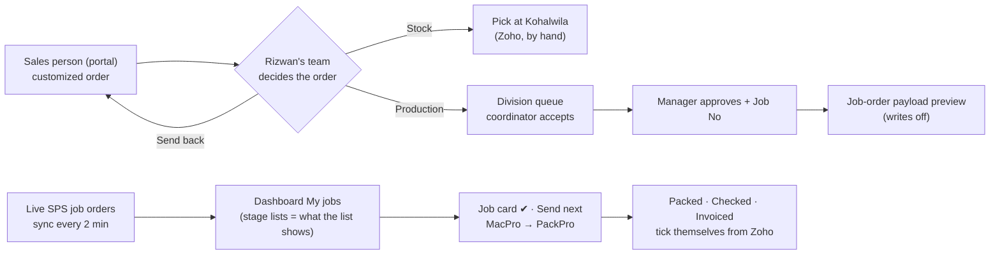

# Joint demo v0.1: Order Portal + Production Dashboard on live SPS data — and the four Sundays after it

**Rev 3, 21 Oct 2026.** Prepared by Abdul Hadhee | IT Executive.
- Rev 1: filter in the sync, per-line decision, demo write mode → plan-critic round 1 **BLOCK** (C1–C7).
- Rev 2: display-only filter, portal = OP S0+S1 as written, writes off → round 2 **BLOCK** on four text
  points (C1–C4), design accepted.
- **Rev 3:** one new column (Portal Ref) in migration **007**; the filter is one `shown()` check inside the
  job list only; the G3 TEST order lives only on the demo morning; the v0.1 dashboard database is a
  **demo copy**, replaced before real use. Response table: §13.
- **Rev 3.1 (21 Oct):** plan-critic round 3 = **APPROVE-WITH-CHANGES**; its C1–C3 and notes applied (G3
  not-found code recorded by a one-off read-only GET, draft fallback; v0.1 database = `data/production.db`
  as practice data, archived at v0.3 with the re-entry steps; PDD amended to migration 008; Unassigned and
  the unread badge; unit-name mapping; dashboard gates straight after track B; live `.env`).
  **Status: APPROVED — build may start** (doctrine gate: plan-critic passed).

Delta over:
- **OP** = `wiki/specs/2026-10-18-order-portal-spec.md` Rev 3.2 (READY for S0/S1); repo `/root/dev/order-portal`
  (not created yet), port 4800.
- **PDD** = `wiki/specs/2026-10-21-pd-demo-release.md` §3 (defaults for Q0–Q14), §5.1 (My jobs) and §6 (set-up
  script) on top of **FR** `2026-10-08-pd-managers-full-release.md` Rev 3.2; repo `/root/dev/production-dashboard`
  (`aa4837b`). PDD §4 (public sign-in) is **not** in v0.1 and moves from migration 007 to **008** (§2).

Evidence: `reports/2026-10-21-pd-demo-plan/research/item-flows-research.md`, `research/sales-analysis.md`,
`research/data/stage-*.csv`.

## 0. Owner decisions (21 Oct; recorded in `/root/CLAUDE.md` §1)
- **D1** Two separate apps.
- **D2** Live data from v0.1, "filtered so we don't cross the API limit". Plain truth (analysis §5): the full
  sync already fits; at a flat 2-minute poll the dashboard uses a median 1,826 and at most about 4,676
  calls/day of SPS's 7,500. A customer/unit filter saves almost nothing (88 % of calls are list polls). The
  limit is protected by the **2-minute poll and a 4,500 cap**; the stage lists decide **which jobs the job
  list shows**.
- **D3** Earliest demo of both together; a release or plan-and-test point **every Sunday for 4 weeks**; full
  release after.
- **D4** Goods gatepass after 25 Nov.
- **D5** SPS read through `itexe@`; SH through the `rizwan@` browser, read-only (from v0.4).
- **D6** Production first: every SPS unit with volume must see real jobs.

## 1. What v0.1 shows

**Walkthrough (about 20 minutes):**
1. **Portal:** a sales person orders `SP-Kraft Food Wrap(10 X 10 )` for the existing SPS contact **TACO BELL**;
   Rizwan's team sends the order to Production; the OPD coordinator accepts; the manager approves with a
   Job No; the portal shows the **exact job order it would create** (OP §4.3 screen 4). Writes stay off.
2. **A two-kind order** within OP's rules (every line an SPS item, OP O1 / CHECK at OP lines 227, 613): two
   customized lines + `Paper White Straw 6mm x 20cm (Packed)` (SPS, made-for-stock). Decided "Production";
   the PSU coordinator returns the straw line, and Rizwan's team fulfils it **from stock** (OP L6 → L7). The
   bought-in lines of a real mixed order (e.g. SH SO `ATXSO261017851`) are shown on a slide only; they come
   in v0.2.
3. **Dashboard, live:** this week's real job orders for the stage-1 lists (~34 a week): ready-to-run chips
   (artwork / die cutter / screen-plate), Job card tick, Send next MacPro → PackPro, and real jobs whose
   Packed / Checked / Invoiced ticked themselves from Zoho.
4. **The hand-off portal → Zoho → dashboard** with the **G3 TEST job order on the demo morning** (§4).

## 2. Scope of v0.1

**Portal = OP S0 + S1, unchanged in behaviour.** Writes disabled (`ZOHO_WRITES_ENABLED=false`, OP AC28); the
payload preview is the demo. Deltas to OP, configuration only:
- **Instance and database:** `PORTAL_INSTANCE=demo`; a new config key **`DB_PATH`** (default
  `data/order-portal.db`, demo value `data/order-portal-demo.db`; OP's key list at OP line 639 and §9 at
  line 602 gain it). The demo DB is deleted before v0.4, **after exporting its `zoho_writes` ledger rows**
  (the G3 record).
- **Tunnel only:** `APP_ORIGIN=http://localhost:4800`, no bridge listener bound (OP §10 line 625's Traefik /
  office-IP rules start with the public address in v0.3).
- Out: S1b, S2–S6, bought-in lines, per-line decisions.

**Dashboard = PDD §3 defaults + §5.1 My jobs (reduced) + §6 set-up script + the display filter (§3).**
- In: the 17 failing tests root-caused and fixed first; ready-to-run fields + "Not ready to run" counter;
  set-up script with undo; My jobs list with strip, Job card tick, Send next, and the admin's Unassigned
  list. Out (→ v0.2): Send selected, attention sort, customer search, drawer timeline, GM view.
- **Migration 007 (new):** `ALTER TABLE zoho_so_headers ADD COLUMN cf_portal_ref TEXT` (nullable). Additive;
  MANIFEST.json entry; numbering stays contiguous; the hard pin `release-migrations.test.js:40`
  (`user_version === 6`) is updated to read the expected version from the migrations folder, and 007 gets
  its own exact-objects test; `db-migration-guard` review. **The website sign-in migration is 008** (PDD §4.8,
  AC-D22, §9, §11 amended in the same branch); `/root/CLAUDE.md`'s reservation line is updated. No backfill: only orders made after G3 carry a Portal Ref.
- **Mapping:** `config/zoho-columns.json` `so_headers` gains `cf_portal_ref` from the **API name recorded at OP
  G1 step 6** (OP line 817); detail writes then store it (`zoho-sync.js:277,284-288`). V8 is not needed for
  this.
- **Sync: unchanged logic.** Settings only: `ZOHO_SYNC_INTERVAL_MIN=2`, `ZOHO_DAILY_CALL_CAP=4500`.
- **Demo database (practice data):** v0.1 runs on the normal file **`data/production.db`** (`DB_PATH`,
  `server/config.js:46`; the shdeploy row of runbook-release-0 line 42 names it, so deploy backups cover
  it, `/root/ops/shdeploy:147-150,182-183`). Ticks and sends are append-only
  (`006-line-job-workflow.sql:97-102`), so **everything done on the dashboard before v0.3 is practice and is
  discarded** — the managers are told this on the demo day. At v0.3 the human stops the process, archives
  the file with `sqlite3 data/production.db ".backup 'data/demo-archive-<date>.db'"` (never `cp`), removes
  `data/production.db`, and starts on an empty one. Re-entry for the fresh database (budgeted in the v0.3
  release, 1–1.5 days): `create-admin`; users and DD-3 pairs; the PDD §6 set-up script (MACPRO/STRIP,
  families, stages, `routes-demo.csv`, lid routes); the `display_filter` row; a full re-sync under the 4,500
  cap (history lane sizing to be re-checked; "two nights" is an estimate).
- **Live sync starts on Mon 9 Nov** at the latest (three days before the target), so history and
  `counters_complete` (`job-queries.js:148-150`) are loaded by the demo.
- Tunnel only (`BRIDGE_HOST=` empty, `APP_ORIGIN=http://localhost:4300`, runbook-release-0 lines 24-36).

## 3. The display filter (dashboard job list only)

### 3.1 Rule
A helper `shown(J, ctx)` decides whether a job appears in **`listJobs`** — the My jobs feed and its
counters (`job-queries.js:96-112`) — and nowhere else. A job is shown when **any** of these holds:
- its SO's customer (`cf_order_received_from`, trimmed, case-folded, inner spaces collapsed) is on the
  customer list;
- its **resolved home unit** (FR §8.0b) is on the unit list;
- its SO has a `cf_portal_ref`;
- someone has **acted on it** (any send, move, tick or untick event), so nothing a person touched disappears
  on a narrowing.

**Inside `listJobs`:** `shown()` filters the scoped list, the counters **and** the unread badge
(`unread_arrivals`, `job-queries.js:107`, which counts from `ctx.jobs`), and is **skipped when
`at === 'unassigned'`** (`job-queries.js:96`) — the admin's Unassigned list shows every reason
(`no_job_no`, `no_manager`, `unit_has_no_pair`, no home unit; `line-jobs.js:313-315`) whatever the stage.

**Not filtered** (unchanged behaviour): the sync queue (`loadQueue`, `zoho-queue.js:66-72`), the admin
problems route (`routes/zoho-sync.js:61-63`), all writes (`job-writes.js:27,130`), the admin's **Unassigned**
list (jobs with no home unit can never match the unit rule, `line-jobs.js:50,59,62`), and single-SO reads
(`oneJob`, `bySo`, drill-down, summaries, trail — `job-queries.js:166-273`): opening a shown job's SO shows
**all** its lines. There is no line-job SSE notice to filter; the sweep (`sweep.js:55-86`) is legacy and
untouched.

### 3.2 Setting and admin route
- One settings row **`display_filter`** = JSON `{"enabled": true, "stage": "S1", "customers": [...],
  "units": [...]}`. **Missing or `enabled:false` = no filter** (fail open: everything shows).
- `customers` holds **display names** as listed in `research/data/stage-sps-lists.csv` (no contact ids in
  v0.1).
- `units` holds **unit codes** (`002-seed.sql:5-10` plus MACPRO/STRIP from the set-up script). Mapping from
  the research CSV's display names: "PCU/MOBA cups" → PCU; "MOBA Punching" → MOBA; "Lids" → PCLU;
  "Plates" → PPU; "Cake wrappers" → CWU; PSU, RWU, FPP, DPU, SHPS, CPU as they are. `MOBA_P` (seeded, never
  used by any line tag) is deliberately not listed.
- Changed through **`PUT /admin/display-filter`**: zod-validated; every unit must exist in `divisions` (same
  pattern as `admin-config.js:505-518`); one transaction + audit row; effective on the next read.

### 3.3 Stages (12-month averages, computed on the **header** division rule — `sales-analysis.md:268`; the
dashboard uses the tag-first home unit, so expect similar but not identical counts)

| Stage | Starts | Customers listed | Unit codes | Real SPS jobs shown / week |
|---|---|---|---|---|
| **S1** | demo week | 27 (9 key + 6 OPD feeders + 12 SHPS feeders) | PSU, RWU, PCU, MOBA, PCLU, PPU, CWU, FPP, DPU | ~34 |
| **S2** | Sunday 1 | 31 | + SHPS, CPU | ~52 |
| **S3** | Sunday 2 | 61 | same | ~57 |
| **S4** | Sunday 3 | — | `enabled:false` (everything) | ~72 |
| review | Sunday 4 | — | — | go / hold for the full release |

Per unit, jobs/week (S1 → S4): OPD 6.5 → 27.1; SHPS 4.6 → 20.2; PSU 6.1; RWU 4.5; PCU 6.3; CPU 2.2 → 3.6;
MOBA punching 2.0; lids 0.7; FPP 0.5; DPU 0.4; plates 0.1; cake wrappers 0.1. **Thin units** (lids, FPP, DPU,
plates, cake wrappers ≈ 1.8 a week together) look nearly empty at any stage; the demo says so. No practice
jobs.

## 4. G3 TEST order: the demo morning
Following OP G3 (OP lines 835-841) and the owner's 18 Oct OQ4, in **one session on the demo morning**:
1. The owner is told; the human sets `ZOHO_WRITES_ENABLED=true` in the **demo** portal's `.env` and restarts
   it (`shdeploy`/pm2 by the human).
2. One customized line is approved; the portal creates **one** job order marked **"TEST – do not produce"**
   (ref `demo-<uuid>`); V2 is recorded.
3. Within 2 minutes it appears on the dashboard (it carries a Portal Ref, so it is always shown) — this is
   walkthrough step 4.
4. **Right after the demo** the TEST job order (and any TEST project) is deleted by hand; writes are switched
   back off (human, `.env` + restart).
5. Right after the hand deletion, the human makes **one** read-only `GET /salesorders/<deleted id>` with the
   read token (curl, outside the app) and records the HTTP status and JSON `code` in the dashboard's
   `docs/zoho-api-findings.md` (V3(a)). `ZOHO_SO_NOT_FOUND_CODE` (`client.js:7`) is then set in a normal
   reviewed commit with a test, deployed later — never edited live. (The dashboard itself never re-asks for
   a deleted order and does not keep response bodies, `zoho-queue.js:83-87`, `client.js:2,68`.) The deleted
   job stays on the dashboard, labelled TEST, until the next 02:00 full list marks it `missing_in_zoho`
   (`zoho-sync.js:212-219`) — at most one night.
6. **Fallback** if the job order is created as a draft and the confirm built into S1 does not work (the confirm
   endpoint is only learned in V2, OP lines 525, 838; the dashboard hides drafts, `line-jobs.js:134`): the
   human confirms it by hand in Zoho; if that is not possible in the session, the hand-off is shown from the
   recorded screens. Allow **2–4 minutes** for it to appear (lines arrive with the detail fetch).

**Declared delta to OP G3 step 5** (OP line 840: "run G3 before the dashboard goes live, or after that code
is recorded"): here G3 runs while the dashboard is already syncing live and before the not-found code is
known; the consequence (the TEST job visible until the next 02:00) is accepted for the demo database.

## 5. The Sunday rhythm (4 Sundays after the demo)
Each Sunday (IT, about 2–3 hours): (1) check last week — sync health, calls vs cap (both apps), jobs shown
per unit, problems; (2) move `display_filter` to the next stage (audited) or hold; (3) release what is ready
(§6) with the release-captain package — the owner deploys; (4) plan and test the next part and list the
owner's questions for Monday.

## 6. Versions (features per update) — "not before" dates, each with what it waits on

| Version | Not before | Portal | Dashboard | Waits on |
|---|---|---|---|---|
| **v0.1 Joint demo** (private, demo DBs) | earliest Fri 6 Nov, latest Tue 17 Nov; **target Thu 12 Nov** | OP S0+S1: order, per-order decision, queue, accept, approve + Job No, payload preview | My jobs (live, stage S1), strip, ready-to-run, Job card, Send next, Unassigned | P1 read key; P2 OP G1/G2 (+ Portal Ref API name); DD-3 pairs and Q-U confirmation; demo accounts for sales / Rizwan's team / coordinators / managers / GM; P3 key-customer names; V-D4 parked; migration 007 review; the 17 failing tests; the human's first-deploy steps (GitHub, protected-paths, shdeploy rows, anonymised fixture) |
| Sun 15 Nov | — | review of the demo week; stage S2 | | — |
| **v0.2** | Sun 22 Nov | **Per-line decisions**; bought-in and made-for-stock lines (SH item list import; "to purchase" list) — own spec delta + plan-critic | Send selected, attention sort, customer search, drawer timeline, GM view | that delta's APPROVE |
| **v0.3 Public, approval-only** | Sun 29 Nov | Approval-only sign-in (portal sign-in spec delta) | PDD §4 sign-in (migration 008); **fresh live DB + re-sync** | PDD §4 plan-critic + security APPROVE; DD-5 (nodemailer) yes; DNS + Traefik; company sending mailbox |
| **v0.4 Live writes, one division** | Sun 6 Dec | Live job-order writes for OPD customized; SH reader (S2) for Kohalwila stock; demo portal DB exported and retired | Wait-limit flags; routes confirmed (Q0–Q14) | OP OQ5, OQ20, V9–V12; managers' Q0–Q14 answers; owner's wait-limit numbers |
| **v0.5 All divisions** | Sun 13 Dec | Writes for all divisions; new item (S3), new customer (S4), images (S5), weekly report (S6) | All pairs; STRIP / cups decisions | OP OQ7, OQ19, V5, OQ8, OQ9, V6, OQ18, V4, OQ12 |
| **v1.0 Full release** | set at the v0.5 review | daily use; "to purchase" list handed to purchasing | Goods-gatepass hand-over; Stores/Logistics receive step | goods gatepass (after 25 Nov); the reorder screen is INV-05 (Jan 2027), not part of v1.0 |

## 7. Acceptance criteria (v0.1 deltas; OP and PDD ACs apply as written)
- **J-AC1** With `display_filter` at S1, `listJobs` returns a job whose customer or home unit is listed and
  omits one that is not; the omitted job's lines are still updated by the sync (DB row changes) and it is
  still in the problems route, the Unassigned list (when home is NULL, and a `no_job_no` job whose home unit
  is not listed) and its SO's drill-down; `unread_arrivals` counts only shown jobs.
- **J-AC2** A job with `cf_portal_ref` is in `listJobs` at any stage; a job with any send, move, tick or
  untick event stays in `listJobs` after the lists are narrowed.
- **J-AC3** `PUT /admin/display-filter`: valid body → saved, audit row, effective on the next `listJobs`
  without restart; unknown unit code or malformed body → 400 and nothing saved; non-admin → 403.
- **J-AC4** No `display_filter` row, or `enabled:false` → `listJobs` equals the unfiltered result.
- **J-AC5 (guard)** `loadQueue` returns identical entries with the filter at S1 and with it off (fake clock,
  same fixture) — it fails only if someone moves the filter into `loadContext`.
- **J-AC6** Customer matching: `"Spar SL (Private ) Limited "` (trailing space, odd inner spacing) matches the
  listed `"Spar SL (Private ) Limited"`; case does not matter.
- **J-AC7** Home unit vs header: a line tagged MACPRO under an OPD header is matched by its home unit
  (MACPRO), not the header text.
- **J-AC8** Migration 007 applies to a v6 database with data; existing rows get NULL `cf_portal_ref`; a second
  start changes nothing; lint, contiguity and MANIFEST checks pass; a detail payload carrying the Portal Ref
  field stores it.
- **J-AC9** Portal demo instance: with writes off, approving a line makes **zero** Zoho write requests (fake
  Zoho log) and shows the payload preview (OP AC28 unchanged); the instance uses `DB_PATH`.
- **J-AC10** Both apps answer only on the loopback listener: no socket on the bridge address.
- **Config regression (not a feature test):** with `ZOHO_SYNC_INTERVAL_MIN=2` and cap 4,500 the fake Zoho log
  shows one list poll per 2 minutes and details stop at the cap under the existing reserve rule.
- **Gate:** unit and e2e suites green in both repos before the v0.1 deploy package; the 17 dashboard failures
  root-caused first.

## 8. Build plan for v0.1 (parallel tracks; working days, Saturday half day; an estimate, not a promise)

| Track | Steps | Days |
|---|---|---|
| **A Portal** (`/root/dev/order-portal`) | OP S0 (3–5) → OP S1 (6–9), tests first, per-slice reviews; `DB_PATH` | 9–14 (OP gives no estimate; mine, unchecked) |
| **B Dashboard** (`/root/dev/production-dashboard`) | 17 failing tests (1–3) → ready-to-run + set-up script (2) → migration 007 + mapping + `shown()` + admin route (1.5–2) → My jobs page (3–4) | 7.5–11 |
| **C Gates** | **dashboard part straight after B** (its reviews + first deploy, so the live sync starts by Mon 9 Nov); portal part after A; reviews + fixes (2–3); first-deploy work for both repos (1–2); G3 on the demo morning (0.5) | 3.5–5.5 |
| **Total (A ∥ B, then C)** | | **13–20.5** |

From Thu 22 Oct (Saturdays half days): 13 days → about **Fri 6 Nov**; 20.5 days → about **Tue 17 Nov**.
**Target Thu 12 Nov** (day 17.5, about 60 % through the range; no slack). A Poya holiday in the window
(date to be checked) moves it later. **Check points:** Mon 2 Nov — portal S0 done; Fri 6 Nov — portal S1
half done and track B through the filter. If either is missed, v0.1 shows the dashboard live and the portal
on its test data, and the joint walkthrough moves to Sun 22 Nov. The fresh-DB re-sync for v0.3 is a track C
item of the v0.3 release (two nights under the cap).

## 9. Preconditions (owner)
- **P1** SPS read-only Self Client under `itexe@` (all READ scopes listed 21 Oct) → values in the dashboard
  dev `.env` now (for the read-only checks), and in the **live** `/root/production-dashboard/.env` at first
  deploy (the human). Dev tests stay on the fake Zoho. In progress.
- **P2** OP G1 (write key incl. projects scope; `Portal Ref` field and its **API name**) and G2 before the
  rehearsal.
- **P3** Key-customer account names (Gamma = Pizza Hut + Taco Bell; Jaykay = Keells; Weligama Hotel
  Properties = Marriott Weligama; Courtyard Marriott has no SH account).
- **P4** DD-3 pairs and Q-U: who manages and coordinates each unit (PCU and STRIP defaults), and the demo
  accounts (names for sales, Rizwan's team, coordinators, managers, GM).
- **V-D4** The uncommitted Sign in with Zoho work: whose? Parked on its own branch before track B; never
  deleted.

## 10. Non-goals for v0.1
Public address · approval-only sign-in · SH reads · any live Zoho write except the one G3 TEST on the demo
morning · bought-in lines · per-line decisions · new item / new customer / images / weekly report ·
reorder · goods gatepass · phones · practice jobs · contact-id matching.

## 11. Rollback
First deploys of both: `pm2 delete` the process and remove its shdeploy row. Dashboard: set-up script
`--undo`; `display_filter` → `enabled:false`; migration 007 is additive (column unused). Demo databases of
both apps are disposable by design (portal ledger exported first). Zoho: only the G3 TEST job order, deleted
by hand on the demo morning.

## 12. Risks
- **Review queue** with two builds → reviews per slice.
- **P1 late** → track B completes on the fake Zoho; live data waits.
- **Worst-case days:** the full sync's worst day (~4,644–4,676 calls) is above the 4,500 cap; on such a day
  details stop while list polls continue (existing reserve), so some jobs show "checking" until the next day.
- **Thin units look empty** — stated in the demo.
- **TEST order visible** on the demo dashboard until the next 02:00 after deletion (§4).
- **Home-unit counts** may differ from the header-rule estimates in §3.3.

## 12b. Overrides of the preview spec found during the build (provisional, owner to confirm)
- **N1 (21 Oct night):** preview spec `2026-09-28-pd-manager-preview.md` lines 371 and 822 and AC86 (line 627)
  say a module whose run ends `too_many_bad_rows` is "not retried the same day". The demo branch instead
  **retries every cycle and logs one `error` per Colombo day per module** (commit `6f4478e`), so a day-long
  freeze cannot leave the screens a day stale. **Cost:** a failed run does not move the watermark, so every
  retry re-reads all pages changed since the last ok run; over a bad day at 2-minute cycles the list calls
  grow and take budget from detail fetches under the 4,500 cap. If the owner prefers "freeze for the day",
  the preview text stands and `6f4478e` is reverted.
- **N2:** preview AC97(e)'s fixture (200 other orders) contradicts its own line 460 ("a retry can wait"); the
  demo branch keeps retries last and uses 10 other orders (commit `bad7c26`).

## 13. Response to plan-critic round 2
| Finding | Answer |
|---|---|
| C1 columns | Migration 007 adds `cf_portal_ref`; mapping from the recorded API name; contact-id matching dropped (display text only); sign-in moves to 008; +0.5–1 day (§2, §8, J-AC8). |
| C2 placement | `shown()` only in `listJobs`; queue, problems, writes, Unassigned and single-SO reads unfiltered; SSE/sweep removed (§3.1, J-AC1, J-AC5). |
| C3 G3 timing | Demo-morning session per OP G3: create, show, delete, writes off; 404 recorded as the not-found code; ref `demo-<uuid>`; human toggles writes; ledger exported before the DB is retired (§4, §2). |
| C4 permanent demo actions | v0.1 dashboard DB is a demo DB; fresh DB + re-sync before v0.3 (§2, §6, §8). |
| N1 codes / estimates | §3.3. · N2 one JSON setting, fail open, zod, unit check, names (§3.2, J-AC3, J-AC4). · N3 ticks count (§3.1, J-AC2). · N4 two-kind order within OP O1; L6 → L7 (§1). · N5 `DB_PATH`; bridge off (§2). · N6 dates 6–17 Nov, target 12 Nov ≈ 60 %, two check points, live sync from 9 Nov (§2, §8). · N7 blocked-by complete (§6, §9). · N8 ACs relabelled and added (§7). · N9 worst day stated (§12). |
