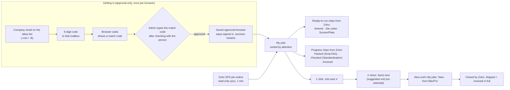

# PD demo release: our own approval-only website for the managers' flow, built on the new "Operation To Be" maps with safe defaults

**Rev 3, 21 Oct 2026.** Spec delta on top of the **PD managers' release** spec
`wiki/specs/2026-10-08-pd-managers-full-release.md` (Rev 3.2, "FR"), which sits on
`wiki/specs/2026-09-28-pd-manager-preview.md`. FR applies unless this file names a section and says what
changes. Code: `/root/dev/production-dashboard`, main `aa4837b` (9 Oct).

**Change log**
- **Rev 1** (21 Oct): web page demo with defaults for Q0–Q14. Plan-critic round 1 = BLOCK (C1–C7).
- **Rev 2** (21 Oct): critic's simpler design (no demo migration, availability as response fields, admin
  API, live data only) + owner direction: our own website under standard-holdings.lk, approval-only.
  Sign-in designed with passkeys. Security review = PASS-WITH-CHANGES (S1–S12); plan-critic round 2 =
  BLOCK (C1–C5, all in sign-in or AC-D4).
- **Rev 3** (21 Oct): **owner correction:** "fingerprint" meant *browser* fingerprinting, not a scanner;
  if that does not work, **email login + admin approval + a saved session that survives server restarts**;
  sign-in uses **company mail on the .com and .lk domains, not Zoho mail**. Passkeys are dropped. §4 is
  rewritten; the security and critic findings that still apply are built in. Response table: §14.

Inputs: the 13 maps in `/root/New Production Flows/`; `reports/2026-10-20-new-production-flows/out/`
(explainer + plan-vs-new PDFs, questions Q0–Q14); the 8 Oct read-only Zoho pulls
`reports/2026-10-08-pd-zoho-study/`; the code at `aa4837b`. Test state on 21 Oct (tree with uncommitted
auth work, V-D4): `npm test` 425 tests, 371 pass, 17 fail, 28 skipped, 9 todo.

---

## 0. What the demo is

A manager or coordinator opens **production.standard-holdings.lk** (name to confirm, P2) on a browser the
admin has approved, and is **already in**: no password, no code, no click. They land on **My jobs**:
every open SPS job in their units with customer, item, quantities, due date and a strip that mostly
**ticks itself from Zoho**. They tick the one step Zoho cannot know (Job card) and press **Send next** to
hand the job to the next unit. The GM sees everything; the admin clears **Unassigned** and approves people
and browsers. Nobody else sees anything: an unknown email or an unapproved browser gets the sign-in screen
only.

## 1. The flow on one screen

## 2. Owner decisions

| ID | Decision | Status |
|---|---|---|
| **DD-1** | Surface: **our own website** under standard-holdings.lk, not the browser add-on (replaces FR D-L). | **Owner, 21 Oct.** FR §10–11 are not built. |
| **DD-2** | Live data only; the SPS read-only Self Client (FR Q-Z1) is precondition P1; no snapshot mode. | Proposed (critic R1 C5). |
| **DD-3** | Pairs: PCU → the MOBA pair; STRIP → the MacPro pair. | Proposed; admin data; confirm before the demo. |
| **DD-4** | Sign-in = **company email on the allow-list → emailed 6-digit code → admin approves that browser (match code) → saved approved browser**, signed in automatically until blocked or unused for 90 days. Browser fingerprinting is used **only as a change alarm**, never as the key (§4.6). Replaces FR D-O "Sign in with Zoho" for the website. Password login stays only on the private tunnel, for admins. | **Owner, 21 Oct** (email + approval + saved session); the fingerprint-as-alarm reading and the 90-day figure are proposed. |
| **DD-5** | New dependency: **`nodemailer` 10.x** (10.1.7 on npm, 21 Oct) to send the codes. Pinned at install. No other new library (passkey libraries dropped). | **Needs the owner's yes** (doctrine §4). |
| **DD-6** | Allowed sign-in domains: **`standard-holdings.com`, `standard-holdings.lk`** (a setting). | Owner said ".com & .lk"; **exact domain names to confirm**. |

## 3. Defaults for the open questions (Q0–Q14)

Every default is reversible through the **existing admin API** or a setting, with no migration. Rows
marked **code** say so. Each default is labelled "our assumption" in the demo script.

### 3.1 Units
| Q | Default | Mechanism |
|---|---|---|
| Q0 | Show the "To Be" maps. | — |
| Q1 Stripping | New unit **STRIP**, paired per DD-3; not on any route; offered in Send next's list. | `POST /admin/divisions` (`admin-config.js:151-154`); 409 on a re-run = already there. If later deactivated, the admin moves jobs sitting at STRIP (FR F5.6). |
| Q6 CPU | Kept. | — |
| Q7 Cups | One unit **PCU**, paired per DD-3. | `division_pairs` admin |
| Q11 FPP / DPU | As FR. | — |
| Q14 Operation team | = the coordinators. | — |

### 3.2 Routes
| Q | Default | Mechanism |
|---|---|---|
| Q2 MacPro first | Routes whose **first token** is `PackPro`, `OPD-Offset`, `MOBA-Plate`, `MOBA-Cake` or `MOBA-Punch` get **`MacPro > ` prefixed**. `MOBA-Cup` is not prefixed (maps: printing "if applicable"); the admin adds MacPro per item where cups are printed. | Derived `routes-demo.csv` (same header, checked at `cli/import-routes.js:35`) + a demo copy of the unit map with `"MacPro": "MACPRO"`; the **existing CLI importer**, unchanged. The CLI writes without the audit log (`import-routes.js:78-89`), so the set-up script keeps its own log and undo list (§6). |
| Q2 (needed for it to show) | **`route_unit_families` → `[["OPD","PACKPRO"]]`** (was `[["OPD","PACKPRO","MACPRO"]]`, `006:93`). `resolveRoute` (`line-jobs.js:66-81`) replaces family members by the **home** unit, so results are: home PACKPRO → `[MACPRO, PACKPRO, CPU]`; home MACPRO → `[MACPRO, PACKPRO, CPU]`; **home OPD → `[MACPRO, OPD, CPU]`** (existing behaviour, `line-jobs.js:69,75`; OPD stands for the offset bucket). Knock-on: a MACPRO-tagged line on a route without MACPRO becomes "route mismatch"; FR AC28/AC31 expectations change (§8). | `PUT /admin/division-rules` (`admin-config.js:526`). It validates every unit in all five rule keys (`:531-534`) and replaces all five (`:539`): MACPRO must exist first, and the undo list saves all five keys. |
| Q8 Lids | PCLU-home items get route **[PCLU]**. These items become `source='admin'` (`admin-config.js:493`) and later CSV re-imports skip them (`import-routes.js:81`); the undo restores units **and** the previous source. | `PUT /admin/item-routes/:id` per item (`admin-config.js:481-498`), audited |
| Q3 Send next | Unchanged (FR D-B). | — |

The **demo database starts with no route events**, so re-importing routes moves no job mid-route.

### 3.3 The strip and the "ready to run" chips
| Q | Default | Mechanism |
|---|---|---|
| Q4 Artwork, die cutter, screen/plate | Three read-only fields on each job in the API response, from the SO header columns `cf_artwork_availablility`, `cf_dye_cutter_availablity`, `cf_screen_plate_availability_2` (`001-schema.sql:10`; written by the sync, `zoho-sync.js:277,284-288`; key confirmed in `v8/d.json`). Normalised: `available` / `not_available` / `not_applicable` / `not_set` (trim, case-insensitive; "Not Available" and "Not Avaialble" → `not_available`). **Per sales order**: every line of an SO shows the same values. | **code** (~40 lines: `line-jobs.js` `JOB_ROWS` + DTO, tests). FR's add-on would read the same DTO; it is not built. |
| Q4 counter | New counter **"Not ready to run"** = open jobs with any field `not_available`. Computed on read; no stored flag. `not_applicable` / `not_set` never count. Separate from FR's `docs_missing`. | **code** (`job-queries.js` counters) |
| Q4 / Q9 hide steps | Manual **Artwork** and **Item photo** removed from every unit's step list. **Job card** stays (1 click). | `PUT /admin/divisions/:code/stages` (`admin-config.js:160-179`), audited, reversible |
| Q5 Material issued | Not on the strip; the drawer shows "Material issued (RM Issue Note) — coming later". | static text |
| Q12 Paper checks | Not shown. | — |
| Q13 PSU wait | Proposed 3 working days; **off** until the owner confirms (FR F6.1). | admin setting |
| Labels | Package → **Packed (SmarTAG)**, shipment → **Checked (Standardization)**, invoice → **Invoiced (to SH)**. | display map in the web page |

Q10 (daily job targets) is out of scope.

## 4. Getting in: approval-only sign-in with saved browsers (DD-4)

### 4.1 What is true about this design (plain words)
- Only **people on the allow-list** can start, and only with a code sent to **their company mailbox**.
- A browser gets in only after **the admin approves that browser**, having checked a match code with the
  person outside the system (in person or on a known phone number).
- An approved browser holds a **saved pass** (a long random secret in a secure cookie, stored hashed in our
  database). Server restarts and deploys do **not** sign anyone out. The pass renews itself on use and
  ends after **90 days without use**, or at once when the admin blocks the browser or the person.
- **The saved pass is a key.** Anyone who copies that cookie off the computer can use it until it is
  blocked. Mitigations: the cookie cannot be read by page scripts (`httpOnly`, `__Host-`, `Secure`,
  `SameSite=Strict`), the change alarm (§4.6), the block button, and short working sessions underneath
  (§4.4). This is the accepted trade-off for zero-click daily use.

### 4.2 Flows
1. **First time on a browser:**
   1. The person types their company email. The page answers the same for every input: "If this email is
      allowed, a code is on its way."
   2. If the email is an **active user's sign-in email** on an allowed domain (DD-6), a 6-digit code is
      queued to **the address stored in our database** (never the typed string).
   3. Correct code → a **pending browser** row is created and the browser receives its saved-pass cookie.
      **No session is issued.** The page shows **"Waiting for approval"** and a **6-character match code**.
   4. The person tells the admin the match code (in person or by phone). The admin opens **Devices**, picks
      the pending row, **types the match code**, sets a label ("Ishan – office PC") and approves.
   5. The waiting page notices (polls the status with the saved pass only) and opens My jobs.
2. **Every day:** open the site → in. **Zero actions.** (Behind the scenes, the saved pass creates a fresh
   working session, §4.4.)
3. **New computer or new browser:** flow 1 again; the admin blocks the old one if it is gone.
4. **Mail not arriving:** the admin can issue a **one-time recovery code** for one named person (§4.7).

### 4.3 Rules (from the security review, adapted)
- **R1 Approval cannot be one click.** The admin must type the match code shown on the waiting browser.
  The approval row shows what the server saw: request time, IP, office network yes/no (setting with the
  office IP list), browser + OS (from the user agent), and the fingerprint summary (§4.6).
- **R2 Pending limits.** Pending browsers expire after **24 h**. At most **one pending browser per person**;
  a new one replaces the old and the row shows "replaced an earlier pending browser".
- **R3 Mail on every change.** The person gets an email when a browser is enrolled and when it is
  approved ("Not you? Call IT.").
- **R4 No self-approval.** Nobody approves their own browser. A browser of a person with the **admin**
  role is approved **only from a tunnel session** (or by a second admin). The first admin's browser is
  approved through the tunnel.
- **R5 Admin actions on the public site need a fresh code.** Approving, blocking, issuing a recovery code,
  or changing anyone's email or roles from the public site requires an email code entered within the
  last **15 minutes** (step-up). On the tunnel, the password session is enough.
- **R6 Blocking.** Blocking a browser ends its sessions on the next request and closes its live update
  stream. Blocking a person (`users.active = 0`) also blocks every browser of theirs, cancels open codes,
  pending browsers and recovery codes. **Changing a person's sign-in email blocks all their browsers.**
  A blocked browser never comes back; it must enrol again.
- **R7 Only two ways in.** A session is created only by (a) an **active** saved browser, or (b) the
  **password on the tunnel listener** for a person with the admin role. Sign in with Zoho
  (`/api/auth/zoho/exchange`, V-D4) is **absent** from this build; `EXTENSION_ORIGINS` must be empty and
  the server refuses to start if it is set while the website sign-in is on.
- **R8 Tunnel vs public is decided by the listener, never by headers.** A request is **tunnel** only if it
  arrived on the loopback listener (`req.socket.localAddress === '127.0.0.1'`), its remote address is
  loopback, and it carries no `X-Forwarded-For`, `Forwarded` or `X-Real-IP`. `Host` is never used.
  Everything on the bridge listener is public. Password sessions are accepted **only** on the tunnel
  listener; saved-browser sessions **only** on the bridge listener.
- **R9 Origins.** `requireOrigin` accepts an exact list: the public origin (`APP_ORIGIN`) on the bridge
  listener, and `http://localhost:4300` **only** on tunnel requests (R8).
- **R10 Pending browsers have no session** and reach only the status endpoint.
- **R11 Health.** `/api/health` returns only `{ok}` on the bridge listener; the detail stays on loopback.
- **R12 Secrets never logged.** No code, recovery code, saved pass, session token or SMTP password in
  logs or `audit_log.detail_json`. Mailer with `logger:false, debug:false`, TLS required, certificate
  verified; SMTP errors are logged without credentials.

### 4.4 Sessions under the saved pass
- New column **`sessions.auth_method`** (`'password'` | `'browser'`) and **`sessions.browser_id`**.
- A saved-browser session lasts **12 h** (one working day) with **4 h idle**; when it ends, the next request
  with a valid saved pass silently creates a new one. Password (tunnel) sessions keep today's limits
  (`sessions.js:3-4`).
- On **every request**, `loadSession` checks: the session, the person is active, and for `browser`
  sessions that the browser row is `active`.
- **`must_reset`** (`admin-users.js:50`, `middleware.js:74-79`) does **not** apply to `browser` sessions:
  those people have no password to reset.
- A new session token is issued at every session creation; the pre-sign-in cookie is cleared.

### 4.5 Email codes
- 6 digits, **10 minutes**, single use; stored as an **HMAC with a server secret**; compared in constant
  time; **bound to the pre-sign-in cookie** of the browser that asked (`__Host-`, `SameSite=Strict`);
  a new code cancels older ones.
- **Tries counted atomically before the compare** (`UPDATE … SET tries = tries + 1 WHERE id = ? AND
  tries < 5 AND used_at IS NULL AND expires_at > now`, one row changed or refuse).
- **Caps (counted in the database, so restarts do not reset them):** 3 codes per email per hour; 10 wrong
  tries per email per 24 h → that email locks and the admin is alerted; about 10 requests per IP per hour;
  about 30 mails per hour in total.
- **Same answer** (body and status) for an allowed email, an unknown email, an email at its cap, a wrong
  code and an expired code. Unknown emails also "lock" after 5 tries. **Mail is queued**; the request
  handler never waits for SMTP.
- Mail text: the code in the body, not the subject; the browser and time; "IT will never ask you for this
  code."

### 4.6 Browser fingerprint: an alarm, not a key
- When a browser enrols, the page sends a small summary: browser family, OS, time zone, language, screen
  size, CPU core count. The server stores a hash and the readable summary (shown to the admin at
  approval).
- On each new working session, the same summary is compared. A change in **browser family or OS** (not a
  version update) or **time zone** → the browser stays approved but must enter a **fresh email code**
  before continuing; the admin sees "fingerprint changed" on the Devices list.
- It is **never** the only check: summaries are easy to copy and identical on same-model office PCs.

### 4.7 Recovery code (mail not arriving)
- Issued by an admin for **one named person**; single use; **30 minutes**; stored hashed; same try limits
  as email codes; given **in person or by calling a number already on record**, never in the channel the
  request came from. It replaces only the email code: the browser still goes pending and still needs R1.
  The audit records who issued it and for whom, never the code.

### 4.8 Data: migration **008** (FR §8.1 reserved 007 for "PD-03D MFA"; the joint demo v0.1 took 007 for `cf_portal_ref`, so this sign-in is 008)
- `users` gains **`login_email TEXT`** (company sign-in email; CHECK contains '@'; unique among active
  users on `lower(login_email)`). `zoho_email` (`006:83`) is left as it is for the parked V-D4 work.
- `browsers(id, user_id → users, pass_hash UNIQUE, status CHECK IN ('pending','active','blocked'),
  match_code_hmac, label, enrol_ip, enrol_office INTEGER, enrol_ua, fp_hash, fp_summary, created_at,
  expires_pending_at, approved_by, approved_at, blocked_by, blocked_at, block_reason, last_seen_at,
  last_ip, last_used_at)`.
- `email_codes(id, user_id NULL, email_lower, preauth_hash, code_hmac, purpose CHECK IN
  ('enrol','step_up','recovery'), created_at, expires_at, tries, used_at, cancelled_at, issued_by NULL)`.
- `sessions` gains `auth_method TEXT CHECK (auth_method IS NULL OR auth_method IN ('password','browser'))`
  and `browser_id INTEGER NULL`. Existing rows get NULL (= password).
- Settings rows: `login_domains` = `["standard-holdings.com","standard-holdings.lk"]`, `office_ips` = `[]`.
- Additive only (`lint-migrations.js:71-73`); numbering contiguous; **MANIFEST.json gains 008**; the
  existing AC48 assertions (`release-migrations.test.js:40,44-47`: `user_version === 6`, object list)
  are updated in the same change. `/root/CLAUDE.md`'s reservation line moves to "007 = joint-demo Portal Ref column, 008 = website sign-in".
- `db-migration-guard` and `security-auditor` reviews required.

### 4.9 What the owner sets up (P2–P4)
- **P2** DNS for the subdomain and a Traefik route to the bridge listener (runbook Part B steps 2–4:
  firewall, the Traefik file, the proxy-IP check, `docs/runbook-release-0.md:89-126`). Edit only this
  site's block in the shared Traefik `custom.yaml`.
- **P3** A **company mailbox** (on the .com or .lk domain) for sending the codes: SMTP host, user and
  password in `.env` only.
- **P4** Register PM2 `production-dashboard` with `shdeploy` (first deploy; `/root/production-dashboard`
  does not exist yet). Before any push: anonymise `test/fixtures/zoho/sample-200.json`
  (`runbook-release-0.md:83`).

## 5. The website

The existing React app (`web/src`); `App.tsx:19-26` is a placeholder today, so these pages are new.

### 5.1 Pages
- **Sign-in** (email → code), **Waiting for approval** (match code), **Blocked**, **Fresh code needed**.
- **My jobs** (managers and coordinators):
  - Top bar: unit filter, search (SO / Job No / item / **customer**), freshness line (FR rule).
  - Counters: due in 3 days · past due · missing documents · **not ready to run** · new for me.
  - Rows sorted by **attention** (new for me → not ready to run → missing → past due → due soonest).
  - Row: customer, item, qty ordered / packed / shipped, due, current unit, **compact strip** (one dot per
    step + "3/5"), **Job card** checkbox, **Send → <suggested unit>**.
  - Row checkboxes + **Send selected**.
  - Drawer: full strip with Zoho numbers, ready-to-run values, route, timeline, untick (manager), Send
    back (note required, `job-writes.js:96`), other lines of the SO, "Material issued — coming later".
- **GM:** same page, all units, read-only.
- **Admin:** existing screens + **Users: sign-in email field** (allow-list editor) + **Devices** (pending /
  active / blocked; type match code to approve; label; block; recovery code) + **Unassigned** + Move.

### 5.2 Server additions (code)
- `sort=attention` and customer search on `GET /api/jobs` (`job-queries.js:27,123` today).
- Ready-to-run fields and counter (§3.3).
- Sign-in, status, Devices and Users-email routes; session and origin rules (§4).
- **Send selected = one request per job, sequential**; each row shows its result; a 409 `stale` row stays
  selected with "changed — check and resend"; max 25 rows (under 60 writes/min, `jobs.js:33`).
- SSE: close streams per session and per browser (`services/sse.js:13` has per-user only).

### 5.3 Click budget (from My jobs; forward sends)
| Action | Max |
|---|---|
| Sign in on an approved browser | **0** |
| See a job's status | 0 |
| Tick Job card | 1 |
| Send next to the suggested unit | 2 |
| Send next to another unit | 3 |
| Send N selected, same suggestion | N + 2 |
| Send back | 3 + a note |
| Ready-to-run, Packed, Checked, Invoiced | 0 (from Zoho) |

## 6. Demo set-up script (scripted, logged, re-runnable, undoable)
Order: create MACPRO + its alias and STRIP (`POST /admin/divisions`; 409 = already there) → pairs (FR §1d
+ DD-3 once Q-U is confirmed) → `route_unit_families` (all five rule keys saved first) → remove Artwork and
Item photo from every unit's stages → import `routes-demo.csv` (CLI) → lid routes per item.
The **undo list is written once**, and each previous value is appended **before** its change, so a run
that fails half-way can still be undone. `--undo` restores stages, the five rule keys, and the route rows
and sources of every item it changed. MACPRO, its alias and the pairs exist today only in the test
harness (`test/helpers/release-harness.js:59-63`).

## 7. Non-goals
Browser add-on · passkeys · phone layout (works, not optimised) · Stores/Logistics role · transfer-order
reads · daily targets · paper checklists · incentive bills · waste · Mac-to-Pac · any Zoho write · SH data ·
snapshot mode · Sign in with Zoho (V-D4 work is parked on its own branch, not deleted).

## 8. Acceptance criteria (demo deltas; FR's still apply except as amended)

**Ready to run**
- **AC-D1** For each of the three fields, raw `"Available "`, `"Available"`, `"Not Available "`,
  `"Not Avaialble "`, `"Not Applicable "`, `""`, null → available, available, not_available, not_available,
  not_applicable, not_set, not_set.
- **AC-D2** "Not ready to run" counts a job iff any field is not_available; every line of one SO gets the
  same values.

**Steps, units, routes**
- **AC-D3** After the set-up script, Artwork and Item photo appear on no strip; a tick on them returns
  `step_not_in_unit` (`job-writes.js:58`) and changes nothing.
- **AC-D4** With families `[["OPD","PACKPRO"]]` and stored route `[MACPRO, PACKPRO, CPU]`, the API returns
  `start_unit = MACPRO` and route `[MACPRO, PACKPRO, CPU]` for home PACKPRO and home MACPRO, and route
  `[MACPRO, OPD, CPU]` for home OPD. FR AC28/AC31 tests are updated in the same change with a note.
- **AC-D5** `routes-demo.csv`: `PackPro > CPU` → `MacPro > PackPro > CPU`; `MOBA-Plate` → `MacPro > MOBA-Plate`;
  `SHPS > PackPro` and `MOBA-Cup` unchanged; header byte-identical.
- **AC-D6** `--undo` restores the stages, all five rule keys, and the route rows **and sources** of every
  item the script changed; items without admin rows match the FR import row-for-row. A run killed after
  step 3 is fully undone.
- **AC-D7** STRIP is offered in Send next for a MACPRO job; sending lands it on the STRIP pair's list as
  "New · from MacPro".

**Sign-in (§4)**
- **AC-D8** Without a session, every `/api/*` route except the sign-in routes, the status endpoint and
  `/health` returns 401; the web app shows only the sign-in page. `/api/health` on the bridge listener
  returns only `{ok}`.
- **AC-D9** The code-request answer is identical (body, status) for: allowed email, unknown email, email
  at its hourly cap, email on a non-allowed domain. Only an allowed email produces a queued mail (fake
  mailer); the handler does not await the mail transport. The mail goes to the stored address even when
  the typed one differs in case or spaces.
- **AC-D10** Codes expire after 10 min, are single use, stored as HMAC, bound to the pre-sign-in cookie
  (a correct code from another browser fails), a new code cancels the old; **50 parallel wrong
  submissions on one code record exactly 5 tries** and then refuse; 10 wrong tries in 24 h lock the
  email and alert the admin; unknown emails lock the same way.
- **AC-D11** A correct code creates a **pending** browser and **no session**; the pending browser reaches
  only the status endpoint (every other `/api` route → 401/403, walked in a test). Approving requires the
  correct match code (a wrong one is refused and audited). After approval, the same browser reaches My
  jobs with **no further input**.
- **AC-D12** The saved pass survives a server restart: approve, restart the app (new process, same DB),
  request → signed in. It expires after 90 days without use (clock-controlled test).
- **AC-D13** Blocking a browser: its next request is refused and its SSE stream closes. Blocking a person:
  all their browsers blocked, open codes/pending/recovery cancelled. Changing a person's sign-in email
  blocks all their browsers. Re-activating a person does not re-activate browsers. All on the audit trail.
- **AC-D14** No self-approval; an admin-role browser can be approved only from a tunnel session; the first
  admin enrols on the public site and is approved through the tunnel.
- **AC-D15** On the bridge listener, password login is refused **whatever the `Host`, `X-Forwarded-*`,
  `Forwarded` or `X-Real-IP` headers say** (tests spoof `Host: localhost` and forwarded headers). On the
  tunnel listener, password login works for admins only and its session is refused if replayed on the
  bridge listener; a browser session is refused on the tunnel listener. A POST with `Origin:
  http://localhost:4300` is accepted only on tunnel requests.
- **AC-D16** The only session-creating code paths are the saved-browser path and the tunnel password path
  (a test lists every route that sets the session cookie); `/api/auth/zoho/exchange` returns 404; the
  server refuses to start with `EXTENSION_ORIGINS` set.
- **AC-D17** Admin approve / block / recovery / email or role change from the public site without an email
  code from the last 15 minutes → 403 `step_up_required`; with one → allowed.
- **AC-D18** Fingerprint: a session request whose summary changes OS or browser family or time zone gets
  `fresh_code_required`; a version-only change does not; the Devices list shows "fingerprint changed".
- **AC-D19** Recovery code: one named person, single use, 30 min, hashed, same try limits; the browser
  still goes pending and needs the match code; audit has issuer and person, never the code.
- **AC-D20** `must_reset` users signing in through a saved browser reach My jobs (no 403).
- **AC-D21** Pending browsers expire after 24 h; a second pending browser replaces the first.
- **AC-D22** Migration 008: from a v7 database with live sessions, 008 applies; existing sessions get NULL
  `auth_method` and still work on the tunnel; a second start changes nothing; lint, contiguity, MANIFEST
  and the updated AC48 pass.
- **AC-D23** A search of test logs and `audit_log.detail_json` finds no code, recovery code, saved pass,
  session token or SMTP password.

**Website (Playwright, `test:e2e`)**
- **AC-D24** Job card tick = 1 click; the row updates without reload within 1 s on the fixture.
- **AC-D25** Send next to the suggested unit = 2 clicks; to another unit = 3.
- **AC-D26** 5 selected rows with the same suggestion = 7 clicks, 5 send events; with one row made stale,
  4 succeed and that row stays selected with the stale message.
- **AC-D27** Attention order and customer search return the expected fixture rows.
- **AC-D28** At 1,280 and 1,024 px, rows show the compact strip and both controls without horizontal scroll.
- **AC-D29** axe finds no serious issues on sign-in, waiting, My jobs and the drawer.

**Gate**
- **AC-D30** `npm test` **and** `npm run test:e2e` green before the deploy package; the 17 failures of
  21 Oct fixed or removed with a written reason after root cause (V-D3).

## 9. Estimate, demo date and cut list (working days, Saturday half day; an estimate, not a promise)
| # | Item | Days |
|---|---|---|
| 1 | Root-cause and green the 17 failing tests on a clean checkout of `aa4837b` | 1–3 |
| 2 | Sign-in: migration 008, email codes + mailer queue, saved browsers, approval with match code, step-up, recovery, fingerprint alarm, listener/origin rules, Users email field, Devices screen, tests | 4–6 |
| 3 | Ready-to-run fields + counter, attention sort, customer search, SSE per-browser close | 1–1.5 |
| 4 | Families change + AC28/31 updates, derived CSV, set-up script with undo, tests | 1–2 |
| 5 | Website: sign-in pages, My jobs, drawer, batch send, Unassigned, GM view, e2e | 5–7 |
| 6 | Reviews (code, security incl. go-public sign-off, migration) and fixes | 2–3 |
| 7 | Deploy prep: fixture anonymised, release-captain package; the owner does DNS, Traefik, SMTP, shdeploy | 1–2 |
| 8 | Rehearsal on live data | 0.5 |
| | **Total** | **15.5–25** |

- **Target demo date: Wed 25 Nov 2026** (the late end; the goods-gatepass demo due 31 Oct shares the
  same days).
- **Cut list if it slips past 18 Nov**, in order: attention sort (use due-date sort) → Send selected →
  fingerprint alarm (keep the block button) → GM view (the admin shows it).

## 10. Preconditions and pre-build checks
- **P1** SPS read-only Self Client created by the owner (`docs/zoho-self-client-setup.md`) before step 8.
- **P2–P4** §4.9. **DD-5** before step 2. **DD-6** domain names before step 2.
- **V-D3** Root cause of the 17 failures before new code (root-cause-debugger).
- **V-D4** Uncommitted work in `server/auth/*`, `create-app.js`, `routes/admin-users.js`, `routes/auth.js`
  and untracked `server/auth/zoho-login.js` (Sign in with Zoho, +112/−16). Ask the owner whose it is;
  move it to its own branch before building; never delete it. Nothing from it stays on main for this
  demo: the allow-list editor is new (`login_email`, §4.8, §5.1).

## 11. Rollback
- **First deploy:** there is no earlier live version (`/root/production-dashboard` does not exist), so
  rollback = `pm2 delete production-dashboard` and remove this site's Traefik block
  (`runbook-release-0.md:221-227`). Later deploys: `shdeploy rollback production-dashboard`.
- Data: the set-up script's `--undo` (§6).
- Sign-in: migration 008 is additive; removing the Traefik block leaves the tunnel login.

## 12. Risks
- **A copied saved pass works until blocked** (§4.1). Mitigation: cookie flags, fingerprint alarm, block
  button, mails on enrol/approve.
- **A shared Windows login** on an office PC means two people share browsers. Rollout rule: one Windows
  login per person; the approval checklist asks "own login?".
- **Mail delivery** from the company mailbox: recovery code (§4.7).
- **Defaults shown as facts:** every default is labelled "assumption".
- **Floor vs screen:** if units do not press Send next, the list drifts (Q3).
- **Families change** alters start units for MACPRO-tagged lines on routes without MACPRO (§3.2).
- **Traefik proxy address** change would make `req.ip` the proxy for everyone (IP caps, office check):
  alert on untrusted forwarded headers (`create-app.js:22-25`); the address check is in the deploy list.

## 13. What answers switch
Q1 no → deactivate STRIP, move its jobs · Q2 no → re-import FR routes, restore families · Q3 logistics →
**code** (new role) · Q4 no → restore Artwork to stages · Q5 yes → **code** (transfer-order reads, API
budget) · Q6 merged → admin data · Q7 split → two units, admin data · Q9 → stages · Q13 → wait limit.

## 14. Response to reviews

**Plan-critic round 2**
| Finding | Answer |
|---|---|
| C1 session types | `sessions.auth_method` + `browser_id` in 008 (§4.4, §4.8); browser sessions skip `must_reset` (AC-D20); device-less sessions tunnel-only (R8, AC-D15); pending browsers get no session (R10, AC-D11). |
| C2 tunnel origin | R9 origin list; R8 listener rule; AC-D15 rewritten on the socket rule; admin-only password is new behaviour (stated); AC-D14 first admin via tunnel. |
| C3 synced passkeys | Passkeys dropped (owner, Rev 3). |
| C4 allow-list editor | New `users.login_email` + Users screen field + API (§4.8, §5.1, §9 item 2); nothing from V-D4 needed. |
| C5 AC-D4 home OPD | AC-D4 now expects `[MACPRO, OPD, CPU]` for home OPD (existing behaviour). |
| N1 AC48/MANIFEST | §4.8, AC-D22. · N2 order/five keys: §3.2, §6. · N3 CLI no audit; lid sources: §3.2, §6, AC-D6. · N4 idempotent script, undo first: §6, AC-D6. · N5 queued mail, same answer at cap: §4.5, AC-D9. · N6 AC-D22. · N7 superseded. · N8 cookie truth: §4.1, §4.4. · N9 recovery: §4.7, AC-D19. · N10 person block, self-approval, out-of-band: R1, R4, R6. · N11 first-deploy rollback, fixture, runbook: §4.9, §11. · N12 estimate + date + cut list: §9. · N13 superseded. · N14 npm: nodemailer 10.1.7 checked 21 Oct. |

**Security review (Rev 2)**
| Finding | Answer |
|---|---|
| S1 approval | R1 match code typed, server facts shown; R2 pending limits; R3 mails. |
| S2 self-approval | R4, AC-D14. |
| S3 tunnel vs public | R8, R9, AC-D15. |
| S4 single path | R7, AC-D16. |
| S5 synced passkeys / cookie | Passkeys dropped; §4.1 states the cookie truth; 12 h / 4 h working sessions; per-request browser check (§4.4). |
| S6 WebAuthn | Superseded (no passkeys). |
| S7 codes | §4.5, AC-D9, AC-D10. |
| S8 blocking | R6, AC-D13; SSE per browser (§5.2). |
| S9 recovery | §4.7, AC-D19. |
| S10 step-up | R5, AC-D17. |
| S11 pending default-deny | R10, AC-D11. |
| S12 secrets | R12, AC-D23. |
| N1 shared Windows login | §12. · N3 Traefik address: §12. · N4 health: R11. · N5 cookies: §4.5. · N6 audit: R1, R6, §4.7. · N2, N7, N8 superseded or accepted. |

Prepared by Abdul Hadhee | IT Executive
